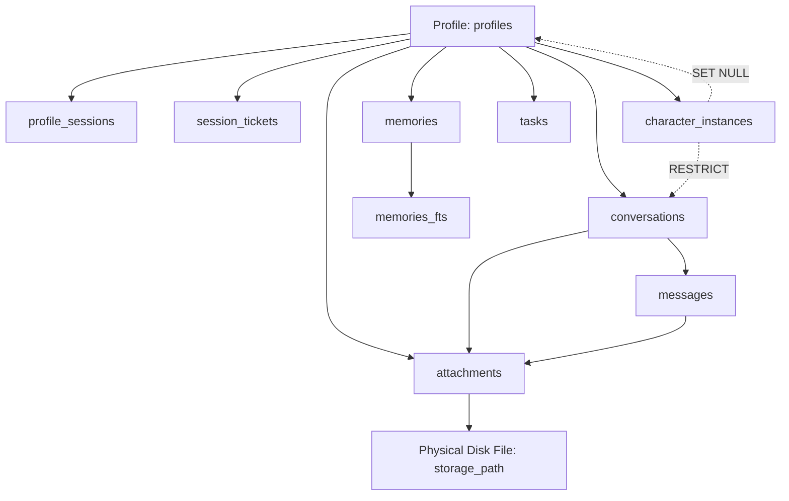

# Implementation Plan: Milestone M2 Batch D — Recoverable Profile Deletion & Safe Purge

Template Version: Docs_ProjectWorkflowStarterKit_v2.0

- **Status:** Awaiting Approval (Phase 1 Planning Complete)
- **Delivery Level:** Level C — Sensitive Design (Special Boundary: Irreversible physical deletion of real user data requires explicit human authorization under Level D operational governance)
- **Scope Mode:** New Feature — Recoverable 7-day Profile deletion, restoration service, and safe hard purge
- **Work Breakdown Structure ID:** `PC-IDENTITY-005`
- **Target Files:**
  - `backend/app/models/profile.py` (verify/reuse existing lifecycle columns)
  - `backend/app/services/profile_purge_service.py` (new surgical purge and maintenance service)
  - `backend/app/api/v1/endpoints/profiles.py` (soft-delete, restore, deleted catalog, and purge endpoints)
  - `backend/app/api/v1/endpoints/system.py` (maintenance purge endpoint)
  - `backend/app/main.py` (startup background maintenance purge hook)
  - `contracts/openapi/openapi.json` (OpenAPI contract update)
  - `frontend/flutter/packages/companion_api/` (DTOs and client methods)
  - `frontend/flutter/apps/desktop/lib/features/profiles/` (desktop controllers, dialogs, Recently Deleted view)
  - `backend/tests/test_profile_deletion.py` (new comprehensive backend test suite)
  - `frontend/flutter/apps/desktop/test/desktop_profile_deletion_test.dart` (new comprehensive desktop UI test suite)
- **Branch:** `feature/m2-profile-deletion-recovery-d`
- **Active Branch Tracker:** `docs/01_Tracking/active/task-feature-m2-profile-deletion-recovery-d.md`

> Notice: Update this plan in place during planning. After Phase 1 approval, track execution in `docs/01_Tracking/active/task-feature-m2-profile-deletion-recovery-d.md` and reopen this plan only when revising scope or architecture.

---

## 1. Request Understanding & Goals

### Primary Objective
Deliver the complete, robust, recoverable Profile deletion lifecycle for the AI Companion PC V1 installation:
1. Provide a local administrative operation to soft-delete an existing secondary Profile with a 7-day recovery holding period.
2. Immediately terminate and revoke all active sessions, pending tokens, and ongoing personal generation for the soft-deleted Profile.
3. Automatically exclude soft-deleted Profiles from normal active Profile catalogs and selectors.
4. Allow local administrators to restore a soft-deleted Profile within 7 days, fully restoring its UUID, conversations, character instances, memories, tasks, and attachments without reviving expired credentials.
5. Provide a safe, bounded hard-purge mechanism that permanently deletes expired Profile records and physical files in strict foreign-key dependency order without touching shared host AI models, templates, or other Profiles.
6. Provide an immediate administrative "Permanently Purge Now" operation with strict confirmation safeguards.
7. Deliver the corresponding Flutter Desktop management UI with typed name confirmation and a "Recently Deleted" recovery panel.

### Relevant Canonical Requirements
- [`docs/04_Architecture/SYSTEM_BASELINE.md`](../SYSTEM_BASELINE.md) (§3 Cross-Cutting Invariants, Decisions D4, ADR-0018)
- [`docs/04_Architecture/02_Data_and_Security/profiles-and-devices.md`](../02_Data_and_Security/profiles-and-devices.md) (§2 Frozen Identity Constraints, §3.1 Multi-Profile PC V1 Ownership Model, §4 Verified Baseline)
- [`docs/04_Architecture/02_Data_and_Security/privacy-retention-and-audit.md`](../02_Data_and_Security/privacy-retention-and-audit.md) (§2 Data Retention Principles, §3 Deletion Lifecycle)
- [`docs/04_Architecture/02_Data_and_Security/authentication-and-secrets.md`](../02_Data_and_Security/authentication-and-secrets.md) (§3.1 Host Admin boundary and Profile Session Lifecycle)
- [`docs/05_Design/02_Profile_Selector_and_Privacy.md`](../../05_Design/02_Profile_Selector_and_Privacy.md) (Profile Management, Delete confirmation, and Recently Deleted recovery UX)
- [`docs/04_Architecture/04_Infrastructure/storage-and-assets.md`](../04_Infrastructure/storage-and-assets.md) (Attachment storage paths and boundary validation)
- [`docs/02_Planning/00_Master/WBS.md`](../00_Master/WBS.md) (`PC-IDENTITY-005` 7-Day Recoverable Profile Deletion Lifecycle & Hard Purge Maintenance)

### Concrete Deliverables
1. **Backend Soft-Deletion Service & Endpoints:** Host Admin-protected `DELETE /api/v1/profiles/{profile_id}` setting 7-day retention (`purge_after`), revoking sessions, invalidating tickets, and excluding from active catalogs.
2. **Backend Restoration Service & Endpoints:** Host Admin-protected `POST /api/v1/profiles/{profile_id}/restore` resetting deletion flags within the 7-day window.
3. **Recoverable Catalog Endpoint:** Host Admin-protected `GET /api/v1/profiles/deleted` returning deleted metadata, deletion timestamp, and days remaining.
4. **Hard-Purge Service & Maintenance Endpoints:**
   - Dedicated `ProfilePurgeService` executing strict 13-step cascade deletion across child entities, FTS5 sync, and physical attachments.
   - `POST /api/v1/profiles/{profile_id}/purge` for immediate administrative purge of soft-deleted profiles.
   - `POST /api/v1/system/maintenance/purge-profiles` for batch cleanup of expired profiles (`purge_after <= now`).
   - Lifespan startup maintenance pass in `backend/app/main.py`.
5. **OpenAPI & Dart Contract Parity:** Updated schemas and client methods in `companion_api` with verified 100% route/schema parity.
6. **Flutter Desktop Profile Management UI:**
   - Delete Profile button with typed confirmation dialog (`Type '<Profile Name>' to confirm`).
   - Recently Deleted Profiles section in Settings with remaining recovery days counter.
   - 1-click Restore button.
   - Confirmation dialog for Immediate Permanent Purge (`Type 'PURGE' to confirm`).
   - Active Profile deletion transition in `DesktopProfileController` and `DesktopChatController` clearing active caches and gracefully selecting an available Profile or prompting selection.
7. **Comprehensive Test Suites:**
   - Pytest integration suite (`backend/tests/test_profile_deletion.py`) covering all 20 required verification scenarios.
   - Flutter desktop widget and controller test suite (`frontend/flutter/apps/desktop/test/desktop_profile_deletion_test.dart`).

### Explicit Out-of-Scope
- Profile PIN implementation, PIN hashing, PIN prompts, security questions, and Windows Hello.
- Satellite device enrollment and mobile profile switching (`PC-IDENTITY-003`).
- Account deletion or full Factory Reset (`PC-IDENTITY-006` / M5).
- Re-architecting backup infrastructure (`app.db.backup`) or rewriting past backup archive files.
- Redesigning the entire `SchedulerService` or introducing heavy external job brokers.
- Global attachment pruning unrelated to the target Profile.
- Redesigning unrelated Desktop UI screens (Chat, Character Studio, Models).

---

## 2. Architecture & Technical Approach

### Technical Findings & Source Baseline
Investigation of the current codebase reveals the following ground reality:

| Component / File | Current Implemented Reality | Implication for Batch D |
| :--- | :--- | :--- |
| `backend/app/models/profile.py` | Columns `status`, `is_deleted`, `deleted_at`, and `purge_after` **already exist** in `profiles` table (via Migration 007). `is_default` partial unique index `uq_profiles_single_default` enforces exactly one default profile. | **No database migration required.** Schema already has all necessary columns to represent active, recoverable, and purged states. |
| `backend/app/core/profile_sessions.py` | `validate_profile_session()` freshly joins `profiles` and checks `record[3] != "active" or record[4] or record[5] is not None`. `guarded_tokens()` polls this check every 250ms during token streaming. | Soft deletion (`is_deleted=True`, `status="deleted"`) **immediately breaks in-flight generation** and invalidates any subsequent personal API requests with HTTP 401. |
| `backend/app/models/conversation.py` | `character_instance_id` has `ForeignKey("character_instances.id", ondelete="RESTRICT")`. | **Direct cascade delete fails** if character instances are deleted before conversations. Hard purge must delete `conversations` before `character_instances`. |
| `backend/app/models/profile.py` | `active_character_instance_id` has `ForeignKey("character_instances.id", ondelete="SET NULL")`. | Circular dependency: `Profile` points to `character_instances`, while `character_instances` points to `profiles`. Purge must nullify `active_character_instance_id` first. |
| `backend/app/models/attachment.py` | Stores metadata in DB (`storage_path`) and physical files in `settings.ATTACHMENT_DIR`. | Physical files must be deleted from disk only after database transaction commits, and paths must be validated using `resolve_and_verify_attachment_path()` to prevent directory traversal. |
| `backend/migrations/.../003_...py` | SQLite triggers `memories_fts_delete` and `memories_fts_update` maintain `memories_fts` virtual table. | Deleting `memories` rows automatically triggers `memories_fts_delete`, removing entries from FTS5 without orphaned index records. |
| `backend/app/db/backup.py` | `backup_database_wal_safe()` writes point-in-time binary SQLite backups to `backups/`. | Historical backups are immutable point-in-time archives. Live purge cannot alter existing backups. Documented as explicit architectural limitation. |

### Complete Profile Ownership Graph & Deletion Sequence



### Deterministic 13-Step Hard-Purge Execution Order
To guarantee zero foreign-key constraint violations (`RESTRICT`), clean FTS5 synchronization, and secure disk cleanup:
1. **Query Physical Assets:** Query all `storage_path` values for `attachments` owned by `profile_id`.
2. **Break Circular FK:** Set `Profile.active_character_instance_id = None` on the target profile row.
3. **Delete Attachments DB Rows:** `DELETE FROM attachments WHERE profile_id = :id`.
4. **Delete Messages:** `DELETE FROM messages WHERE profile_id = :id`.
5. **Delete Conversations:** `DELETE FROM conversations WHERE profile_id = :id` (eliminating `RESTRICT` dependency on `character_instances`).
6. **Delete Character Instances:** `DELETE FROM character_instances WHERE profile_id = :id`.
7. **Delete Memories:** `DELETE FROM memories WHERE profile_id = :id` (SQLite trigger `memories_fts_delete` automatically purges `memories_fts`).
8. **Delete Tasks:** `DELETE FROM tasks WHERE profile_id = :id`.
9. **Delete Session Tickets:** `DELETE FROM session_tickets WHERE profile_id = :id`.
10. **Delete Profile Sessions:** `DELETE FROM profile_sessions WHERE profile_id = :id`.
11. **Delete Profile Record:** `DELETE FROM profiles WHERE id = :id`.
12. **Commit Transaction:** Atomically commit all relational deletions in SQLite.
13. **Unlink Physical Files:** Safely unlink physical attachment files from `settings.ATTACHMENT_DIR` using `resolve_and_verify_attachment_path()`, ignoring already-missing files.

---

## 3. Critical Design Decisions & Material Choices

### Decision A — Default & Last-Active Profile Protection
- **Policy:** **Strictly prohibit deleting the default Profile (`is_default == True`) and strictly prohibit deleting the last remaining active Profile in the installation.**
- **Rationale:**
  - The default Profile (`is_default == True`) anchors initial installation identity and is governed by partial unique index `uq_profiles_single_default`. Allowing deletion would require arbitrary automatic default reassignment or complex restore re-arbitration.
  - Allowing deletion of the last remaining active Profile leaves the PC Companion client completely unauthenticated with no profile to switch to.
- **Enforcement:** If a request targets the default profile, return HTTP 400 Bad Request (`{"error": {"code": "CANNOT_DELETE_DEFAULT_PROFILE", "message": "The Default Personal Profile cannot be deleted."}}`). If the target is the only remaining active profile, return HTTP 400 Bad Request (`{"error": {"code": "CANNOT_DELETE_LAST_PROFILE", "message": "Cannot delete the last remaining active Profile."}}`).

### Decision B — Lifecycle State Representation & Reusing Existing Schema
- **Policy:** **Reuse the existing `profiles` table columns without schema migration.**
- **State Definitions:**
  - **Active:** `status == "active"`, `is_deleted == False`, `deleted_at == None`, `purge_after == None`.
  - **Recoverable (Soft-Deleted):** `status == "deleted"`, `is_deleted == True`, `deleted_at == <timestamp>`, `purge_after == <timestamp + 7 days>`.
  - **Purged:** The `profiles` row and all related personal records are deleted from the database.
- **Rationale:** No migrations are needed; Migration 007 already defined these exact columns. Reusing them eliminates migration risk.

### Decision C — Maintenance & Expiration Strategy
- **Policy:** **Decoupled maintenance service executed at runtime startup and via Host Admin maintenance endpoint.**
- **Implementation:**
  - `ProfilePurgeService.execute_maintenance_purge(db, now)` queries all profiles where `is_deleted == True` and `status == "deleted"` and `purge_after <= now`.
  - Iterates through eligible profiles, executing the atomic 13-step purge per profile in an isolated sub-transaction.
  - Triggered at runtime startup in `backend/app/main.py` lifespan (non-blocking task) and exposed via `POST /api/v1/system/maintenance/purge-profiles`.
  - **Offline PC Handling:** If the computer was turned off past the 7-day deadline, the startup maintenance pass immediately identifies the overdue Profile on boot and executes hard purge safely.
  - **Failure Handling:** If an error occurs purging Profile X, that Profile's transaction rolls back and an error is logged; other profiles continue. Profile X remains soft-deleted and will be retried on the next maintenance run.

### Decision D — Immediate Permanent Purge ("Permanently Purge Now")
- **Policy:** **Supported for soft-deleted profiles via dedicated Host Admin endpoint `POST /api/v1/profiles/{profile_id}/purge`.**
- **Safeguards:**
  - Requires Host Admin credentials.
  - Profile must already be in soft-deleted state (`is_deleted == True`).
  - Desktop UI requires explicit confirmation by typing `PURGE` before enabling the button.
  - In automated tests, only temporary disposable databases (`tmp_path`) are used. Real human production data is never touched during CI/testing.

### Decision E — Interaction with Backup Archives
- **Policy:** **Live hard purge guarantees deletion from the live database and live file storage. Historical backup archives are immutable point-in-time snapshots and are not rewritten.**
- **Truthful Documentation:** Deleting a live Profile does not reach into historical `.db` backup archives created prior to deletion. If an administrator manually restores an old backup using `restore_database_from_backup()`, the database will be restored to the state at the time of the backup. Future cross-backup tombstone synchronization is tracked in `DECISION_DEBT.md` (`DEBT-V1-014`).

---

## 4. API Request & Response Contracts

### 1. `DELETE /api/v1/profiles/{profile_id}`
- **Security:** `require_host_admin` (loopback only, `X-Host-Admin-Secret`).
- **Preconditions:** Profile exists, `is_deleted == False`, `status == "active"`, `is_default == False`, active profiles count > 1.
- **Response:** `200 OK`
  ```json
  {
    "id": "uuid-here",
    "name": "Work",
    "is_default": false,
    "status": "deleted",
    "is_deleted": true,
    "deleted_at": "2026-11-05T20:00:00Z",
    "purge_after": "2026-11-12T20:00:00Z",
    "pin_protected": false
  }
  ```

### 2. `POST /api/v1/profiles/{profile_id}/restore`
- **Security:** `require_host_admin`.
- **Preconditions:** Profile exists, `is_deleted == True`, `status == "deleted"`, `purge_after > now_utc()`.
- **Effects:** Clears `is_deleted`, `deleted_at`, `purge_after`, sets `status = "active"`. Stale revoked sessions remain revoked.
- **Response:** `200 OK`
  ```json
  {
    "id": "uuid-here",
    "name": "Work",
    "is_default": false,
    "status": "active",
    "is_deleted": false,
    "deleted_at": null,
    "purge_after": null,
    "pin_protected": false
  }
  ```

### 3. `GET /api/v1/profiles/deleted`
- **Security:** `require_host_admin`.
- **Response:** `200 OK`
  ```json
  [
    {
      "id": "uuid-here",
      "name": "Work",
      "is_default": false,
      "status": "deleted",
      "is_deleted": true,
      "deleted_at": "2026-11-05T20:00:00Z",
      "purge_after": "2026-11-12T20:00:00Z",
      "pin_protected": false
    }
  ]
  ```

### 4. `POST /api/v1/profiles/{profile_id}/purge`
- **Security:** `require_host_admin`.
- **Preconditions:** Profile exists, `is_deleted == True`, `is_default == False`.
- **Response:** `200 OK`
  ```json
  {
    "purged_profile_id": "uuid-here",
    "status": "purged"
  }
  ```

### 5. `POST /api/v1/system/maintenance/purge-profiles`
- **Security:** `require_host_admin`.
- **Response:** `200 OK`
  ```json
  {
    "purged_profile_ids": ["uuid-1"],
    "purged_count": 1,
    "errors": []
  }
  ```

---

## 5. Proposed File Changes & In-Place Logic

### A. Backend Services & Endpoints
- **Create `backend/app/services/profile_purge_service.py`:**
  - Implements `ProfilePurgeService.soft_delete_profile(db, profile_id, now)`.
  - Implements `ProfilePurgeService.restore_profile(db, profile_id, now)`.
  - Implements `ProfilePurgeService.purge_profile(db, profile_id)`.
  - Implements `ProfilePurgeService.execute_maintenance_purge(db, now)`.
- **Modify `backend/app/api/v1/endpoints/profiles.py`:**
  - Update `ProfileMetadata` to include `is_deleted: bool = False`, `deleted_at: Optional[datetime] = None`, `purge_after: Optional[datetime] = None`.
  - Add `DELETE /{profile_id}` (soft-delete).
  - Add `POST /{profile_id}/restore` (restore).
  - Add `GET /deleted` (list recoverable profiles).
  - Add `POST /{profile_id}/purge` (immediate purge).
- **Modify `backend/app/api/v1/endpoints/system.py`:**
  - Add `POST /system/maintenance/purge-profiles` calling `ProfilePurgeService.execute_maintenance_purge()`.
- **Modify `backend/app/main.py`:**
  - Add non-blocking maintenance call in startup lifespan.

### B. OpenAPI & Dart Client Parity
- **Modify `contracts/openapi/openapi.json`:**
  - Regenerate OpenAPI spec containing new routes and schemas.
- **Modify `frontend/flutter/packages/companion_api/lib/dto/profile_dto.dart`:**
  - Extend `ProfileMetadata` with `is_deleted`, `deleted_at`, `purge_after`.
  - Add `ProfilePurgeResponse` and `MaintenancePurgeResponse`.
- **Modify `frontend/flutter/packages/companion_api/lib/client/companion_client.dart`:**
  - Add `deleteProfile(String profileId)`.
  - Add `restoreProfile(String profileId)`.
  - Add `listDeletedProfiles()`.
  - Add `purgeProfile(String profileId)`.
  - Add `runPurgeMaintenance()`.
- **Update Parity Checkers:**
  - Update `scripts/check_dart_openapi_parity.py` and `scripts/tests/test_check_dart_openapi_parity.py` to cover all 36 routes and 29 schemas.

### C. Flutter Desktop UI & State Management
- **Modify `frontend/flutter/apps/desktop/lib/features/profiles/desktop_profile_controller.dart`:**
  - Add `deletedProfiles` list state and getter `hasDeletedProfiles`.
  - Add `deleteProfile(String profileId)` handling active profile deletion, updating local catalogs, and clearing credentials if active.
  - Add `restoreProfile(String profileId)`.
  - Add `purgeProfileImmediately(String profileId)`.
  - Handle active profile deletion gracefully: if active profile is deleted, `activeProfileId` is reset to null, `DesktopChatController.invalidateProfileSession()` is invoked, and `clientSettings` persists the update.
- **Modify `frontend/flutter/apps/desktop/lib/features/profiles/profile_dialogs.dart`:**
  - Add `showDeleteProfileDialog(context, controller, profile)`.
  - Add `showPurgeConfirmationDialog(context, controller, profile)`.
- **Modify `frontend/flutter/apps/desktop/lib/features/profiles/profile_access_card.dart`:**
  - Add Delete button with confirmation dialog.
  - Add expandable "Recently Deleted Profiles" card with remaining days badge, Restore button, and Permanent Purge button.
- **Modify `frontend/flutter/apps/desktop/lib/features/profiles/profile_selector_header.dart`:**
  - Ensure deleted profiles never show in selector popup.

---

## 6. Step-by-Step Implementation Sequence (TDD)

### Step 1: Backend Deletion, Restore & Hard-Purge Logic (RED -> GREEN)
1. Write comprehensive tests in `backend/tests/test_profile_deletion.py`:
   - Soft-delete non-default profile: sets `is_deleted=True`, `status="deleted"`, `purge_after = now + 7 days`.
   - Prohibit deleting default profile (`400 Bad Request`).
   - Prohibit deleting last active profile (`400 Bad Request`).
   - Revoke active sessions and invalidate tickets on soft deletion.
   - Immediate in-flight turn failure and 401 on guarded token check after soft deletion.
   - Restore soft-deleted profile within 7 days: sets `status="active"`, `is_deleted=False`.
   - Restore does not revive revoked tokens.
   - Restore rejects expired profile (`410 Gone` / `400 Bad Request`).
   - Hard purge removes data in strict 13-step order (attachments, messages, conversations, instances, memories, tasks, sessions, profile).
   - Hard purge unlinks physical attachment files within `ATTACHMENT_DIR`.
   - Hard purge triggers FTS5 cleanup (`memories_fts` empty for target profile).
   - Maintenance purge cleans only profiles with `purge_after <= now`.
   - Other profiles remain completely untouched.
2. Implement `ProfilePurgeService` in `backend/app/services/profile_purge_service.py`.
3. Implement endpoints in `backend/app/api/v1/endpoints/profiles.py` and `system.py`.
4. Verify all backend tests pass (`pytest backend/tests/test_profile_deletion.py`).

### Step 2: OpenAPI Contract & Dart Client Parity
1. Regenerate `contracts/openapi/openapi.json`.
2. Update `companion_api` DTOs and `CompanionClient`.
3. Add tests in `companion_api/test/profile_deletion_client_test.dart`.
4. Run `python scripts/check_dart_openapi_parity.py --check` and verify 36/36 routes pass.

### Step 3: Desktop Profile Controller & UI
1. Extend `DesktopProfileController` with delete, restore, listDeleted, and purge.
2. Implement `showDeleteProfileDialog` and `showPurgeConfirmationDialog`.
3. Update `ProfileAccessCard` with Delete Profile button and Recently Deleted Profiles card.
4. Add comprehensive widget and integration tests in `frontend/flutter/apps/desktop/test/desktop_profile_deletion_test.dart`.

### Step 4: Full Local Regression Verification Gate
1. `pytest backend/tests -q` (all 700+ tests pass).
2. `python scripts/check_dart_openapi_parity.py --check`.
3. `flutter analyze` in `companion_api` and `apps/desktop` (0 errors, 0 warnings).
4. `flutter test` in `companion_api` and `apps/desktop` (all tests pass).

---

## 7. Acceptance Criteria & Verification Strategy

### Automated Repository Verification Matrix
- [ ] `backend\.venv\Scripts\python.exe -m pytest backend/tests/test_profile_deletion.py -v` (all new tests pass)
- [ ] `backend\.venv\Scripts\python.exe -m pytest backend/tests -q` (zero regressions across entire test suite)
- [ ] `backend\.venv\Scripts\python.exe scripts/check_dart_openapi_parity.py --check` (36/36 routes, 29/29 schemas verified)
- [ ] `cd frontend/flutter/packages/companion_api && flutter test` (all tests pass)
- [ ] `cd frontend/flutter/apps/desktop && flutter test test/desktop_profile_deletion_test.dart` (all deletion UI tests pass)
- [ ] `cd frontend/flutter/apps/desktop && flutter test` (all 330+ desktop tests pass)
- [ ] `cd frontend/flutter/apps/desktop && flutter analyze` (zero issues)

### Windows Manual Acceptance Checklist
1. Launch Flutter Desktop connected to Local AI Runtime.
2. Create a secondary profile named "Work & Testing".
3. Switch to "Work & Testing", create a test conversation with a message and assign a character.
4. Navigate to Settings -> Profile access.
5. Verify "Default Profile" cannot be deleted (Delete button disabled or hidden).
6. Click "Delete Profile" on "Work & Testing".
7. Verify warning displays: "This profile and its data will be moved to Recently Deleted for 7 days."
8. Verify "Delete Profile" button is disabled until typing exact name "Work & Testing".
9. Confirm deletion:
   - Profile disappears from active selector and Navigation Rail.
   - Active profile gracefully transitions to Default Profile.
   - "Work & Testing" appears in "Recently Deleted Profiles" with "Purge in 7 days".
10. Click "Restore" on "Work & Testing":
    - Profile restores to active catalog immediately.
    - Switch to "Work & Testing" and confirm conversation, message, and character remain intact.
11. Verify Default Profile was never modified or disrupted.

---

## 8. Level C vs Level D Boundaries & Operational Safeguards

- **Level C (Planned Autonomous Implementation):**
  - Coding soft-delete, restore, and hard-purge services.
  - Adding automated tests against temporary SQLite test databases and synthetic directories.
  - Building Desktop UI confirmation dialogs.
  - Publishing documentation and opening Draft PR.
- **Level D (Human-Controlled Destructive Operations):**
  - **Executing permanent hard purge on live, real human production user data.**
  - Under Level D governance, AI autonomy NEVER executes irreversible data deletion on production databases outside synthetic test fixtures. All automated testing strictly operates on temporary directories (`tmp_path`, `Directory.systemTemp`).

---

## 9. Material Decisions Summary for Human Owner Approval

1. **Default & Last-Active Protection:** Prohibit deleting the default Profile and the last active Profile.
2. **Schema Reuse:** Reuse existing `status`, `is_deleted`, `deleted_at`, `purge_after` without migrations.
3. **Decoupled Maintenance:** Run maintenance purge at startup and via loopback Host Admin endpoint without depending on unbuilt `SchedulerService`.
4. **Immediate Purge:** Allow immediate permanent purge of already-deleted profiles with typed confirmation.
5. **Backup Archive Immutability:** Live purge deletes live data; past historical `.db` backup files remain immutable point-in-time snapshots.
