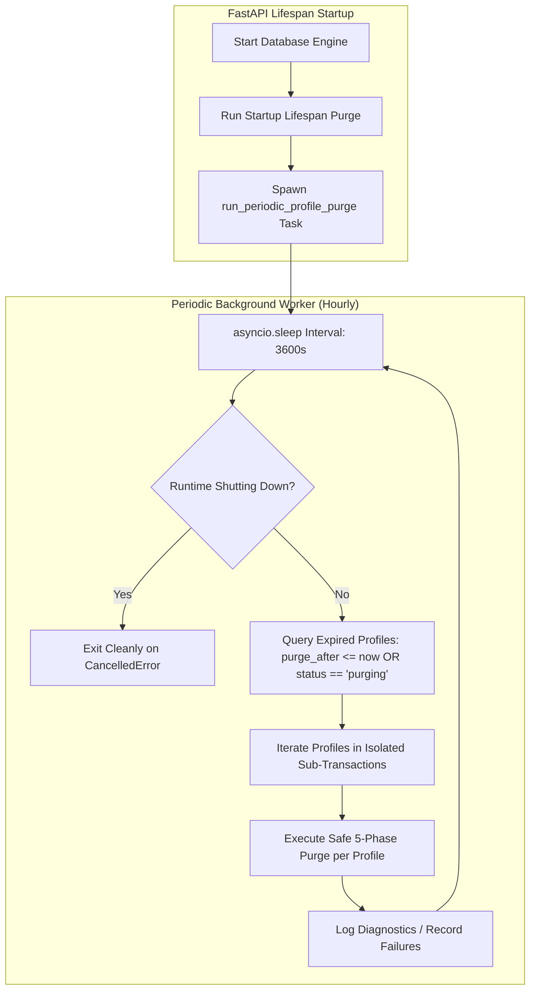

# Implementation Plan: Milestone M2 Batch D — Recoverable Profile Deletion & Safe Purge

Template Version: Docs_ProjectWorkflowStarterKit_v2.0

- **Status:** Revised Phase 1 Plan — Published for Human Owner Final Review
- **Delivery Level:** Level C — Sensitive Design (Special Boundary: Irreversible physical deletion of real user data requires explicit human authorization under Level D operational governance)
- **Scope Mode:** New Feature — 30-day recoverable Profile deletion ("Move to Recently Deleted"), Profile-level administrative restoration, physical-first permanent Profile purge ("Permanently Delete"), in-flight upload reconciliation, and periodic Runtime maintenance purge
- **Work Breakdown Structure ID:** `PC-IDENTITY-005`
- **Target Files:**
  - `backend/app/models/profile.py` (verify/reuse existing `status`, `is_deleted`, `deleted_at`, `purge_after` columns)
  - `backend/app/api/v1/endpoints/attachments.py` (add Profile-scoped path validator `resolve_and_verify_profile_attachment_path`, verify upload lifecycle checks)
  - `backend/app/services/profile_purge_service.py` (new soft-delete, restore, pre-validated atomic purge, upload reconciliation, and periodic background maintenance task `run_periodic_profile_purge`)
  - `backend/app/api/v1/endpoints/profiles.py` (soft-delete, restore, deleted catalog, and immediate permanent purge endpoints)
  - `backend/app/api/v1/endpoints/system.py` (Host Admin maintenance purge endpoint)
  - `backend/app/main.py` (startup maintenance sweep AND periodic asyncio background maintenance task registered in lifespan context)
  - `contracts/openapi/openapi.json` (OpenAPI contract update)
  - `frontend/flutter/packages/companion_api/` (DTOs and client methods)
  - `frontend/flutter/apps/desktop/lib/features/profiles/` (desktop controllers, "Move to Recently Deleted" vs. "Permanently Delete" dialogs, Recently Deleted recovery view)
  - `backend/tests/test_profile_deletion.py` (comprehensive backend verification suite `DEL-01`–`DEL-15`, `DEL-18`, `DEL-19`)
  - `frontend/flutter/apps/desktop/test/desktop_profile_deletion_test.dart` (comprehensive desktop UI verification suite `DEL-16`–`DEL-17`)
  - `docs/04_Architecture/02_Data_and_Security/privacy-retention-and-audit.md` (reconciled in Phase 1 per §2.C)
  - `docs/04_Architecture/04_Infrastructure/backup-recovery-and-diagnostics.md` (reconciled in Phase 1 per §2.C)
- **Branch:** `feature/m2-profile-deletion-recovery-d`
- **Active Branch Tracker:** `docs/01_Tracking/active/task-feature-m2-profile-deletion-recovery-d.md`

> Notice: Update this plan in place during planning. After Phase 1 approval, track execution in `docs/01_Tracking/active/task-feature-m2-profile-deletion-recovery-d.md` and reopen this plan only when revising scope or architecture.

---

## 1. Request Understanding, Approved Product Decisions & Scope Boundaries

### 1.1 Approved Product Decisions (Human Owner)

#### A. Profile Deletion and 30-Day Recovery
1. **Move to Recently Deleted:** Deleting an active secondary Profile moves it into **Recently Deleted** (`status = "deleted"`, `is_deleted = True`, `deleted_at = now`).
2. **30-Day Recovery Window:** The Profile remains recoverable for **30 days** measured from its `deleted_at` timestamp, with expiry calculated as:
   $$\text{purge\_after} = \text{deleted\_at} + 30\text{ days}$$
3. **Desktop UI Presentation:** The Desktop UI displays the remaining recovery time and clearly distinguishes **Move to Recently Deleted** (recoverable for 30 days) from **Permanently Delete** (immediate, irreversible removal).
4. **Automatic & Immediate Purge:** Expired Profiles (`purge_after <= now`) and interrupted purges (`status == "purging"`) are automatically permanently purged through Runtime maintenance sweeps while the application is open. Local Account administrators may also trigger **Permanently Delete** immediately with explicit UI confirmation.
5. **Default & Last-Active Protection:** Deleting the default Profile (`is_default == True`) or the last remaining active Profile on the host is strictly prohibited.

#### B. Recovery Authority & Ownership Separation
1. **Profile-Level Admin Authority:** Local Account Admin (`require_host_admin`) can recover deleted Profiles during the 30-day window.
2. **No Cross-Layer Content Resurrection:** Admin recovery is limited strictly to the Profile deletion lifecycle (`Profile` row state). Moving a Profile to Recently Deleted or restoring it **must not** modify `is_deleted` or `deleted_at` on individual `Conversation`, `Message`, `Attachment`, `Memory`, `Task`, or `CharacterInstance` records. Restoring a Profile restores its Profile-level state without undoing individual content deletions that occurred before the Profile was deleted.
3. **Scope Boundary:** Individual messages, attachments, and user-owned files are governed by their owning user's lifecycle, not the administrative Profile recovery interface. Separate user-facing recycle bins for messages, attachments, or files are out of scope for `PC-IDENTITY-005`.

#### C. Backup Restoration Semantics & Attachment Consistency Limitation
1. **Point-in-Time Snapshot Restoration:** Restoring a backup restores the snapshot as it existed when that backup was created. If a backup is created while a Profile exists, the Profile is deleted afterward, and an administrator later restores that earlier backup, the Profile returns because it was present in that snapshot.
2. **Supersedes Tombstone Anti-Resurrection Rule for Backups:** This explicitly supersedes prior requirements that deletion tombstones prevent resurrection from older database backups. Note: This backup restoration semantic is strictly distinct from multi-device and mobile synchronization tombstones (`mobile-offline-and-sync.md`), which continue to track deletions across live connected devices.
3. **Coordinated Backup Architecture vs. Current Implementation Limitation:**
   - **Target Architecture:** Coordinated database-and-asset backup packaging (`companion.db` bundled with external files in `settings.ATTACHMENT_DIR`) is the intended PC V1 design to ensure complete referential coherence across data and media.
   - **Current Implementation Reality & Limitation:** The current backup implementation (`backend/app/db/backup.py`: `create_pre_migration_backup` / `restore_database_from_backup`) snapshots only the SQLite database file (`companion.db`) and does **not** package external attachment files in `settings.ATTACHMENT_DIR`.
   - **Consequence:** If an older database snapshot is restored after a permanent Profile purge, the attachment database records will return with the Profile, but their physical image files on disk remain deleted. Requesting a preview or download for such an attachment will return HTTP 404 (Attachment file not found), while metadata queries succeed. `DEL-07` validates this exact current database-only boundary without falsely asserting physical asset recovery.

#### D. Purge Ordering, Upload-Race Synchronization & Robust Failure Handling (Without a Separate Ledger)
The Human Owner approved a streamlined physical-first approach without a separate deletion ledger or cleanup manifest. To prevent in-flight uploads from escaping deletion or creating untracked files, and to avoid prematurely locking out restoration before file deletion begins, the purge sequence enforces strict synchronization and ordering:

1. **Upload Lifecycle Validation (Server-Side):**
   - In `backend/app/api/v1/endpoints/attachments.py`, `upload_attachment()` enforces that every upload requires an active, owned Profile Session (`validate_profile_session()`).
   - `validate_profile_session()` queries `Profile.status == 'active'` and `Profile.is_deleted == False` on every check.
   - Any upload targeting a soft-deleted or purging Profile fails closed server-side with HTTP 401 (`Inactive Profile Session`).
2. **Phase A — Pre-Validate All Attachment Paths Before State Transition:**
   - Query all existing `Attachment.storage_path` rows for `profile_id`.
   - Validate each path via `resolve_and_verify_profile_attachment_path(storage_path, profile_id)`.
   - **Failure Behavior:** If any path fails validation (e.g., cross-profile path or directory traversal attempt), the purge aborts immediately with `SecurityException` **before** the Profile's status is changed. The Profile remains in `status == "deleted"` and **remains restorable** by an administrator (`DEL-08`).
3. **Phase B — Atomic Non-Restorable State Transition:**
   - Only after all attachment paths pass pre-validation does the Profile conditionally transition to `status = "purging"` (with `is_deleted = True` and `purge_after = min(purge_after, now)`).
   - Once `status == "purging"` is committed, the Profile is permanently non-restorable, preventing restore-versus-purge races (`DEL-11`).
   - Simultaneously revokes all active `profile_sessions` and deletes all `session_tickets` for `profile_id`. Any upload in flight that has not yet committed its database transaction will fail `validate_profile_session()` prior to `db.commit()` and roll back (`DEL-19`).
4. **Phase C — Attachment Reconciliation After Purge Transition:**
   - To guarantee that no upload that committed just before Phase B's transaction locked the Profile can escape deletion, the purge **re-queries the authoritative attachment records** for `profile_id` after the `status = "purging"` commit.
   - Validates every newly resolved path against `(settings.ATTACHMENT_DIR / profile_id).resolve()`.
   - Because Phase B is durably committed, no subsequent upload can ever commit for this Profile.
5. **Phase D — Physical File Deletion with Pre-Unlink Revalidation & Directory Sweep:**
   - For each attachment in the reconciled set, revalidate containment immediately before unlinking each file.
   - Delete physical files with `file_path.unlink(missing_ok=True)`. Already-missing files are treated as successfully cleaned.
   - **Interruption Guard:** If an `OSError` occurs during unlinking (e.g. file locked by another process after 2 of 5 files are unlinked), the purge halts immediately. The Profile remains in `status == "purging"`, and all database records (`Attachment` rows and child rows) are retained in SQLite (`DEL-09`).
   - **Temporary File Sweep:** After unlinking all registered attachment files, the purge scans the Profile's dedicated directory `settings.ATTACHMENT_DIR / profile_id` for any uncommitted `.tmp_*` files left by rejected or crashed in-flight uploads, unlinking them safely (`DEL-19`).
   - Cleans up empty conversation subdirectories and the Profile attachment folder via non-recursive `rmdir()`.
6. **Retry Succeeds Without a Separate Ledger:**
   - When a subsequent maintenance sweep or manual purge retries the Profile in `status == "purging"`, it pre-validates paths, treats the already-deleted files as cleaned (`missing_ok=True`), deletes any remaining physical files, sweeps any temp files, and completes the purge (`DEL-10`).
7. **Phase E — Atomic Relational Database Deletion in Strict FK Order:**
   - Only after all physical attachment files for the Profile are confirmed absent does the service delete the Profile's relational rows in strict foreign-key order and remove the `Profile` record in an atomic transaction.

#### E. Periodic Automatic Purge Scheduling While Application Is Open
1. **Lightweight Periodic Sweep:** In addition to the startup lifespan hook and manual maintenance endpoint, the Runtime will execute a lightweight periodic background maintenance task (`run_periodic_profile_purge`) while the application remains open.
2. **Cadence & Resource Safety:** Runs an hourly sweep (default interval 3600 seconds, configurable via `settings.PROFILE_PURGE_INTERVAL_SECONDS = 3600`). Avoids heavy external job brokers or background threading daemons by using a native `asyncio.Task` registered in the FastAPI `lifespan` context.
3. **Execution Invariants:**
   - Identifies Profiles where `is_deleted == True` and (`(status == 'deleted' and purge_after <= now)` or `status == 'purging'`).
   - Executes the safe purge procedure per Profile within an isolated database transaction.
   - Leaves Profiles where `purge_after > now` untouched in Recently Deleted.
   - Handles individual purge failures cleanly: logs an error with Profile ID and diagnostics, records failure in `failed_profile_ids`, does not report failures as successful, and continues to process other Profiles.
   - Failed Profiles remain in `status == "deleted"` (if expired) or `status == "purging"` and are automatically retried on the next maintenance cycle.
   - Shuts down cleanly on application exit via task cancellation without leaving active database transactions.
   - Validated deterministically in `DEL-18` using a controllable clock / injectable iteration flag without real-time waiting periods.

#### F. UUID Allocation Direction & Python 3.11 Investigation
1. **Approved Target Allocation:**

| Entity | Approved UUID Version | Current Repository Implementation Fact | Batch D Action |
| :--- | :--- | :--- | :--- |
| **Account** | UUIDv4 | No `accounts` table; installation-scoped | Keep UUIDv4 |
| **Profile** | UUIDv4 | `str(uuid.uuid4())` in `profiles.py:92`, `profile.py:98`, `007_...py:57` | Already UUIDv4 — preserve |
| **Character** (`CharacterInstance`) | UUIDv4 | `str(uuid.uuid4())` in `character_service.py:596` | Already UUIDv4 — preserve |
| **Conversation** | UUIDv7 | `str(uuid.uuid4())` in `conversations.py:117` | Record direction; no migration in Batch D |
| **Message** | UUIDv7 | `str(uuid.uuid4())` in `orchestrator.py:261, 271` | Record direction; no migration in Batch D |
| **Attachment** | UUIDv7 | `generate_uuid()` (`uuid.uuid4().hex`) in `attachments.py:89, 203` | Record direction; no migration in Batch D |
| **Memory records** | UUIDv7 | `str(uuid.uuid4())` in `memories.py:66` | Record direction; no migration in Batch D |
| **Emotion records** | UUIDv7 | Not yet implemented (`PC-CHAR` follow-on) | Adopt UUIDv7 when implemented |

2. **Python 3.11 UUIDv7 Investigation:**
   - **Standard Library Fact:** Python's built-in `uuid` module only introduces `uuid.uuid7()` in Python 3.14 (PEP 716). On the project's canonical target runtime (**Python 3.11**) and current local venv, `hasattr(uuid, "uuid7")` is `False`.
   - **Recommended Implementation for Follow-On UUIDv7 Adoption:** Use the battle-tested, pure-Python [`uuid6`](https://pypi.org/project/uuid6/) package (`uuid6.uuid7()`, RFC 9562 compliant, returns standard `uuid.UUID` instances, zero native C/Rust compilation dependencies across Windows/Linux CI) rather than writing a custom bit-packing generator.
   - **Scope Guardrail:** Per instructions, Batch D (`PC-IDENTITY-005`) does **not** mass-migrate existing identifiers, alter `backend/requirements.txt`, or expand into a cross-codebase UUID refactor.

### 1.2 Explicit Out-of-Scope
- Profile PIN creation, verification, security questions, and Windows Hello.
- Separate user-facing recycle bins or recovery interfaces for individual messages, attachments, conversations, or user files.
- Cross-codebase UUIDv7 migration or adding new third-party dependencies in Batch D.
- Satellite device enrollment (`PC-IDENTITY-003`).
- Account deletion or full Factory Reset (`PC-IDENTITY-006`).
- Bundling external attachment files into SQLite `.db` migration backups.
- Introducing deletion ledgers, cleanup manifests, or external job brokers.

---

## 2. Source-Verified Technical Findings & Lifecycle Architecture

### 2.1 Existing Implementation Facts Verified in Source

| Source File | Verified Implementation Fact | Engineering Consequence for Batch D |
| :--- | :--- | :--- |
| [`backend/app/models/profile.py`](../../../backend/app/models/profile.py) & [`007_profiles_and_owner_id_migration.py`](../../../backend/migrations/versions/007_profiles_and_owner_id_migration.py) | `profiles` already defines `status` (`String(16)`, no `CHECK` constraint), `is_deleted` (`Boolean`), `deleted_at` (`DateTime(timezone=True)`), `purge_after` (`DateTime(timezone=True)`), and `active_character_instance_id` (`ForeignKey("character_instances.id", ondelete="SET NULL")`). Partial unique index `uq_profiles_single_default` enforces `is_default = 1`. | **Zero schema migrations required.** `status` natively accommodates `"active"`, `"deleted"`, and `"purging"`. |
| [`backend/app/models/conversation.py`](../../../backend/app/models/conversation.py) | `Conversation.character_instance_id` defines `ForeignKey("character_instances.id", ondelete="RESTRICT")`. | Deleting `character_instances` before `conversations` (or relying on unspecified SQLite `ON DELETE CASCADE` table visitation order from `profiles`) fails with `IntegrityError`. Explicit ordered `DELETE` statements are mandatory. |
| [`backend/app/models/attachment.py`](../../../backend/app/models/attachment.py) & [`backend/app/api/v1/endpoints/attachments.py`](../../../backend/app/api/v1/endpoints/attachments.py) | Uploads write to `settings.ATTACHMENT_DIR / session.profile_id / conversation_id` and store relative `storage_path = f"attachments/{session.profile_id}/{conversation_id}/{filename}"`. `resolve_and_verify_attachment_path()` only checks containment within global `settings.ATTACHMENT_DIR`. `upload_attachment` re-validates profile session at start, before disk write, and before commit, rolling back and unlinking files on error. | Purge must use a stricter `resolve_and_verify_profile_attachment_path(storage_path, profile_id)` checking containment within `(settings.ATTACHMENT_DIR / profile_id).resolve()`. Reconciling attachment paths after `status = "purging"` and sweeping `.tmp_*` files completely seals upload-vs-purge races. |
| [`backend/app/core/profile_sessions.py`](../../../backend/app/core/profile_sessions.py) & [`backend/app/services/assistant/orchestrator.py`](../../../backend/app/services/assistant/orchestrator.py) | `validate_profile_session()` queries SQLite on every call (`with db.no_autoflush`) and raises `HTTPException(401)` whenever `revoked_at is not None or state != "active" or deleted or deleted_at is not None`. `_authorized_tokens()` and `guarded_tokens()` re-validate before each token and poll `asyncio.wait(..., timeout=0.25)` while waiting on provider output; `orchestrate_chat_stream()` re-validates before committing final assistant output (`orchestrator.py:497, 507`) and rolls back on `401` (`orchestrator.py:551`). | The `0.25s` timeout is a cooperative polling interval while awaiting provider output, **not** a guaranteed hard real-time maximum cancellation latency (actual wall-clock stop time includes event-loop scheduling, SQLite query time, any non-token preflight step, and stream teardown). What is strictly guaranteed is that **no further SSE tokens are emitted and no completed assistant turn is committed after revocation is observed**. |
| [`backend/app/db/backup.py`](../../../backend/app/db/backup.py) | `create_pre_migration_backup()` and `restore_database_from_backup()` use `sqlite3.Connection.backup()` on the SQLite database file (`companion.db`). | Restoring an earlier SQLite snapshot restores the exact database rows (including Profiles) present when that snapshot was created, and does not touch external files in `ATTACHMENT_DIR`. |
| [`007_profiles_and_owner_id_migration.py`](../../../backend/migrations/versions/007_profiles_and_owner_id_migration.py) | SQLite trigger `memories_fts_delete` (`AFTER DELETE ON memories`) executes `INSERT INTO memories_fts(memories_fts, rowid, id, content, category) VALUES('delete', OLD.rowid, OLD.id, OLD.content, OLD.category)`. | Executing `DELETE FROM memories WHERE profile_id = :id` automatically removes all FTS5 index entries for that Profile. |

---

### 2.2 Profile Deletion & Restoration State Machine

```mermaid
stateDiagram-v2
    [*] --> active: Profile Created
    active --> deleted: DELETE /api/v1/profiles/{id}\n(Move to Recently Deleted:\nis_deleted=True, status='deleted',\npurge_after = deleted_at + 30d,\nrevoke sessions & delete tickets)
    deleted --> active: POST /api/v1/profiles/{id}/restore\n(Requires status=='deleted' AND purge_after > now;\npreserves child content deleted_at flags;\ndoes NOT revive revoked sessions)
    deleted --> deleted: Purge pre-validation fails\n(Invalid/escaped path; no status change;\nProfile remains restorable)
    deleted --> purging: All paths pre-validated ->\nAtomic claim: status='purging'\n(Non-restorable; purge_after <= now)
    purging --> purging: Physical file unlink failure / crash\n(DB rows retained; retried on next purge)
    purging --> [*]: Physical files & temp sweep confirmed removed ->\nAtomic DB transaction deletes child rows & Profile
```



#### Consistent State Invariants Across Existing Fields (`profiles` table)

| Lifecycle State | `status` | `is_deleted` | `deleted_at` | `purge_after` | Restorable? | Accessible by Session? |
| :--- | :--- | :--- | :--- | :--- | :--- | :--- |
| **Active** | `"active"` | `False` | `None` | `None` | N/A | Yes |
| **Recently Deleted (Recoverable)** | `"deleted"` | `True` | `<UTC timestamp>` | `deleted_at + 30 days` (`> now`) | **Yes** | No (`401`) |
| **Recently Deleted (Expired)** | `"deleted"` | `True` | `<UTC timestamp>` | `deleted_at + 30 days` (`<= now`) | **No** (`410 Gone`) | No (`401`) |
| **Purging (Non-Restorable)** | `"purging"` | `True` | `<UTC timestamp>` | `<= now` | **No** (`409 Conflict`) | No (`401`) |
| **Purged (Removed)** | *(row deleted)* | *(row deleted)* | *(row deleted)* | *(row deleted)* | **No** (`404 Not Found`) | No (`401`) |

#### Name Uniqueness Across Lifecycle States
- In `backend/app/api/v1/endpoints/profiles.py:60-65`: `_validate_and_normalize_name()` currently checks uniqueness only against active profiles (`Profile.is_deleted.is_(False), Profile.deleted_at.is_(None), Profile.status == "active"`).
- **Restoration Name Collision Prevention:** Enforce case-insensitive name uniqueness in `_validate_and_normalize_name()` across all non-purged Profiles (`Profile.id != exclude_profile_id`) **and** re-verify in `restore_profile()`. Preventing duplicate names with Profiles still in Recently Deleted avoids confusing identical names in Settings and guarantees a deleted Profile can always be restored without a name collision!

---

### 2.3 Comprehensive 5-Phase Permanent Purge Sequence (With Upload Synchronization)

Permanent deletion (`ProfilePurgeService.purge_profile(db, profile_id, now, *, allow_unexpired: bool)`) enforces strict ordering across five distinct phases:

#### Phase A — Pre-Validation of Known Attachment Paths (Preflight Read)
1. **Inspect Preconditions:**
   - Load `Profile` by `profile_id`.
   - If not found -> raise `404 Not Found`.
   - If `profile.is_default` -> raise `400 Bad Request` (`CANNOT_DELETE_DEFAULT_PROFILE`).
   - If `not profile.is_deleted or profile.status == "active"` -> raise `409 Conflict` (`PROFILE_MUST_BE_SOFT_DELETED_FIRST`).
   - If `not allow_unexpired and profile.status == "deleted" and (profile.purge_after is None or profile.purge_after > now)` -> raise `409 Conflict` (`PROFILE_RETENTION_NOT_EXPIRED`).
2. **Validate Every Attachment Path BEFORE Any State Change:**
   - Query `select(Attachment.id, Attachment.storage_path).where(Attachment.profile_id == profile_id)`.
   - For each row, call `resolve_and_verify_profile_attachment_path(storage_path, profile_id)`:
     - Verifies `profile_root = (settings.ATTACHMENT_DIR / profile_id).resolve()` is inside `ATTACHMENT_DIR`.
     - Verifies `candidate = (settings.COMPANION_DATA_ROOT / storage_path).resolve()` is strictly inside `profile_root` and `!= profile_root`.
   - **Pre-Validation Failure Guard:** If ANY path fails validation (e.g. cross-profile path or directory traversal), raise `SecurityException` **immediately**.
   - **Crucial Invariant:** Because no state transition has occurred, `Profile.status` remains `"deleted"` and the Profile **remains restorable** (`DEL-08`). No physical files are touched.

#### Phase B — Atomic Non-Restorable State Transition (Transaction 1)
3. **Atomic Conditional Claim (`status -> "purging"`):**
   - Execute conditional `UPDATE`:
     ```python
     stmt = (
         update(Profile)
         .where(
             Profile.id == profile_id,
             Profile.is_default.is_(False),
             Profile.is_deleted.is_(True),
             Profile.status.in_(("deleted", "purging")),
         )
         .values(
             status="purging",
             purge_after=now if (profile.purge_after is None or profile.purge_after > now) else profile.purge_after,
             updated_at=now,
         )
     )
     ```
   - If `result.rowcount != 1`: roll back and raise `409 Conflict` (concurrent restore won the race before purge started).
   - Defensively revoke all active `profile_sessions` and delete all `session_tickets` for `profile_id`.
   - `await db.commit()`
   - **Postcondition of Phase B:** `Profile.status == "purging"` is durably committed. Any concurrent or subsequent `POST /restore` fails closed with `409 Conflict` (`DEL-11`). Any in-flight upload will fail its subsequent session re-validation check with 401 and roll back (`DEL-19`).

#### Phase C — Post-Transition Attachment Reconciliation (Read)
4. **Reconcile Authoritative Attachment Records:**
   - Re-query `select(Attachment.id, Attachment.storage_path).where(Attachment.profile_id == profile_id)`.
   - This captures any upload that successfully committed its database transaction immediately before Phase B committed.
   - Validate any newly observed paths against `(settings.ATTACHMENT_DIR / profile_id).resolve()`.
   - Because `Profile.status == "purging"` is already committed, no new upload can ever commit after this point.

#### Phase D — Physical File Deletion with Pre-Unlink Revalidation & Temp Sweep (Disk I/O)
5. **Delete Physical Attachment Files First:**
   - For each attachment in the reconciled set, revalidate containment immediately before unlinking.
   - Unlink via `await asyncio.to_thread(file_path.unlink, missing_ok=True)`.
   - Already-missing files (`missing_ok=True`) are treated as successfully cleaned.
   - **Interruption Guard:** If an `OSError` occurs (e.g., file locked by another process after 2 of 5 files are deleted), **stop file deletion immediately** and raise/report the error.
   - Because database records have not been touched, all `Attachment` rows remain in SQLite with `Profile.status == "purging"` for a subsequent retry (`DEL-09`).
6. **Temporary File & Directory Sweep:**
   - Scan the target Profile's dedicated directory `settings.ATTACHMENT_DIR / profile_id` for any uncommitted `.tmp_*` files or orphaned binary artifacts left by aborted in-flight uploads, unlinking them safely (`DEL-19`).
   - Attempt non-recursive `rmdir()` on empty conversation subdirectories and on `settings.ATTACHMENT_DIR / profile_id` itself (ignoring `OSError` if non-empty or absent; never calling recursive `rmtree`).

#### Phase E — Atomic Relational Database Purge in Strict FK Order (Transaction 2)
7. Once all physical files and temp artifacts are confirmed absent, execute relational deletions in a single atomic SQLite transaction:
   1. `UPDATE profiles SET active_character_instance_id = NULL WHERE id = :profile_id` (breaks circular FK `fk_profiles_active_character_instance_id`).
   2. `DELETE FROM attachments WHERE profile_id = :profile_id`
   3. `DELETE FROM messages WHERE profile_id = :profile_id`
   4. `DELETE FROM conversations WHERE profile_id = :profile_id` (precedes `character_instances` because `conversations.character_instance_id` specifies `ON DELETE RESTRICT`).
   5. `DELETE FROM character_instances WHERE profile_id = :profile_id`
   6. `DELETE FROM memories WHERE profile_id = :profile_id` (fires `memories_fts_delete` trigger).
   7. `DELETE FROM tasks WHERE profile_id = :profile_id`
   8. `DELETE FROM session_tickets WHERE profile_id = :profile_id`
   9. `DELETE FROM profile_sessions WHERE profile_id = :profile_id`
   10. `DELETE FROM profiles WHERE id = :profile_id AND is_default = 0 AND is_deleted = 1 AND status = 'purging'`
   11. `await db.commit()`

---

### 2.4 Periodic Maintenance Worker Architecture



- **Scheduler Implementation:** In `backend/app/services/profile_purge_service.py`, `run_periodic_profile_purge(interval_seconds: float = 3600, *, loop_once_for_test: bool = False)` runs an asynchronous loop sleeping between sweeps.
- **FastAPI Lifespan Integration:** In `backend/app/main.py`:
  - Startup: `purge_worker = asyncio.create_task(run_periodic_profile_purge())`.
  - Shutdown: `purge_worker.cancel()`, followed by `with suppress(asyncio.CancelledError): await purge_worker`.
- **Fault Tolerance:** If Profile X fails to purge (e.g. disk locked), Profile X's transaction rolls back and its ID is recorded in `failed_profile_ids`. The loop logs the error, proceeds to purge Profile Y, and retries Profile X on the next cycle.

---

## 3. Security, Authorization & Confirmation Boundaries

### 3.1 Backend API Authorization Boundary vs. UI Confirmation Safeguard
- **Backend API Enforcement:**
  - All Profile deletion, restoration, deleted-catalog enumeration, immediate purge, and maintenance purge endpoints require **Host Admin authority** (`Depends(require_host_admin)`: loopback client IP + valid `X-Host-Admin-Secret` header).
  - Ordinary `ProfileSession` bearer tokens (`psk_...`), pairing tokens, and remote clients have **zero** access to these endpoints.
  - `POST /api/v1/profiles/{profile_id}/purge` enforces lifecycle preconditions in the backend (`is_default == False`, `is_deleted == True`, `status in ("deleted", "purging")`), refusing to permanently purge an active Profile that has not first been moved to Recently Deleted.
- **Desktop UI Confirmation Safeguard (Client-Side UX Only):**
  - In Flutter Desktop (`profile_dialogs.dart`), the **Move to Recently Deleted** dialog requires typing the target Profile's display name to enable the confirm button, and the **Permanently Delete** dialog requires typing the target Profile's display name (or `DELETE`) to enable the permanent delete button.
  - **Truthful Boundary Statement:** These typed confirmations are **UI safeguards against accidental user clicks** in the Desktop client. They are not claimed as backend security controls, because any local process possessing `X-Host-Admin-Secret` already holds full Host Admin authority.

### 3.2 API Request & Response Contracts

#### 1. `DELETE /api/v1/profiles/{profile_id}` — Move Profile to Recently Deleted
- **Security:** `require_host_admin`
- **Preconditions:**
  - Profile exists (`404` if not found).
  - `profile.is_default == False` (`400 Bad Request`: `"The Default Personal Profile cannot be deleted"`).
  - `profile.is_deleted == False` and `profile.status == "active"` (`409 Conflict` if already deleted/purging).
  - Active profiles count `> 1` (`400 Bad Request`: `"Cannot delete the last remaining active Profile"`).
- **Effects:**
  - Sets `status = "deleted"`, `is_deleted = True`, `deleted_at = now`, `purge_after = now + timedelta(days=30)`.
  - Revokes all active `profile_sessions` for `profile_id` (`revoked_at = now`) and deletes all `session_tickets` for `profile_id`.
  - Preserves child entity `is_deleted` / `deleted_at` values untouched.
- **Response (`200 OK` — `ProfileMetadata`):**
  ```json
  {
    "id": "b4a1e8f0-9c3d-4e2a-8b1c-0d1e2f3a4b5c",
    "name": "Work",
    "is_default": false,
    "status": "deleted",
    "pin_protected": false,
    "is_deleted": true,
    "deleted_at": "2026-11-05T20:00:00Z",
    "purge_after": "2026-12-05T20:00:00Z"
  }
  ```

#### 2. `GET /api/v1/profiles/deleted` — List Recently Deleted Profiles
- **Security:** `require_host_admin`
- **Behavior:** Returns Profiles where `Profile.is_deleted.is_(True)` and `Profile.status.in_(("deleted", "purging"))`, ordered by `Profile.deleted_at.desc(), Profile.id.asc()`.
- **Response (`200 OK` — `list[ProfileMetadata]`):** Includes `is_deleted`, `deleted_at`, `purge_after`, and `status` (`"deleted"` vs. `"purging"`).

#### 3. `POST /api/v1/profiles/{profile_id}/restore` — Restore Recently Deleted Profile
- **Security:** `require_host_admin`
- **Preconditions:**
  - Profile exists (`404` if not found).
  - `profile.status == "purging"` -> `409 Conflict` (`"Profile is being permanently deleted and can no longer be restored"`).
  - `not profile.is_deleted or profile.status != "deleted"` -> `409 Conflict` (`"Profile is not in a restorable deleted state"`).
  - `profile.purge_after is None or profile.purge_after <= now_utc()` -> `410 Gone` (`"Profile recovery window has expired"`).
  - No other active Profile has the same case-insensitive name (`409 Conflict`).
- **Effects:**
  - Atomically updates `status = "active"`, `is_deleted = False`, `deleted_at = None`, `purge_after = None`, `updated_at = now` where `status == "deleted"` and `purge_after > now`.
  - Does **not** revive previously revoked `profile_sessions` and does **not** alter `is_deleted` / `deleted_at` on child conversations, messages, memories, tasks, or attachments.
- **Response (`200 OK` — `ProfileMetadata`):** Restored Profile metadata with `status = "active"`, `is_deleted = false`, `deleted_at = null`, `purge_after = null`.

#### 4. `POST /api/v1/profiles/{profile_id}/purge` — Immediate Permanent Delete
- **Security:** `require_host_admin`
- **Preconditions:**
  - Profile exists (`404` if not found).
  - `profile.is_default == False` (`400 Bad Request`).
  - `profile.is_deleted == True` and `profile.status in ("deleted", "purging")` (`409 Conflict` if Profile is still active).
- **Effects:** Executes Phase A (Pre-validation), Phase B (`status = "purging"`), Phase C (reconciliation), Phase D (revalidation + physical file & temp deletion), and Phase E (atomic relational deletion in FK order).
- **Response (`200 OK` — `ProfilePurgeResponse`):**
  ```json
  {
    "purged_profile_id": "b4a1e8f0-9c3d-4e2a-8b1c-0d1e2f3a4b5c",
    "status": "purged"
  }
  ```

#### 5. `POST /api/v1/system/maintenance/purge-profiles` — Runtime Maintenance Purge
- **Security:** `require_host_admin`
- **Behavior:** Selects all non-default Profiles where `Profile.is_deleted.is_(True)` and (`(Profile.status == "deleted" and Profile.purge_after <= now)` or `Profile.status == "purging"`), and runs `purge_profile(..., allow_unexpired=False)` for each candidate in an isolated per-Profile transaction scope so a failure on one Profile does not block others.
- **Startup & Periodic Integration:** Invoked during application startup in [`backend/app/main.py`](../../../backend/app/main.py) lifespan after `initialize_database_runtime()`, and run periodically by `run_periodic_profile_purge`.
- **Response (`200 OK` — `MaintenancePurgeResponse`):**
  ```json
  {
    "purged_profile_ids": ["b4a1e8f0-9c3d-4e2a-8b1c-0d1e2f3a4b5c"],
    "purged_count": 1,
    "failed_profile_ids": []
  }
  ```

---

## 4. Canonical Documentation Reconciliation Inventory

### 4.1 Reconciled in Phase 1 (Explicitly Authorized in Handoff §2.C)
1. [`docs/04_Architecture/02_Data_and_Security/privacy-retention-and-audit.md`](../../04_Architecture/02_Data_and_Security/privacy-retention-and-audit.md)
   - Replaced superseded tombstone anti-resurrection invariant in §1 with point-in-time backup snapshot restoration semantics and exact backup asset scope.
   - Added explicit note that backup restoration semantics are strictly distinct from mobile synchronization tombstones (`mobile-offline-and-sync.md`), which remain active for delta synchronization.
   - Added 30-day Profile recovery lifecycle (`PC-IDENTITY-005`), Profile-level recovery authority boundary (preserving prior individual content deletions), pre-validation before `status="purging"` transition, physical-first attachment cleanup ordering, backup-attachment consistency limitation, and UUIDv4/UUIDv7 entity allocation direction in §2.1 & §4.
   - Removed superseded backup tombstone open-design item from §5.
2. [`docs/04_Architecture/04_Infrastructure/backup-recovery-and-diagnostics.md`](../../04_Infrastructure/backup-recovery-and-diagnostics.md)
   - Replaced `- **Tombstones:** Known deletion tombstones prevent known resurrection from older restore material` in §2.3 with `- **Point-in-Time Snapshot Semantics:** Restoring a backup restores the snapshot as it existed when that backup was created... Note: This backup restoration semantic is strictly distinct from mobile synchronization tombstones (mobile-offline-and-sync.md), which remain active for delta synchronization...`
   - Added explicit subsection on **Backup & Asset Consistency Limitation** documenting that current SQLite backups snapshot only `companion.db` without `ATTACHMENT_DIR`, causing restored attachment records to reference missing files if restored after a purge.

### 4.2 Outstanding Canonical Documentation Closure Tasks (Phase 3 Closure)
The following repository documents contain legacy `7-day` Profile recovery wording or restore-tombstone references and are queued for reconciliation during Phase 3 documentation sync:

| Document | Location | Current Conflicting Text | Required Phase 3 Reconciliation |
| :--- | :--- | :--- | :--- |
| [`docs/04_Architecture/02_Data_and_Security/profiles-and-devices.md`](../../04_Architecture/02_Data_and_Security/profiles-and-devices.md) | §2 line 47, §4 line 112, §6 line 133 | `7-day recovery window` / `7-day recoverable deletion` | Update to `30-day recovery window` (`purge_after = deleted_at + 30 days`) and record implemented Batch D reality in §4. |
| [`docs/05_Design/02_Profile_Selector_and_Privacy.md`](../../05_Design/02_Profile_Selector_and_Privacy.md) | §4.1–§4.2 lines 47–57 | `7-Day Soft-Delete Warning`, `7-day soft-delete holding state`, `Permanently Purge Now` | Update to `30-Day` recovery window (`Recently Deleted`), clearly distinguishing **Move to Recently Deleted** from **Permanently Delete**. |
| [`docs/05_Design/README.md`](../../05_Design/README.md) | Line 55 | `7-day soft-delete warning` | Update summary to `30-day soft-delete warning`. |
| [`docs/04_Architecture/decisions/ADR-0018-multi-profile-pc-v1-ownership-model.md`](../../04_Architecture/decisions/ADR-0018-multi-profile-pc-v1-ownership-model.md) & [`decisions/README.md`](../../04_Architecture/decisions/README.md) | Lines 26–28 / Line 24 | `7-day recoverable soft-delete window` / `After 7 days, a hard purge...` | Reconcile recovery window to `30 days`. |
| [`docs/02_Planning/00_Master/WBS.md`](../00_Master/WBS.md) & [`DECISION_REGISTER.md`](../00_Master/DECISION_REGISTER.md) | `WBS.md` line 76, `DECISION_REGISTER.md` line 31 | `PC-IDENTITY-005: 7-Day Recoverable Profile Deletion...` / `7-day recoverable delete window` | Reconcile to `30-Day Recoverable Profile Deletion Lifecycle & Hard Purge Maintenance`. |
| [`docs/04_Architecture/01_Domains/memory-and-personalization.md`](../../04_Architecture/01_Domains/memory-and-personalization.md) | §2.2 line 58 | `Tombstones prevent known resurrection from restore.` | Reconcile with point-in-time backup snapshot restoration (while preserving mobile delta-sync tombstones). |
| [`docs/04_Architecture/04_Infrastructure/mobile-offline-and-sync.md`](../../04_Architecture/04_Infrastructure/mobile-offline-and-sync.md) & [`MOBILE_WBS.md`](../00_Master/MOBILE_WBS.md) | Lines 204–208, 337 / Line 105 | `7-day recovery window` / `PROFILE_INACTIVE (7-day recovery)` | Reconcile `PROFILE_INACTIVE` recovery window description to `30-day recovery window` (preserving mobile delta-sync tombstones for live sync). |

---

## 5. Desktop UI Interaction Design (`frontend/flutter/apps/desktop/`)

1. **Clear Action Distinction:**
   - Active non-default Profile cards in `ProfileAccessCard` (Settings -> Profile Access) provide a **Move to Recently Deleted** action (disabled/hidden on the Default Profile and when only 1 active Profile exists).
   - Selecting **Move to Recently Deleted** opens `showMoveToRecentlyDeletedDialog`:
     - Explains that the Profile will be moved to **Recently Deleted** for **30 days**, active sessions will be immediately disconnected, and shared AI models will remain untouched.
     - Requires typing the exact Profile display name to enable the **Move to Recently Deleted** confirmation button.
2. **Recently Deleted Section:**
   - Displayed in `ProfileAccessCard` whenever `deletedProfiles` is non-empty.
   - Each entry shows:
     - Profile display name.
     - Remaining recovery time badge: e.g., `30 days remaining` (calculated from `purgeAfter.difference(now)` in days/hours; or `Purge pending` / `Purging...` if `purgeAfter <= now` or `status == "purging"`).
     - **Restore** button (enabled when `status == "deleted"` and `purgeAfter > now`).
     - **Permanently Delete** button.
3. **Permanently Delete Confirmation Dialog:**
   - Selecting **Permanently Delete** on a Recently Deleted Profile opens `showPermanentDeleteProfileDialog`:
     - States clearly that this action **permanently and irreversibly deletes** the Profile and its conversations, character customisations, memories, tasks, and attachments before the 30-day recovery period ends.
     - Requires typing the exact Profile display name to enable the destructive **Permanently Delete** button.
4. **Active Profile Deletion Transition:**
   - If the currently active Profile on the Desktop client is moved to Recently Deleted:
     - `DesktopProfileController` clears the active session token, invokes `DesktopChatController.invalidateProfileSession()` to stop any active stream and clear in-memory conversation/message state, and switches cleanly to the Default Profile (or prompts selection if the Default Profile requires unlock).

---

## 6. Step-by-Step Implementation Tasks (Phase 2 — After Approval)

### Task 1: Backend Profile-Scoped Attachment Validator, Upload Reconciliation & `ProfilePurgeService`
- **Files:**
  - Modify: `backend/app/api/v1/endpoints/attachments.py` (add `resolve_and_verify_profile_attachment_path(storage_path: str, profile_id: str) -> Path`, ensure upload lifecycle checks)
  - Create: `backend/app/services/profile_purge_service.py` (implement `run_periodic_profile_purge`)
  - Modify: `backend/app/api/v1/endpoints/profiles.py`, `backend/app/api/v1/endpoints/system.py`, `backend/app/main.py`
  - Create Test: `backend/tests/test_profile_deletion.py`
- **Steps (TDD):**
  - [ ] Write failing backend tests in `backend/tests/test_profile_deletion.py` covering Scenarios `DEL-01` through `DEL-15`, `DEL-18`, and `DEL-19`.
  - [ ] Run `backend\.venv\Scripts\python.exe -m pytest backend/tests/test_profile_deletion.py -v` to confirm RED failure.
  - [ ] Implement `resolve_and_verify_profile_attachment_path(storage_path, profile_id)` in `attachments.py`.
  - [ ] Implement `ProfilePurgeService` (`soft_delete_profile`, `list_deleted_profiles`, `restore_profile`, `purge_profile`, `execute_maintenance_purge`, `run_periodic_profile_purge`) enforcing:
    1. Pre-validation of all attachment paths *before* changing state (`DEL-08`).
    2. Atomic transition to `status = "purging"` and session revocation.
    3. Post-transition attachment reconciliation capturing any just-committed upload (`DEL-19`).
    4. Pre-unlink containment revalidation, physical file unlinking first (halting on `OSError` with DB rows retained; treating missing files as cleaned) (`DEL-09`).
    5. Safe retry without a separate ledger (`DEL-10`).
    6. Profile directory sweep removing any leftover `.tmp_*` files or uncommitted artifacts from aborted uploads (`DEL-19`).
    7. Atomic 10-step relational deletion in strict FK order.
    8. Periodic background maintenance sweep (`run_periodic_profile_purge`) with individual Profile failure isolation and logging (`DEL-18`).
  - [ ] Wire routes in `profiles.py` (`DELETE /{profile_id}`, `GET /deleted`, `POST /{profile_id}/restore`, `POST /{profile_id}/purge`), `system.py` (`POST /system/maintenance/purge-profiles`), and lifespan startup hook & periodic task in `main.py`.
  - [ ] Run `backend\.venv\Scripts\python.exe -m pytest backend/tests/test_profile_deletion.py -v` to confirm GREEN pass.

### Task 2: OpenAPI Contract & Dart `companion_api` Parity
- **Files:**
  - Modify: `contracts/openapi/openapi.json`
  - Modify: `frontend/flutter/packages/companion_api/lib/src/models/profile_models.dart` (or DTO file), `companion_client.dart`
  - Modify: `scripts/check_dart_openapi_parity.py`, `scripts/tests/test_check_dart_openapi_parity.py`
  - Test: `frontend/flutter/packages/companion_api/test/`
- **Steps (TDD):**
  - [ ] Write failing Dart client serialization and endpoint tests for `deleteProfile`, `listDeletedProfiles`, `restoreProfile`, `purgeProfile`, and `runPurgeMaintenance`.
  - [ ] Regenerate `contracts/openapi/openapi.json` and update `companion_api` models/client and parity script.
  - [ ] Verify `backend\.venv\Scripts\python.exe scripts/check_dart_openapi_parity.py --check` and `flutter test` in `packages/companion_api`.

### Task 3: Flutter Desktop Profile Deletion & Recovery UI
- **Files:**
  - Modify: `frontend/flutter/apps/desktop/lib/features/profiles/desktop_profile_controller.dart`
  - Modify: `frontend/flutter/apps/desktop/lib/features/profiles/profile_dialogs.dart`
  - Modify: `frontend/flutter/apps/desktop/lib/features/profiles/profile_access_card.dart`
  - Modify: `frontend/flutter/apps/desktop/lib/features/profiles/profile_selector_header.dart`
  - Create Test: `frontend/flutter/apps/desktop/test/desktop_profile_deletion_test.dart`
- **Steps (TDD):**
  - [ ] Write failing widget/controller tests in `desktop_profile_deletion_test.dart` covering Scenarios `DEL-16` and `DEL-17`.
  - [ ] Implement controller state (`deletedProfiles`, `deleteProfile`, `restoreProfile`, `purgeProfileImmediately`) and dialogs (`showMoveToRecentlyDeletedDialog`, `showPermanentDeleteProfileDialog`) plus Recently Deleted UI in `ProfileAccessCard`.
  - [ ] Run `flutter test test/desktop_profile_deletion_test.dart` and `flutter analyze` to verify GREEN pass.

---

## 7. Updated Verification Matrix (Scenario IDs & Expected Outcomes)

| Scenario ID | Category | Test Description | Verification Layer | Expected Outcome |
| :--- | :--- | :--- | :--- | :--- |
| **`DEL-01`** | Soft Deletion & 30-Day Window | Move an active secondary Profile to Recently Deleted (`DELETE /api/v1/profiles/{id}`) | Backend (`test_profile_deletion.py`) | Returns `200 OK`; sets `status="deleted"`, `is_deleted=True`, `deleted_at=now`, `purge_after = deleted_at + 30 days`; excludes Profile from `GET /api/v1/profiles` and lists it in `GET /api/v1/profiles/deleted`. |
| **`DEL-02`** | Countdown & Exact Expiry Boundary | Verify recovery eligibility at `now < purge_after`, exact boundary `now == purge_after`, and `now > purge_after` | Backend (`test_profile_deletion.py`) | Restore succeeds when `now < purge_after`; at `now == purge_after` and `now > purge_after`, `POST /restore` fails closed with `410 Gone` and maintenance purge treats the Profile as expired. |
| **`DEL-03`** | Profile Restoration & Prior Content Deletion Preservation | Soft-delete one message/conversation/attachment/memory/task inside Profile A, keep another active, then soft-delete Profile A and restore Profile A (`POST /api/v1/profiles/{id}/restore`) | Backend (`test_profile_deletion.py`) | Profile A returns to `status="active"`, `is_deleted=False`, `deleted_at=None`, `purge_after=None` with original UUID; active records remain active; **previously soft-deleted child content remains soft-deleted** (`is_deleted=True`, original `deleted_at` preserved); revoked sessions remain revoked. |
| **`DEL-04`** | Default & Last-Active Protection | Attempt `DELETE /api/v1/profiles/{default_id}`, `POST /api/v1/profiles/{default_id}/purge`, or deleting the only remaining active Profile | Backend (`test_profile_deletion.py`) | Rejects with `400 Bad Request`; Default Profile and last active Profile remain `"active"` and untouched. |
| **`DEL-05`** | Automatic Maintenance Purge of Expired Profiles | Run `execute_maintenance_purge` / `POST /api/v1/system/maintenance/purge-profiles` (and startup lifespan hook) with an expired Profile (`purge_after <= now`) and an unexpired deleted Profile (`purge_after > now`) | Backend (`test_profile_deletion.py`) | Expired Profile and all its child rows (`attachments`, `messages`, `conversations`, `character_instances`, `memories`, `memories_fts`, `tasks`, `session_tickets`, `profile_sessions`) and physical files are permanently removed; unexpired deleted Profile remains intact in Recently Deleted. |
| **`DEL-06`** | Immediate Permanent Purge | Soft-delete a Profile, then invoke `POST /api/v1/profiles/{id}/purge` before 30 days elapse; also test calling `/purge` on an active Profile | Backend (`test_profile_deletion.py`) | Calling `/purge` on an active Profile fails closed (`409 Conflict`); calling `/purge` on a soft-deleted Profile immediately removes its physical files and all database rows. |
| **`DEL-07`** | Backup Restoration Database Snapshot Semantics & Asset Limitation | Create a SQLite backup via `create_pre_migration_backup()` while Profile B exists with active messages and an attachment file -> permanently purge Profile B (deleting its database rows and unlinking its physical attachment file) -> restore the backup via `restore_database_from_backup()` | Backend (`test_profile_deletion.py`) | Restoring the earlier SQLite snapshot restores Profile B and its relational SQLite records (conversations, messages, attachments, memories, tasks) exactly as they existed when the backup was created (no tombstone suppression). However, because current backups snapshot only SQLite without `ATTACHMENT_DIR`, physical attachment files remain deleted on disk, and querying/previewing the restored attachment returns HTTP 404 (file not found), verifying the exact database-only backup boundary without claiming physical asset recovery. |
| **`DEL-08`** | Path-Validation Failure Before State Transition & Restorability Preservation | Tamper with an `Attachment.storage_path` for Profile B to point outside `ATTACHMENT_DIR/<profile_id>` (e.g. `attachments/<other_profile_id>/...` or directory traversal `../../root.png`), then trigger permanent purge of Profile B | Backend (`test_profile_deletion.py`) | Pre-validation raises `SecurityException` **before** the Profile's status is changed; Profile B remains in `status == "deleted"` and **remains restorable** (`POST /restore` succeeds afterward); no physical files are unlinked; all database rows are retained. |
| **`DEL-09`** | Interruption After Partial Physical File Deletion & State Retention | Create Profile B with multiple attachment files (e.g. 5 files), initiate permanent purge, and simulate an `OSError` (e.g. filesystem permission error or file lock) after some, but not all, files have been deleted (e.g. 2 of 5 files unlinked) | Backend (`test_profile_deletion.py`) | The purge halts immediately; Profile B remains in `status == "purging"` (non-restorable); all database records (`Attachment` rows and child rows) are retained in SQLite; the remaining 3 physical files remain on disk. |
| **`DEL-10`** | Subsequent Retry Succeeds Without a Separate Cleanup Ledger | Resolve the simulated `OSError` on the partially-purged Profile B from `DEL-09` and re-run purge / maintenance | Backend (`test_profile_deletion.py`) | The retry pre-validates paths, treats the 2 already-missing files as cleaned (`missing_ok=True`), unlinks the remaining 3 physical files, and atomically deletes all relational records and the `Profile` in SQLite. All files and records are cleanly removed with zero orphaned state, and no separate cleanup ledger was required. |
| **`DEL-11`** | Restore-vs-Purge Concurrency & Non-Restorable `purging` State | Attempt `restore_profile` after Purge has completed pre-validation and entered `status == "purging"`, and run concurrent `restore_profile` vs. `purge_profile` tasks | Backend (`test_profile_deletion.py`) | Once `status == "purging"`, `restore_profile` is rejected with `409 Conflict`. Concurrent restore and purge never both succeed; final state is deterministically either fully active (with all files intact) or fully purged. |
| **`DEL-12`** | Session Revocation & In-Flight Generation Cancellation | Start an active streaming turn (`orchestrate_chat_stream`) for Profile B, soft-delete Profile B mid-stream, and attempt subsequent API calls with Profile B's token | Backend (`test_profile_deletion.py`) | Active `ProfileSession` is immediately revoked (`401`); in-flight stream stops emitting further tokens once revocation is observed by `_authorized_tokens` and rolls back without committing completed assistant output. |
| **`DEL-13`** | FK Ordering (`CharacterInstance` RESTRICT & `active_character_instance_id`) | Populate Profile B with `CharacterInstance` set as `Profile.active_character_instance_id` and referenced by a `Conversation` (`ondelete="RESTRICT"`), `Message`, `Attachment`, `Memory` (FTS5), and `Task`, then permanently purge Profile B | Backend (`test_profile_deletion.py`) | Purge succeeds with `PRAGMA foreign_keys=ON` and zero `IntegrityError`; `PRAGMA foreign_key_check` is clean; `memories_fts` has zero entries for Profile B. |
| **`DEL-14`** | Cross-Profile & Host Resource Isolation (Concrete Assertions) | Populate Default Profile, Active Profile C (with conversations, messages, attachment files on disk, memories, tasks, character instances, and active sessions), and shared `character_templates` alongside Profile B, then soft-delete and permanently purge Profile B | Backend (`test_profile_deletion.py`) | Concretely asserts: (1) Default Profile and Profile C database records retain their exact original values (`id`, `name`, `status`, `is_default`, `updated_at`); (2) Conversation, message, memory, task, and character instance counts and contents for Default Profile and Profile C are unchanged; (3) Profile C attachment files on disk still exist with byte-for-byte identical content and SHA-256 hashes; (4) Shared `character_templates` table rows remain identical; (5) Active `profile_sessions` for Profile C remain valid and accepted; (6) No files outside `settings.ATTACHMENT_DIR / profile_b_id` are unlinked. |
| **`DEL-15`** | Non-Purged Profile Name Conflict on Create/Restore | Attempt to create or restore a Profile with a name matching an existing active Profile or a Profile in Recently Deleted | Backend (`test_profile_deletion.py`) | Fails with `409 Conflict`, guaranteeing that Profiles in Recently Deleted do not cause confusing duplicate names and can always be restored cleanly without name collisions. |
| **`DEL-16`** | Desktop UI — Move to Recently Deleted & Active Session Switch | In Flutter Desktop widget test, open Settings -> Profile Access, verify Default Profile cannot be deleted, click **Move to Recently Deleted** on secondary Profile, verify typed name gate, confirm deletion | Flutter Desktop (`desktop_profile_deletion_test.dart`) | Confirm button stays disabled until exact Profile name is typed; on confirm, Profile moves to **Recently Deleted** showing `30 days remaining`, disappears from `ProfileSelectorHeader`, and if active, switches cleanly to Default Profile and clears chat state. |
| **`DEL-17`** | Desktop UI — Restore & Permanently Delete Flows | In Flutter Desktop widget test, test clicking **Restore** on a Recently Deleted Profile, and test clicking **Permanently Delete** with typed confirmation modal | Flutter Desktop (`desktop_profile_deletion_test.dart`) | **Restore** moves Profile back to active list; **Permanently Delete** requires typed confirmation before calling `purgeProfile` and removes the Profile from Recently Deleted. |
| **`DEL-18`** | Periodic Automatic Maintenance Purge While Runtime Remains Running | Start the Runtime with an active periodic maintenance worker (`run_periodic_profile_purge`), seed an expired soft-deleted Profile (`purge_after <= now`) and an unexpired soft-deleted Profile (`purge_after > now`), simulate advancing the maintenance cycle without restarting the application | Backend (`test_profile_deletion.py`) | The expired Profile is permanently purged in the background while the Runtime continues running; the unexpired Profile remains untouched in Recently Deleted; when an individual purge fails (e.g. simulated filesystem error), the failure is logged and recorded in `failed_profile_ids` rather than treated as successful, and succeeds on the next maintenance cycle. |
| **`DEL-19`** | In-Flight Attachment Upload Versus Permanent Profile Purge Race | Test a controlled race between an in-flight attachment upload and permanent Profile purge by pausing `upload_attachment` between disk write and final session re-validation/commit while triggering `purge_profile` | Backend (`test_profile_deletion.py`) | (1) The Profile transitions to `purging` safely; (2) The in-flight upload fails its post-write session re-validation check (`401 Inactive Profile Session`) and rolls back its database transaction; (3) The purge's post-transition reconciliation and temp-file sweep unlinks the aborted upload's physical file / `.tmp_*` artifacts; (4) Zero orphaned attachment rows or physical files remain in `settings.ATTACHMENT_DIR / profile_id`; (5) Existing attachments are deleted physical-first; (6) Database rows and Profile are removed only after cleanup succeeds; (7) Other Profiles and their attachments remain untouched. |

---

## 8. Level C vs. Level D Operational Safeguards

- **Level C (Planned Autonomous Implementation after Plan Approval):**
  - Implementing backend services, endpoints, OpenAPI contracts, Dart client methods, Flutter Desktop UI, periodic background maintenance worker, upload-race synchronization, and automated test suites operating strictly on disposable temporary SQLite databases (`tmp_path`) and temporary attachment directories.
- **Level D (Human-Controlled Destructive Operations):**
  - Executing irreversible deletion on real human user data in a live production environment remains exclusively under Human Owner control. Automated verification never touches live user data roots.

---

## 9. Status and Governance Review

- **Status Assessment:**
  - **Phase 1 Planning Status:** Complete with all requested corrections incorporated. Awaiting final Human Owner review and explicit authorization.
  - **Outstanding Phase 1 Planning Corrections Addressed in this Revision:**
    1. Periodic automatic maintenance purge while Runtime remains open (§1.1.E, §2.4, §6 Task 1, `DEL-18`).
    2. In-flight attachment upload versus permanent purge race reconciliation and temp-file sweep (§1.1.D, §2.3, §6 Task 1, `DEL-19`).
    3. Concrete assertion upgrades for Scenario `DEL-14` (replacing vague "100% untouched").
    4. Explicit inventory of Phase 3 canonical documentation closure tasks (§4.2).
  - **Outstanding Phase 3 Documentation Closure Tasks:**
    - Reconciling the 9 remaining canonical specifications and trackers identified in §4.2 (`profiles-and-devices.md`, `02_Profile_Selector_and_Privacy.md`, `ADR-0018`, `decisions/README.md`, `WBS.md`, `DECISION_REGISTER.md`, `memory-and-personalization.md`, `mobile-offline-and-sync.md`, `MOBILE_WBS.md`) during Phase 3 documentation closure alongside implementation evidence.
- **Strict Execution Boundaries:**
  - This remains a planning-only task.
  - No production backend code, API endpoints, Flutter UI, or database migrations have been implemented.
  - No destructive deletion against real human user data has occurred.
  - No PR has been created, and no changes have been merged into `develop` or `master`.
