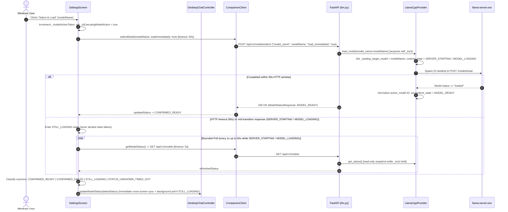
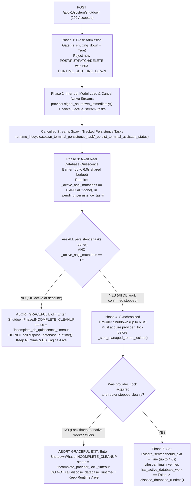

# Implementation Plan — M2 PC-HOST-005: Secure Host Lifecycle, Provider Cleanup & Model-Loading Reliability

- **Status:** `AWAITING HUMAN / INDEPENDENT PLAN REVIEW`
- **Delivery Level:** `Level C — Sensitive Design`
- **Scope Mode:** `New Feature / Security, Lifecycle Hardening & Bounded Model-Loading Reliability`
- **Milestone / Work Items:**
  - **Track A (Primary):** `M2 — PC Companion Foundation` / `PC-HOST-005` (`Host Administration Separation & Secure Lifecycle Authority`)
  - **Track B (Bounded Reliability Extension):** `PC-CLIENT-010` (`Model Management UI`), `PC-CLIENT-004` (`API Client Layer`), and `PC-MODEL-006` (`Single-Resident Model Lifecycle Policy`)
- **Branch:** `feature/m2-secure-host-lifecycle`
- **Target Integration Branch:** `develop`
- **Verified Baseline SHA:** `261d4b43930d3dcdad2dbd913d4dd4d60c8a4887`
- **Previously Reviewed Plan Commits:** `8adfae0f964de81528883f73b8165e1cb9f62fae` (Initial), `350ba136b3786a761337e1df8b6720ce4161bc4d` (Revision 1), `d18e3f0f8d8aa8b68d0363f8f5f0a02440d2e90d` (Revision 2)
- **Active Branch Tracker:** [`docs/01_Tracking/active/task-feature-m2-secure-host-lifecycle.md`](../../01_Tracking/active/task-feature-m2-secure-host-lifecycle.md)
- **Date:** `2026-11-04`
- **Author / Role:** `Authorized Implementing Agent (Phase 1 Final Safety Reconciliation)`

> [!IMPORTANT]
> **Phase 1 Planning Candidate Notice:** This document is a **Phase 1 planning review candidate** published on `feature/m2-secure-host-lifecycle` resolving the three final Phase 1 safety reconciliation items (**Correction 1: Provider Lock Ownership**, **Correction 2: Real Database Quiescence Barrier**, and **Correction 3: Coordinated End-to-End Shutdown Deadline**). It is **NOT** yet approved for Phase 2 implementation, and zero production source code, tests, contracts, or database migrations have been modified in Phase 1. Implementation begins only after explicit **Human Owner** and **Independent Reviewer** final plan approval.

---

## 1. Approved Product Directions, Baseline and Scope (`Track A` + `Track B`)

### 1.1 Approved Architectural Directions (Human Owner Decisions)
The Human Owner has approved the following baseline directions for this delivery:
1. **Combined Two-Track Delivery Scope:** Deliver **Track A (`PC-HOST-005`: Secure Host Lifecycle & Provider Cleanup)** and **Track B (Bounded Model-Loading Reliability under `PC-CLIENT-010` / `PC-CLIENT-004` / `PC-MODEL-006`)** together on `feature/m2-secure-host-lifecycle`.
2. **Primary Shutdown Mechanism:** Use cooperative, authenticated Host Administration HTTP shutdown (`POST /api/v1/system/shutdown` protected by `require_host_admin`) via the programmatic Uvicorn entrypoint (`backend/app/runtime_server.py`) as the primary Runtime termination path.
3. **Emergency OS Fallback:** Permit a Windows OS process termination fallback **only** when process identity and ownership are established safely via handle-bound provenance verification, failing closed on any ambiguity.
4. **Four Distinct Provider Lifecycle Operations:** Preserve distinct semantics for (a) ordinary model unloading (`unload_model()`), (b) Core-managed router termination (`stop_managed_router()`), (c) full Runtime shutdown (`shutdown()`), and (d) supervisor emergency recovery, while never terminating an externally started `llama-server.exe` (`_managed_by_core == False`).
5. **Initial Tunable Timeout Candidates:** Treat all phase and operation timeout budgets (`6.0s` combined generation/persistence quiescence drain, `6.0s` synchronized provider/router teardown, `4.0s` Uvicorn lifespan socket exit, `25.0s` Flutter cooperative exit observation window, `90.0s` model-load HTTP timeout, and `60.0s` automatic status-reconciliation polling window) as **initial tunable design candidates**, not guaranteed wall-clock completion times prior to empirical Windows acceptance testing.
6. **Remote Host Protection:** Never shut down a remote Runtime (`isRemoteHost == true`) from the Desktop client's **Exit Companion** action.
7. **Governance Continuity:** Preserve the S1 four-phase delivery workflow, same feature branch continuity, autonomous Phase 2/3 execution once Phase 1 is approved, and the Human Owner's exclusive squash-merge authority.

### 1.2 Independent Review Resolution Ledger (Through Final Safety Reconciliation)

| Finding ID | Review Finding Summary | Resolution Status | Selected Mechanism & Verification Tier |
| :--- | :--- | :--- | :--- |
| **`Safety Correction 1`** | Calling `_stop_managed_router_unlocked()` when `self._lock.acquire()` times out violates lock ownership and races on shared provider state. | `RESOLVED IN DESIGN` *(Requires Phase 2 unit test evidence)* | **Strict Lock Ownership (§6.2):** `signal_shutdown_immediately()` sets only lock-free cancellation primitives (`_closing = True`, `_shutdown_event.set()`, cancelling `_active_load_task` and active router HTTP calls) without mutating shared provider state. All mutations of `_server_process`, `_server_client`, `_managed_by_core`, and `_runtime_state` occur **exclusively while holding `self._lock`**. If `self._lock.acquire()` times out (`2.0s` post-drain), `shutdown()` **does not** execute unlocked cleanup; it returns `ProviderShutdownResult(completed_cleanly=False, lock_acquired=False, reason="PROVIDER_LOCK_TIMEOUT")` and escalates via truthful incomplete-shutdown reporting (§6.2, §11). |
| **`Safety Correction 2`** | Cancelling unfinished `_pending_persistence_tasks`, waiting `1.0s`, and calling `dispose_database_runtime()` violates database quiescence because cancellation does not prove completion. | `RESOLVED IN DESIGN` *(Requires Phase 2 DB quiescence unit test evidence)* | **Real Database Quiescence Barrier (§7.2):** Clean shutdown requires confirmed completion (`task.done() == True` for every task in `_pending_persistence_tasks` AND `_active_asgi_mutations == 0`). If any tracked persistence task or mutation remains active when the quiescence deadline expires (even after cancellation is requested), the runtime **does not** call `dispose_database_runtime()` and **does not** exit Uvicorn; it transitions to `ShutdownPhase.INCOMPLETE_CLEANUP` (`incomplete_db_quiescence_timeout`), keeps the runtime/DB alive to avoid corrupting in-flight writes, and requires either a retry or separately confirmed emergency termination disclosing potential incomplete writes (§7.2, §11). |
| **`Safety Correction 3`** | An `8.0s` Flutter fallback window can expire before sequential backend drain + router stop + Uvicorn exit finishes, causing a healthy runtime to be killed prematurely. | `RESOLVED IN DESIGN` *(Requires Phase 2 unit + isolated Windows acceptance evidence)* | **Coordinated End-to-End Shutdown Deadline (§5.4, §11):** Backend phase budgets are bounded at $\le 16.0\text{s}$ total (`0.1s` admission closure + `6.0s` combined stream/persistence quiescence + `6.0s` locked provider/router stop + `4.0s` Uvicorn socket/lifespan exit), while Flutter's cooperative observation window is set to **`25.0s`** (with active status polling on `GET /api/v1/system/status`). Explicitly distinguishes `GRACEFUL_SUCCESS`, `INCOMPLETE_CLEANUP`, `UNRESPONSIVE_RUNTIME`, and `EMERGENCY_TERMINATED` (§11). |
| **`Issue A1` & `Issue A2`** | `LlamaCppProvider.shutdown()` left Core-managed `llama-server.exe` alive; Settings `Exit Companion` invoked unconfirmed UI-only exit. | `RESOLVED IN DESIGN` *(Accepted in prior review)* | Separate `unload_model()`, `_stop_managed_router_locked()`, and `shutdown()`; unify Tray and Settings `Exit Companion` behind mandatory confirmation (§3). |
| **`Issue B1` & `Final C4`–`C6`** | Model-loading timeout (`5s`), `GET /api/v1/models` route, `model_name` field, 4-state truthful timeout UX, and `Authorization: Bearer psk_...` auth accuracy. | `RESOLVED IN DESIGN` *(Accepted in prior review)* | `90s` load timeout, `GET /api/v1/models` polling, `model_name` preserved, 4-state reconciliation (`CONFIRMED_READY`, `CONFIRMED_FAILED`, `STILL_LOADING`, `STATUS_UNKNOWN_TIMED_OUT`), and accurate `HostAdminSecretStore` + Bearer credential test matrix (§4, §8, §9). |
| **`Final C1` & `§9`** | Programmatic Uvicorn entrypoint (`app.runtime_server`) and handle-bound Windows fallback verification propositions (`P1`–`P4`). | `RESOLVED IN DESIGN` / `REQUIRES IMPLEMENTATION EVIDENCE` *(Accepted in prior review)* | `backend/app/runtime_server.py` explicitly registers `uvicorn.Server`; handle-bound `GetProcessById` $\rightarrow$ 4-factor verify $\rightarrow$ `$proc.Kill()` tested in Phase 2 Tasks 4 & 7 (§5, §10). |

### 1.3 Canonical References

| Canonical Document | Normative Sections & Requirements |
| :--- | :--- |
| [`docs/04_Architecture/SYSTEM_BASELINE.md`](../../04_Architecture/SYSTEM_BASELINE.md) | **§2 & §5:** Single-Machine Split Architecture; Local AI Runtime (`127.0.0.1:8000`) runs independently of Flutter UI; **Close Window (`×`)** hides UI to tray; **Exit Companion** performs confirmed full shutdown of UI + Local AI Runtime + Core-managed `llama.cpp`; **Host Administration Authority (`D15`)** separates normal Profile Session (`psk_`) and Device Pairing (`companion_sec_`) tokens from host-wide privileged operations (`X-Host-Admin-Secret`). |
| [`docs/04_Architecture/04_Infrastructure/windows-host-and-notifications.md`](../../04_Architecture/04_Infrastructure/windows-host-and-notifications.md) | **§1.2, §1.3, §2.1, §2.2, §4.2:** Four distinct lifecycle actions (**Close Window (`×`)**, **Quit UI Only (Dev/Diagnostics)**, **Pause Companion** [deferred], **Exit Companion**); mandatory user confirmation before full shutdown; intentional exit suppresses crash-recovery restart loops; `PC-HOST-005` owns authenticated host shutdown. |
| [`docs/04_Architecture/02_Data_and_Security/profiles-and-devices.md`](../../04_Architecture/02_Data_and_Security/profiles-and-devices.md) | **§1.3 & §3.2 (`D15`):** Profile sessions and remote paired devices must never stop the host runtime or mutate shared host-wide process state. |
| [`docs/04_Architecture/02_Data_and_Security/authentication-and-secrets.md`](../../04_Architecture/02_Data_and_Security/authentication-and-secrets.md) | **§1.1, §2.2, §3.1, §5.3 (`D15`):** Three distinct credential classes (`Authorization: Bearer psk_`, `Authorization: Bearer companion_sec_` / `X-API-Key`, and `X-Host-Admin-Secret: hsk_`); `%LOCALAPPDATA%\AICompanion\secrets\desktop_admin.secret` ACL-restricted to current Windows user SID + `SYSTEM`; loopback IP/Host and non-browser (`Origin`/`Sec-Fetch-Site` rejected) enforcement. |
| [`docs/04_Architecture/04_Infrastructure/runtime-and-models.md`](../../04_Architecture/04_Infrastructure/runtime-and-models.md) | **§2.2 & §5.3:** Core-managed `llama-server.exe` lifecycle ownership (`_managed_by_core`), single-resident model loading, active generation cancellation, and clean subprocess termination on runtime exit. |
| [`docs/05_Design/01_PC_Desktop_Shell_and_Tray.md`](../../05_Design/01_PC_Desktop_Shell_and_Tray.md) | **§5 (Tray & Background Behavior):** Tray menu actions and explicit user-facing distinction between hiding window, developer UI-only exit, and confirmed full **"Exit Companion"** shutdown. |
| [`docs/04_Architecture/decisions/ADR-0003-d2-windows-host-model.md`](../../04_Architecture/decisions/ADR-0003-d2-windows-host-model.md) | **ADR-0003 (`D2`) — Per-User Background Host Model:** Runtime runs under interactive Windows user session without requiring UAC elevation or a Windows Service (`services.msc`). |

---

## 2. Independently Supported Source Findings (Verified Current Implementation)

Direct inspection of the repository on `feature/m2-secure-host-lifecycle` (base `develop` SHA `261d4b43930d3dcdad2dbd913d4dd4d60c8a4887`) established the following source-verified facts:

| Subsystem / File | Verified Source Behavior & Line References |
| :--- | :--- |
| [`backend/app/api/v1/endpoints/llm.py`](../../../backend/app/api/v1/endpoints/llm.py#L40-L164) | Exposes `GET /api/v1/models` (`get_model_status`, protected by `Depends(verify_telemetry)`), `GET /api/v1/models/registry`, `POST /api/v1/models/load` (`ModelLoadRequest(model_name, profile)`), `POST /api/v1/models/select` (`ModelSelectRequest(model_name, load_immediately, profile)`), `POST /api/v1/models/unload`, and `PATCH /api/v1/models/profile` (all four mutations protected by `Depends(require_host_admin)`). |
| [`backend/app/api/v1/endpoints/health.py`](../../../backend/app/api/v1/endpoints/health.py#L1-L78) | Exposes public `GET /api/v1/health` (`HealthResponse(status="healthy")`) and Host-Admin-protected `GET /api/v1/system/status` (`SystemStatusResponse`). No shutdown endpoint exists yet. |
| [`backend/app/core/host_admin.py`](../../../backend/app/core/host_admin.py#L31-L108) & [`windows_security.py`](../../../backend/app/core/windows_security.py) | Provisions `%LOCALAPPDATA%\AICompanion\secrets\desktop_admin.secret` (`hsk_<token_urlsafe(48)>`) with protected DACL `O:<user_sid>D:P(A;;FA;;;<user_sid>)(A;;FA;;;SY)` and non-reparse directory validation. `require_host_admin` enforces loopback peer IP, loopback `Host` header, absence of `Origin` and `Sec-Fetch-Site`, and `secrets.compare_digest` on `X-Host-Admin-Secret`. |
| [`backend/app/core/profile_sessions.py`](../../../backend/app/core/profile_sessions.py#L58-L69) & [`deps.py`](../../../backend/app/api/deps.py#L20-L27) | `get_current_profile_session` extracts `Authorization: Bearer psk_<token>` via `Security(bearer_security)` and validates the hashed session against SQLite `profile_sessions`. `verify_telemetry` accepts either `Authorization: Bearer psk_<token>` or `Authorization: Bearer companion_sec_<token>` / `X-API-Key`. |
| [`backend/app/services/llm/llama_cpp.py`](../../../backend/app/services/llm/llama_cpp.py#L377-L711) & [`#L792-L1105`](../../../backend/app/services/llm/llama_cpp.py#L792-L1105) | (1) `load_model()` holds `async with self._lock:` (`#L378`) across up to `45s` of router startup (`#L610-L631`) and `45s + 30s` of `/models/load` HTTP + polling (`#L246-L278`).<br>(2) `shutdown()` (`#L1086-L1105`) calls `await self.unload_model()`, which returns `True` at line 677 after HTTP `/models/unload` succeeds, leaving `self._server_process` (`llama-server.exe`) running; if `_active_work_drained.wait()` times out at line 1099, `shutdown()` also returns early at line 1104 without stopping `self._server_process`.<br>(3) `get_status()` (`#L792-L859`) runs without `self._lock` and at lines 830 and 845 overwrites `self._active_model_name = None` and `self._server_is_active = False` if called while `load_model()` is mid-transition, and sets raw `loaded_model_id` from `llama-server` without normalizing via `find_model_registry_entry`. |
| [`backend/app/services/assistant/orchestrator.py`](../../../backend/app/services/assistant/orchestrator.py#L317-L354) & [`#L518-L539`](../../../backend/app/services/assistant/orchestrator.py#L518-L539) | On stream cancellation (`CancelledError` / `GeneratorExit`), rolls back the request `db` session and calls `await asyncio.shield(_persist_terminal_assistant_status(...))` using a separate session from `get_session_factory()`. Because `_persist_terminal_assistant_status` is passed as a bare coroutine to `asyncio.shield` and is not registered in a central runtime task set, a second cancellation or premature `dispose_database_runtime()` call can race with the uncommitted terminal status write. |
| [`frontend/flutter/packages/companion_api/lib/client/companion_client.dart`](../../../frontend/flutter/packages/companion_api/lib/client/companion_client.dart#L57-L108) & [`#L209-L281`](../../../frontend/flutter/packages/companion_api/lib/client/companion_client.dart#L209-L281) | (1) `_buildHeaders(admin: true)` reads `await hostAdminStore?.readToken()` on each call and sets `X-Host-Admin-Secret`.<br>(2) `_requestWithoutRedirects()` (`#L102-L108`) hardcodes `.timeout(const Duration(seconds: 5))` on **every** `_adminRequest`, including `selectModel(modelName, loadImmediately: true)` (`POST /api/v1/models/select`) and `loadModel()` (`POST /api/v1/models/load`).<br>(3) `getModelStatus()` (`#L209-L218`) calls `GET /api/v1/models`. |
| [`frontend/flutter/apps/desktop/lib/platform/host_admin_secret_store.dart`](../../../frontend/flutter/apps/desktop/lib/platform/host_admin_secret_store.dart#L10-L73) | `readToken()` invokes `powershell.exe` on every call to verify non-reparse attributes and Windows DACLs (`current user SID + SYSTEM`) on `%LOCALAPPDATA%\AICompanion\secrets\desktop_admin.secret` before reading the secret from disk. Does not cache tokens in memory. |
| [`frontend/flutter/apps/desktop/lib/coordinator/desktop_runtime_coordinator.dart`](../../../frontend/flutter/apps/desktop/lib/coordinator/desktop_runtime_coordinator.dart#L52-L56) & [`#L789-L795`](../../../frontend/flutter/apps/desktop/lib/coordinator/desktop_runtime_coordinator.dart#L789-L795) | (1) Constructs `CompanionClient` without `hostAdminStore`.<br>(2) Spawns detached runtime with `args: ['-m', 'uvicorn', 'app.main:app', '--host', targetHost, '--port', '$targetPort', '--no-use-colors']`.<br>(3) Uses lockfile `%LOCALAPPDATA%\AI Companion\runtime.lock` locked directly via `FileMode.append` + `FileLock.exclusive`. |
| [`frontend/flutter/apps/desktop/lib/screens/settings_screen.dart`](../../../frontend/flutter/apps/desktop/lib/screens/settings_screen.dart#L563-L569) & [`#L998-L1047`](../../../frontend/flutter/apps/desktop/lib/screens/settings_screen.dart#L998-L1047) | (1) Line 564: **Exit Companion** button calls `coordinator?.handleExitRequested()` (unconfirmed UI-only exit).<br>(2) Lines 1025–1046: When `selectModel(modelId, loadImmediately: true)` throws `TimeoutException` at `5.0s`, the `catch` block calls `getModelStatus()` (`GET /api/v1/models`) once immediately while the backend is still loading, overwrites `_modelActionMessage` with `'Model selection saved, but activation failed: ... Model is NOT active.'`, does not poll, and never updates `widget.chatController`. |

---

## 3. Confirmed Shutdown Defects (`Issue A1` & `Issue A2`)

### 3.1 `Issue A1` — Explicit Separation of Four Provider Lifecycle Operations
We explicitly separate and enforce four distinct operations in [`LlamaCppProvider`](../../../backend/app/services/llm/llama_cpp.py), ensuring all shared provider state mutations occur strictly under `self._lock`:

| Operation | Method / Trigger | Synchronization Requirement | Effect on Model Weights | Effect on Core-Managed `llama-server.exe` (`_managed_by_core == True`) | Effect on External `llama-server.exe` (`_managed_by_core == False`) | Resulting `LLMRuntimeState` |
| :--- | :--- | :--- | :--- | :--- | :--- | :--- |
| **1. Ordinary Model Unload** | `await provider.unload_model()` (`POST /api/v1/models/unload`) | Holds `self._lock` | Unloads active model from VRAM (`POST /models/unload` on router or frees `self._llm` if idle). | **Preserves running `llama-server.exe` router** when HTTP `/models/unload` succeeds so subsequent model loads are fast. Only terminates `_server_process` if router HTTP unload fails. | Sends HTTP `POST /models/unload` only; **never** terminates external OS process. | `MODEL_UNLOADED` (or `SERVER_STOPPED` if fallback process kill was required) |
| **2. Stop Managed Router** | `await provider.stop_managed_router()` (acquires `self._lock` and delegates to `_stop_managed_router_locked()`) | **Must hold `self._lock`** | Unloaded as part of router stop. | Closes `self._server_client`; terminates `self._server_process` (`terminate()` $\rightarrow$ `wait(3.0s)` $\rightarrow$ `kill()` + `wait(1.0s)`); clears `_server_process`, `_server_pid`, `_managed_by_core = False`. | Closes `self._server_client` and detaches provider state (`_server_is_active = False`); **never** kills external OS process. | `SERVER_STOPPED` |
| **3. Full Runtime Shutdown** | `await provider.shutdown(drain_timeout=4.0, lock_timeout=2.0)` (`POST /api/v1/system/shutdown` & `lifespan` exit) | Phase A: Lock-free signal.<br>Phase B: **Must acquire `self._lock`** before calling `_stop_managed_router_locked()`. | Releases model weights safely when `self._lock` is acquired (respecting Route B native worker guard in §6.3). | Phase A signals `_shutdown_event` so any active `load_model()` aborts and cleans up its partial router under `self._lock`. Phase B acquires `self._lock` and calls `_stop_managed_router_locked()`. **If `self._lock` acquisition times out, `shutdown()` does NOT touch shared provider state unlocked; it returns `ProviderShutdownResult(completed_cleanly=False, lock_acquired=False)` for explicit escalation (§6.2).** | Cancels active Route A HTTP streams to the external router and (under `self._lock`) closes `_server_client`; **never** kills external OS process. | `SERVER_STOPPED` (or `INCOMPLETE` if `self._lock` timed out) |
| **4. Emergency Recovery** | `WindowsRuntimeProcessSupervisor.terminateVerifiedRuntimeProcess()` | OS process handle-bound | N/A (OS process level). | Terminated by supervisor **only** when unresponsive or explicitly confirmed by the user after incomplete cleanup, and **only** if handle-bound child provenance confirms `llama-server.exe` is the Core-managed child of the verified runtime process (§10). | **Never touched** (fails closed on missing/external provenance). | `RuntimeStatus.stopped` |

### 3.2 `Issue A2` — Preserving Four Distinct Desktop Lifecycle Operations

| User Action | Entry Points | Confirmation Required? | Desktop UI (`flutter_desktop.exe`) | Local AI Runtime (`pythonw.exe`) | Core-Managed `llama-server.exe` | Crash-Recovery Auto-Restart |
| :--- | :--- | :--- | :--- | :--- | :--- | :--- |
| **1. Close Window (`×`) / Hide to Tray** | Window titlebar `×` button; Settings **Hide to Tray** button | No | Hidden to System Tray (`windowManager.hide()`) | Continues running | Continues running | Active |
| **2. Quit UI Only (Dev/Diagnostics)** | System Tray `Close UI Only (Dev Test)` (`quit_ui_dev`) | No (Explicit dev-only label) | Exits (`exit(0)`) | Continues running (`ProcessStartMode.detached`) | Continues running | Inactive (UI exited) |
| **3. Pause Companion** | *(Deferred out of `PC-HOST-005`)* | N/A | N/A | N/A | N/A | N/A |
| **4. Exit Companion (Full Shutdown)** | System Tray **Exit Companion** (`exit_full`) AND Settings **Exit Companion** button | **Yes (Mandatory modal confirmation dialog)** | Exits (`exit(0)`) **only after** runtime stop is verified (or user explicitly selects `Force Stop Local Runtime` / `Quit Desktop UI Only` in the recovery dialog) | Gracefully drains & exits via `POST /api/v1/system/shutdown` (or escalates on incomplete/unresponsive state) | Terminated under `self._lock` via `_stop_managed_router_locked()` (or handle-bound child fallback on emergency termination) | **Suppressed** (`_intentionalShutdown = true`) |

---

## 4. Model-Loading Reliability & Truthful Timeout Reconciliation (`Issue B1`, `Corrections C4 & C5`)

### 4.1 Verified Root Causes in Existing Source
1. **Hardcoded 5-Second Client Timeout (`Issue B1-RC1`):** [`CompanionClient._requestWithoutRedirects()`](../../../frontend/flutter/packages/companion_api/lib/client/companion_client.dart#L106) enforces `const Duration(seconds: 5)` on all `_adminRequest` calls, including `selectModel(modelName, loadImmediately: true)` (`POST /api/v1/models/select` with `{"model_name": modelName, "load_immediately": true}`) and `loadModel()` (`POST /api/v1/models/load`). Meanwhile, [`LlamaCppProvider.load_model()`](../../../backend/app/services/llm/llama_cpp.py#L610-L631) allows up to `45.0s` for `llama-server.exe` startup plus `45.0s` POST + `30.0s` polling in `_router_load_model()` (`#L246-L278`). Any cold model load taking $> 5.0\text{s}$ throws `TimeoutException` in Flutter at `5.0s` while the backend continues spawning `llama-server.exe` and loading weights in the background.
2. **Premature Failure Declaration Without Polling (`Issue B1-RC2`):** In [`settings_screen.dart`](../../../frontend/flutter/apps/desktop/lib/screens/settings_screen.dart#L1025-L1046), catching `TimeoutException` at $t = 5.0\text{s}$ immediately calls `client.getModelStatus()` (`GET /api/v1/models`) once while `runtime_state` is still `SERVER_STARTING` or `MODEL_LOADING`, overwrites `_modelActionMessage` with `'Model selection saved, but activation failed: ... Model is NOT active.'`, sets `_isExecutingModelAction = false`, and performs zero follow-up polling.
3. **Lockless State Clobbering & Unnormalized Model IDs in `get_status()` (`Issue B1-RC3`):** In [`llama_cpp.py`](../../../backend/app/services/llm/llama_cpp.py#L792-L859), `get_status()` (`GET /api/v1/models`) runs without checking `self._lock` or transitional states, overwriting `self._active_model_name = None` (line 830) and `self._server_is_active = False` (line 845) if probed while `load_model()` is starting the router or loading weights. Additionally, lines 817–822 assign raw `loaded_model_id` from `llama-server` without normalizing through `find_model_registry_entry(loaded_model_id)`, causing `SettingsScreen`'s activation check (`#L1014-L1020`) to false-negative when `llama-server` reports a filename/path matching `primaryFile`.
4. **Why Clicking "Load Model" a Second Time Succeeds (`Issue B1-RC4`):** Once the background load from the first click completes, a second click hits the active-model reuse fast path (`#L425-L442`) or `Mode 0` (`#L466-L480`, where `_router_load_model` receives HTTP 400 `"already running"` at `#L254-L256` and returns `True`), returning HTTP 200 in $< 10\text{ms}$.
5. **Missing Cross-Screen Chat Controller Sync (`Issue B1-RC5`):** Unlike `_unloadModel()` (line 1082), `_selectModel()` never updates `widget.chatController`, leaving `DesktopChatController._modelStatus` stale.

### 4.2 Exact API Contracts for Model Operations (`Correction C4`)
All model management and reconciliation flows preserve the exact existing backend routes and payload schemas in [`backend/app/api/v1/endpoints/llm.py`](../../../backend/app/api/v1/endpoints/llm.py) and [`companion_client.dart`](../../../frontend/flutter/packages/companion_api/lib/client/companion_client.dart):

| Operation | HTTP Method & Route | Auth Dependency | Request Payload Schema | Response Schema | Client Timeout Budget (Initial Tunable Candidate) |
| :--- | :--- | :--- | :--- | :--- | :--- |
| **Get Model Status** | `GET /api/v1/models` | `Depends(verify_telemetry)` (`Authorization: Bearer psk_...` or `companion_sec_...`) | None | `ModelStatusResponse` | `5.0s` |
| **Get Model Registry** | `GET /api/v1/models/registry` | `Depends(verify_telemetry)` | None | `List[ModelRegistryEntry]` | `5.0s` |
| **Select Model** | `POST /api/v1/models/select` | `Depends(require_host_admin)` (`X-Host-Admin-Secret`) | `ModelSelectRequest`: `{"model_name": str, "load_immediately": bool, "profile": Optional[str]}` | `ModelStatusResponse` | `90.0s` when `load_immediately == true`; `10.0s` when `load_immediately == false` |
| **Load Model** | `POST /api/v1/models/load` | `Depends(require_host_admin)` (`X-Host-Admin-Secret`) | `ModelLoadRequest`: `{"model_name": Optional[str], "profile": Optional[str]}` | `ModelStatusResponse` | `90.0s` |
| **Unload Model** | `POST /api/v1/models/unload` | `Depends(require_host_admin)` (`X-Host-Admin-Secret`) | None | `ModelStatusResponse` | `20.0s` |

### 4.3 Four-State Truthful Model-Load Reconciliation (`Correction C5`)



To ensure timeout expiration is **never** misrepresented as a permanent model-loading failure, `SettingsScreen` and `DesktopChatController` classify model activation into four explicit states:

| Outcome State | Authoritative Condition (`GET /api/v1/models`) | UI Presentation & User Actions in `SettingsScreen` | `DesktopChatController` Synchronization |
| :--- | :--- | :--- | :--- |
| **1. `CONFIRMED_READY`** | `runtime_state == "MODEL_READY"` (or `"MODEL_SLEEPING"`) AND `_isTargetModelActive(status, modelName)` matches via `id`, `runtimeModelId`, `primaryFile`, or filename stem. | Success message: `'Model selected and ready: <activeModel>'`. Action spinner stops; model card shows `Active / Ready`. | `chatController.updateModelStatus(status)` immediately marks Chat model ready for turns. |
| **2. `CONFIRMED_FAILED`** | Deterministic `4xx`/`5xx` HTTP error response from `/api/v1/models/select` or `/load`, OR `GET /api/v1/models` reports `runtime_state in ("MODEL_ERROR", "SERVER_ERROR", "SERVER_STOPPED", "MODEL_UNLOADED")` after the load operation exited. | Error message: `'Model activation failed: <errorDetail>.'` Action spinner stops; user can click **Retry Load**. | `chatController.updateModelStatus(status)` updates Chat with the error/unloaded state. |
| **3. `STILL_LOADING`** | `GET /api/v1/models` reports `runtime_state in ("SERVER_STARTING", "MODEL_LOADING")` (either during the `60s` automatic poll window or when the `60s` window expires while the backend is still actively loading). | **Never claims the load failed.**<br>- During active 60s poll: shows spinner + `'Loading model weights in Local AI Runtime (<runtimeState>)...'`.<br>- If 60s poll window expires while still `SERVER_STARTING` / `MODEL_LOADING`: shows informational banner `'Model is still loading in the background (<runtimeState>). No reload is needed.'` with a **`Refresh Model Status` / `Continue Waiting`** button that calls `GET /api/v1/models` (and resumes bounded polling) **without** sending a redundant `POST /api/v1/models/load` or `/select`. Duplicate load buttons for the loading model remain disabled. | `chatController.updateModelStatus(status)` updates Chat to show `Loading model...` and starts a lightweight `2.0s` background status poll on `GET /api/v1/models` inside `DesktopChatController` so even if the user navigates away from Settings to Chat, Chat automatically transitions to `MODEL_READY` as soon as the backend finishes. |
| **4. `STATUS_UNKNOWN_TIMED_OUT`** | Both the initial HTTP request and follow-up `GET /api/v1/models` probes failed with `TimeoutException` or transient socket error, so current backend state cannot be read. | Warning banner: `'Model load status could not be confirmed (status check timed out). The model may still be loading in the background.'` Displays a primary **`Refresh Model Status`** button (`GET /api/v1/models`) before offering a full reload. | Preserves non-destructive pending status until `Refresh Model Status` succeeds. |

---

## 5. Reliable Uvicorn Lifecycle Ownership (`Final C1` & `Safety Correction 3`)

### 5.1 Explicit Programmatic Runtime Entry Point (`backend/app/runtime_server.py`)
To avoid `gc.get_objects()` or asyncio stack introspection, we introduce [`backend/app/runtime_server.py`](../../../backend/app/runtime_server.py) as the canonical runtime launcher:

```python
"""Deterministic Uvicorn runtime entrypoint with explicit server lifecycle registration."""

import argparse
import asyncio
import uvicorn
from app.core.runtime_lifecycle import runtime_lifecycle


def build_arg_parser() -> argparse.ArgumentParser:
    parser = argparse.ArgumentParser(description="AI Companion Local Runtime Server")
    parser.add_argument("--app", default="app.main:app", help="ASGI application import string")
    parser.add_argument("--host", default="127.0.0.1", help="Bind host")
    parser.add_argument("--port", type=int, default=8000, help="Bind port")
    parser.add_argument("--no-use-colors", action="store_true", help="Disable ANSI color codes")
    parser.add_argument("--log-level", default="info", help="Uvicorn log level")
    return parser


async def serve_runtime(args: argparse.Namespace) -> int:
    config = uvicorn.Config(
        app=args.app,
        host=args.host,
        port=args.port,
        use_colors=not args.no_use_colors,
        log_level=args.log_level,
        timeout_graceful_shutdown=4,
    )
    server = uvicorn.Server(config=config)
    runtime_lifecycle.register_uvicorn_server(server, host=args.host, port=args.port)
    try:
        await server.serve()
    finally:
        runtime_lifecycle.clear_uvicorn_server(server)
    return 0


def main() -> int:
    parser = build_arg_parser()
    args = parser.parse_args()
    return asyncio.run(serve_runtime(args))


if __name__ == "__main__":
    raise SystemExit(main())
```

### 5.2 Dependent Contract Synchronization
1. **Supervisor Launch Arguments ([`desktop_runtime_coordinator.dart`](../../../frontend/flutter/apps/desktop/lib/coordinator/desktop_runtime_coordinator.dart#L789-L795)):**
   - Spawns `pythonw.exe` with `args: ['-m', 'app.runtime_server', '--app', 'app.main:app', '--host', targetHost, '--port', '$targetPort', '--no-use-colors']`.
2. **Process Provenance Verification ([`windows_runtime_process_supervisor.dart`](../../../frontend/flutter/apps/desktop/lib/platform/windows_runtime_process_supervisor.dart#L458-L465)):**
   - `WindowsRuntimeProcessSupervisor.isCompanionRuntimeCommandLine(String commandLine, {required int expectedPort})` requires `matchesExactPort(commandLine, expectedPort)` (`--port <expectedPort>`), `commandLine.contains('app.main:app')`, and `(commandLine.contains('app.runtime_server') || commandLine.contains('uvicorn'))`.
3. **Verification Tier:**
   - *Source-verified (`uvicorn/server.py` lines 67, 96–101, 233–264):* Setting `server.should_exit = True` on the registered `uvicorn.Server` instance exits `main_loop()` within `100ms` and runs `await self.shutdown(sockets=sockets)` $\rightarrow$ `await self.lifespan.shutdown()`.
   - *Requires Phase 2 isolated Windows acceptance verification:* Empirical process-exit and port-release verification in `windows_runtime_supervision_acceptance_test.dart`.

---

## 6. Strict Provider Lock Ownership & Non-Deadlocking Shutdown (`Safety Correction 1`)

### 6.1 Why Unlocked Fallback Cleanup Is Prohibited
In [`backend/app/services/llm/llama_cpp.py`](../../../backend/app/services/llm/llama_cpp.py), shared mutable state (`self._server_process`, `self._server_client`, `self._managed_by_core`, `self._active_model_name`, `self._runtime_state`) is protected by `self._lock`. If `shutdown()` called an unlocked cleanup helper while an in-flight `load_model()` or `unload_model()` still held `self._lock`, both coroutines would mutate `self._server_process` and `self._server_client` concurrently, violating lock ownership.

### 6.2 Strictly Synchronized Two-Phase Provider Shutdown Protocol

```mermaid
sequenceDiagram
    autonumber
    participant Coord as RuntimeLifecycleCoordinator
    participant Prov as LlamaCppProvider
    participant Load as Active load_model() Task (Holds self._lock)
    participant Router as Core-Managed llama-server.exe

    Coord->>Prov: signal_shutdown_immediately()
    Note over Prov: PHASE A: Lock-Free Cancellation Signal ONLY (Zero shared-state mutation)
    Prov->>Prov: self._closing = True; self._shutdown_event.set()
    Prov->>Prov: Cancel _idle_check_task, _active_generation_tasks, & _active_load_task
    Prov->>Prov: Trigger abort on _active_router_http_clients
    Prov-->>Load: _shutdown_event / CancelledError interrupts wait or HTTP call
    alt Normal Cooperative Abort (load_model() unwinds while holding self._lock)
        Load->>Router: If _managed_by_core: await _stop_managed_router_locked()
        Load->>Load: Set _runtime_state = SERVER_STOPPED, release self._lock
        Coord->>Prov: shutdown(drain_timeout=4.0, lock_timeout=2.0)
        Prov->>Prov: Await _active_work_drained (up to 4.0s)
        Prov->>Prov: Acquire self._lock (succeeds within 2.0s)
        Prov->>Router: await _stop_managed_router_locked() (idempotent under self._lock)
        Prov->>Prov: If not has_active_generation: free self._llm (under self._lock)
        Prov->>Prov: Release self._lock
        Prov-->>Coord: ProviderShutdownResult(completed_cleanly=True, lock_acquired=True)
    else Cancellation-Resistant Operation Wedged Inside self._lock
        Coord->>Prov: shutdown(drain_timeout=4.0, lock_timeout=2.0)
        Prov->>Prov: wait_for(self._lock.acquire(), timeout=2.0) -> TimeoutError!
        Note over Prov: STRICT INVARIANT: Do NOT call _stop_managed_router_locked() without self._lock!
        Prov-->>Coord: ProviderShutdownResult(completed_cleanly=False, lock_acquired=False, reason="PROVIDER_LOCK_TIMEOUT")
        Coord->>Coord: Enter ShutdownPhase.INCOMPLETE_CLEANUP (keep runtime alive; report incomplete_provider_lock_timeout)
    end
```

#### Synchronization & Escalation Rules (`Safety Correction 1`):
1. **Lock-Free Cancellation Primitives Only (`signal_shutdown_immediately()`):**
   - Executes without acquiring `self._lock`.
   - Sets only atomic cancellation flags/events (`self._closing = True`, `self._shutdown_event.set()`) and cancels task/request handles (`self._idle_check_task`, `self._active_generation_tasks`, `self._active_load_task`, and active `httpx` requests in `self._active_router_http_clients`).
   - **Never** mutates `self._server_process`, `self._server_client`, `self._managed_by_core`, `self._active_model_name`, or `self._runtime_state`.
2. **Lock-Holder Cleanup Responsibility (`load_model()` / `unload_model()`):**
   - `load_model()` holds `self._lock` and uses `await self._sleep_or_abort(0.5)` (waiting on `self._shutdown_event.wait()`).
   - When `load_model()` catches `CancelledError` or observes `self._closing == True` while holding `self._lock`, `load_model()` itself calls `await self._stop_managed_router_locked()` **before releasing `self._lock`**, ensuring any partially started Core-managed `llama-server.exe` (`_managed_by_core == True`) is terminated while holding the lock and any external router (`_managed_by_core == False`) is left untouched.
3. **Strict Lock Acquisition Requirement in `shutdown()`:**
   - After waiting up to `drain_timeout` (`4.0s` initial budget) for `self._active_work_drained.wait()`, `shutdown()` attempts to acquire `self._lock` with a bounded `lock_timeout` (`2.0s` initial budget): `await asyncio.wait_for(self._lock.acquire(), timeout=lock_timeout)`.
   - **When `self._lock` is acquired:** `shutdown()` executes `await self._stop_managed_router_locked()` under `self._lock`, frees `self._llm` only if `not self.has_active_generation` (Route B native worker safety guard), releases `self._lock`, and returns `ProviderShutdownResult(completed_cleanly=True, lock_acquired=True)`.
   - **When `self._lock.acquire()` times out:**
     - `shutdown()` **MUST NOT** call `_stop_managed_router_locked()` or mutate shared provider state without holding `self._lock`.
     - Instead, `shutdown()` returns `ProviderShutdownResult(completed_cleanly=False, lock_acquired=False, reason="PROVIDER_LOCK_TIMEOUT", managed_llm_pid=self._server_pid if self._managed_by_core else None, managed_by_core=self._managed_by_core)`.
     - `RuntimeLifecycleCoordinator` transitions to `ShutdownPhase.INCOMPLETE_CLEANUP` (`shutdown_quiescence_status = "incomplete_provider_lock_timeout"`), keeps the runtime alive so the wedged operation is not corrupted by concurrent unlocked teardown, and surfaces this status to Flutter via `GET /api/v1/system/status` for user-confirmed recovery or emergency termination (§11.2).

---

## 7. Real Database Quiescence Barrier & Cancellation Persistence (`Safety Correction 2`)

### 7.1 Why Cancelling Tasks + Sleeping `1.0s` Is Not a Quiescence Barrier
Task cancellation in Python (`task.cancel()`) schedules a `CancelledError` at the task's next `await` point; it does **not** prove the task has finished executing or that its underlying `aiosqlite` connection has completed an in-flight SQL statement or commit. Calling `dispose_database_runtime()` (`await _engine.dispose()`) after a fixed `1.0s` wait while a task in `_pending_persistence_tasks` or an active ASGI mutation still has `not task.done()` risks disposing the database engine while SQLite work is actively running.

### 7.2 True Quiescence Barrier & Incomplete-Shutdown Handling (`RuntimeLifecycleCoordinator`)



#### Rules of the Database Quiescence Barrier (`Safety Correction 2`):
1. **Comprehensive Work Tracking in `RuntimeLifecycleCoordinator`:**
   - `_active_asgi_mutations: set[str]`: Tracks every admitted `POST`, `PUT`, `PATCH`, or `DELETE` request (excluding `/api/v1/system/shutdown`) across the **full ASGI `app(scope, receive, send)` execution**, only removing the request ID in `finally:` after the response stream (including `StreamingResponse`) has completely closed and `get_db()` has exited its `async with factory() as session:` block.
   - `_active_stream_tasks: set[asyncio.Task]`: Registers active `orchestrate_chat_stream` and streaming `create_chat_completion` generator tasks so shutdown cancels them immediately.
   - `_pending_persistence_tasks: set[asyncio.Task[bool]]`: Explicit task handles created via `runtime_lifecycle.spawn_terminal_persistence_task(_persist_terminal_assistant_status(...))`. `_persist_terminal_assistant_status(...) -> bool` returns `True` **only** when `await session.commit()` completes without error.
2. **Definition of Confirmed Database Quiescence (`has_active_database_work == False`):**
   - `runtime_lifecycle.has_active_database_work` is `False` **if and only if**:
     - `len(self._active_asgi_mutations) == 0`, AND
     - `len(self._active_stream_tasks) == 0`, AND
     - every `task` in `self._pending_persistence_tasks` satisfies `task.done() == True`.
3. **Prohibition on Disposing Database While Work Remains Active:**
   - `wait_for_database_quiescence(timeout=6.0)` waits for `has_active_database_work` to become `False`.
   - If the timeout expires and `has_active_database_work` is still `True` (for example, a delayed SQLite commit or a cancellation-resistant task has not finished):
     - `RuntimeLifecycleCoordinator` **does NOT call `dispose_database_runtime()`** and **does NOT set `uvicorn_server.should_exit = True`**.
     - It transitions to `ShutdownPhase.INCOMPLETE_CLEANUP` with `shutdown_quiescence_status = "incomplete_db_quiescence_timeout"`.
     - Furthermore, [`dispose_database_runtime()`](../../../backend/app/db/session.py#L72-L79) (and the `lifespan` `finally` block in [`backend/app/main.py`](../../../backend/app/main.py#L182)) guards engine disposal by checking `if not runtime_lifecycle.has_active_database_work:`: it never disposes `_engine` while tracked persistence or mutation tasks remain active.
4. **Recovery vs. Explicitly Confirmed Emergency Termination When Quiescence Fails:**
   - Keeping the Runtime and SQLite engine alive when `incomplete_db_quiescence_timeout` occurs allows the delayed SQLite commit to finish safely without mid-commit engine disposal.
   - Meanwhile, `GET /api/v1/system/status` immediately reports `shutting_down = True` and `shutdown_quiescence_status = "incomplete_db_quiescence_timeout"` (or `"clean"` if the delayed write subsequently finishes!).
   - When `DesktopRuntimeCoordinator` observes `incomplete_db_quiescence_timeout` (or `incomplete_provider_lock_timeout`), it does **not** automatically kill the live process; it surfaces `RuntimeStatus.shutdownFailed` (`incompleteCleanup`) in the Desktop UI with three truthful options:
     1. **`Wait / Retry Graceful Shutdown`** — Re-polls `/api/v1/system/shutdown` & `/api/v1/system/status` so if the delayed commit finished, the runtime can now complete clean shutdown.
     2. **`Force Stop Local Runtime (Emergency Termination — Potential Incomplete Writes)`** — Clearly discloses that in-flight database writes or model tasks have not confirmed completion, and **only if the user explicitly confirms** invokes handle-bound `terminateVerifiedRuntimeProcess()`.
     3. **`Quit Desktop UI Only`** / **`Cancel`**.

---

## 8. Host Admin Secret Store & Authentication Accuracy (`Final C6`)

### 8.1 Verified Client & Secret Store Behavior
- [`HostAdminSecretStore.readToken()`](../../../frontend/flutter/apps/desktop/lib/platform/host_admin_secret_store.dart#L48-L65) executes a PowerShell verification script on every call that checks non-reparse attributes on every path component and validates that the Windows DACL on `%LOCALAPPDATA%\AICompanion\secrets` and `desktop_admin.secret` grants access only to the current Windows user SID and `NT AUTHORITY\SYSTEM`, then reads the `hsk_...` secret directly from disk without in-memory caching.
- [`CompanionClient._buildHeaders(admin: true)`](../../../frontend/flutter/packages/companion_api/lib/client/companion_client.dart#L63-L70) calls `await hostAdminStore?.readToken()` on each admin request and attaches `X-Host-Admin-Secret`.
- Phase 2 wires `HostAdminSecretStore` into `DesktopRuntimeCoordinator` (constructor + `updateConfiguration`), `main.dart`, and `SettingsScreen._resolveClient()`, and adds `COMPANION_HOST_ADMIN_SECRET_FILE` / `secretFilePathOverride` for isolated Windows acceptance tests.

### 8.2 Credential Classes & Security Enforcement Matrix

| Actor / Credential Class | Actual Wire Header Format | Permitted Authority | Shutdown Authority (`POST /api/v1/system/shutdown`) | Enforcement Mechanism |
| :--- | :--- | :--- | :--- | :--- |
| **1. Local Host Administrator (`hsk_`)** | `X-Host-Admin-Secret: hsk_<token>` | Host supervision (`/system/status`), Host shutdown (`/system/shutdown`), model management (`/models/load`, `/select`, `/unload`, `/profile`), Profile list & bootstrap ticket issuance. | **ALLOWED (`202 Accepted`)** | `Depends(require_host_admin)`: loopback client IP (`127.0.0.1`/`::1`), loopback `Host` header (`127.0.0.1`, `localhost`, `[::1]`), **no** `Origin` or `Sec-Fetch-Site` headers, and `secrets.compare_digest` match of ACL-protected `desktop_admin.secret`. |
| **2. Profile Session (`psk_`)** | `Authorization: Bearer psk_<token>` | Profile-scoped conversations, messages, memories, tasks, attachments, characters, session self-inspection/revocation (`Depends(get_current_profile_session)`). | **DENIED (`403 Forbidden`)** | `require_host_admin` does not accept `Authorization: Bearer psk_...` and rejects any request lacking a valid `X-Host-Admin-Secret`. |
| **3. Paired Device / Telemetry (`companion_sec_`)** | `Authorization: Bearer companion_sec_<token>` or `X-API-Key: companion_sec_<token>` | Telemetry / model status read (`Depends(verify_telemetry)`). | **DENIED (`403 Forbidden`)** | Rejected by `require_host_admin` (and rejected by loopback IP check if originating from a remote LAN IP). |
| **4. Browser Context (Web Harness / CSRF)** | Any request carrying `Origin` or `Sec-Fetch-Site` headers | Profile-scoped web harness flows after bootstrap ticket exchange. | **DENIED (`403 Forbidden`)** | `require_host_admin` rejects any request with `Origin` or `Sec-Fetch-Site` headers even if `X-Host-Admin-Secret` is present. |
| **5. Malformed / Spoofed Headers** | `X-Profile-Session: psk_...`, empty `X-Host-Admin-Secret`, whitespace-padded secret, or non-loopback `Host: evil.example` | None. | **DENIED (`403 Forbidden`)** | Explicitly tested as negative cases in `test_host_shutdown.py`. |

---

## 9. Exact Routes, File Paths and Contracts (`Final C4`)

### 9.1 System & Health Endpoints (`backend/app/api/v1/endpoints/health.py`)

| Endpoint | Auth Dependency | Current Status | Phase 2 Contract Behavior |
| :--- | :--- | :--- | :--- |
| `GET /api/v1/health` | Public (`health_router`) | Exists (`#L20-L26`) | Returns `200 OK` (`HealthResponse(status="healthy")`) when running; returns `503 Service Unavailable` (`status="shutting_down"`) once `runtime_lifecycle.is_shutting_down` is `True`. |
| `GET /api/v1/system/status` | `Depends(require_host_admin)` (`system_router`) | Exists (`#L44-L78`) | Extended with optional non-breaking fields: `shutting_down: bool = False`, `shutdown_phase: Optional[str] = None`, `shutdown_quiescence_status: Optional[str] = None`, `managed_llm_pid: Optional[int] = None`, `managed_by_core: bool = False`. |
| `POST /api/v1/system/shutdown` | `Depends(require_host_admin)` (`system_router`) | **New in Phase 2** | Accepts optional `SystemShutdownRequest(reason="user_exit_companion", drain_timeout_seconds=6.0)`. Returns `202 Accepted` (`SystemShutdownResponse(status="shutting_down", pid=os.getpid(), managed_llm_pid=..., managed_by_core=..., already_shutting_down=..., shutdown_phase=..., message=...)`). *(Note: `202 Accepted` means cooperative shutdown has been initiated, NOT that cleanup or process exit has completed.)* |

### 9.2 Windows File Paths & Lock Semantics

| Artifact | Canonical Default Path | Environment Override | Locking & Cleanup Semantics |
| :--- | :--- | :--- | :--- |
| **Runtime Lockfile** | `%LOCALAPPDATA%\AI Companion\runtime.lock` *(With space in `AI Companion`, [`desktop_runtime_coordinator.dart`](../../../frontend/flutter/apps/desktop/lib/coordinator/desktop_runtime_coordinator.dart#L155))* | `COMPANION_LOCK_FILE` | Locked **directly** via `lockFile.open(mode: FileMode.append)` + `handle.lock(FileLock.exclusive)` in [`WindowsRuntimeProcessSupervisor.acquireStartupLock`](../../../frontend/flutter/apps/desktop/lib/platform/windows_runtime_process_supervisor.dart#L68-L90). Cleared safely on confirmed OS process exit by acquiring the exclusive lock handle, truncating to `0` bytes through the handle (`setPosition(0)` + `truncate(0)` + `flush()`), releasing/closing the handle, and performing a best-effort `lockFile.delete()`. |
| **Runtime Logfile** | `%LOCALAPPDATA%\AI Companion\Logs\runtime.log` (`#L169`) | `COMPANION_LOG_FILE` | Append-only runtime log; preserved across shutdown. |
| **Host Admin Secret** | `%LOCALAPPDATA%\AICompanion\secrets\desktop_admin.secret` *(No space in `AICompanion`, [`host_admin.py`](../../../backend/app/core/host_admin.py#L33) & [`host_admin_secret_store.dart`](../../../frontend/flutter/apps/desktop/lib/platform/host_admin_secret_store.dart#L20))* | `COMPANION_HOST_ADMIN_SECRET_FILE` *(Added in Phase 2)* | Protected by Windows DACL (`current user SID + SYSTEM`) and non-reparse check. |

---

## 10. Process Termination Safety (`§9` — Handle-Bound Design & Verification Propositions)

### 10.1 Handle-Bound Process Verification & Termination Design
When the local runtime is unresponsive to HTTP (`UNRESPONSIVE_RUNTIME`) or the user explicitly confirms **Force Stop Local Runtime** after an incomplete cleanup report (`INCOMPLETE_CLEANUP`), [`WindowsRuntimeProcessSupervisor.terminateVerifiedRuntimeProcess()`](../../../frontend/flutter/apps/desktop/lib/platform/windows_runtime_process_supervisor.dart) executes a single PowerShell script that binds the OS process object **before** verifying provenance and terminating:

1. **Step 1 — Acquire Process Object & Kernel Handle First:**
   - Calls `$proc = [System.Diagnostics.Process]::GetProcessById($expectedPid)` and forces handle acquisition via `$_ = $proc.Handle`.
   - If `GetProcessById` throws `ArgumentException` or `$proc.HasExited` is `true`, returns `alreadyExited`.
2. **Step 2 — Verify 4-Factor Runtime Provenance Against `expectedDescriptor` (`RuntimeLockfileData`):**
   - Queries `$startTimeUtc = $proc.StartTime.ToUniversalTime()` from the held process handle and queries `Get-CimInstance Win32_Process -Filter "ProcessId = $expectedPid"` for `ExecutablePath` and `CommandLine`, then re-verifies `$proc.HasExited -eq $false`.
   - Verifies all four conditions:
     1. `ProcessId == expectedDescriptor.pid`.
     2. `ExecutablePath` matches `expectedDescriptor.executablePath` under `isExecutablePathMatch` (`python.exe` / `pythonw.exe` in the expected environment directory).
     3. `CommandLine` matches `isCompanionRuntimeCommandLine(cmdLine, expectedPort: expectedDescriptor.port)` (`--port <expectedPort>`, `app.main:app`, and `app.runtime_server` or `uvicorn`).
     4. `|$startTimeUtc - expectedDescriptor.startedAt|` $\le 15\text{ seconds}$.
   - **Fail-Closed Rule:** If WMI/CIM is unavailable, any field is missing, or any of the 4 checks fails, the script **does not call `$proc.Kill()`** and returns `provenanceMismatch` or `inspectionUnavailable`.
3. **Step 3 — Independent Handle-Bound Verification of Core-Owned Child `llama-server.exe`:**
   - If `managedByCore == false` (externally started router), skips child termination completely.
   - Otherwise, for each candidate child PID (`ParentProcessId == $expectedPid` or `ProcessId == $managedLlmPid`), opens `$childProc = [System.Diagnostics.Process]::GetProcessById($childPid)` (`$_ = $childProc.Handle`) and verifies while held:
     1. `ExecutablePath` basename is `llama-server.exe`.
     2. `CommandLine` contains `--models-dir` and `--port`.
     3. `$childProc.StartTime.ToUniversalTime() >= $startTimeUtc`.
     4. `ParentProcessId == $expectedPid` (or `ProcessId == $managedLlmPid` when `managedByCore == true`).
   - Only if all child checks pass, calls `$childProc.Kill()` and `$childProc.WaitForExit($timeoutMs)` on the held `$childProc` instance. Fails closed on any ambiguity.
4. **Step 4 — Terminate Verified Runtime via the Held `$proc` Object:**
   - Calls `$proc.Kill()` and `$proc.WaitForExit($timeoutMs)` on the exact `$proc` instance acquired in Step 1 (`TerminateProcess` on `$proc.SafeProcessHandle`), disposes handles in `finally`, and reports truthful status (`terminated`, `alreadyExited`, `provenanceMismatch`, `inspectionUnavailable`, or `timeout`).

### 10.2 Propositions Requiring Phase 2 Implementation & Isolated Windows Verification
- **Proposition P1 (Foreign Process Rejection):** Given a live PID belonging to an unrelated process, `terminateVerifiedRuntimeProcess()` returns `provenanceMismatch` and leaves the process running.
- **Proposition P2 (Creation-Time / PID-Reuse Rejection):** Given a descriptor whose `startedAt` differs from the target process's actual `StartTime` by $> 15\text{s}$, `terminateVerifiedRuntimeProcess()` returns `provenanceMismatch` and leaves the process running.
- **Proposition P3 (Process Exit During Verification):** If the target process exits while verification is running, `terminateVerifiedRuntimeProcess()` returns `alreadyExited` cleanly without throwing an unhandled exception or killing any other process.
- **Proposition P4 (External vs. Core-Managed `llama-server.exe` Discrimination):** A `llama-server.exe` process with `managedByCore == false` or mismatched `StartTime` / CLI flags is never terminated during fallback.

---

## 11. Coordinated End-to-End Shutdown Deadline & Outcome Classification (`Safety Correction 3`)

### 11.1 Coordinated Phase Deadlines (Preventing Premature Fallback Kill)
To guarantee that a healthy Runtime performing legitimate sequential cleanup is **never** prematurely killed by Flutter's supervisor, the backend internal phase budgets ($\le 16.0\text{s}$ cumulative nominal cap) and Flutter's cooperative observation window (`25.0s` initial tunable candidate) are explicitly coordinated:

| Phase | Lifecycle Stage | Owner | Initial Tunable Budget | Cumulative Backend Cap | Exact Completion / Escalation Behavior |
| :--- | :--- | :--- | :--- | :--- | :--- |
| **Phase 1** | **Admission Closure & `202 Accepted`** | Backend (`RuntimeLifecycleCoordinator` + ASGI Middleware) | $\le 0.1\text{s}$ | `0.1s` | Sets `is_shutting_down = True` (`shutdown_phase = "closing_admission"`); rejects new `POST`/`PUT`/`PATCH`/`DELETE` with `503 RUNTIME_SHUTTING_DOWN`; returns `202 Accepted`. |
| **Phase 2** | **Model-Load Interruption & Generation Cancellation** | Backend (`LlamaCppProvider.signal_shutdown_immediately()` + Stream Registry) | Shared `6.0s` budget with Phase 3 (`4.0s` generation drain target) | `4.1s` | Lock-free signal sets `_closing = True` and `_shutdown_event.set()`; cancels `_active_load_task`, active router HTTP clients, Route A tasks, and `_active_stream_tasks`. |
| **Phase 3** | **Persistence & Request Quiescence Barrier** | Backend (`RuntimeLifecycleCoordinator.wait_for_database_quiescence()`) | Shared `6.0s` budget with Phase 2 | `6.1s` | Awaits `_active_asgi_mutations == 0` AND `all(t.done() for t in _pending_persistence_tasks)`. **If not quiescent at `6.0s`:** aborts shutdown (`shutdown_quiescence_status = "incomplete_db_quiescence_timeout"`), **does not** dispose DB or stop Uvicorn, and reports incomplete status via `GET /api/v1/system/status`. |
| **Phase 4** | **Synchronized Provider & Router Shutdown** | Backend (`LlamaCppProvider.shutdown()`) | `2.0s` `self._lock` acquire + `3.0s` `terminate()` + `1.0s` `kill()` = `6.0s` max | `12.1s` | Acquires `self._lock`. **If lock acquisition times out at `2.0s`:** aborts without unlocked mutation (`shutdown_quiescence_status = "incomplete_provider_lock_timeout"`). **If acquired:** calls `_stop_managed_router_locked()` (`_managed_by_core == True` only) and frees `self._llm` if `not has_active_generation`. |
| **Phase 5** | **Uvicorn Lifespan Exit & Safe DB Disposal** | Backend (`uvicorn.Server.should_exit = True` + `lifespan` `finally`) | `4.0s` (`timeout_graceful_shutdown = 4`) | **`16.1s` max** | Reached **only** when Phases 3 & 4 succeeded cleanly (`shutdown_quiescence_status = "clean"`). Sets `server.should_exit = True`; Uvicorn closes sockets and runs `lifespan` `finally` $\rightarrow$ `dispose_database_runtime()` (verified `has_active_database_work == False`). |
| **Phase 6** | **OS Process Exit Verification & Status Polling** | Flutter (`DesktopRuntimeCoordinator.shutdownLocalRuntime()`) | **`25.0s` cooperative observation window** (strictly $> 16.1\text{s}$ max backend cleanup budget) | `0.0s`–`25.0s` | Polls OS process liveness and `GET /api/v1/system/status` every `250ms`. Never kills a healthy runtime while `shutdown_phase` is actively progressing within the `25.0s` window. |
| **Phase 7** | **Recovery Dialog or Emergency Escalation** | Flutter (`DesktopShell` / `WindowsRuntimeProcessSupervisor`) | `8.0s` handle-bound termination budget (when invoked) | Post-observation | Executed **only** if the runtime is unresponsive or the user explicitly confirms **Force Stop Local Runtime** after an `INCOMPLETE_CLEANUP` report. |

> [!NOTE]
> **No Fixed Wall-Clock Promise Without Empirical Evidence:** All timeout numbers above (`4.0s`, `6.0s`, `16.1s`, `25.0s`, `8.0s`, `90.0s`, `60.0s`) are **initial tunable design budgets**. Actual wall-clock teardown and model-loading durations depend on host hardware, GPU driver state, and OS scheduling, and will be measured empirically during Phase 2 acceptance tests.

### 11.2 Explicit Four-Outcome Shutdown Classification (`Safety Correction 3`)

| Shutdown Outcome | Exact Technical Criteria | Automatic OS Kill Executed? | User-Facing Result & Actions in Flutter Desktop |
| :--- | :--- | :--- | :--- |
| **1. `GRACEFUL_SUCCESS`** | Backend completed Phases 1–5 cleanly (`CLEAN_QUIESCENCE` + provider lock acquired + router stopped + DB disposed), verified runtime PID and Core-managed `llama-server.exe` exited within the `25.0s` cooperative window, and `runtime.lock` is cleared. | **No** (Clean cooperative exit) | Transitions to `RuntimeStatus.stopped` and closes Desktop UI (`exit(0)`). |
| **2. `INCOMPLETE_CLEANUP`** | Runtime is reachable and responsive, but `GET /api/v1/system/status` reports `incomplete_db_quiescence_timeout` (active DB/persistence work did not finish within `6.0s`) or `incomplete_provider_lock_timeout` (`LlamaCppProvider._lock` could not be acquired within `2.0s`), OR the `25.0s` observation window expires while the runtime still reports active cleanup. | **No** (Runtime & DB kept alive to prevent mid-write corruption) | Transitions to `RuntimeStatus.shutdownFailed` (`incompleteCleanup`). Displays **Incomplete Shutdown Dialog** disclosing that in-flight database writes or model operations have not finished, with actions:<br>1. **`Wait / Retry Graceful Shutdown`**<br>2. **`Force Stop Local Runtime (Emergency Termination — May Lose Unsaved In-Flight Work)`**<br>3. **`Quit Desktop UI Only`** / **`Cancel`** |
| **3. `UNRESPONSIVE_RUNTIME`** | Runtime does not respond to `POST /api/v1/system/shutdown` or `GET /api/v1/system/status` (socket timeout / `RuntimeStatus.processUnresponsive`) while its verified OS process remains alive. | **Only via handle-bound fallback (`Phase 7`)** | Invokes `terminateVerifiedRuntimeProcess()`. If verified termination succeeds, records `EMERGENCY_TERMINATED`; if termination fails or provenance mismatches, surfaces `RuntimeStatus.shutdownFailed` (`unresponsiveRuntime`). |
| **4. `EMERGENCY_TERMINATED`** | Handle-bound `terminateVerifiedRuntimeProcess()` terminated the verified runtime PID (and any verified Core-managed child `llama-server.exe`) either because the runtime was `UNRESPONSIVE_RUNTIME` or because the user explicitly clicked **`Force Stop Local Runtime`** from the `INCOMPLETE_CLEANUP` dialog. | **Yes (Handle-bound verified `$proc.Kill()`)** | Cleans up `runtime.lock`, records `shutdownOutcome = emergencyTerminated` (never conflated with `GRACEFUL_SUCCESS` in logs/diagnostics), transitions to `RuntimeStatus.stopped`, and closes Desktop UI. |

---

## 12. Security Threat Scenarios & Privilege Boundaries

| Threat Scenario | Attack Vector | Defense-in-Depth Mitigation | Expected Result |
| :--- | :--- | :--- | :--- |
| **T1: Browser / CSRF / Local Web App Shutdown** | Web page sends `POST http://127.0.0.1:8000/api/v1/system/shutdown`. | `require_host_admin` rejects any request carrying `Origin` or `Sec-Fetch-Site` headers (`403 Forbidden`) and requires `X-Host-Admin-Secret`. | **Blocked (`403 Forbidden`)** |
| **T2: DNS Rebinding Attack** | Browser rebinds domain to `127.0.0.1` and sends `Host: attacker.com`. | `require_host_admin` validates `Host` header hostname is strictly `127.0.0.1`, `localhost`, or `[::1]`. | **Blocked (`403 Forbidden`)** |
| **T3: Normal Profile Session Escalation** | Client sends `Authorization: Bearer psk_<token>` to `/api/v1/system/shutdown`. | `require_host_admin` ignores `Authorization: Bearer psk_...` and requires `X-Host-Admin-Secret: hsk_...`. | **Blocked (`403 Forbidden`)** |
| **T4: Paired Device Escalation** | Client sends `Authorization: Bearer companion_sec_<token>` or `X-API-Key: companion_sec_<token>`. | Rejected by `require_host_admin` (`403 Forbidden`). | **Blocked (`403 Forbidden`)** |
| **T5: Symlink / Reparse Point Secret Hijack** | Attacker replaces `%LOCALAPPDATA%\AICompanion\secrets` with a junction/symlink. | Both backend (`windows_security.py`) and Flutter (`HostAdminSecretStore`) reject `FILE_ATTRIBUTE_REPARSE_POINT` on every ancestor directory and enforce protected DACL (`user SID + SYSTEM`). | **Blocked (Secret rejected)** |
| **T6: Stale Lockfile / PID Reuse Collateral Kill** | `runtime.lock` references a PID now used by an unrelated process. | Handle-bound `terminateVerifiedRuntimeProcess()` opens `GetProcessById` first, checks `StartTime`, `ExecutablePath`, and `CommandLine` while holding the handle, detects mismatch, and aborts without calling `.Kill()`. | **Blocked (`provenanceMismatch`, zero processes killed)** |
| **T7: Developer's External `llama-server.exe` Killed** | Developer runs an external `llama-server.exe` outside AI Companion. | Provider tracks `_managed_by_core == False`; supervisor checks `managed_by_core`, `ParentProcessId`, `StartTime >= runtimeStartTime`, and CLI flags before any child kill. | **Preserved (External process untouched)** |

---

## 13. Alternatives and Tradeoffs

| Decision Area | Selected Option | Rejected Alternative | Why Rejected |
| :--- | :--- | :--- | :--- |
| **Provider Lock Timeout Handling (`Correction 1`)** | Require `self._lock` for all shared provider state cleanup; if `self._lock.acquire()` times out after lock-free cancellation, return `PROVIDER_LOCK_TIMEOUT` and escalate via `INCOMPLETE_CLEANUP`. | Calling `_stop_managed_router_unlocked()` without holding `self._lock` when lock acquisition times out. | Mutating `_server_process` / `_server_client` without holding `self._lock` violates lock ownership and races with the current lock holder. |
| **DB Quiescence Timeout Handling (`Correction 2`)** | Require confirmed task completion (`all(t.done())` and `_active_asgi_mutations == 0`) before `dispose_database_runtime()`; if deadline expires with active DB work, keep runtime/DB alive (`INCOMPLETE_CLEANUP`) and require retry or user-confirmed force stop. | Calling `task.cancel()`, waiting `1.0s`, and calling `dispose_database_runtime()` regardless of whether the task finished. | Cancellation does not prove a task has unwound; disposing the SQLAlchemy engine while a persistence task is still active can corrupt in-flight writes. |
| **End-to-End Shutdown Timing (`Correction 3`)** | Coordinate backend phase caps ($\le 16.0\text{s}$ total) with a `25.0s` Flutter cooperative observation window and live `/api/v1/system/status` phase inspection. | `8.0s` Flutter poll window against sequential `5s` + `7s` + `5s` + `8s` backend timeouts. | An `8.0s` client window expires before healthy sequential backend cleanup can finish, causing premature OS fallback kills. |
| **Uvicorn Server Control (`Final C1`)** | Programmatic `backend/app/runtime_server.py` explicitly constructing `uvicorn.Config` & `uvicorn.Server` and registering `server` with `RuntimeLifecycleCoordinator`. | `gc.get_objects()` / stack introspection or `os.kill(os.getpid(), signal.SIGINT)`. | `gc.get_objects()` is fragile and non-deterministic; `os.kill(SIGINT)` is unsafe on Windows under detached `pythonw.exe`. |

---

## 14. Affected Files Inventory (Phase 2)

| File Path | Change Type | Planned Responsibility in Phase 2 |
| :--- | :--- | :--- |
| [`backend/app/runtime_server.py`](../../../backend/app/runtime_server.py) | **Create** | Programmatic Uvicorn entrypoint (`pythonw.exe -m app.runtime_server --app app.main:app --host ... --port ... --no-use-colors`, `timeout_graceful_shutdown=4`) that constructs `uvicorn.Server` and registers it with `RuntimeLifecycleCoordinator`. |
| [`backend/app/core/runtime_lifecycle.py`](../../../backend/app/core/runtime_lifecycle.py) | **Create** | `RuntimeLifecycleCoordinator` managing registered `uvicorn.Server`, `is_shutting_down`, full-ASGI `_active_asgi_mutations`, `_active_stream_tasks`, `_pending_persistence_tasks`, real quiescence barrier (`wait_for_database_quiescence()`), `ShutdownPhase` / `shutdown_quiescence_status` reporting, and conditional `should_exit = True` signaling. |
| [`backend/app/core/host_admin.py`](../../../backend/app/core/host_admin.py) | Modify | Support optional `COMPANION_HOST_ADMIN_SECRET_FILE` override while preserving strict Windows DACL and non-reparse verification. |
| [`backend/app/schemas/health.py`](../../../backend/app/schemas/health.py) | Modify | Add `SystemShutdownRequest`, `SystemShutdownResponse`, and `shutting_down` / `shutdown_phase` / `shutdown_quiescence_status` / `managed_llm_pid` / `managed_by_core` fields on `SystemStatusResponse`. |
| [`backend/app/api/v1/endpoints/health.py`](../../../backend/app/api/v1/endpoints/health.py) | Modify | Add `POST /api/v1/system/shutdown` on `system_router` (`Depends(require_host_admin)`), update `GET /api/v1/health` (`503` when shutting down) and `GET /api/v1/system/status`. |
| [`backend/app/main.py`](../../../backend/app/main.py) & [`backend/app/db/session.py`](../../../backend/app/db/session.py) | Modify | Register ASGI mutation-admission & stream-lifetime accounting middleware; guard `dispose_database_runtime()` so it never disposes `_engine` while `runtime_lifecycle.has_active_database_work` is `True`. |
| [`backend/app/services/assistant/orchestrator.py`](../../../backend/app/services/assistant/orchestrator.py) & [`backend/app/api/v1/endpoints/llm.py`](../../../backend/app/api/v1/endpoints/llm.py) | Modify | Register active stream tasks with `runtime_lifecycle`; update `_persist_terminal_assistant_status() -> bool` to return commit confirmation and run via `runtime_lifecycle.spawn_terminal_persistence_task()`. |
| [`backend/app/services/llm/base.py`](../../../backend/app/services/llm/base.py) & [`backend/app/services/llm/llama_cpp.py`](../../../backend/app/services/llm/llama_cpp.py) | Modify | Implement lock-free `signal_shutdown_immediately()` (zero shared-state mutation), interruptible `_sleep_or_abort()` and locked partial router cleanup in `load_model()`, strict lock acquisition in `shutdown()` returning `ProviderShutdownResult(completed_cleanly=False, lock_acquired=False)` on lock timeout, separate `unload_model()` / `_stop_managed_router_locked()` / `shutdown()`, Route B `_closing` break & `del self._llm` guard, lock-free snapshot `get_status()`, and canonical `active_model` ID normalization. |
| [`contracts/openapi/openapi.json`](../../../contracts/openapi/openapi.json) | Regenerate | Sync OpenAPI specification with `POST /api/v1/system/shutdown` and updated `SystemStatusResponse`. |
| [`frontend/flutter/packages/companion_core/lib/platform/runtime_process_state.dart`](../../../frontend/flutter/packages/companion_core/lib/platform/runtime_process_state.dart) | Modify | Add `shuttingDown`, `stopped`, and `shutdownFailed` (with `incompleteCleanup` vs. `unresponsiveRuntime` reason metadata) to `RuntimeStatus`. |
| [`frontend/flutter/packages/companion_api/lib/dto/system_status_dto.dart`](../../../frontend/flutter/packages/companion_api/lib/dto/system_status_dto.dart) & [`companion_client.dart`](../../../frontend/flutter/packages/companion_api/lib/client/companion_client.dart) | Modify | Add `SystemShutdownDto`, `CompanionClient.shutdownSystem()`, and operation-specific `timeout` parameter (`90s` for `selectModel(loadImmediately: true)` and `loadModel()`, `20s` for `unloadModel()`, `5s` default including `getModelStatus()` on `GET /api/v1/models`). |
| [`frontend/flutter/apps/desktop/lib/platform/host_admin_secret_store.dart`](../../../frontend/flutter/apps/desktop/lib/platform/host_admin_secret_store.dart) | Modify | Support optional `secretFilePathOverride` / `COMPANION_HOST_ADMIN_SECRET_FILE` for isolated Windows acceptance tests. |
| [`frontend/flutter/apps/desktop/lib/platform/windows_runtime_process_supervisor.dart`](../../../frontend/flutter/apps/desktop/lib/platform/windows_runtime_process_supervisor.dart) | Modify | Update `isCompanionRuntimeCommandLine()` to accept `app.runtime_server` (and `uvicorn`) + `app.main:app` + `--port <port>`; add handle-bound `terminateVerifiedRuntimeProcess()` and `clearRuntimeLockfileThroughHandle()`. |
| [`frontend/flutter/apps/desktop/lib/coordinator/desktop_runtime_coordinator.dart`](../../../frontend/flutter/apps/desktop/lib/coordinator/desktop_runtime_coordinator.dart) & [`main.dart`](../../../frontend/flutter/apps/desktop/lib/main.dart) | Modify | Launch via `-m app.runtime_server --app app.main:app`; wire `hostAdminStore`; implement `shutdownLocalRuntime()` with `25.0s` cooperative observation window, `GET /api/v1/system/status` phase inspection (`GRACEFUL_SUCCESS` vs. `INCOMPLETE_CLEANUP` vs. `UNRESPONSIVE_RUNTIME`), explicit `forceEmergencyStopLocalRuntime()`, and crash-recovery suppression. |
| [`frontend/flutter/apps/desktop/lib/lifecycle/desktop_lifecycle_coordinator.dart`](../../../frontend/flutter/apps/desktop/lib/lifecycle/desktop_lifecycle_coordinator.dart), [`shell/desktop_shell.dart`](../../../frontend/flutter/apps/desktop/lib/shell/desktop_shell.dart), [`screens/settings_screen.dart`](../../../frontend/flutter/apps/desktop/lib/screens/settings_screen.dart), [`features/chat/desktop_chat_controller.dart`](../../../frontend/flutter/apps/desktop/lib/features/chat/desktop_chat_controller.dart) | Modify | Enable Tray `Exit Companion`; route Tray & Settings `Exit Companion` through mandatory confirmation and incomplete-cleanup / emergency-stop recovery dialogs; implement 4-state truthful model-load reconciliation (`CONFIRMED_READY`, `CONFIRMED_FAILED`, `STILL_LOADING` with `Refresh Model Status`, `STATUS_UNKNOWN_TIMED_OUT`), normalized model ID matching, and immediate + background `DesktopChatController` sync on `GET /api/v1/models`. |

---

## 15. Risk Classification and Acceptance Criteria

### 15.1 Risk Classification
- **Classification:** **Level C — Sensitive Design**
- **Rationale:** Modifies the privileged Host Administration boundary (`require_host_admin`), adds `POST /api/v1/system/shutdown`, introduces programmatic Uvicorn server lifecycle control (`app.runtime_server`), enforces a database quiescence barrier before engine disposal, synchronizes provider lock ownership during shutdown, and implements handle-bound OS process fallback termination in `WindowsRuntimeProcessSupervisor`.

### 15.2 Acceptance Criteria
1. **Host Admin Exclusivity (`D15`):** `POST /api/v1/system/shutdown` succeeds (`202 Accepted`) **only** for loopback requests with no `Origin`/`Sec-Fetch-Site` headers and a valid `X-Host-Admin-Secret`. Requests using `Authorization: Bearer psk_...`, `Authorization: Bearer companion_sec_...`, `X-API-Key: companion_sec_...`, malformed custom headers, browser headers, or non-loopback peers/hosts are deterministically rejected (`403 Forbidden`).
2. **Strict Provider Lock Ownership During Shutdown (`Safety Correction 1`):** `signal_shutdown_immediately()` sets only lock-free cancellation primitives without mutating shared provider state. All mutations of `_server_process`, `_server_client`, `_managed_by_core`, and `_runtime_state` occur strictly under `self._lock`. If `self._lock.acquire()` times out during `shutdown()`, `shutdown()` does **not** run unlocked cleanup; it returns `ProviderShutdownResult(completed_cleanly=False, lock_acquired=False, reason="PROVIDER_LOCK_TIMEOUT")` and transitions the runtime to `INCOMPLETE_CLEANUP` (`incomplete_provider_lock_timeout`), while always preserving external routers (`_managed_by_core == False`).
3. **Real Database Quiescence Barrier (`Safety Correction 2`):** Clean shutdown requires confirmed completion (`all(t.done())` in `_pending_persistence_tasks` and `_active_asgi_mutations == 0`). If any tracked persistence task or mutation remains active when the quiescence deadline expires, `RuntimeLifecycleCoordinator` does **not** call `dispose_database_runtime()` and does **not** stop Uvicorn; it keeps the runtime and SQLite engine alive, reports `incomplete_db_quiescence_timeout`, and requires either a retry or explicit user-confirmed emergency termination disclosing potential incomplete writes.
4. **Coordinated End-to-End Shutdown Deadline (`Safety Correction 3`):** Backend phase caps ($\le 16.1\text{s}$ total) and Flutter's `25.0s` cooperative observation window prevent premature fallback kills of a healthy runtime performing expected cleanup, and truthfully distinguish `GRACEFUL_SUCCESS`, `INCOMPLETE_CLEANUP`, `UNRESPONSIVE_RUNTIME`, and `EMERGENCY_TERMINATED`.
5. **Handle-Bound OS Fallback Safety (`§9`):** `WindowsRuntimeProcessSupervisor.terminateVerifiedRuntimeProcess()` acquires the OS process handle first (`GetProcessById`), verifies all 4 provenance factors (`ProcessId`, `ExecutablePath`, `CommandLine`, `StartTime` within $\pm 15\text{s}$) before calling `$proc.Kill()` on that same handle object, independently verifies Core-managed child `llama-server.exe` handles, and fails closed on any mismatch or ambiguity.
6. **Truthful Model-Loading Reliability (`Issue B1`, `C4`, `C5`):** Selecting/loading a model via `POST /api/v1/models/select` (`model_name`) uses a `90s` timeout, polls `GET /api/v1/models` when in `SERVER_STARTING` / `MODEL_LOADING`, normalizes model IDs, distinguishes `CONFIRMED_READY`, `CONFIRMED_FAILED`, `STILL_LOADING` (with `Refresh Model Status`), and `STATUS_UNKNOWN_TIMED_OUT`, and synchronizes `DesktopChatController`.

---

## 16. Proposed Automated Test Matrix

### 16.1 Host Admin, Quiescence, Lock Ownership & Shutdown Lifecycle Tests (`pytest` & `flutter test`)

| # | Test Scenario | Target Suite | Verification Assertion |
| :--- | :--- | :--- | :--- |
| **S1** | Valid local Host Admin shutdown request | `backend/tests/unit/test_host_shutdown.py` | Loopback `POST /api/v1/system/shutdown` with valid `X-Host-Admin-Secret: hsk_...` returns `202 Accepted` (`status="shutting_down"`, `pid`, `already_shutting_down=False`). |
| **S2** | Missing or invalid `X-Host-Admin-Secret` | `test_host_shutdown.py` | Missing, empty, whitespace-padded, or wrong `X-Host-Admin-Secret` returns `403 Forbidden`. |
| **S3** | Actual Profile Session bearer credential (`Authorization: Bearer psk_...`) | `test_host_shutdown.py` | Valid active Profile Session token sent as `Authorization: Bearer psk_<token>` without `X-Host-Admin-Secret` is rejected with `403 Forbidden`. |
| **S4** | Paired Device credentials (`Authorization: Bearer companion_sec_...` and `X-API-Key`) | `test_host_shutdown.py` | Both bearer and `X-API-Key` paired-device credentials are rejected with `403 Forbidden`. |
| **S5** | Malformed custom headers & browser headers (`Origin`, `Sec-Fetch-Site`, `X-Profile-Session`) | `test_host_shutdown.py` | Spoofed `X-Profile-Session`, `Origin: http://localhost:3000`, or `Sec-Fetch-Site: same-site` are rejected with `403 Forbidden` even when `X-Host-Admin-Secret` is supplied. |
| **S6** | Non-loopback client IP or non-loopback `Host` header | `test_host_shutdown.py` | Rejected with `403 Forbidden`. |
| **S7** | Programmatic `runtime_server.py` ownership & `should_exit = True` (`Final C1`) | `test_host_shutdown.py` | `serve_runtime()` registers the exact `uvicorn.Server` on `runtime_lifecycle`; clean shutdown sets `server.should_exit = True` and cleans up reference on exit without `gc.get_objects()`. |
| **S8** | Repeat / concurrent shutdown requests | `test_host_shutdown.py` & `desktop_runtime_coordinator_test.dart` | Second `POST /api/v1/system/shutdown` returns `202 Accepted` (`already_shutting_down=True`); concurrent Flutter `shutdownLocalRuntime()` calls coalesce onto one future. |
| **S9** | Whole-runtime admission control & active ASGI stream/mutation drain (`Final C3`) | `test_host_shutdown.py` | Once `is_shutting_down` is `True`, new `POST`/`PUT`/`PATCH`/`DELETE` requests across conversations, memories, tasks, models, and characters return `503 RUNTIME_SHUTTING_DOWN`, while an already-admitted mutation completes before `dispose_database_runtime()`. |
| **S10** | Tracked cancellation persistence under secondary cancellation & delayed SQLite commit (`Safety Correction 2`) | `test_host_shutdown.py` | Cancelling an active `orchestrate_chat_stream` registers `persistence_task` in `_pending_persistence_tasks`; even if the stream task receives a second `CancelledError` or SQLite commit is delayed (within the `6.0s` quiescence window), `wait_for_database_quiescence()` awaits `persistence_task.done() == True` (`status="cancelled"`) before `dispose_database_runtime()`. |
| **S11** | Cancellation-resistant persistence task / unsuccessful DB drain attempt (`Safety Correction 2`) | `test_host_shutdown.py` | When a tracked `_pending_persistence_tasks` task or active mutation ignores cancellation and remains unfinished (`not task.done()`) past the quiescence deadline, `RuntimeLifecycleCoordinator` **does not** call `dispose_database_runtime()` and **does not** set `server.should_exit = True`; it transitions to `INCOMPLETE_CLEANUP` (`shutdown_quiescence_status="incomplete_db_quiescence_timeout"`). |
| **S12** | Cooperative shutdown during router startup & model-weight loading (`Final C2`) | `backend/tests/unit/test_llama_cpp_provider.py` | Calling `shutdown()` while `load_model()` holds `self._lock` in `SERVER_STARTING` or `MODEL_LOADING` triggers `_shutdown_event`, causes `load_model()` to clean up its partial Core-managed `llama-server.exe` under `self._lock` and release `self._lock`, and allows `shutdown()` to acquire `self._lock` and return `completed_cleanly=True`. |
| **S13** | Cancellation-resistant model load & provider lock acquisition timeout (`Safety Correction 1`) | `test_llama_cpp_provider.py` & `test_host_shutdown.py` | When `self._lock` is held by a simulated cancellation-resistant operation that does not release `self._lock` within `lock_timeout`, `shutdown()` **never** calls `_stop_managed_router_locked()` or mutates `_server_process` unlocked; it returns `ProviderShutdownResult(completed_cleanly=False, lock_acquired=False, reason="PROVIDER_LOCK_TIMEOUT")` and `RuntimeLifecycleCoordinator` reports `incomplete_provider_lock_timeout`. |
| **S14** | Shutdown during Route A stream vs. Route B native inference (`Final C2`, `C3`) | `test_llama_cpp_provider.py` | Route A task is cancelled and router stopped under `self._lock`; Route B streaming loop breaks on `_closing == True`; if a Route B native thread is still running after drain timeout, `self._llm` is **not** deleted prematurely. |
| **S15** | Ordinary `unload_model()` vs. `_stop_managed_router_locked()` vs. external router (`Issue A1`) | `test_llama_cpp_provider.py` | `unload_model()` keeps Core-managed router alive on HTTP 200; `shutdown()` terminates Core-managed `_server_process` under `self._lock`; when `_managed_by_core == False`, external `llama-server.exe` is never killed. |
| **S16** | Handle-bound OS fallback & PID-reuse / child-ambiguity refusal (`§9`) | `windows_runtime_process_supervisor_test.dart` | `terminateVerifiedRuntimeProcess()` verifies `app.runtime_server` / `uvicorn` + `app.main:app` + `--port` + `ExecutablePath` + `StartTime` ($\pm 15\text{s}$) on the held process handle, refuses to kill on any mismatch or child ownership ambiguity, and leaves external `llama-server.exe` untouched. |
| **S17** | Coordinated `25.0s` Flutter observation window & 4-outcome discrimination (`Safety Correction 3`) | `desktop_runtime_coordinator_test.dart` & `desktop_shell_test.dart` | (a) A healthy runtime taking `12s` (exceeding `8s` but within `25s`) completes `GRACEFUL_SUCCESS` without triggering premature OS fallback.<br>(b) A runtime reporting `incomplete_db_quiescence_timeout` or `incomplete_provider_lock_timeout` transitions to `RuntimeStatus.shutdownFailed` (`incompleteCleanup`) **without** auto-killing the live runtime, presenting `Wait / Retry Graceful Shutdown` and `Force Stop Local Runtime (May Lose Unsaved In-Flight Work)` (which triggers `EMERGENCY_TERMINATED` only upon user confirmation). |

### 16.2 Model-Loading Reliability Tests (`pytest` & `flutter test`)

| # | Test Scenario | Target Suite | Verification Assertion |
| :--- | :--- | :--- | :--- |
| **M1** | Fast model load completing within client timeout (`CONFIRMED_READY`) | `settings_screen_test.dart` | `selectModel(modelName, loadImmediately: true)` (`POST /api/v1/models/select` with `model_name`) returns `MODEL_READY`; UI marks model ready and syncs `DesktopChatController`. |
| **M2** | Cold model load ($> 5\text{s}$) exceeding old timeout & reconciling via `GET /api/v1/models` | `companion_client_test.dart` & `settings_screen_test.dart` | `selectModel(loadImmediately: true)` uses `90s` timeout; if `TimeoutException` or `MODEL_LOADING` occurs, `SettingsScreen` enters `STILL_LOADING` and polls `GET /api/v1/models` until `MODEL_READY` (`CONFIRMED_READY`) without showing a false failure error. |
| **M3** | Observation window expires while backend is still `MODEL_LOADING` (`STILL_LOADING` vs. `CONFIRMED_FAILED`) (`Final C5`) | `settings_screen_test.dart` | If the `60s` poll deadline expires while `GET /api/v1/models` still reports `MODEL_LOADING` / `SERVER_STARTING`, UI stays in `STILL_LOADING` (`'Model is still loading in the background...'`) and shows **`Refresh Model Status`** (calling `GET /api/v1/models`, NOT a duplicate `POST /api/v1/models/load`). |
| **M4** | Status check itself times out (`STATUS_UNKNOWN_TIMED_OUT`) (`Final C5`) | `settings_screen_test.dart` | When both load and `GET /api/v1/models` time out, UI shows `'Model load status could not be confirmed...'` with **`Refresh Model Status`**. |
| **M5** | Concurrent `get_status()` (`GET /api/v1/models`) during `SERVER_STARTING` / `MODEL_LOADING` (`Final C2`, `C5`) | `test_llama_cpp_provider.py` | `get_status()` returns a lock-free snapshot (`SERVER_STARTING` / `MODEL_LOADING`) without blocking on `self._lock` and without overwriting `_active_model_name` or `_server_is_active`. |
| **M6** | Model ID normalization (`loaded_model_id` filename/path vs. registry `id`) | `test_llama_cpp_provider.py` & `settings_screen_test.dart` | `get_status()` normalizes `loaded_model_id` via `find_model_registry_entry`, and `SettingsScreen._isTargetModelActive` matches `id`, `runtimeModelId`, and `primaryFile`. |
| **M7** | Real model load failure (`CONFIRMED_FAILED`) | `test_llama_cpp_provider.py` & `settings_screen_test.dart` | Router crash or invalid GGUF cleans up partial router process under `self._lock`, sets `MODEL_ERROR` / `SERVER_ERROR`, and surfaces `CONFIRMED_FAILED` in UI. |
| **M8** | Clicking `Load Model` twice / single-resident model swap | `test_llama_cpp_provider.py` & `settings_screen_test.dart` | Duplicate button clicks are disabled during `STILL_LOADING`; backend serializes via `self._lock`, reuses already-loaded identical model without duplicate router spawn, and cleanly swaps models when a different `model_name` is selected. |
| **M9** | Screen navigation & `DesktopChatController` background status poll (`Final C5`) | `desktop_chat_controller_test.dart` | When `DesktopChatController.updateModelStatus()` receives `SERVER_STARTING` or `MODEL_LOADING`, it polls `GET /api/v1/models` every `2.0s` until `MODEL_READY` even if `SettingsScreen` was closed/disposed. |

---

## 17. Physical Windows Acceptance Strategy

1. **Automated Isolated Windows Process Acceptance Suite (`windows_runtime_supervision_acceptance_test.dart` & [`scripts/verify_windows_runtime_supervision.ps1`](../../../scripts/verify_windows_runtime_supervision.ps1)):**
   - Runs in an isolated disposable directory (`COMPANION_LOCK_FILE`, `COMPANION_LOG_FILE`, `COMPANION_HOST_ADMIN_SECRET_FILE`, `COMPANION_DATA_ROOT`) on an ephemeral loopback port so the Human Owner's active AI Companion runtime and `%LOCALAPPDATA%` are completely untouched.
   - Verifies:
     - Detached launch via `pythonw.exe -m app.runtime_server --app app.main:app --host 127.0.0.1 --port <testPort> --no-use-colors`.
     - Cooperative `POST /api/v1/system/shutdown` via `DesktopRuntimeCoordinator.shutdownLocalRuntime()` using the wired `HostAdminSecretStore`.
     - Clean Uvicorn exit (`should_exit = True`), `runtime.lock` truncation/deletion, `RuntimeStatus.stopped` state (`GRACEFUL_SUCCESS`), and zero crash-recovery restarts.
     - Isolated handle-bound fallback tests (`P1`–`P4`): refusing to terminate a foreign process or mismatched `startedAt` timestamp (`provenanceMismatch`), and cleanly handling a process that exits during verification (`alreadyExited`).
2. **Interactive Windows Desktop Verification Checklist (Phase 3 / Human Acceptance):**
   - Select & load a GGUF model in Settings taking $> 5\text{s}$ $\rightarrow$ verify UI shows `STILL_LOADING` progress, transitions directly to `CONFIRMED_READY` on the first click, and Chat screen immediately shows the model ready.
   - Verify `Close Window (×)` hides to system tray and keeps runtime alive.
   - Verify `Exit Companion` in Settings and System Tray opens the mandatory confirmation dialog, cancels cleanly when dismissed, and stops both `pythonw.exe` and Core-managed `llama-server.exe` when confirmed.

---

## 18. Required Git Permissions & Genuine Stop Conditions

- **Phase 1 (Current — Explicitly Authorized):**
  - Revise, stage, commit, and push [`docs/02_Planning/01_Plans/plan-m2-secure-host-lifecycle.md`](plan-m2-secure-host-lifecycle.md) and [`docs/01_Tracking/active/task-feature-m2-secure-host-lifecycle.md`](../../01_Tracking/active/task-feature-m2-secure-host-lifecycle.md) on `feature/m2-secure-host-lifecycle`.
  - Do **not** modify production code, tests, migrations, generated contracts, `AGENTS.md`, or `DELIVERY_WORKFLOW.md`, and do **not** open a PR in Phase 1.
- **Phases 2–3 (Upon Final Plan Approval):**
  - Autonomous implementation, verification, in-scope defect fixes, canonical documentation reconciliation, commits, pushes, and draft PR creation on `feature/m2-secure-host-lifecycle`.
- **Genuine Stop Conditions:**
  1. Mandatory **Phase 1 Plan Approval Gate** (active now).
  2. Any requirement to weaken `require_host_admin`, mutate shared provider state without holding `self._lock`, dispose the database engine while tracked persistence remains active, or terminate unverified OS processes.
  3. Unresolvable test or contract failures outside approved scope.

---

## 19. Proposed Implementation Sequence (Phase 2 — TDD Tasks)

Once Phase 1 is approved, Phase 2 will execute autonomously on `feature/m2-secure-host-lifecycle` in the following TDD sequence:

1. **Task 1 — Backend `LlamaCppProvider` Strict Lock Ownership, Cancellation-Aware `load_model()` & Lifecycle Separation (`test_llama_cpp_provider.py` $\rightarrow$ `base.py`, `llama_cpp.py`):**
   - Write failing tests for `signal_shutdown_immediately()` cooperative abort (`S12`), cancellation-resistant load / `self._lock` acquisition timeout returning `ProviderShutdownResult(completed_cleanly=False, lock_acquired=False, reason="PROVIDER_LOCK_TIMEOUT")` without unlocked state mutation (`S13`), `unload_model()` vs. `_stop_managed_router_locked()` vs. `shutdown()` (`S15`), external router preservation (`_managed_by_core == False`), Route A task cancellation & Route B `del self._llm` guard (`S14`), lock-free snapshot `get_status()` (`M5`), and canonical `active_model` ID normalization (`M6`).
   - Implement in [`backend/app/services/llm/base.py`](../../../backend/app/services/llm/base.py) and [`backend/app/services/llm/llama_cpp.py`](../../../backend/app/services/llm/llama_cpp.py).
2. **Task 2 — Backend `runtime_server.py`, `RuntimeLifecycleCoordinator`, Real DB Quiescence Barrier & `POST /api/v1/system/shutdown` (`test_host_shutdown.py` $\rightarrow$ `runtime_server.py`, `runtime_lifecycle.py`, `health.py`, `main.py`, `session.py`, `orchestrator.py`, `llm.py`, `host_admin.py`):**
   - Write failing tests for `S1`–`S11` (Host Admin `202 Accepted`; `403` rejections for `Authorization: Bearer psk_...`, `Authorization: Bearer companion_sec_...`, `X-API-Key`, `Origin`, `Sec-Fetch-Site`, malformed headers, non-loopback; programmatic `uvicorn.Server` registration; ASGI mutation admission gate `503 RUNTIME_SHUTTING_DOWN`; tracked `_pending_persistence_tasks` committing `status="cancelled"` before `dispose_database_runtime()`; and cancellation-resistant persistence task / unsuccessful drain keeping DB engine and runtime alive with `incomplete_db_quiescence_timeout`).
   - Implement [`backend/app/runtime_server.py`](../../../backend/app/runtime_server.py), [`backend/app/core/runtime_lifecycle.py`](../../../backend/app/core/runtime_lifecycle.py), `POST /api/v1/system/shutdown` in [`health.py`](../../../backend/app/api/v1/endpoints/health.py), middleware in [`main.py`](../../../backend/app/main.py), active-work guard in [`session.py`](../../../backend/app/db/session.py), tracked persistence in [`orchestrator.py`](../../../backend/app/services/assistant/orchestrator.py), and `COMPANION_HOST_ADMIN_SECRET_FILE` override in [`host_admin.py`](../../../backend/app/core/host_admin.py).
3. **Task 3 — OpenAPI Contract Sync & `CompanionClient` Shutdown + Operation Timeouts (`companion_client_test.dart` $\rightarrow$ `openapi.json`, `companion_client.dart`):**
   - Regenerate [`contracts/openapi/openapi.json`](../../../contracts/openapi/openapi.json) and verify with `python scripts/check_openapi_contract.py --check`.
   - Write failing tests in `companion_client_test.dart` for `shutdownSystem()` and operation-specific timeouts (`90s` for `selectModel(loadImmediately: true)` and `loadModel()`, `20s` for `unloadModel()`, `5s` default including `getModelStatus()` on `GET /api/v1/models`), then implement in `companion_api`.
4. **Task 4 — Flutter `WindowsRuntimeProcessSupervisor` Handle-Bound Termination, Entrypoint Provenance & Lockfile Cleanup (`windows_runtime_process_supervisor_test.dart` $\rightarrow$ `windows_runtime_process_supervisor.dart`, `host_admin_secret_store.dart`):**
   - Write failing tests (`S16`, Propositions `P1`–`P4`) for `isCompanionRuntimeCommandLine()` (`app.runtime_server` and `uvicorn`), handle-bound 4-factor provenance verification, foreign/PID-reuse mismatch refusal, child `llama-server.exe` handle verification, external router preservation, and `clearRuntimeLockfileThroughHandle()`.
   - Implement in [`windows_runtime_process_supervisor.dart`](../../../frontend/flutter/apps/desktop/lib/platform/windows_runtime_process_supervisor.dart) and [`host_admin_secret_store.dart`](../../../frontend/flutter/apps/desktop/lib/platform/host_admin_secret_store.dart).
5. **Task 5 — Flutter `DesktopRuntimeCoordinator` Coordinated `25.0s` Shutdown Window & 4-Outcome Handling (`desktop_runtime_coordinator_test.dart` $\rightarrow$ `desktop_runtime_coordinator.dart`, `main.dart`):**
   - Write failing tests (`S8`, `S17`) verifying `hostAdminStore` wiring, `-m app.runtime_server --app app.main:app` launch args, `25.0s` cooperative exit observation (`GRACEFUL_SUCCESS` without premature fallback kill at `12s`), `INCOMPLETE_CLEANUP` (`incomplete_db_quiescence_timeout` / `incomplete_provider_lock_timeout`) keeping runtime alive and surfacing `shutdownFailed`, explicit `forceEmergencyStopLocalRuntime()` (`EMERGENCY_TERMINATED`), and crash-recovery suppression.
   - Implement in [`desktop_runtime_coordinator.dart`](../../../frontend/flutter/apps/desktop/lib/coordinator/desktop_runtime_coordinator.dart) and [`main.dart`](../../../frontend/flutter/apps/desktop/lib/main.dart).
6. **Task 6 — Desktop Tray/Settings Confirmation, Incomplete-Shutdown Recovery Dialog & 4-State Model-Loading Reconciliation (`desktop_lifecycle_coordinator_test.dart`, `settings_screen_test.dart`, `desktop_chat_controller_test.dart` $\rightarrow$ `desktop_lifecycle_coordinator.dart`, `desktop_shell.dart`, `settings_screen.dart`, `desktop_chat_controller.dart`):**
   - Write failing widget/controller tests (`S17`, `M1`–`M4`, `M6`–`M9`) for Tray & Settings `Exit Companion` confirmation, Incomplete Shutdown Recovery Dialog (`Wait / Retry Graceful Shutdown`, `Force Stop Local Runtime`, `Quit Desktop UI Only`, `Cancel`), 4-state model-loading reconciliation, normalized model ID matching, and `DesktopChatController` immediate + background `GET /api/v1/models` sync.
   - Implement across `desktop_lifecycle_coordinator.dart`, `desktop_shell.dart`, `settings_screen.dart`, and `desktop_chat_controller.dart`.
7. **Task 7 — Full Verification & Isolated Windows Process Acceptance Suite:**
   - Extend [`windows_runtime_supervision_acceptance_test.dart`](../../../frontend/flutter/apps/desktop/test/windows_runtime_supervision_acceptance_test.dart) and [`scripts/verify_windows_runtime_supervision.ps1`](../../../scripts/verify_windows_runtime_supervision.ps1) to verify end-to-end launch and shutdown with `app.runtime_server` and isolated handle-bound fallback checks.
   - Run full backend `pytest`, Flutter package/app tests, `dart analyze`, React web tests, and `check_openapi_contract.py --check` before proceeding to Phase 3 documentation and closure.

---

## 20. Final Plan Approval Gate

All three safety reconciliation items (**Correction 1: Provider Lock Ownership**, **Correction 2: Real Database Quiescence Barrier**, and **Correction 3: Coordinated End-to-End Shutdown Deadline**) are incorporated into this plan. Standing by for final Independent Review confirmation and Human Owner authorization to begin Phase 2 implementation.
