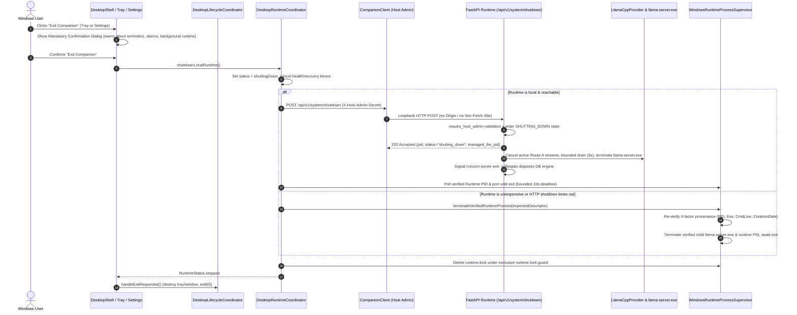
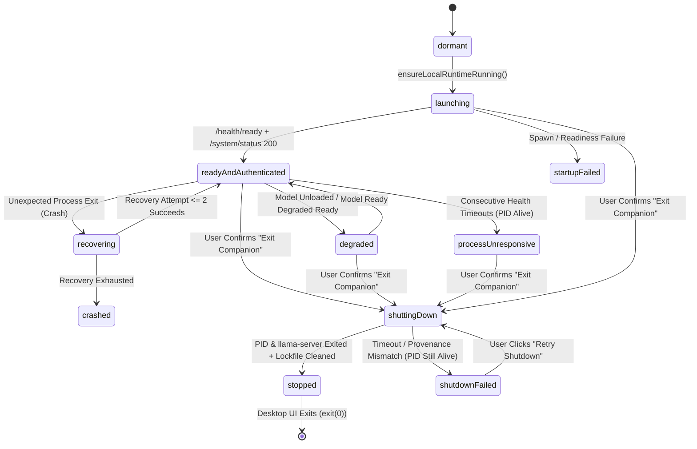

# Implementation Plan — M2 PC-HOST-005: Host Administration Separation & Secure Lifecycle Authority

- **Status:** `AWAITING HUMAN / INDEPENDENT PLAN REVIEW`
- **Delivery Level:** `Level C — Sensitive Design`
- **Scope Mode:** `New Feature / Security & Lifecycle Hardening`
- **Milestone / Work Item:** `M2 — PC Companion Foundation` / `PC-HOST-005`
- **Branch:** `feature/m2-secure-host-lifecycle`
- **Target Integration Branch:** `develop`
- **Verified Baseline SHA:** `261d4b43930d3dcdad2dbd913d4dd4d60c8a4887`
- **Active Branch Tracker:** [`docs/01_Tracking/active/task-feature-m2-secure-host-lifecycle.md`](../../01_Tracking/active/task-feature-m2-secure-host-lifecycle.md)
- **Date:** `2026-11-04`
- **Author / Role:** `Authorized Implementing Agent (Phase 1 Planning Publication)`

> [!IMPORTANT]
> **Phase 1 Planning Candidate Notice:** This document is a **Phase 1 planning review candidate** published on `feature/m2-secure-host-lifecycle`. It is **NOT** approved for Phase 2 implementation, and zero production source code, tests, contracts, or database migrations have been modified in Phase 1. Implementation begins only after explicit **Human Owner** and **Independent Reviewer** plan/design approval.

---

## 1. Objective and Scope

### 1.1 Problem Statement & Objective
In the AI Companion PC V1 architecture, the Local AI Runtime (`pythonw.exe` / Uvicorn FastAPI service and its Core-managed `llama-server.exe` child process) operates as an independent per-user background process (`127.0.0.1:8000`) supervised by the Windows Flutter Desktop shell. While `PC-HOST-001` delivered detached runtime startup, lockfile discovery (`%LOCALAPPDATA%\AICompanion\runtime\runtime.lock`), health polling, and bounded crash recovery, and `PC-IDENTITY-002` delivered the Windows ACL-protected Host Administration Secret (`%LOCALAPPDATA%\AICompanion\secrets\desktop_admin.secret`) for model and Profile bootstrap endpoints, **deliberate full-host shutdown ("Exit Companion") remains unimplemented** (`disabled: true` in the system tray menu and miswired to UI-only exit in the Settings screen).

Furthermore, code inspection of the current runtime teardown path revealed that [`LlamaCppProvider.shutdown()`](../../../backend/app/services/llm/llama_cpp.py) leaves the Core-managed `llama-server.exe` router process running whenever HTTP router model unload succeeds (`unload_model()` returns early after router API unload) or when the 120-second drain timeout elapses.

The objective of **`PC-HOST-005` (Host Administration Separation & Secure Lifecycle Authority)** is to complete the privileged host-lifecycle boundary and end-to-end confirmed shutdown flow across the FastAPI Local AI Runtime and the Windows Flutter Desktop client:
1. Establish an authenticated, loopback-only, browser-origin-rejected Host Admin runtime shutdown contract (`POST /api/v1/system/shutdown`) guarded by `require_host_admin`.
2. Ensure deterministic, bounded runtime teardown that admission-controls new work, cancels active in-flight LLM generation streams cleanly, drains/disposes database sessions, and **unconditionally terminates** any Core-managed `llama-server.exe` child process before Uvicorn exits.
3. Implement a 4-factor provenance-verified OS process termination fallback in [`WindowsRuntimeProcessSupervisor`](../../../frontend/flutter/apps/desktop/lib/platform/windows_runtime_process_supervisor.dart) for unresponsive local runtime recovery without ever killing by bare image name, port, or unverified PID.
4. Wire the System Tray **"Exit Companion"** action and the Settings **"Exit Companion"** button through a mandatory confirmation dialog that clearly explains the impact on PC-hosted reminders, alarms, background work, and connected clients, while strictly preserving the separation from **Close Window (`×`)** and **Close UI Only (Dev Test)**.

### 1.2 In-Scope Deliverables (Phase 2 — Upon Approval)
- **Backend Host Admin Lifecycle Endpoint & Teardown Coordinator:**
  - `POST /api/v1/system/shutdown` on `system_router` in [`backend/app/api/v1/endpoints/health.py`](../../../backend/app/api/v1/endpoints/health.py), protected by `Depends(require_host_admin)`.
  - Idempotent shutdown state machine (`RUNNING` $\rightarrow$ `SHUTTING_DOWN`) with admission control rejecting new chat turns or model loads during shutdown.
  - Prompt active generation stream cancellation and bounded drain in [`LlamaCppProvider.shutdown()`](../../../backend/app/services/llm/llama_cpp.py), fixing the defect where `llama-server.exe` remained alive after router API unload or drain timeout.
  - Configurable environment/path override support in [`backend/app/core/host_admin.py`](../../../backend/app/core/host_admin.py) (`COMPANION_HOST_ADMIN_SECRET_FILE` / `LOCALAPPDATA`) that preserves strict Windows SID DACL and non-reparse validation while enabling isolated acceptance testing.
- **OpenAPI Contract Sync:**
  - Regenerated [`contracts/openapi/openapi.json`](../../../contracts/openapi/openapi.json) and typed DTOs in `companion_api`.
- **Flutter Desktop Runtime Supervisor & Coordinator Shutdown Flow:**
  - `CompanionClient.shutdownSystem()` in [`frontend/flutter/packages/companion_api/lib/client/companion_client.dart`](../../../frontend/flutter/packages/companion_api/lib/client/companion_client.dart) using `_adminRequest`.
  - `DesktopRuntimeCoordinator.shutdownLocalRuntime()` in [`frontend/flutter/apps/desktop/lib/coordinator/desktop_runtime_coordinator.dart`](../../../frontend/flutter/apps/desktop/lib/coordinator/desktop_runtime_coordinator.dart) with explicit lifecycle states (`shuttingDown`, `stopped`, `shutdownFailed`), intentional-exit auto-restart suppression, bounded process-exit polling, 4-factor provenance fallback termination, and `runtime.lock` cleanup.
  - Fixed-path override injection in [`HostAdminSecretStore`](../../../frontend/flutter/apps/desktop/lib/platform/host_admin_secret_store.dart) for isolated acceptance tests.
- **Flutter Desktop Tray & Settings UX:**
  - Enable the System Tray `exit_full` (**"Exit Companion"**) action in [`DesktopLifecycleCoordinator`](../../../frontend/flutter/apps/desktop/lib/lifecycle/desktop_lifecycle_coordinator.dart).
  - Fix the Settings screen **"Exit Companion"** button in [`settings_screen.dart`](../../../frontend/flutter/apps/desktop/lib/screens/settings_screen.dart) so it invokes the confirmed full-shutdown flow instead of unconfirmed UI-only exit.
  - Confirmation dialog, in-flight progress indicator, and structured failure dialog (offering **Retry Shutdown** or **Quit Desktop UI Only** if runtime stop fails).

---

## 2. Canonical Requirements and Decision References

| Canonical Document | Normative Sections & Requirements |
| :--- | :--- |
| [`docs/04_Architecture/SYSTEM_BASELINE.md`](../../04_Architecture/SYSTEM_BASELINE.md) | **§2 & §5:** Single-Machine Split Architecture; Local AI Runtime (`127.0.0.1:8000`) runs independently of Flutter UI; **Close Window (`×`)** hides UI to tray; **Exit Companion** performs confirmed full shutdown of UI + Local AI Runtime + Core-managed `llama.cpp`; **Host Administration Authority (`D15`)** separates normal Profile Session (`psk_`) and Device Pairing (`companion_sec_`) tokens from host-wide privileged operations (`X-Host-Admin-Secret`). |
| [`docs/04_Architecture/04_Infrastructure/windows-host-and-notifications.md`](../../04_Architecture/04_Infrastructure/windows-host-and-notifications.md) | **§1.2, §1.3, §2.1, §2.2, §4.2:** Four distinct lifecycle actions (**Close Window (`×`)**, **Quit UI Only (Dev/Diagnostics)**, **Pause Companion** [deferred], **Exit Companion**); mandatory user confirmation before full shutdown warning that PC-hosted reminders, alarms, and background companion behaviors become unavailable; intentional exit must suppress automatic crash-recovery restart loops; `PC-HOST-005` remains open for authenticated host shutdown. |
| [`docs/04_Architecture/02_Data_and_Security/profiles-and-devices.md`](../../04_Architecture/02_Data_and_Security/profiles-and-devices.md) | **§1.3 & §3.2 (`D15`):** Separation of Profile Administration vs. Host Administration; Profile sessions and remote paired devices must never stop the host runtime or mutate shared host-wide process state. |
| [`docs/04_Architecture/02_Data_and_Security/authentication-and-secrets.md`](../../04_Architecture/02_Data_and_Security/authentication-and-secrets.md) | **§1.1, §2.2, §3.1, §5.3 (`D15`):** Three distinct credential classes (`psk_`, `companion_sec_`, `hsk_`); `%LOCALAPPDATA%\AICompanion\secrets\desktop_admin.secret` ACL-restricted to current Windows user SID + `SYSTEM`; `X-Host-Admin-Secret` required with loopback IP/Host and non-browser (`Origin`/`Sec-Fetch-Site` rejected) enforcement. |
| [`docs/04_Architecture/04_Infrastructure/runtime-and-models.md`](../../04_Architecture/04_Infrastructure/runtime-and-models.md) | **§2.2 & §5.3:** Core-managed `llama-server.exe` lifecycle ownership; active generation cancellation and clean subprocess termination on runtime exit. |
| [`docs/05_Design/01_PC_Desktop_Shell_and_Tray.md`](../../05_Design/01_PC_Desktop_Shell_and_Tray.md) | **§5 (Tray & Background Behavior):** Tray menu actions and explicit user-facing distinction between hiding window, developer UI-only exit, and confirmed full **"Exit Companion"** shutdown. |
| [`docs/04_Architecture/decisions/ADR-0003-d2-windows-host-model.md`](../../04_Architecture/decisions/ADR-0003-d2-windows-host-model.md) | **ADR-0003 (`D2`) — Per-User Background Host Model:** Runtime runs under interactive Windows user session without requiring UAC elevation or a Windows Service (`services.msc`). |
| [`docs/02_Planning/00_Master/WBS.md`](../../02_Planning/00_Master/WBS.md) & [`DELIVERY_INDEX.md`](../../02_Planning/00_Master/DELIVERY_INDEX.md) | **`PC-HOST-005`:** Host Administration Separation & Secure Lifecycle Authority (`Depends On: PC-HOST-001, PC-IDENTITY-002`). |

---

## 3. Verified Current Implementation

Direct source inspection on branch `feature/m2-secure-host-lifecycle` (at `261d4b43930d3dcdad2dbd913d4dd4d60c8a4887`) verified the following implemented reality:

| Subsystem / File | Verified Implemented Behavior |
| :--- | :--- |
| [`backend/app/core/host_admin.py`](../../../backend/app/core/host_admin.py) | Provisions `%LOCALAPPDATA%\AICompanion\secrets\desktop_admin.secret` (`hsk_<token_urlsafe(48)>`) during FastAPI `lifespan` startup via `initialize_host_admin_secret()`. `require_host_admin` verifies: (1) loopback client IP (`ip_address(client_host).is_loopback`), (2) loopback `Host` header (`127.0.0.1`, `localhost`, `[::1]`), (3) absence of `Origin` and `Sec-Fetch-Site` headers, and (4) `secrets.compare_digest` match of `X-Host-Admin-Secret`. |
| [`backend/app/core/windows_security.py`](../../../backend/app/core/windows_security.py) | Enforces non-reparse directory chains (`FILE_ATTRIBUTE_REPARSE_POINT` rejected) and applies protected Windows DACL `O:<user_sid>D:P(A;;FA;;;<user_sid>)(A;;FA;;;SY)` (`SE_DACL_PROTECTED`) to secret directories and files. |
| [`backend/app/api/v1/endpoints/health.py`](../../../backend/app/api/v1/endpoints/health.py) | Exposes `GET /api/v1/health` (public probe), `GET /api/v1/health/ready` (readiness probe), and `GET /api/v1/system/status` (protected by `Depends(require_host_admin)`). Does **not** expose any shutdown endpoint. |
| [`backend/app/main.py`](../../../backend/app/main.py) | `lifespan` context manager initializes DB schema, Neutral Assistant seed, and `initialize_host_admin_secret()`. On exit (`finally` block, lines 178–186), calls `await llm_manager.get_provider().shutdown()` and `await dispose_database_runtime()`. |
| [`backend/app/services/llm/llama_cpp.py`](../../../backend/app/services/llm/llama_cpp.py) | Manages Route A (`llama-server.exe` router child process stored in `self._server_process`) and Route B (`llama-cpp-python` in-process fallback). Tracks in-flight turns via `self._active_work_count` and `self._active_work_drained`. |
| [`frontend/flutter/apps/desktop/lib/platform/host_admin_secret_store.dart`](../../../frontend/flutter/apps/desktop/lib/platform/host_admin_secret_store.dart) | Reads `%LOCALAPPDATA%\AICompanion\secrets\desktop_admin.secret` after executing a PowerShell verification script that confirms no reparse points exist on the path chain and that all ACL rules belong exclusively to the current Windows user SID or `NT AUTHORITY\SYSTEM`. |
| [`frontend/flutter/packages/companion_api/lib/client/companion_client.dart`](../../../frontend/flutter/packages/companion_api/lib/client/companion_client.dart) | `_adminRequest` enforces loopback base URL (`_assertLoopbackAdminUri`), reads the secret from `hostAdminSecretProvider`, attaches `X-Host-Admin-Secret`, disables HTTP redirects (`followRedirects = false`), and clears/retries once on `401`/`403` in case the secret rotated across runtime restarts. |
| [`frontend/flutter/apps/desktop/lib/platform/windows_runtime_process_supervisor.dart`](../../../frontend/flutter/apps/desktop/lib/platform/windows_runtime_process_supervisor.dart) | Launches detached `pythonw.exe -m uvicorn app.main:app` with `ProcessStartMode.detached`, writes `runtime.lock` (`instanceId`, `pid`, `port`, `startedAt`, `executablePath`), and verifies running processes via `Win32_Process` (`ExecutablePath`, `CommandLine` tokens `uvicorn` + `app.main:app` + `--port`, and `CreationDate`). Has **no** method to stop or terminate a runtime process. |
| [`frontend/flutter/apps/desktop/lib/coordinator/desktop_runtime_coordinator.dart`](../../../frontend/flutter/apps/desktop/lib/coordinator/desktop_runtime_coordinator.dart) | Supervises local runtime discovery, exclusive `runtime.lock.guard` acquisition, detached launch, readiness polling, and bounded crash recovery (`maxRecoveryAttempts = 2`). Has **no** `shutdownLocalRuntime()` method; `dispose()` only stops timers inside the Flutter client. |
| [`frontend/flutter/apps/desktop/lib/lifecycle/desktop_lifecycle_coordinator.dart`](../../../frontend/flutter/apps/desktop/lib/lifecycle/desktop_lifecycle_coordinator.dart) | Intercepts `onWindowClose()` $\rightarrow$ `hideToTray()`. Tray menu defines `quit_ui_dev` (`Close UI Only (Dev Test)`) $\rightarrow$ `handleExitRequested()` (destroys tray/window and calls `exit(0)`), and `exit_full` (`Exit Companion (Full Shutdown - Planned PC-HOST-005)`, `disabled: true`). |
| [`frontend/flutter/apps/desktop/lib/screens/settings_screen.dart`](../../../frontend/flutter/apps/desktop/lib/screens/settings_screen.dart) | Displays Host Supervision card (`_buildLifecycleCard`, lines 494–575) with two buttons: **Hide to Tray** (`coordinator?.hideToTray()`) and **Exit Companion** (`coordinator?.handleExitRequested()`). |

---

## 4. Evidence-Based Gap Analysis

### 4.1 Answers to the 12 Mandatory Investigation Questions

1. **What Host Admin mechanism already exists in backend and Flutter?**
   - Backend [`host_admin.py`](../../../backend/app/core/host_admin.py) provisions `%LOCALAPPDATA%\AICompanion\secrets\desktop_admin.secret` with Windows ACL protection (`user SID + SYSTEM`) and validates `X-Host-Admin-Secret` + loopback peer/host + absence of browser `Origin`/`Sec-Fetch-Site` headers. Flutter [`HostAdminSecretStore`](../../../frontend/flutter/apps/desktop/lib/platform/host_admin_secret_store.dart) verifies ACLs and non-reparse attributes before reading the secret, and [`CompanionClient._adminRequest`](../../../frontend/flutter/packages/companion_api/lib/client/companion_client.dart) attaches `X-Host-Admin-Secret` over loopback.
2. **Which operations currently use Host Admin authority?**
   - `GET /api/v1/system/status`, `POST /api/v1/models/load`, `POST /api/v1/models/select`, `POST /api/v1/models/unload`, `PATCH /api/v1/models/profile`, `GET /api/v1/profiles`, `GET /api/v1/auth/bootstrap/requests`, and `POST /api/v1/auth/bootstrap/ticket`.
3. **Which lifecycle operations exist today (`Close Window`, `Quit UI Only`, `Exit Companion`, runtime restart/recovery)?**
   - `Close Window (×)` hides the window to the system tray while keeping UI and Runtime alive. `Close UI Only (Dev Test)` exits the Flutter process (`exit(0)`) while leaving the detached Runtime running. Bounded crash recovery restarts an unexpectedly vanished local runtime up to 2 times. Full `Exit Companion` is unimplemented (disabled in tray; miswired in Settings).
4. **How does the Flutter supervisor identify and verify the Runtime process it owns or attached to?**
   - Through `%LOCALAPPDATA%\AICompanion\runtime\runtime.lock` (`RuntimeLockfileData`: `schemaVersion`, `instanceId`, `pid`, `port`, `startedAt`, `executablePath`) combined with WMI `Win32_Process` inspection in [`WindowsRuntimeProcessSupervisor`](../../../frontend/flutter/apps/desktop/lib/platform/windows_runtime_process_supervisor.dart) checking PID, executable basename (`python.exe`/`pythonw.exe`), command line (`uvicorn`, `app.main:app`, `--port <port>`), and `CreationDate`.
5. **How is `runtime.lock` created, validated, updated, and cleaned up?**
   - Created/updated while holding an exclusive OS file lock on `runtime.lock.guard` (`FileMode.write` + `LockRetrying`). Validated via `RuntimeLockfileData.tryParseJson` (checking schema version, positive PID, valid port, executable path, and `startedAt`). Cleaned up via `deleteRuntimeLockfileIfPresent` when a stale PID is detected during startup/recovery, but not yet cleaned up during intentional host shutdown.
6. **How does the backend shut down `llama-server.exe` or loaded model resources when exiting?**
   - FastAPI `lifespan` teardown calls `await llm_manager.get_provider().shutdown()`. However, [`LlamaCppProvider.shutdown()`](../../../backend/app/services/llm/llama_cpp.py) currently calls `await self.unload_model()`, which **returns `True` at line 677 immediately after `_router_unload_model` succeeds**, skipping lines 681–690 where `self._server_process` (`llama-server.exe`) is terminated! Furthermore, if the 120-second drain wait times out, `shutdown()` returns early at line 1104 without stopping `llama-server.exe`.
7. **What happens to active chat streams or background work when shutdown is requested?**
   - Currently, `LlamaCppProvider` waits passively up to 120 seconds (`_shutdown_drain_timeout`) for `_active_work_drained` without cancelling the active upstream `httpx` request to `llama-server.exe`, and new requests are only blocked inside `LlamaCppProvider` once `_closing = True`. When a stream is cancelled, [`orchestrate_chat_stream`](../../../backend/app/services/assistant/orchestrator.py) already catches `asyncio.CancelledError`, rolls back the partial turn DB session, and runs `_persist_terminal_chat_request_status(..., status="cancelled")` under `asyncio.shield()`.
8. **What happens if the Runtime is healthy vs unresponsive when the user selects `Exit Companion`?**
   - If healthy, the runtime can execute a cooperative authenticated `POST /api/v1/system/shutdown` request. If unresponsive (`RuntimeStatus.processUnresponsive` or HTTP shutdown times out while the OS process remains alive), an HTTP-only design would fail to stop the hung local process; therefore, a strictly provenance-verified OS process termination fallback is required.
9. **What happens if the Runtime was already started before the Flutter UI attached vs launched by the current Flutter UI instance?**
   - Because both cases run under the same Windows user SID and read the same ACL-protected `desktop_admin.secret` and `runtime.lock` descriptor, an attached local Flutter Desktop shell has identical Host Admin authority (`X-Host-Admin-Secret`) and lockfile provenance metadata to shut down an existing local runtime cleanly.
10. **How does the system prevent accidental termination of unrelated `python.exe`, `pythonw.exe`, or `llama-server.exe` processes?**
    - Never invoke `taskkill /IM` or kill by port alone. Any OS-level fallback termination must verify all 4 provenance factors immediately before termination: (1) PID matches `runtime.lock`, (2) `ExecutablePath` matches expected Python/runtime binary, (3) `CommandLine` contains `uvicorn`, `app.main:app`, and `--port <port>`, and (4) `Win32_Process.CreationDate` matches `runtime.lock.startedAt` within clock-skew/process-spawn tolerance ($\le 15\text{s}$). Child `llama-server.exe` fallback termination additionally verifies `ParentProcessId == runtimePid` (or tracked router PID) and `llama-server` executable identity.
11. **How should intentional user shutdown interact with crash recovery so the supervisor does not immediately relaunch a runtime the user just stopped?**
    - Before initiating shutdown, `DesktopRuntimeCoordinator` sets an explicit `_intentionalShutdownInProgress` / `RuntimeStatus.shuttingDown` $\rightarrow$ `RuntimeStatus.stopped` state and cancels `_healthTimer` and `_recoveryAttempts`, ensuring `_handleUnexpectedRuntimeExit()` cannot trigger during or after intentional shutdown.
12. **How should the design remain compatible with future `PC-HOST-002`, `PC-HOST-003`, and `PC-CLIENT-012` without implementing them prematurely?**
    - `PC-HOST-002` (Windows login startup registration) only starts the runtime at Windows session logon (`ONLOGON`), not as an infinite respawn watchdog; removing `runtime.lock` on clean shutdown ensures the next logon or manual app launch starts cleanly. `PC-HOST-003` / `PC-CLIENT-012` (native Windows toast notifications) can subscribe to the coordinator's structured lifecycle states without altering the shutdown contract.

### 4.2 Categorized Gap Matrix

| Category | Item | Evidence / Location |
| :--- | :--- | :--- |
| **Verified Implementation** | Windows ACL-protected `desktop_admin.secret` (`hsk_`) provisioning & verification (`require_host_admin`, `HostAdminSecretStore`, `CompanionClient._adminRequest`). | [`backend/app/core/host_admin.py`](../../../backend/app/core/host_admin.py), [`backend/app/core/windows_security.py`](../../../backend/app/core/windows_security.py), [`host_admin_secret_store.dart`](../../../frontend/flutter/apps/desktop/lib/platform/host_admin_secret_store.dart) |
| **Verified Implementation** | Detached runtime startup, `runtime.lock` discovery, WMI process inspection, and bounded crash recovery (`maxRecoveryAttempts = 2`). | [`windows_runtime_process_supervisor.dart`](../../../frontend/flutter/apps/desktop/lib/platform/windows_runtime_process_supervisor.dart), [`desktop_runtime_coordinator.dart`](../../../frontend/flutter/apps/desktop/lib/coordinator/desktop_runtime_coordinator.dart) |
| **Verified Implementation** | Shielded cancellation persistence (`status="cancelled"`) when a streaming chat request is cancelled mid-generation. | [`backend/app/services/assistant/orchestrator.py`](../../../backend/app/services/assistant/orchestrator.py) (lines 483–518) |
| **Partial Implementation** | Secret path configurability for isolated Windows acceptance tests: `host_admin_secret_path()` reads `LOCALAPPDATA`, whereas `HostAdminSecretStore` in the running Flutter test process uses parent `LOCALAPPDATA` unless an injectable path or override is supported. | [`backend/app/core/host_admin.py`](../../../backend/app/core/host_admin.py), [`host_admin_secret_store.dart`](../../../frontend/flutter/apps/desktop/lib/platform/host_admin_secret_store.dart) |
| **Approved but Unimplemented Behavior** | Authenticated Host Admin runtime shutdown endpoint (`POST /api/v1/system/shutdown`), coordinator shutdown orchestration, 4-factor provenance OS fallback kill, and confirmed Tray/Settings **Exit Companion** UX. | [`health.py`](../../../backend/app/api/v1/endpoints/health.py), [`desktop_runtime_coordinator.dart`](../../../frontend/flutter/apps/desktop/lib/coordinator/desktop_runtime_coordinator.dart), [`desktop_lifecycle_coordinator.dart`](../../../frontend/flutter/apps/desktop/lib/lifecycle/desktop_lifecycle_coordinator.dart) |
| **Newly Discovered Defect 1** | **`LlamaCppProvider.shutdown()` orphans `llama-server.exe`:** Calling `await self.unload_model()` inside `shutdown()` returns `True` at line 677 after HTTP router unload succeeds ("router alive"), skipping `_server_process.terminate()`. Also, if `_active_work_drained.wait()` times out, `shutdown()` returns early at line 1104 without terminating `_server_process` or cancelling active Route A HTTP streams. | [`backend/app/services/llm/llama_cpp.py`](../../../backend/app/services/llm/llama_cpp.py) (lines 670–690, 1092–1105) |
| **Newly Discovered Defect 2** | **Settings screen "Exit Companion" button performs unconfirmed UI-only exit:** In [`settings_screen.dart`](../../../frontend/flutter/apps/desktop/lib/screens/settings_screen.dart) (lines 563–569), clicking **Exit Companion** calls `coordinator?.handleExitRequested()`, which immediately closes the Flutter UI (`exit(0)`) without confirmation and leaves the Local AI Runtime running in the background. | [`frontend/flutter/apps/desktop/lib/screens/settings_screen.dart`](../../../frontend/flutter/apps/desktop/lib/screens/settings_screen.dart) (lines 563–569) |

---

## 5. Proposed Technical Architecture

### 5.1 End-to-End Architecture Overview
We propose a **Cooperative Host-Admin HTTP Shutdown + 4-Factor Provenance-Verified OS Fallback** architecture:



### 5.2 Backend Cooperative Shutdown Design (`POST /api/v1/system/shutdown`)
1. **Endpoint Contract:**
   - **Route:** `POST /api/v1/system/shutdown` mounted on `system_router` in [`backend/app/api/v1/endpoints/health.py`](../../../backend/app/api/v1/endpoints/health.py).
   - **Authentication:** `Depends(require_host_admin)` (loopback peer IP, loopback `Host` header, no `Origin`/`Sec-Fetch-Site`, constant-time `X-Host-Admin-Secret` match).
   - **Request Body (`SystemShutdownRequest`):** Optional JSON `{ "reason": "user_exit_companion", "drain_timeout_seconds": 5.0 }` (defaults to `reason="host_admin_request"`, `drain_timeout_seconds=5.0`, clamped to `[1.0, 30.0]`).
   - **Response (`202 Accepted`, `SystemShutdownResponse`):**
     ```json
     {
       "status": "shutting_down",
       "pid": 12345,
       "managed_llm_pid": 12890,
       "already_shutting_down": false,
       "message": "Local AI Runtime shutdown initiated."
     }
     ```
2. **Shutdown Coordinator & Admission Control (`backend/app/core/runtime_lifecycle.py` or `health.py`):**
   - Maintains process-wide `_is_shutting_down: bool` and `_shutdown_task: asyncio.Task | None`.
   - Repeat calls while `_is_shutting_down == True` return `202 Accepted` with `"already_shutting_down": true` (idempotent).
   - Once `_is_shutting_down` is set:
     - `GET /api/v1/health/ready` returns `503 Service Unavailable` with `status="shutting_down"`.
     - New chat turns (`POST /api/v1/conversations/{id}/chat/stream` and `/chat`) and model load/select mutations return `503 Service Unavailable` (`RUNTIME_SHUTTING_DOWN`).
   - Schedules `_execute_graceful_runtime_shutdown(drain_timeout_seconds)` as a background task after flushing the `202 Accepted` HTTP response (~50ms yield so the client reliably receives the response before socket closure):
     1. Calls `await llm_manager.get_provider().shutdown(drain_timeout=drain_timeout_seconds)`.
     2. Signals Uvicorn shutdown cleanly (setting the active Uvicorn server state or raising `SIGINT` via `signal.raise_signal(signal.SIGINT)` / `os.kill(os.getpid(), signal.SIGINT)` on Windows so Uvicorn exits its main loop and executes the FastAPI `lifespan` `finally` block, including `dispose_database_runtime()`).

### 5.3 Fixing `LlamaCppProvider.shutdown()` & Active Stream Cancellation
In [`backend/app/services/llm/llama_cpp.py`](../../../backend/app/services/llm/llama_cpp.py):
1. **Track Active Generation Tasks / Streams:**
   - Maintain `self._active_generation_tasks: set[asyncio.Task[Any]]` (registered inside `_begin_work()` or around `generate` / `generate_stream`).
2. **Deterministic `shutdown(self, drain_timeout: float | None = None)`:**
   - Set `self._closing = True`.
   - Cancel all tasks in `self._active_generation_tasks` so active `httpx` streams to `llama-server.exe` abort immediately and `orchestrate_chat_stream` triggers its existing shielded `status="cancelled"` persistence.
   - Wait up to `effective_timeout = drain_timeout if drain_timeout is not None else self._shutdown_drain_timeout` (defaulting to `5.0s` during explicit shutdown) for `self._active_work_drained.wait()`.
   - **Even if the drain wait times out**, proceed to resource cleanup (never return early before terminating the subprocess).
   - Extract a dedicated internal helper `_terminate_router_process_and_client()` called by `shutdown()` (and by `unload_model()` when full router stop is required) that:
     1. Closes `self._server_client` (`await self._server_client.aclose()`).
     2. If `self._server_process is not None`: calls `self._server_process.terminate()`, waits up to `5.0s` via `asyncio.to_thread(self._server_process.wait, 5.0)`, and if still alive calls `self._server_process.kill()` and `wait(2.0)`.
     3. Resets `self._server_process = None`, `self._loaded_model_path = None`, `self._loaded_model_id = None`, and sets state to `UNLOADED`.
   - Expose `managed_server_pid: int | None` property on `LLMProvider` / `LlamaCppProvider` so `GET /api/v1/system/status` and `POST /api/v1/system/shutdown` can report the Core-managed `llama-server.exe` PID for observability and supervisor verification.

### 5.4 Flutter Desktop Runtime Supervisor & Coordinator Shutdown
1. **`WindowsRuntimeProcessSupervisor` (`windows_runtime_process_supervisor.dart`):**
   - Add `Future<RuntimeTerminationResult> terminateVerifiedRuntimeProcess({required RuntimeLockfileData expectedDescriptor, int? managedLlmPid, Duration timeout = const Duration(seconds: 8)})`:
     - Queries WMI `Win32_Process` for `expectedDescriptor.pid`.
     - If the process does not exist, returns `RuntimeTerminationResult.alreadyExited`.
     - Verifies **all 4 provenance factors**:
       1. `ProcessId == expectedDescriptor.pid`
       2. `_isExpectedPythonExecutable(ExecutablePath)` (or matches `expectedDescriptor.executablePath`)
       3. `_ looksLikeCompanionUvicornCommand(CommandLine, expectedPort: expectedDescriptor.port)`
       4. `CreationDate` parsed to UTC is within $\pm 15\text{ seconds}$ of `expectedDescriptor.startedAt`.
     - If any factor fails, returns `RuntimeTerminationResult.provenanceMismatch` **without terminating any process**.
     - Also inspects child processes where `ParentProcessId == expectedDescriptor.pid` (or `ProcessId == managedLlmPid`) whose `ExecutablePath` basename is `llama-server.exe`.
     - Terminates verified child `llama-server.exe` (if still alive) and the verified runtime PID by invoking PowerShell `Stop-Process -Id <verifiedPid> -Force -ErrorAction Stop` (scoped strictly to the verified numeric PID after provenance validation), then polls up to `timeout` to confirm both processes have exited the OS process table.
2. **`DesktopRuntimeCoordinator.shutdownLocalRuntime()` (`desktop_runtime_coordinator.dart`):**
   - If `isRemoteHost == true`: does not attempt remote runtime shutdown; returns a clear status so the UI can exit the local shell only.
   - Sets `_intentionalShutdown = true`, cancels `_healthTimer`, resets `_recoveryAttempts = 0`, and transitions state to `RuntimeStatus.shuttingDown`.
   - Step 1 (Cooperative HTTP Shutdown): If a local runtime is running (`readyAndAuthenticated`, `degraded`, `launching`), calls `_client.shutdownSystem(reason: 'user_exit_companion')`.
   - Step 2 (Poll for Clean Exit): Polls every `250ms` up to `8 seconds` checking whether the verified Runtime PID (and any reported `managedLlmPid`) has exited and port `8000` is closed.
   - Step 3 (Provenance-Verified OS Fallback): If the cooperative HTTP call failed (e.g., runtime was in `processUnresponsive`) or the process is still alive after the 8-second cooperative wait, invokes `_supervisor.terminateVerifiedRuntimeProcess(...)` using the verified `RuntimeLockfileData`.
   - Step 4 (Lockfile Cleanup & Final State): Once process exit is confirmed, acquires `runtime.lock.guard` and deletes `runtime.lock`, transitioning to `RuntimeStatus.stopped`. If the process remains alive or provenance could not be verified, transitions to `RuntimeStatus.shutdownFailed` with an actionable error message and **blocks silent UI exit**.
3. **Tray & Settings Confirmation UX (`desktop_shell.dart`, `settings_screen.dart`, `desktop_lifecycle_coordinator.dart`):**
   - Enable `exit_full` (`Exit Companion`) in `DesktopLifecycleCoordinator.buildTrayMenuItems()`. When clicked while the window is hidden to tray, restore/focus the window first so the modal confirmation dialog is visible.
   - Update the Settings screen **Exit Companion** button (`settings_screen.dart` line 563) to invoke the exact same `requestFullExitCompanion()` handler on `DesktopShell` / `DesktopLifecycleCoordinator`.
   - **Confirmation Dialog:**
     - Title: `Exit AI Companion?`
     - Body: Explains clearly that exiting stops both the Desktop App and the Local AI Runtime (`127.0.0.1:8000`), and that PC-hosted reminders, alarms, background companion tasks, and connected Web/Mobile sessions will be unavailable until AI Companion is launched again. (Also points out that closing the window with `×` hides the app to the system tray instead.)
     - Actions: `Cancel`, `Hide to Tray Instead`, and destructive `Exit Companion`.
   - **Failure Dialog:** If `shutdownLocalRuntime()` returns `RuntimeStatus.shutdownFailed`, displays the specific failure reason with actions: `Cancel`, `Retry Shutdown`, and `Quit Desktop UI Only (Leave Runtime State As-Is)`.

---

## 6. Security and Privilege Boundaries

| Actor / Credential | Permitted Authority | Shutdown Authority (`POST /api/v1/system/shutdown`) | Enforcement Mechanism |
| :--- | :--- | :--- | :--- |
| **Local Windows Desktop Shell (`X-Host-Admin-Secret`, `hsk_`)** | Host supervision, model load/unload/select, Profile bootstrap, Host shutdown. | **ALLOWED** | Loopback peer IP (`127.0.0.1`/`::1`) + loopback `Host` header + no `Origin`/`Sec-Fetch-Site` + constant-time match of ACL-protected `desktop_admin.secret`. |
| **Normal Profile Session (`X-Profile-Session`, `psk_`)** | Profile-scoped conversations, messages, memories, characters, devices. | **DENIED (`403 Forbidden`)** | `require_host_admin` ignores `X-Profile-Session` and rejects requests lacking `X-Host-Admin-Secret`. |
| **Paired Remote Device (`Authorization: Bearer companion_sec_`)** | Device-scoped companion endpoints within active Profile. | **DENIED (`403 Forbidden`)** | Rejected by `require_host_admin` (and non-loopback peer IP check if remote). |
| **Local or Remote Browser (`Origin` / `Sec-Fetch-Site` present)** | React Web dev harness Profile-scoped flows (`localhost:3000`). | **DENIED (`403 Forbidden`)** | `require_host_admin` explicitly rejects any request carrying `Origin` or `Sec-Fetch-Site` headers to prevent CSRF/DNS-rebinding/browser-initiated shutdown. |
| **Character / Emotion State or LLM Tool Execution** | Prompt modulation, bounded sandboxed tools under `Default Deny`. | **DENIED** | Neither Character state nor the LLM orchestrator has access to `desktop_admin.secret` or host lifecycle routes (`ADR-0005`, `ADR-0018`, `ADR-0019`). |

---

## 7. Runtime Lifecycle State Transitions

### 7.1 State Transition Diagram



### 7.2 Lifecycle Action Comparison Matrix

| User Action | Entry Point | Confirmation Required? | Flutter Desktop UI | Local AI Runtime (`pythonw.exe`) | Core-Managed `llama-server.exe` | Auto-Restart / Crash Recovery |
| :--- | :--- | :--- | :--- | :--- | :--- | :--- |
| **Close Window (`×`)** | Titlebar `×` / Settings `Hide to Tray` | No | Hidden to System Tray (`window.hide()`) | Keeps running | Keeps running | Active |
| **Quit UI Only (Dev Test)** | Tray `Close UI Only (Dev Test)` | No (Explicit dev label) | Exits (`exit(0)`) | Keeps running (`detached`) | Keeps running | Inactive (UI exited) |
| **Pause Companion** | *(Deferred out of `PC-HOST-005`)* | N/A | N/A | N/A | N/A | N/A |
| **Exit Companion (Full Shutdown)** | Tray `Exit Companion` / Settings `Exit Companion` | **Yes (Mandatory modal warning)** | Exits (`exit(0)`) **only after** runtime stop is verified (or user explicitly overrides on failure) | Gracefully drains & exits (or verified-provenance fallback kill) | Unconditionally terminated & verified exited | **Suppressed** (`_intentionalShutdown = true`) |

---

## 8. Process Ownership and Failure Semantics

1. **4-Factor Provenance Verification Before Any OS Fallback Kill:**
   - The supervisor **never** kills by image name (`taskkill /IM pythonw.exe` or `taskkill /IM llama-server.exe`), **never** kills an arbitrary process listening on port `8000`, and **never** trusts a raw PID from `runtime.lock` without live WMI verification.
   - Before issuing `Stop-Process -Id <pid>`, `WindowsRuntimeProcessSupervisor` queries `Win32_Process WHERE ProcessId = <pid>` and verifies:
     1. Exact `ProcessId` match.
     2. `ExecutablePath` basename is `python.exe` or `pythonw.exe` (and matches `expectedDescriptor.executablePath` when normalized).
     3. `CommandLine` contains `uvicorn`, `app.main:app`, and `--port <expectedPort>`.
     4. `CreationDate` (converted to UTC) is within $\pm 15\text{s}$ of `expectedDescriptor.startedAt` (defending against OS PID reuse after a previous runtime exited).
2. **Core-Managed vs. External `llama-server.exe` Ownership:**
   - When the backend launches `llama-server.exe` (`_server_process` in `LlamaCppProvider`), the backend owns that subprocess and terminates it during `LlamaCppProvider.shutdown()`.
   - If the backend process itself becomes unresponsive and the Flutter supervisor executes the OS fallback termination, the supervisor queries `Win32_Process` for child processes where `ParentProcessId == verifiedRuntimePid` (or `ProcessId == reportedManagedLlmPid`) **and** `ExecutablePath` ends with `llama-server.exe`, terminating only that verified child process before/with the parent runtime process.
   - An external `llama-server.exe` started independently by a developer outside AI Companion is never terminated by the fallback supervisor because its `ParentProcessId` does not match the verified runtime PID and it is not tracked as `managed_llm_pid`.
3. **Lockfile & Stale-State Cleanup:**
   - On confirmed process exit, `DesktopRuntimeCoordinator` acquires the exclusive OS lock on `runtime.lock.guard` and deletes `runtime.lock`.
   - If `runtime.lock` was already stale (process already exited before shutdown was requested), `shutdownLocalRuntime()` verifies the PID is absent from `Win32_Process`, cleans up the stale `runtime.lock`, and transitions directly to `RuntimeStatus.stopped`.
4. **Concurrent / Repeat Shutdown Requests:**
   - Backend: `POST /api/v1/system/shutdown` is idempotent; repeat requests during teardown return `202 Accepted` with `already_shutting_down: true`.
   - Flutter: `DesktopRuntimeCoordinator.shutdownLocalRuntime()` coalesces concurrent calls onto the same in-flight `Future<RuntimeState>`.

---

## 9. Implementation Components and Affected Files

| File Path | Change Type | Planned Responsibility in Phase 2 |
| :--- | :--- | :--- |
| [`backend/app/core/host_admin.py`](../../../backend/app/core/host_admin.py) | Modify | Support optional `COMPANION_HOST_ADMIN_SECRET_FILE` override (while still enforcing `validate_secret_file_security` ACL and non-reparse checks) for hermetic acceptance tests. |
| [`backend/app/schemas/health.py`](../../../backend/app/schemas/health.py) | Modify | Add `SystemShutdownRequest`, `SystemShutdownResponse`, and optional `managed_llm_pid` / `shutting_down` fields on `SystemStatusResponse`. |
| [`backend/app/api/v1/endpoints/health.py`](../../../backend/app/api/v1/endpoints/health.py) | Modify | Add `POST /api/v1/system/shutdown` on `system_router` with `Depends(require_host_admin)`, idempotent shutdown state, readiness `503` during shutdown, and scheduled graceful teardown trigger. |
| [`backend/app/api/v1/endpoints/conversations.py`](../../../backend/app/api/v1/endpoints/conversations.py) & [`llm.py`](../../../backend/app/api/v1/endpoints/llm.py) | Modify | Reject new chat turns and model load/select operations with `503 Service Unavailable` (`RUNTIME_SHUTTING_DOWN`) once host shutdown has begun. |
| [`backend/app/services/llm/base.py`](../../../backend/app/services/llm/base.py) & [`llama_cpp.py`](../../../backend/app/services/llm/llama_cpp.py) | Modify | Track and cancel active generation tasks on shutdown; bound drain wait; fix `shutdown()` so `_server_process` (`llama-server.exe`) is unconditionally terminated even after router API unload or drain timeout; expose `managed_server_pid`. |
| [`contracts/openapi/openapi.json`](../../../contracts/openapi/openapi.json) | Regenerate | Sync OpenAPI specification with `POST /api/v1/system/shutdown` and updated schemas. |
| [`frontend/flutter/packages/companion_core/lib/platform/runtime_process_state.dart`](../../../frontend/flutter/packages/companion_core/lib/platform/runtime_process_state.dart) | Modify | Add `shuttingDown`, `stopped`, and `shutdownFailed` to `RuntimeStatus`. |
| [`frontend/flutter/packages/companion_api/lib/dto/system_status_dto.dart`](../../../frontend/flutter/packages/companion_api/lib/dto/system_status_dto.dart) & [`companion_client.dart`](../../../frontend/flutter/packages/companion_api/lib/client/companion_client.dart) | Modify | Add `SystemShutdownDto` and `CompanionClient.shutdownSystem()` using `_adminRequest('POST', '/api/v1/system/shutdown')`. |
| [`frontend/flutter/apps/desktop/lib/platform/host_admin_secret_store.dart`](../../../frontend/flutter/apps/desktop/lib/platform/host_admin_secret_store.dart) | Modify | Allow optional environment/constructor root override for isolated Windows acceptance tests while keeping default fixed `%LOCALAPPDATA%` path and PowerShell ACL/reparse verification. |
| [`frontend/flutter/apps/desktop/lib/platform/windows_runtime_process_supervisor.dart`](../../../frontend/flutter/apps/desktop/lib/platform/windows_runtime_process_supervisor.dart) | Modify | Add `terminateVerifiedRuntimeProcess()` with 4-factor WMI provenance verification and verified child `llama-server.exe` termination. |
| [`frontend/flutter/apps/desktop/lib/coordinator/desktop_runtime_coordinator.dart`](../../../frontend/flutter/apps/desktop/lib/coordinator/desktop_runtime_coordinator.dart) | Modify | Add `shutdownLocalRuntime()` orchestrating cooperative HTTP shutdown, exit polling, provenance fallback kill, intentional-exit recovery suppression, and `runtime.lock` cleanup. |
| [`frontend/flutter/apps/desktop/lib/lifecycle/desktop_lifecycle_coordinator.dart`](../../../frontend/flutter/apps/desktop/lib/lifecycle/desktop_lifecycle_coordinator.dart) | Modify | Enable `exit_full` (`Exit Companion`) tray item, wire `onFullExitRequested` callback, and preserve `quit_ui_dev` (`Close UI Only (Dev Test)`). |
| [`frontend/flutter/apps/desktop/lib/shell/desktop_shell.dart`](../../../frontend/flutter/apps/desktop/lib/shell/desktop_shell.dart) & [`screens/settings_screen.dart`](../../../frontend/flutter/apps/desktop/lib/screens/settings_screen.dart) | Modify | Implement mandatory confirmation dialog, shutdown progress state, failure recovery dialog, and fix Settings `Exit Companion` button to route through confirmed full shutdown. |
| `backend/tests/unit/test_host_shutdown.py`, `backend/tests/unit/test_llama_cpp_provider.py`, Flutter unit/widget/acceptance tests, [`scripts/verify_windows_runtime_supervision.ps1`](../../../scripts/verify_windows_runtime_supervision.ps1) | Add / Modify | Comprehensive automated and physical Windows acceptance test coverage. |

---

## 10. Dependencies and Assumptions

- **Completed Prerequisites:**
  - `PC-HOST-001` (Windows Runtime Process Supervision, `runtime.lock`, `WindowsRuntimeProcessSupervisor`, `DesktopRuntimeCoordinator` — merged in PR #24).
  - `PC-IDENTITY-002` (Windows ACL-protected `desktop_admin.secret` and `require_host_admin` — merged in PR #27/#28).
- **Assumptions:**
  - Both the Flutter Desktop UI and the Local AI Runtime run under the same interactive Windows user account (`ADR-0003`).
  - PowerShell (`powershell.exe`) and WMI/CIM (`Win32_Process`) are available on the Windows 10/11 target host (already relied upon by `PC-HOST-001` and `HostAdminSecretStore`).

---

## 11. Explicit Non-Goals

To preserve strict scope discipline, `PC-HOST-005` **will NOT**:
1. Implement Windows login startup registration (`HKCU\...\Run` or Task Scheduler) — owned by **`PC-HOST-002`**.
2. Implement the background proactive notification dispatcher or native Windows WinRT toast click activation — owned by **`PC-HOST-003`** and **`PC-CLIENT-012`**.
3. Implement the full **"Pause Companion"** runtime state machine (pausing proactive scheduler/triggers while keeping runtime alive).
4. Implement Windows installer / MSIX / Inno Setup packaging — owned by **`PC-HOST-006`**.
5. Allow remote hosts (`isRemoteHost == true`) or browser clients (`Origin` / `Sec-Fetch-Site`) to shut down a host runtime over the network.
6. Introduce a Windows Service (`services.msc`) or require Administrator / UAC elevation (`ADR-0003`).

---

## 12. Alternative Designs and Tradeoffs

| Design Option | Mechanism | Pros | Cons / Risks | Verdict |
| :--- | :--- | :--- | :--- | :--- |
| **Option 1 (Recommended): Cooperative Host-Admin HTTP Shutdown + 4-Factor Provenance OS Fallback** | Primary: `POST /api/v1/system/shutdown` authenticated via `X-Host-Admin-Secret` triggers in-process stream cancellation, `llama-server.exe` termination, and FastAPI lifespan DB disposal. Secondary: WMI 4-factor provenance-verified OS termination if runtime is hung. | Cleanly cancels active chat turns with `status="cancelled"`, deterministically stops `llama-server.exe`, flushes SQLite WAL/connections via FastAPI `lifespan`, reuses existing `D15` Host Admin secret, and still recovers if Uvicorn hangs. | Requires coordinating HTTP request + bounded polling + supervisor fallback. | **RECOMMENDED** |
| **Option 2: Pure OS Process Kill from Flutter (`Stop-Process` / `TerminateProcess` only)** | Flutter skips HTTP and immediately kills the Python PID from `runtime.lock`. | Fewer backend lines of code. | Abruptly kills Python without running FastAPI `lifespan` teardown, risks leaving `llama-server.exe` orphaned as a detached child, and aborts active SQLite writes without recording `status="cancelled"`. | **Rejected** |
| **Option 3: Windows Named Pipe / Kernel Event Control Channel** | Runtime creates a custom Win32 named pipe or event object with a custom DACL for shutdown signaling. | OS-native IPC channel. | Duplicates the already-implemented and tested `D15` ACL-protected `desktop_admin.secret` + loopback HTTP mechanism (`PC-IDENTITY-002`) and adds Win32 FFI complexity. | **Rejected** |
| **Option 4: Windows Service (`services.msc`) SCM Control** | Register Runtime as a Windows Service and stop via `sc stop`. | Standard server management pattern. | Violates accepted `ADR-0003` (per-user non-elevated background host model) and breaks per-user `%LOCALAPPDATA%` isolation and GPU session access. | **Rejected** |

---

## 13. Automated Testing Strategy

### 13.1 Backend Unit & Integration Tests (`pytest`)
- `backend/tests/unit/test_host_shutdown.py` (New):
  - `POST /api/v1/system/shutdown` rejects missing secret (`403`), invalid secret (`403`), normal Profile session token `X-Profile-Session: psk_...` without host secret (`403`), paired device bearer token (`403`), browser `Origin` header (`403`), browser `Sec-Fetch-Site` header (`403`), and non-loopback client host (`403`).
  - `POST /api/v1/system/shutdown` with valid `X-Host-Admin-Secret` over loopback returns `202 Accepted` with `status="shutting_down"` and `pid`.
  - Repeat `POST /api/v1/system/shutdown` while shutting down is idempotent (`202 Accepted`, `already_shutting_down=True`).
  - Once shutdown is initiated, `GET /api/v1/health/ready` returns `503` and new chat/model-load requests are rejected with `503 RUNTIME_SHUTTING_DOWN`.
- `backend/tests/unit/test_llama_cpp_provider.py` (Updated):
  - Verify `LlamaCppProvider.shutdown()` cancels in-flight Route A streaming requests immediately instead of blocking for 120s.
  - Verify `LlamaCppProvider.shutdown()` **always terminates `_server_process` (`llama-server.exe`)** even when `_router_unload_model` succeeds or when drain wait times out (regression test for Newly Discovered Defect 1).

### 13.2 Flutter Package & Desktop Tests (`flutter test`)
- `frontend/flutter/packages/companion_api/test/companion_client_test.dart`:
  - Verify `shutdownSystem()` sends `POST /api/v1/system/shutdown` with `X-Host-Admin-Secret`, rejects non-loopback URLs, and parses `SystemShutdownDto`.
- `frontend/flutter/apps/desktop/test/windows_runtime_process_supervisor_test.dart`:
  - Verify `terminateVerifiedRuntimeProcess()` refuses to terminate when PID is missing, executable path mismatches, command line lacks `uvicorn`/`app.main:app`/`--port`, or `CreationDate` diverges from `startedAt` by $> 15\text{s}$ (PID reuse protection).
  - Verify `terminateVerifiedRuntimeProcess()` terminates verified child `llama-server.exe` and runtime PID when all 4 provenance checks pass.
- `frontend/flutter/apps/desktop/test/desktop_runtime_coordinator_test.dart`:
  - Verify `shutdownLocalRuntime()` transitions `readyAndAuthenticated` $\rightarrow$ `shuttingDown` $\rightarrow$ `stopped`, deletes `runtime.lock`, and suppresses crash-recovery auto-restart.
  - Verify fallback to `terminateVerifiedRuntimeProcess()` when cooperative HTTP shutdown fails or times out.
  - Verify transition to `shutdownFailed` when process remains alive after fallback.
- `frontend/flutter/apps/desktop/test/desktop_lifecycle_coordinator_test.dart` & widget tests:
  - Verify tray `exit_full` (`Exit Companion`) is enabled and distinct from `quit_ui_dev` (`Close UI Only (Dev Test)`).
  - Verify clicking `Exit Companion` in Tray or Settings opens the confirmation dialog and does not exit when canceled.

### 13.3 Contract & Static Analysis Verification
- `python scripts/check_openapi_contract.py --check`
- `dart analyze` across `companion_core`, `companion_api`, and `apps/desktop`

---

## 14. Physical Windows Acceptance Strategy

1. **Automated Isolated Windows Process Acceptance Test (`windows_runtime_supervision_acceptance_test.dart` & `scripts/verify_windows_runtime_supervision.ps1`):**
   - Uses an isolated temporary `%LOCALAPPDATA%` directory and random high loopback port (`18080+`) so any developer-running local runtime on port `8000` is untouched.
   - Launches a real detached local FastAPI runtime via `DesktopRuntimeCoordinator.ensureLocalRuntimeRunning()`, verifies `runtime.lock` and `desktop_admin.secret` creation, invokes `coordinator.shutdownLocalRuntime()`, and asserts:
     - Cooperative `POST /api/v1/system/shutdown` succeeds using the isolated `desktop_admin.secret`.
     - The detached Python runtime PID exits completely within the bounded timeout.
     - `runtime.lock` is removed.
     - Coordinator state reaches `RuntimeStatus.stopped` and zero automatic restart attempts occur.
2. **Interactive Windows Desktop Acceptance Checklist (Human / Phase 3 Verification):**
   - Launch Desktop app $\rightarrow$ verify `Close Window (×)` hides to tray and keeps runtime alive.
   - Click `Cancel` on `Exit Companion` confirmation dialog $\rightarrow$ verify UI and runtime remain active.
   - Confirm `Exit Companion` from Settings or System Tray $\rightarrow$ verify UI closes and neither `pythonw.exe` (for port 8000) nor Core-managed `llama-server.exe` remains in Windows Task Manager.
   - Relaunch Desktop app $\rightarrow$ verify runtime starts cleanly with a fresh `runtime.lock`.

---

## 15. Risk Classification

- **Classification:** **Level C — Sensitive Design**
- **Rationale:** `PC-HOST-005` modifies the privileged Host Administration boundary (`require_host_admin`), introduces a new host-terminating API endpoint (`POST /api/v1/system/shutdown`), alters subprocess termination logic in `LlamaCppProvider`, and implements OS process termination fallback logic in the Windows supervisor. Under [`AGENTS.md`](../../../AGENTS.md) §4 and [`docs/06_Guides/DELIVERY_WORKFLOW.md`](../../06_Guides/DELIVERY_WORKFLOW.md) §3, security/privilege boundaries, public API contracts, and host process supervision require explicit **Human Owner plan/design approval** before Phase 2 implementation.

---

## 16. Acceptance Criteria

1. **Host Admin Exclusivity:** `POST /api/v1/system/shutdown` succeeds (`202 Accepted`) **only** for loopback requests with no `Origin`/`Sec-Fetch-Site` headers and a valid `X-Host-Admin-Secret`. Requests using `X-Profile-Session`, `Authorization: Bearer companion_sec_`, browser headers, or non-loopback peers are deterministically rejected (`403 Forbidden`).
2. **Deterministic Subprocess & DB Teardown:** Initiating shutdown cancels active LLM generation streams (persisting `status="cancelled"`), terminates any Core-managed `llama-server.exe` process even after router API unload or drain timeout, disposes SQLite connections cleanly, and exits the Uvicorn runtime process.
3. **4-Factor Provenance Fallback Safety:** If the local runtime is unresponsive to HTTP shutdown, `WindowsRuntimeProcessSupervisor` terminates the process **only** after verifying PID, executable identity, command-line signature (`uvicorn` + `app.main:app` + `--port`), and `CreationDate` match against `runtime.lock`. Unrelated `python.exe`/`pythonw.exe`/`llama-server.exe` processes are never terminated.
4. **Distinct Lifecycle Actions & Mandatory Confirmation:**
   - `Close Window (×)` hides the window to the system tray.
   - `Close UI Only (Dev Test)` exits only the Flutter UI while leaving the runtime running.
   - Both System Tray `Exit Companion` and Settings `Exit Companion` display a mandatory confirmation dialog warning that PC-hosted reminders, alarms, and background companion services will stop.
5. **No Orphaned Processes or False Restarts:** After confirmed `Exit Companion`, the verified runtime PID and any Core-managed `llama-server.exe` child have exited, `runtime.lock` is cleaned up, and the supervisor does not trigger crash-recovery relaunch.
6. **Actionable Failure Recovery:** If runtime shutdown fails or times out, the UI does not silently exit; it surfaces `RuntimeStatus.shutdownFailed` with options to **Retry Shutdown** or **Quit Desktop UI Only**.

---

## 17. Required Git Permissions

- **Phase 1 (Current — Explicitly Authorized):**
  - Create and switch to `feature/m2-secure-host-lifecycle` from verified `develop` (`261d4b43930d3dcdad2dbd913d4dd4d60c8a4887`).
  - Stage, commit, and push only [`AGENTS.md`](../../../AGENTS.md), [`docs/06_Guides/DELIVERY_WORKFLOW.md`](../../06_Guides/DELIVERY_WORKFLOW.md), [`docs/02_Planning/01_Plans/plan-m2-secure-host-lifecycle.md`](plan-m2-secure-host-lifecycle.md), and [`docs/01_Tracking/active/task-feature-m2-secure-host-lifecycle.md`](../../01_Tracking/active/task-feature-m2-secure-host-lifecycle.md).
  - Do **not** open a Pull Request or modify production code in Phase 1.
- **Phases 2–3 (Requested Upon Plan Approval):**
  - On the **same** branch `feature/m2-secure-host-lifecycle`, implement the approved scope, run automated verification, update canonical documentation (`windows-host-and-notifications.md`, `authentication-and-secrets.md`, `SYSTEM_BASELINE.md`, `DELIVERY_INDEX.md`, `WBS.md`, `CHANGELOG.md`, walkthrough, and archive branch tracker), commit, push to `origin/feature/m2-secure-host-lifecycle`, and open/update one draft PR targeting `develop`.

---

## 18. Genuine Stop Conditions

The Implementing Agent must halt immediately and escalate to the Human Owner if:
1. Phase 1 planning publication completes (mandatory **Phase 1 Plan Approval Gate** stop — active now).
2. Any requirement arises to weaken `require_host_admin` (e.g., allowing browser origins, remote peers, or Profile tokens to stop the host).
3. Any scenario requires terminating OS processes without verifying process provenance.
4. A database schema migration appears necessary (none is expected or authorized for `PC-HOST-005`).
5. Automated test suites or OpenAPI contract checks fail in a way that cannot be resolved within the approved architecture.

---

## 19. Proposed Implementation Sequence (Phase 2 — TDD)

Once approved by the Human Owner and Independent Reviewer, Phase 2 will execute autonomously in the following TDD order:
1. **Step 1 — Backend `LlamaCppProvider.shutdown()` & Stream Cancellation (RED $\rightarrow$ GREEN $\rightarrow$ REFACTOR):**
   - Write failing unit tests in `backend/tests/unit/test_llama_cpp_provider.py` proving `shutdown()` leaves `_server_process` alive after router unload and on drain timeout.
   - Implement active stream task cancellation, bounded drain, `_terminate_router_process_and_client()`, and `managed_server_pid` in `llama_cpp.py`.
2. **Step 2 — Backend `POST /api/v1/system/shutdown` & Host Admin Path Override (RED $\rightarrow$ GREEN $\rightarrow$ REFACTOR):**
   - Write failing unit/integration tests in `backend/tests/unit/test_host_shutdown.py` covering all security rejections (`403`), idempotent `202 Accepted`, readiness `503`, and turn admission control during shutdown.
   - Implement `SystemShutdownRequest`/`SystemShutdownResponse`, shutdown coordinator state, `POST /api/v1/system/shutdown`, and `COMPANION_HOST_ADMIN_SECRET_FILE` override support in `host_admin.py`.
3. **Step 3 — OpenAPI Contract Generation & `companion_api` Client:**
   - Regenerate `contracts/openapi/openapi.json` and verify with `python scripts/check_openapi_contract.py --check`.
   - Write failing unit tests in `companion_client_test.dart`, then implement `SystemShutdownDto` and `CompanionClient.shutdownSystem()`.
4. **Step 4 — Flutter `WindowsRuntimeProcessSupervisor` 4-Factor Provenance Termination (RED $\rightarrow$ GREEN $\rightarrow$ REFACTOR):**
   - Write failing unit tests in `windows_runtime_process_supervisor_test.dart` for provenance mismatch rejection and verified child `llama-server.exe` + runtime PID termination.
   - Implement `terminateVerifiedRuntimeProcess()` and configurable secret path support in `HostAdminSecretStore`.
5. **Step 5 — Flutter `DesktopRuntimeCoordinator.shutdownLocalRuntime()` (RED $\rightarrow$ GREEN $\rightarrow$ REFACTOR):**
   - Write failing unit tests in `desktop_runtime_coordinator_test.dart` covering cooperative HTTP shutdown, unresponsive fallback termination, lockfile deletion, and crash-recovery suppression.
   - Implement `shutdownLocalRuntime()` and new `RuntimeStatus` values (`shuttingDown`, `stopped`, `shutdownFailed`).
6. **Step 6 — Tray & Settings Confirmation UX (`DesktopLifecycleCoordinator`, `DesktopShell`, `SettingsScreen`):**
   - Write widget/unit tests verifying Tray `Exit Companion` enablement, Settings `Exit Companion` wiring, confirmation dialog cancellation vs. confirmation, and failure dialog options.
   - Implement the UI flows and dialogs.
7. **Step 7 — Full Verification & Isolated Windows Acceptance Suite:**
   - Extend `windows_runtime_supervision_acceptance_test.dart` and `scripts/verify_windows_runtime_supervision.ps1` to test end-to-end confirmed shutdown in an isolated `%LOCALAPPDATA%` root.
   - Run full backend `pytest`, Flutter package/app tests, `dart analyze`, and OpenAPI drift check before proceeding to Phase 3 documentation and closure.

---

## 20. Unresolved Decisions Requiring Human Owner Approval

Before Phase 2 implementation begins, the Human Owner is asked to review and confirm the following three design choices:

1. **Decision 1 — Cooperative Host-Admin HTTP Shutdown + 4-Factor Provenance OS Fallback (Recommended Architecture):**
   - *Proposal:* Use `POST /api/v1/system/shutdown` (authenticated via `X-Host-Admin-Secret`) as the primary cooperative shutdown path so active chat streams are cancelled cleanly and `llama-server.exe` + SQLite are closed deterministically, backed by a 4-factor WMI provenance-verified `Stop-Process` fallback in `WindowsRuntimeProcessSupervisor` if the local runtime is unresponsive.
2. **Decision 2 — Bounded Drain Timeout on Explicit User Shutdown (`5.0s` Default vs. `120.0s` Natural Drain):**
   - *Proposal:* Keep the existing `120.0s` drain timeout for passive model swaps if desired, but when the user explicitly confirms **Exit Companion**, actively cancel in-flight generation streams (`status="cancelled"`) and apply a bounded **5.0-second** drain timeout before terminating `llama-server.exe` and exiting Uvicorn, so the user's explicit exit request completes within a few seconds rather than hanging for 2 minutes.
3. **Decision 3 — Behavior of "Exit Companion" When Connected to a Remote Host (`isRemoteHost == true`):**
   - *Proposal:* Because a client connected to a remote host URL does not supervise a local runtime and must never stop a remote host over the network, clicking **Exit Companion** in remote-host mode displays a tailored confirmation dialog stating that the remote runtime will remain running and that confirming will disconnect and close the local Desktop app (`Quit Desktop UI`).

---

## 21. Canonical Documentation, Closure & Walkthrough Plan (Phase 3)

After Phase 2 implementation and all automated verification checks pass cleanly, Phase 3 will update:
- [`docs/04_Architecture/04_Infrastructure/windows-host-and-notifications.md`](../../04_Architecture/04_Infrastructure/windows-host-and-notifications.md) (mark `PC-HOST-005` implemented and document `POST /api/v1/system/shutdown` + 4-factor provenance fallback).
- [`docs/04_Architecture/02_Data_and_Security/authentication-and-secrets.md`](../../04_Architecture/02_Data_and_Security/authentication-and-secrets.md) (include `POST /api/v1/system/shutdown` in the table of `X-Host-Admin-Secret` endpoints).
- [`docs/04_Architecture/SYSTEM_BASELINE.md`](../../04_Architecture/SYSTEM_BASELINE.md) (update `PC-HOST-005` status from planned to implemented).
- [`docs/02_Planning/00_Master/DELIVERY_INDEX.md`](../../02_Planning/00_Master/DELIVERY_INDEX.md) and [`docs/02_Planning/00_Master/WBS.md`](../../02_Planning/00_Master/WBS.md).
- [`CHANGELOG.md`](../../../CHANGELOG.md) (append under `## [Unreleased]`).
- Technical walkthrough at `docs/03_Walkthroughs/walkthrough-m2-secure-host-lifecycle.md`.
- Reconcile and archive [`docs/01_Tracking/active/task-feature-m2-secure-host-lifecycle.md`](../../01_Tracking/active/task-feature-m2-secure-host-lifecycle.md) to `docs/01_Tracking/archive/task-feature-m2-secure-host-lifecycle.md`.
