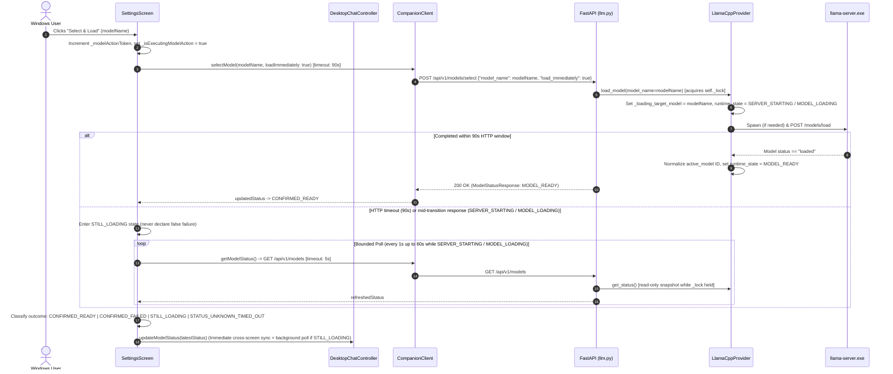
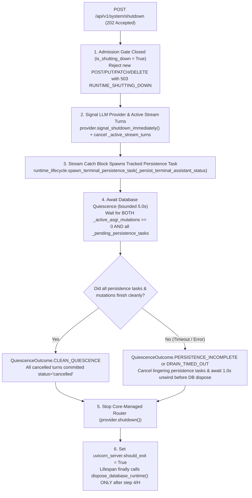

# Implementation Plan — M2 PC-HOST-005: Secure Host Lifecycle, Provider Cleanup & Model-Loading Reliability

- **Status:** `AWAITING HUMAN / INDEPENDENT PLAN REVIEW`
- **Delivery Level:** `Level C — Sensitive Design`
- **Scope Mode:** `New Feature / Security, Lifecycle Hardening & Bounded Model-Loading Reliability`
- **Milestone / Work Items:**
  - **Track A (Primary):** `M2 — PC Companion Foundation` / `PC-HOST-005` (`Host Administration Separation & Secure Lifecycle Authority`)
  - **Track B (Bounded Reliability Extension):** `PC-CLIENT-010` (`Model Management UI`), `PC-CLIENT-004` (`API Client Layer`), and `PC-MODEL-006` (`Single-Resident Model Lifecycle Policy`)
- **Branch:** `feature/m2-secure-host-lifecycle`
- **Target Integration Branch:** `develop`
- **Verified Baseline SHA:** `261d4b43930d3dcdad2dbd913d4dd4d60c8a4887`
- **Previously Reviewed Plan Commits:** `8adfae0f964de81528883f73b8165e1cb9f62fae` (Initial), `350ba136b3786a761337e1df8b6720ce4161bc4d` (Revision 1)
- **Active Branch Tracker:** [`docs/01_Tracking/active/task-feature-m2-secure-host-lifecycle.md`](../../01_Tracking/active/task-feature-m2-secure-host-lifecycle.md)
- **Date:** `2026-11-04`
- **Author / Role:** `Authorized Implementing Agent (Final Phase 1 Design Corrections)`

> [!IMPORTANT]
> **Phase 1 Planning Candidate Notice:** This document is a **Phase 1 planning review candidate** published on `feature/m2-secure-host-lifecycle` incorporating the final Phase 1 Independent Review corrections (`C1`–`C6` and §9 Process Termination Safety). It is **NOT** yet approved for Phase 2 implementation, and zero production source code, tests, contracts, or database migrations have been modified in Phase 1. Implementation begins only after explicit **Human Owner** and **Independent Reviewer** final plan approval.

---

## 1. Approved Product Directions, Baseline and Scope (`Track A` + `Track B`)

### 1.1 Approved Architectural Directions (Human Owner Decisions)
The Human Owner has approved the following baseline directions for this delivery:
1. **Combined Two-Track Delivery Scope:** Deliver **Track A (`PC-HOST-005`: Secure Host Lifecycle & Provider Cleanup)** and **Track B (Bounded Model-Loading Reliability under `PC-CLIENT-010` / `PC-CLIENT-004` / `PC-MODEL-006`)** together on `feature/m2-secure-host-lifecycle`.
2. **Primary Shutdown Mechanism:** Use cooperative, authenticated Host Administration HTTP shutdown (`POST /api/v1/system/shutdown` protected by `require_host_admin`) as the primary Runtime termination path.
3. **Emergency OS Fallback:** Permit a Windows OS process termination fallback **only** when process identity and ownership are established safely via handle-bound provenance verification, failing closed on any ambiguity.
4. **Four Distinct Provider Lifecycle Operations:** Preserve distinct semantics for (a) ordinary model unloading (`unload_model()`), (b) Core-managed router termination (`stop_managed_router()`), (c) full Runtime shutdown (`shutdown()`), and (d) supervisor emergency recovery, while never terminating an externally started `llama-server.exe` (`_managed_by_core == False`).
5. **Initial Tunable Timeout Candidates:** Use the `5.0s` active-generation/quiescence drain budget, `90.0s` model-load HTTP timeout, and `60.0s` automatic status-reconciliation polling window as initial tunable design budgets, subject to truthful state reporting and non-deadlocking cancellation.
6. **Remote Host Protection:** Never shut down a remote Runtime (`isRemoteHost == true`) from the Desktop client's **Exit Companion** action.
7. **Governance Continuity:** Preserve the S1 four-phase delivery workflow, same feature branch continuity, autonomous Phase 2/3 execution once Phase 1 is approved, and the Human Owner's exclusive squash-merge authority.

### 1.2 Independent Review Resolution Ledger (Commits `8adfae0` & `350ba13` $\rightarrow$ Current)

| Finding ID | Review Finding Summary | Resolution Status | Selected Mechanism & Verification Tier |
| :--- | :--- | :--- | :--- |
| **`Issue A1`** | `LlamaCppProvider.shutdown()` left Core-managed `llama-server.exe` running after HTTP router unload or drain timeout. | `RESOLVED IN DESIGN` *(Requires Phase 2 unit/acceptance evidence)* | Separate `unload_model()`, `stop_managed_router()`, and `shutdown()`. `shutdown()` unconditionally calls `stop_managed_router()` when `_managed_by_core == True` and preserves external routers (`_managed_by_core == False`) (§3.1). |
| **`Issue A2`** | Settings `Exit Companion` invoked unconfirmed UI-only exit (`handleExitRequested()`). | `RESOLVED IN DESIGN` *(Requires Phase 2 widget test evidence)* | Route both System Tray `exit_full` and Settings `Exit Companion` through `requestFullExitCompanion()` with mandatory confirmation dialog while preserving `Close Window (×)` and `Close UI Only (Dev Test)` (§3.2). |
| **`Issue B1`** | Cold model loads ($> 5\text{s}$) hit hardcoded `5s` client timeout while `llama-server.exe` continued loading in background. | `RESOLVED IN DESIGN` *(Requires Phase 2 unit/widget evidence)* | `90s` HTTP timeout on `selectModel(loadImmediately: true)` and `loadModel()`, lock-free snapshot `get_status()` during active load, canonical model ID normalization, 4-state truthful status reconciliation (`CONFIRMED_READY`, `CONFIRMED_FAILED`, `STILL_LOADING`, `STATUS_UNKNOWN_TIMED_OUT`), and Chat controller sync (§4, §11). |
| **`Final C1`** | Relying on `gc.get_objects()` or asyncio stack inspection to find `uvicorn.Server` is unacceptable for security-sensitive shutdown. | `RESOLVED IN DESIGN` *(Requires Phase 2 unit + isolated Windows acceptance evidence)* | Dedicated programmatic entry point `backend/app/runtime_server.py` (`pythonw.exe -m app.runtime_server --app app.main:app --host <host> --port <port> --no-use-colors`) explicitly constructs `uvicorn.Config` & `uvicorn.Server`, registers `server` with `RuntimeLifecycleCoordinator` before `server.serve()`, and updates supervisor launch + provenance checks (§5). |
| **`Final C2`** | `shutdown()` acquiring `self._lock` before setting `_closing = True` deadlocks behind an active `load_model()` holding `self._lock`. | `RESOLVED IN DESIGN` *(Requires Phase 2 concurrency unit test evidence)* | Lock-free shutdown signaling (`_closing = True`, `_shutdown_event.set()`, cancelling `_active_load_task` and closing active router `httpx` clients) executes **before** acquiring `self._lock`; `load_model()` uses interruptible `_sleep_or_abort()` waits, cleans up partial router spawn on abort, and releases `self._lock` immediately (§6). |
| **`Final C3`** | Route-level middleware counters miss `StreamingResponse` lifetimes, and `asyncio.shield()` does not guarantee `_persist_terminal_assistant_status()` has committed before `dispose_database_runtime()`. | `RESOLVED IN DESIGN` *(Requires Phase 2 async DB quiescence test evidence)* | `RuntimeLifecycleCoordinator` tracks (1) full ASGI body-completion scope for mutating/streaming requests, (2) active streaming turn tasks, and (3) explicit `asyncio.Task[bool]` handles in `_pending_persistence_tasks` spawned for terminal status writes. `dispose_database_runtime()` awaits completion of `_pending_persistence_tasks` and distinguishes `CLEAN_QUIESCENCE`, `PERSISTENCE_INCOMPLETE`, and `DRAIN_TIMED_OUT` (§7). |
| **`Final C4`** | Previous plan referenced nonexistent `GET /api/v1/models/status` and `model_id` instead of actual `GET /api/v1/models` and `model_name`. | `RESOLVED IN DESIGN` *(Verified directly against `llm.py` & `companion_client.dart`)* | All architecture text, sequence diagrams, tables, tests, and implementation steps updated to use `GET /api/v1/models` and `model_name` (`ModelSelectRequest` / `ModelLoadRequest`) with zero breaking contract changes (§4, §9). |
| **`Final C5`** | Treating expiration of the `60s` status-polling window as a confirmed model-load failure misrepresents a still-loading model. | `RESOLVED IN DESIGN` *(Requires Phase 2 widget/controller test evidence)* | Four distinct states (`CONFIRMED_READY`, `CONFIRMED_FAILED`, `STILL_LOADING`, `STATUS_UNKNOWN_TIMED_OUT`). Expiring the observation window while backend is `SERVER_STARTING` / `MODEL_LOADING` surfaces `STILL_LOADING` with a `Refresh Model Status` action (no duplicate load POST), and `DesktopChatController` continues lightweight background status polling (§4.3, §11). |
| **`Final C6`** | Inaccurate claim that `CompanionClient._adminRequest` already retries/clears secret on `401`/`403`; test matrix used `X-Profile-Session` instead of `Authorization: Bearer psk_...`. | `RESOLVED IN DESIGN` *(Verified against `companion_client.dart`, `host_admin_secret_store.dart`, `profile_sessions.py`)* | Accurately documents that `HostAdminSecretStore.readToken()` reads and ACL-verifies `desktop_admin.secret` fresh from disk on every `_adminRequest` without in-memory caching. Security test matrix updated to test `Authorization: Bearer psk_...` (Profile Session), `Authorization: Bearer companion_sec_...` / `X-API-Key` (paired device), and malformed custom headers separately (§8, §16). |
| **`Process Safety (§9)`** | Handle-bound OS termination guarantees must be framed as propositions requiring Phase 2 implementation and isolated Windows verification. | `REQUIRES IMPLEMENTATION EVIDENCE` *(Design complete in §10; empirical verification in Phase 2 Tasks 4 & 7)* | Specifies exact PowerShell/`System.Diagnostics.Process` handle acquisition (`$proc = GetProcessById($pid); $_ = $proc.Handle`), 4-factor verification before `$proc.Kill()`, independent child `llama-server.exe` handle verification, fail-closed ambiguity handling, and isolated Windows test cases (§10, §16, §17). |

### 1.3 Canonical References

| Canonical Document | Normative Sections & Requirements |
| :--- | :--- |
| [`docs/04_Architecture/SYSTEM_BASELINE.md`](../../04_Architecture/SYSTEM_BASELINE.md) | **§2 & §5:** Single-Machine Split Architecture; Local AI Runtime (`127.0.0.1:8000`) runs independently of Flutter UI; **Close Window (`×`)** hides UI to tray; **Exit Companion** performs confirmed full shutdown of UI + Local AI Runtime + Core-managed `llama.cpp`; **Host Administration Authority (`D15`)** separates normal Profile Session (`psk_`) and Device Pairing (`companion_sec_`) tokens from host-wide privileged operations (`X-Host-Admin-Secret`). |
| [`docs/04_Architecture/04_Infrastructure/windows-host-and-notifications.md`](../../04_Architecture/04_Infrastructure/windows-host-and-notifications.md) | **§1.2, §1.3, §2.1, §2.2, §4.2:** Four distinct lifecycle actions (**Close Window (`×`)**, **Quit UI Only (Dev/Diagnostics)**, **Pause Companion** [deferred], **Exit Companion**); mandatory user confirmation before full shutdown; intentional exit suppresses crash-recovery restart loops; `PC-HOST-005` owns authenticated host shutdown. |
| [`docs/04_Architecture/02_Data_and_Security/profiles-and-devices.md`](../../04_Architecture/02_Data_and_Security/profiles-and-devices.md) | **§1.3 & §3.2 (`D15`):** Profile sessions and remote paired devices must never stop the host runtime or mutate shared host-wide process state. |
| [`docs/04_Architecture/02_Data_and_Security/authentication-and-secrets.md`](../../04_Architecture/02_Data_and_Security/authentication-and-secrets.md) | **§1.1, §2.2, §3.1, §5.3 (`D15`):** Three distinct credential classes (`Authorization: Bearer psk_`, `Authorization: Bearer companion_sec_` / `X-API-Key`, and `X-Host-Admin-Secret: hsk_`); `%LOCALAPPDATA%\AICompanion\secrets\desktop_admin.secret` ACL-restricted to current Windows user SID + `SYSTEM`; loopback IP/Host and non-browser (`Origin`/`Sec-Fetch-Site` rejected) enforcement. |
| [`docs/04_Architecture/04_Infrastructure/runtime-and-models.md`](../../04_Architecture/04_Infrastructure/runtime-and-models.md) | **§2.2 & §5.3:** Core-managed `llama-server.exe` lifecycle ownership (`_managed_by_core`), single-resident model loading, active generation cancellation, and clean subprocess termination on runtime exit. |
| [`docs/05_Design/01_PC_Desktop_Shell_and_Tray.md`](../../05_Design/01_PC_Desktop_Shell_and_Tray.md) | **§5 (Tray & Background Behavior):** Tray menu actions and explicit user-facing distinction between hiding window, developer UI-only exit, and confirmed full **"Exit Companion"** shutdown. |
| [`docs/04_Architecture/decisions/ADR-0003-d2-windows-host-model.md`](../../04_Architecture/decisions/ADR-0003-d2-windows-host-model.md) | **ADR-0003 (`D2`) — Per-User Background Host Model:** Runtime runs under interactive Windows user session without requiring UAC elevation or a Windows Service (`services.msc`). |

---

## 2. Independently Supported Source Findings (Verified Current Implementation)

Direct inspection of the repository on `feature/m2-secure-host-lifecycle` (base `develop` SHA `261d4b43930d3dcdad2dbd913d4dd4d60c8a4887`) established the following source-verified facts:

| Subsystem / File | Verified Source Behavior & Line References |
| :--- | :--- |
| [`backend/app/api/v1/endpoints/llm.py`](../../../backend/app/api/v1/endpoints/llm.py#L40-L164) | Exposes `GET /api/v1/models` (`get_model_status`, protected by `Depends(verify_telemetry)`), `GET /api/v1/models/registry`, `POST /api/v1/models/load` (`ModelLoadRequest(model_name, profile)`), `POST /api/v1/models/select` (`ModelSelectRequest(model_name, load_immediately, profile)`), `POST /api/v1/models/unload`, and `PATCH /api/v1/models/profile` (all four mutations protected by `Depends(require_host_admin)`). |
| [`backend/app/api/v1/endpoints/health.py`](../../../backend/app/api/v1/endpoints/health.py#L1-L78) | Exposes public `GET /api/v1/health` (`HealthResponse(status="healthy")`) and Host-Admin-protected `GET /api/v1/system/status` (`SystemStatusResponse`). No shutdown endpoint exists yet. |
| [`backend/app/core/host_admin.py`](../../../backend/app/core/host_admin.py#L31-L108) & [`windows_security.py`](../../../backend/app/core/windows_security.py) | Provisions `%LOCALAPPDATA%\AICompanion\secrets\desktop_admin.secret` (`hsk_<token_urlsafe(48)>`) with protected DACL `O:<user_sid>D:P(A;;FA;;;<user_sid>)(A;;FA;;;SY)` and non-reparse directory validation. `require_host_admin` enforces loopback peer IP, loopback `Host` header, absence of `Origin` and `Sec-Fetch-Site`, and `secrets.compare_digest` on `X-Host-Admin-Secret`. |
| [`backend/app/core/profile_sessions.py`](../../../backend/app/core/profile_sessions.py#L58-L69) & [`deps.py`](../../../backend/app/api/deps.py#L20-L27) | `get_current_profile_session` extracts `Authorization: Bearer psk_<token>` via `Security(bearer_security)` and validates the hashed session against SQLite `profile_sessions`. `verify_telemetry` accepts either `Authorization: Bearer psk_<token>` or `Authorization: Bearer companion_sec_<token>` / `X-API-Key`. |
| [`backend/app/services/llm/llama_cpp.py`](../../../backend/app/services/llm/llama_cpp.py#L377-L711) & [`#L792-L1105`](../../../backend/app/services/llm/llama_cpp.py#L792-L1105) | (1) `load_model()` holds `async with self._lock:` (`#L378`) across up to `45s` of router startup (`#L610-L631`) and `45s + 30s` of `/models/load` HTTP + polling (`#L246-L278`).<br>(2) `shutdown()` (`#L1086-L1105`) calls `await self.unload_model()`, which returns `True` at line 677 after HTTP `/models/unload` succeeds, leaving `self._server_process` (`llama-server.exe`) running; if `_active_work_drained.wait()` times out at line 1099, `shutdown()` also returns early at line 1104 without stopping `self._server_process`.<br>(3) `get_status()` (`#L792-L859`) runs without `self._lock` and at lines 830 and 845 overwrites `self._active_model_name = None` and `self._server_is_active = False` if called while `load_model()` is mid-transition, and sets raw `loaded_model_id` from `llama-server` without normalizing via `find_model_registry_entry`. |
| [`backend/app/services/assistant/orchestrator.py`](../../../backend/app/services/assistant/orchestrator.py#L317-L354) & [`#L518-L539`](../../../backend/app/services/assistant/orchestrator.py#L518-L539) | On stream cancellation (`CancelledError` / `GeneratorExit`), rolls back the request `db` session and calls `await asyncio.shield(_persist_terminal_assistant_status(...))` using a separate session from `get_session_factory()`. Because `_persist_terminal_assistant_status` is passed as a bare coroutine to `asyncio.shield` and is not registered in a central runtime task set, a second cancellation or immediate `dispose_database_runtime()` call can race with the uncommitted terminal status write. |
| [`frontend/flutter/packages/companion_api/lib/client/companion_client.dart`](../../../backend/app/api/v1/endpoints/llm.py) ([`#L57-L108`](../../../frontend/flutter/packages/companion_api/lib/client/companion_client.dart#L57-L108), [`#L209-L281`](../../../frontend/flutter/packages/companion_api/lib/client/companion_client.dart#L209-L281)) | (1) `_buildHeaders(admin: true)` reads `await hostAdminStore?.readToken()` on each call and sets `X-Host-Admin-Secret`.<br>(2) `_requestWithoutRedirects()` (`#L102-L108`) hardcodes `.timeout(const Duration(seconds: 5))` on **every** `_adminRequest`, including `selectModel(modelName, loadImmediately: true)` (`POST /api/v1/models/select`) and `loadModel()` (`POST /api/v1/models/load`).<br>(3) `getModelStatus()` (`#L209-L218`) calls `GET /api/v1/models`. |
| [`frontend/flutter/apps/desktop/lib/platform/host_admin_secret_store.dart`](../../../frontend/flutter/apps/desktop/lib/platform/host_admin_secret_store.dart#L10-L73) | `readToken()` invokes `powershell.exe` on every call to verify non-reparse attributes and Windows DACLs (`current user SID + SYSTEM`) on `%LOCALAPPDATA%\AICompanion\secrets\desktop_admin.secret` before reading the secret from disk. Does not cache tokens in memory. |
| [`frontend/flutter/apps/desktop/lib/coordinator/desktop_runtime_coordinator.dart`](../../../frontend/flutter/apps/desktop/lib/coordinator/desktop_runtime_coordinator.dart#L52-L56) & [`#L789-L795`](../../../frontend/flutter/apps/desktop/lib/coordinator/desktop_runtime_coordinator.dart#L789-L795) | (1) Constructs `CompanionClient` without `hostAdminStore` (`Correction C4`).<br>(2) Spawns detached runtime with `args: ['-m', 'uvicorn', 'app.main:app', '--host', targetHost, '--port', '$targetPort', '--no-use-colors']`.<br>(3) Uses lockfile `%LOCALAPPDATA%\AI Companion\runtime.lock` locked directly via `FileMode.append` + `FileLock.exclusive`. |
| [`frontend/flutter/apps/desktop/lib/screens/settings_screen.dart`](../../../frontend/flutter/apps/desktop/lib/screens/settings_screen.dart#L563-L569) & [`#L998-L1047`](../../../frontend/flutter/apps/desktop/lib/screens/settings_screen.dart#L998-L1047) | (1) Line 564: **Exit Companion** button calls `coordinator?.handleExitRequested()` (unconfirmed UI-only exit).<br>(2) Lines 1025–1046: When `selectModel(modelId, loadImmediately: true)` throws `TimeoutException` at `5.0s`, the `catch` block calls `getModelStatus()` (`GET /api/v1/models`) once immediately while the backend is still loading, overwrites `_modelActionMessage` with `'Model selection saved, but activation failed: ... Model is NOT active.'`, does not poll, and never updates `widget.chatController`. |

---

## 3. Confirmed Shutdown Defects (`Issue A1` & `Issue A2`)

### 3.1 `Issue A1` — Explicit Separation of Four Provider Lifecycle Operations
We explicitly separate and enforce four distinct operations in [`LlamaCppProvider`](../../../backend/app/services/llm/llama_cpp.py):

| Operation | Method / Trigger | Effect on Model Weights | Effect on Core-Managed `llama-server.exe` (`_managed_by_core == True`) | Effect on External `llama-server.exe` (`_managed_by_core == False`) | Resulting `LLMRuntimeState` |
| :--- | :--- | :--- | :--- | :--- | :--- |
| **1. Ordinary Model Unload** | `await provider.unload_model()` (`POST /api/v1/models/unload`) | Unloads active model from VRAM (`POST /models/unload` on router or frees `self._llm` if idle). | **Preserves running `llama-server.exe` router** when HTTP `/models/unload` succeeds so subsequent model loads are fast. Only terminates `_server_process` if router HTTP unload fails. | Sends HTTP `POST /models/unload` only; **never** terminates external OS process. | `MODEL_UNLOADED` (or `SERVER_STOPPED` if fallback process kill was required) |
| **2. Stop Managed Router** | `await provider.stop_managed_router()` | Unloaded as part of router stop. | Closes `self._server_client`; terminates `self._server_process` (`terminate()` $\rightarrow$ `wait(5.0s)` $\rightarrow$ `kill()` + `wait(2.0s)`); clears `_server_process`, `_server_pid`, `_managed_by_core = False`. | Closes `self._server_client` and detaches provider state (`_server_is_active = False`); **never** kills external OS process. | `SERVER_STOPPED` |
| **3. Full Runtime Shutdown** | `await provider.shutdown(drain_timeout=5.0)` (`POST /api/v1/system/shutdown` & FastAPI `lifespan` exit) | Releases model weights safely (respecting Route B native worker guard in §6.3). | Signals lock-free shutdown (`_closing = True`, `_shutdown_event.set()`), aborts any active `load_model()` or Route A stream, waits up to `drain_timeout` for `_active_work_drained`, and **unconditionally executes `await self.stop_managed_router()`** even if drain wait or lock acquisition timed out. | Cancels active Route A HTTP streams to the external router and closes `_server_client`; **never** kills external OS process. | `SERVER_STOPPED` |
| **4. Emergency Recovery** | `WindowsRuntimeProcessSupervisor.terminateVerifiedRuntimeProcess()` | N/A (OS process level). | Terminated by supervisor **only** if handle-bound child provenance confirms `llama-server.exe` is the Core-managed child of the verified runtime process (§10). | **Never touched** (fails closed on missing/external provenance). | `RuntimeStatus.stopped` |

### 3.2 `Issue A2` — Preserving Four Distinct Desktop Lifecycle Operations

| User Action | Entry Points | Confirmation Required? | Desktop UI (`flutter_desktop.exe`) | Local AI Runtime (`pythonw.exe`) | Core-Managed `llama-server.exe` | Crash-Recovery Auto-Restart |
| :--- | :--- | :--- | :--- | :--- | :--- | :--- |
| **1. Close Window (`×`) / Hide to Tray** | Window titlebar `×` button; Settings **Hide to Tray** button | No | Hidden to System Tray (`windowManager.hide()`) | Continues running | Continues running | Active |
| **2. Quit UI Only (Dev/Diagnostics)** | System Tray `Close UI Only (Dev Test)` (`quit_ui_dev`) | No (Explicit dev-only label) | Exits (`exit(0)`) | Continues running (`ProcessStartMode.detached`) | Continues running | Inactive (UI exited) |
| **3. Pause Companion** | *(Deferred out of `PC-HOST-005`)* | N/A | N/A | N/A | N/A | N/A |
| **4. Exit Companion (Full Shutdown)** | System Tray **Exit Companion** (`exit_full`) AND Settings **Exit Companion** button | **Yes (Mandatory modal confirmation dialog)** | Exits (`exit(0)`) **only after** runtime stop is verified (or user explicitly selects `Quit Desktop UI Only` in failure recovery dialog) | Gracefully drains & exits via `POST /api/v1/system/shutdown` (or handle-bound OS fallback) | Unconditionally terminated via `stop_managed_router()` (or handle-bound child fallback) | **Suppressed** (`_intentionalShutdown = true`) |

---

## 4. Model-Loading Reliability & Truthful Timeout Reconciliation (`Issue B1`, `Corrections C4 & C5`)

### 4.1 Verified Root Causes in Existing Source
1. **Hardcoded 5-Second Client Timeout (`Issue B1-RC1`):** [`CompanionClient._requestWithoutRedirects()`](../../../frontend/flutter/packages/companion_api/lib/client/companion_client.dart#L106) enforces `const Duration(seconds: 5)` on all `_adminRequest` calls, including `selectModel(modelName, loadImmediately: true)` (`POST /api/v1/models/select` with `{"model_name": modelName, "load_immediately": true}`) and `loadModel()` (`POST /api/v1/models/load`). Meanwhile, [`LlamaCppProvider.load_model()`](../../../backend/app/services/llm/llama_cpp.py#L610-L631) allows up to `45.0s` for `llama-server.exe` startup plus `45.0s` POST + `30.0s` polling in `_router_load_model()` (`#L246-L278`). Any cold model load taking $> 5.0\text{s}$ throws `TimeoutException` in Flutter at `5.0s` while the backend continues spawning `llama-server.exe` and loading weights in the background.
2. **Premature Failure Declaration Without Polling (`Issue B1-RC2`):** In [`settings_screen.dart`](../../../frontend/flutter/apps/desktop/lib/screens/settings_screen.dart#L1025-L1046), catching `TimeoutException` at $t = 5.0\text{s}$ immediately calls `client.getModelStatus()` (`GET /api/v1/models`) once while `runtime_state` is still `SERVER_STARTING` or `MODEL_LOADING`, overwrites `_modelActionMessage` with `'Model selection saved, but activation failed: ... Model is NOT active.'`, sets `_isExecutingModelAction = false`, and performs zero follow-up polling.
3. **Lockless State Clobbering & Unnormalized Model IDs in `get_status()` (`Issue B1-RC3`):** In [`llama_cpp.py`](../../../backend/app/services/llm/llama_cpp.py#L792-L859), `get_status()` (`GET /api/v1/models`) runs without checking `self._lock` or transitional states, overwriting `self._active_model_name = None` (line 830) and `self._server_is_active = False` (line 845) if probed while `load_model()` is starting the router or loading weights. Additionally, lines 817–822 assign raw `loaded_model_id` from `llama-server` without normalizing through `find_model_registry_entry(loaded_model_id)`, causing `SettingsScreen`'s activation check (`#L1014-L1020`) to false-negative when `llama-server` reports a filename/path matching `primaryFile`.
4. **Why Clicking "Load Model" a Second Time Succeeds (`Issue B1-RC4`):** Once the background load from the first click completes, a second click hits the active-model reuse fast path (`#L425-L442`) or `Mode 0` (`#L466-L480`, where `_router_load_model` receives HTTP 400 `"already running"` at `#L254-L256` and returns `True`), returning HTTP 200 in $< 10\text{ms}$.
5. **Missing Cross-Screen Chat Controller Sync (`Issue B1-RC5`):** Unlike `_unloadModel()` (line 1082), `_selectModel()` never updates `widget.chatController`, leaving `DesktopChatController._modelStatus` stale.

### 4.2 Exact API Contracts for Model Operations (`Correction C4`)
All model management and reconciliation flows preserve the exact existing backend routes and payload schemas in [`backend/app/api/v1/endpoints/llm.py`](../../../backend/app/api/v1/endpoints/llm.py) and [`companion_client.dart`](../../../frontend/flutter/packages/companion_api/lib/client/companion_client.dart):

| Operation | HTTP Method & Route | Auth Dependency | Request Payload Schema | Response Schema | Client Timeout Budget (Initial Tunable Candidate) |
| :--- | :--- | :--- | :--- | :--- | :--- |
| **Get Model Status** | `GET /api/v1/models` | `Depends(verify_telemetry)` (`Authorization: Bearer psk_...` or `companion_sec_...`) | None | `ModelStatusResponse` | `5.0s` |
| **Get Model Registry** | `GET /api/v1/models/registry` | `Depends(verify_telemetry)` | None | `List[ModelRegistryEntry]` | `5.0s` |
| **Select Model** | `POST /api/v1/models/select` | `Depends(require_host_admin)` (`X-Host-Admin-Secret`) | `ModelSelectRequest`: `{"model_name": str, "load_immediately": bool, "profile": Optional[str]}` | `ModelStatusResponse` | `90.0s` when `load_immediately == true`; `10.0s` when `load_immediately == false` |
| **Load Model** | `POST /api/v1/models/load` | `Depends(require_host_admin)` (`X-Host-Admin-Secret`) | `ModelLoadRequest`: `{"model_name": Optional[str], "profile": Optional[str]}` | `ModelStatusResponse` | `90.0s` |
| **Unload Model** | `POST /api/v1/models/unload` | `Depends(require_host_admin)` (`X-Host-Admin-Secret`) | None | `ModelStatusResponse` | `20.0s` |

### 4.3 Four-State Truthful Model-Load Reconciliation (`Correction C5`)



To ensure timeout expiration is **never** misrepresented as a permanent model-loading failure, `SettingsScreen` and `DesktopChatController` classify model activation into four explicit states:

| Outcome State | Authoritative Condition (`GET /api/v1/models`) | UI Presentation & User Actions in `SettingsScreen` | `DesktopChatController` Synchronization |
| :--- | :--- | :--- | :--- |
| **1. `CONFIRMED_READY`** | `runtime_state == "MODEL_READY"` (or `"MODEL_SLEEPING"`) AND `_isTargetModelActive(status, modelName)` matches via `id`, `runtimeModelId`, `primaryFile`, or filename stem. | Success message: `'Model selected and ready: <activeModel>'`. Action spinner stops; model card shows `Active / Ready`. | `chatController.updateModelStatus(status)` immediately marks Chat model ready for turns. |
| **2. `CONFIRMED_FAILED`** | Deterministic `4xx`/`5xx` HTTP error response from `/api/v1/models/select` or `/load`, OR `GET /api/v1/models` reports `runtime_state in ("MODEL_ERROR", "SERVER_ERROR", "SERVER_STOPPED", "MODEL_UNLOADED")` after the load operation exited. | Error message: `'Model activation failed: <errorDetail>.'` Action spinner stops; user can click **Retry Load**. | `chatController.updateModelStatus(status)` updates Chat with the error/unloaded state. |
| **3. `STILL_LOADING`** | `GET /api/v1/models` reports `runtime_state in ("SERVER_STARTING", "MODEL_LOADING")` (either during the `60s` automatic poll window or when the `60s` window expires while the backend is still actively loading). | **Never claims the load failed.**<br>- During active 60s poll: shows spinner + `'Loading model weights in Local AI Runtime (<runtimeState>)...'`.<br>- If 60s poll window expires while still `SERVER_STARTING` / `MODEL_LOADING`: shows informational banner `'Model is still loading in the background (<runtimeState>). No reload is needed.'` with a **`Refresh Model Status` / `Continue Waiting`** button that calls `GET /api/v1/models` (and resumes bounded polling) **without** sending a redundant `POST /api/v1/models/load` or `/select`. Duplicate load buttons for the loading model remain disabled. | `chatController.updateModelStatus(status)` updates Chat to show `Loading model...` and starts a lightweight `2.0s` background status poll on `GET /api/v1/models` inside `DesktopChatController` so even if the user navigates away from Settings to Chat, Chat automatically transitions to `MODEL_READY` as soon as the backend finishes! |
| **4. `STATUS_UNKNOWN_TIMED_OUT`** | Both the initial HTTP request and follow-up `GET /api/v1/models` probes failed with `TimeoutException` or transient socket error, so current backend state cannot be read. | Warning banner: `'Model load status could not be confirmed (status check timed out). The model may still be loading in the background.'` Displays a primary **`Refresh Model Status`** button (`GET /api/v1/models`) before offering a full reload. | Preserves non-destructive pending status until `Refresh Model Status` succeeds. |

---

## 5. Reliable Uvicorn Lifecycle Ownership (`Correction C1`)

### 5.1 Why Introspection (`gc.get_objects()` / Task Stack) Is Rejected
Relying on `gc.get_objects()` or walking `asyncio` stack frames to discover a `uvicorn.Server` instance is fragile, sensitive to Python/Uvicorn internal frame changes, and could bind the wrong server object in multi-server test harnesses. For a Level C security-sensitive host lifecycle boundary, server ownership must be **explicit and deterministic**.

### 5.2 Explicit Programmatic Runtime Entry Point (`backend/app/runtime_server.py`)
We introduce a dedicated programmatic runtime launcher module at [`backend/app/runtime_server.py`](../../../backend/app/runtime_server.py) that owns `uvicorn.Config` and `uvicorn.Server` creation explicitly:

```python
"""Deterministic Uvicorn runtime entrypoint with explicit server lifecycle registration."""

import argparse
import asyncio
import uvicorn
from app.core.runtime_lifecycle import runtime_lifecycle


def build_arg_parser() -> argparse.ArgumentParser:
    parser = argparse.ArgumentParser(description="AI Companion Local Runtime Server")
    parser.add_argument("--app", default="app.main:app", help="ASGI application import string")
    parser.add_argument("--host", default="127.0.0.1", help="Bind host")
    parser.add_argument("--port", type=int, default=8000, help="Bind port")
    parser.add_argument("--no-use-colors", action="store_true", help="Disable ANSI color codes")
    parser.add_argument("--log-level", default="info", help="Uvicorn log level")
    return parser


async def serve_runtime(args: argparse.Namespace) -> int:
    config = uvicorn.Config(
        app=args.app,
        host=args.host,
        port=args.port,
        use_colors=not args.no_use_colors,
        log_level=args.log_level,
        timeout_graceful_shutdown=8,
    )
    server = uvicorn.Server(config=config)
    runtime_lifecycle.register_uvicorn_server(server, host=args.host, port=args.port)
    try:
        await server.serve()
    finally:
        runtime_lifecycle.clear_uvicorn_server(server)
    return 0


def main() -> int:
    parser = build_arg_parser()
    args = parser.parse_args()
    return asyncio.run(serve_runtime(args))


if __name__ == "__main__":
    raise SystemExit(main())
```

### 5.3 Impact on Dependent Contracts & Supervisor Provenance
Changing the supervised launch entrypoint from `-m uvicorn app.main:app` to `-m app.runtime_server --app app.main:app` is synchronized across every dependent component:

| Dependent Component | File Path | Exact Contract Update |
| :--- | :--- | :--- |
| **1. Supervisor Spawn Arguments** | [`desktop_runtime_coordinator.dart`](../../../frontend/flutter/apps/desktop/lib/coordinator/desktop_runtime_coordinator.dart#L789-L795) | Spawn `pythonw.exe` with `args: ['-m', 'app.runtime_server', '--app', 'app.main:app', '--host', targetHost, '--port', '$targetPort', '--no-use-colors']`. |
| **2. Process Provenance Check** | [`windows_runtime_process_supervisor.dart`](../../../frontend/flutter/apps/desktop/lib/platform/windows_runtime_process_supervisor.dart#L458-L465) | Extract `static bool isCompanionRuntimeCommandLine(String commandLine, {required int expectedPort})` checking:<br>1. `matchesExactPort(commandLine, expectedPort)` (`--port <expectedPort>`)<br>2. `commandLine.contains('app.main:app')`<br>3. `commandLine.contains('app.runtime_server') || commandLine.contains('uvicorn')` *(accepts canonical `app.runtime_server` and preserves backward-compatible recognition of an already-running `uvicorn app.main:app` process)*. |
| **3. FastAPI Lifespan & `RuntimeLifecycleCoordinator`** | [`backend/app/core/runtime_lifecycle.py`](../../../backend/app/core/runtime_lifecycle.py) & [`backend/app/main.py`](../../../backend/app/main.py#L131-L184) | `runtime_lifecycle.register_uvicorn_server(server)` stores the exact `uvicorn.Server` reference before `server.serve()` starts. `clear_uvicorn_server(server)` checks `if self._uvicorn_server is server:` so test servers never clobber an unrelated server reference. |
| **4. Supervisor Unit & Acceptance Tests** | [`windows_runtime_process_supervisor_test.dart`](../../../frontend/flutter/apps/desktop/test/windows_runtime_process_supervisor_test.dart) & [`windows_runtime_supervision_acceptance_test.dart`](../../../frontend/flutter/apps/desktop/test/windows_runtime_supervision_acceptance_test.dart) | Update test command-line fixtures to test `-m app.runtime_server --app app.main:app --port 8000` (plus a backward-compatibility test for `-m uvicorn app.main:app --port 8000`). |

### 5.4 Verification Tier for Uvicorn Ownership & Shutdown
- **Supported by Source Inspection (`backend/.venv/Lib/site-packages/uvicorn/server.py` lines 67, 96–101, 233–264):**
  - `server.serve()` enters `_serve()`, starts `lifespan.startup()`, opens listening sockets, and runs `await self.main_loop()`.
  - `main_loop()` polls `self.on_tick()` every `0.1s` (`100ms`); when `server.should_exit = True` is set on the registered `server` instance, `main_loop()` returns cleanly, `_serve()` calls `await self.shutdown(sockets=sockets)` (closing listening TCP sockets, shutting down active HTTP connections, awaiting `_wait_tasks_to_complete()` bounded by `timeout_graceful_shutdown=8`, and calling `await self.lifespan.shutdown()`).
- **Requires Phase 2 Isolated Windows Acceptance Evidence:**
  - Confirming end-to-end process exit (`exitCode == 0`) and TCP port release under `ProcessStartMode.detached` with `pythonw.exe -m app.runtime_server` in `windows_runtime_supervision_acceptance_test.dart`.

---

## 6. Non-Deadlocking Shutdown During Active Model Loading & Route A/B Inference (`Correction C2`)

### 6.1 Why `shutdown()` Must Signal Cancellation Before Acquiring `self._lock`
In [`backend/app/services/llm/llama_cpp.py`](../../../backend/app/services/llm/llama_cpp.py#L378), `load_model()` acquires `async with self._lock:` and holds it across router process creation (`#L575`), up to `45s` of `/health` polling (`#L610-L631`), `45s` of `POST /models/load` (`#L247`), and `30s` of `/models` polling (`#L259-L276`). If `shutdown()` waited to acquire `self._lock` before setting `self._closing = True` or aborting the in-flight load, `shutdown()` would block behind `load_model()` for up to `120s`.

### 6.2 Lock-Free Cancellation Protocol & Lock Ordering Matrix
We separate **lock-free immediate shutdown signaling** from **lock-serialized state cleanup**:

```mermaid
sequenceDiagram
    autonumber
    participant Coord as RuntimeLifecycleCoordinator
    participant Prov as LlamaCppProvider
    participant Load as Active load_model() Task (Holds self._lock)
    participant Router as Core-Managed llama-server.exe

    Coord->>Prov: shutdown(drain_timeout=5.0)
    Note over Prov: PHASE A: Lock-Free Immediate Signal (Does NOT acquire self._lock)
    Prov->>Prov: self._closing = True; self._shutdown_event.set()
    Prov->>Prov: Cancel _idle_check_task & all _active_generation_tasks (Route A)
    Prov->>Prov: Close all _active_router_http_clients & cancel _active_load_task
    Prov-->>Load: _shutdown_event fires / CancelledError raised inside poll or httpx POST
    Note over Load: Exception handler inside load_model() (while holding self._lock):
    Load->>Router: If _managed_by_core: _stop_managed_router_unlocked() terminates partial router
    Load->>Load: Set _runtime_state = SERVER_STOPPED, release self._lock, return False
    Note over Prov: PHASE B: Post-Signal Drain & Teardown
    Prov->>Prov: Wait up to drain_timeout for _active_work_drained
    Prov->>Prov: Acquire self._lock (bounded 3.0s timeout)
    Prov->>Router: Unconditionally call _stop_managed_router_unlocked() (idempotent if already stopped)
    Prov->>Prov: If not has_active_generation: free self._llm (Route B guard)
```

#### Explicit Lock Ownership & Concurrency Rules in `LlamaCppProvider`:

| Provider Operation / Field | Requires `self._lock`? | Concurrency & Cancellation Rule |
| :--- | :--- | :--- |
| **`signal_shutdown_immediately()` (Phase A of `shutdown()`)** | **NO (Lock-Free)** | Synchronously sets `self._closing = True` and `self._shutdown_event.set()`; cancels `self._idle_check_task`, all tasks in `self._active_generation_tasks`, and `self._active_load_task`; closes any `httpx.AsyncClient` registered in `self._active_router_http_clients`. Safe to call multiple times (idempotent). |
| **`get_status()` (`GET /api/v1/models`)** | **NO (Lock-Free Snapshot when Locked or Closing)** | If `self._closing` is `True`: immediately returns `ModelStatusResponse(runtime_state=SERVER_STOPPED, model_loaded=False, ...)`.<br>If `self._lock.locked()` or `self._runtime_state in (SERVER_STARTING, MODEL_LOADING, MODEL_UNLOADING)`: returns a read-only in-memory snapshot (`runtime_state=self._runtime_state`, `active_model=self._active_model_name`) **without** awaiting `self._lock`, **without** querying `http://127.0.0.1:8080/models`, and **without** mutating `self._active_model_name` or `self._server_is_active`. |
| **`load_model()` / `unload_model()` / `set_profile()` Entry Check** | **Fast-Fail Before `self._lock`, Then Acquires `self._lock`** | Checks `if self._closing or self._shutdown_event.is_set(): return False` *before* `async with self._lock:` and again immediately *after* entering `async with self._lock:`. |
| **Wait Loops & Router HTTP Calls Inside `load_model()`** | **Runs Under `self._lock`, Interrupted by `_shutdown_event`** | 1. Registers `self._active_load_task = asyncio.current_task()` on entry and clears it in `finally:`.<br>2. Registers temporary `httpx.AsyncClient` instances in `self._active_router_http_clients` so `signal_shutdown_immediately()` can close the socket mid-request.<br>3. Replaces `await asyncio.sleep(0.5)` in router startup (`#L612`) and model-load polling (`#L259`) with `await self._sleep_or_abort(0.5)` (waiting on `self._shutdown_event.wait()`).<br>4. If aborted during startup/loading (`CancelledError` or ` self._closing`), `load_model()`'s `except/finally` block calls `await self._stop_managed_router_unlocked()` (terminating any partially started Core-managed `llama-server.exe` while leaving `_managed_by_core == False` external routers untouched) and releases `self._lock` immediately. |
| **Final Cleanup in `shutdown()` (Phase B)** | **Bounded `self._lock` Acquisition + Unconditional Router Stop** | After `signal_shutdown_immediately()` and waiting up to `drain_timeout` for `_active_work_drained.wait()`, `shutdown()` attempts `await asyncio.wait_for(self._lock.acquire(), timeout=3.0)`. **Even if acquiring `self._lock` times out**, `shutdown()` unconditionally executes `await self._stop_managed_router_unlocked()` so a Core-managed `llama-server.exe` can never survive shutdown. |

### 6.3 Route A vs. Route B Inference Cancellation & Native Memory Safety (`Correction C3`)

| Inference Path | Mechanism During `shutdown(drain_timeout=5.0)` | Native Memory & Subprocess Safety Guarantee |
| :--- | :--- | :--- |
| **Route A (`llama-server.exe` HTTP)** | `signal_shutdown_immediately()` cancels all `self._active_generation_tasks` and closes active `httpx` streams; `_stop_managed_router_unlocked()` terminates Core-managed `llama-server.exe` (`terminate()` $\rightarrow$ `wait(5s)` $\rightarrow$ `kill()` + `wait(2s)`). | Weights live in the child `llama-server.exe` address space and are reclaimed by the OS on process exit. External routers (`_managed_by_core == False`) have their HTTP streams cancelled and client closed, but their OS process is never killed. |
| **Route B (`llama-cpp-python` in-process thread via `asyncio.to_thread`)** | `signal_shutdown_immediately()` sets `self._closing = True` and cancels the awaiting consumer task. Inside `_worker` (`llama_cpp.py` line 1058 `for chunk in stream:`), `if self._closing: break` exits the C++ token loop at the next token boundary. | **Mandatory Use-After-Free Guard:** Because Python cannot forcibly kill a running C++ thread mid-call, if `_active_work_drained` has **not** fired when `drain_timeout` expires (`self.has_active_generation == True`), `shutdown()` **MUST NOT** execute `del self._llm` or `gc.collect()`. `self._llm` is deleted only when `not self.has_active_generation`. |

---

## 7. Database Quiescence and Cancellation Persistence (`Correction C3`)

### 7.1 Why Route-Return Counters and Bare `asyncio.shield()` Are Insufficient
1. **`StreamingResponse` Outlives the Route Function:** In [`conversations.py`](../../../backend/app/api/v1/endpoints/conversations.py#L662-L672) (`POST /api/v1/conversations/{id}/messages`) and [`llm.py`](../../../backend/app/api/v1/endpoints/llm.py#L281-L289) (`POST /api/v1/chat/completions`), the endpoint function returns a `StreamingResponse` object *before* Starlette iterates the async generator (`orchestrate_chat_stream`). Counting only route-handler execution would mark the request finished while the SSE stream and its `db: AsyncSession` are still active.
2. **Bare `asyncio.shield(coro)` Does Not Track Detached Completion:** In [`orchestrator.py`](../../../backend/app/services/assistant/orchestrator.py#L529-L538), `await asyncio.shield(_persist_terminal_assistant_status(...))` wraps a coroutine. If the outer task awaiting `asyncio.shield(...)` receives a second `CancelledError` while the shielded task is mid-commit on SQLite, `asyncio.shield` raises `CancelledError` to the caller while the inner persistence task continues running untracked in the background. If `dispose_database_runtime()` is called immediately thereafter, it can dispose the SQLAlchemy engine while `_persist_terminal_assistant_status` is mid-transaction.

### 7.2 Explicit Runtime Quiescence & Persistence Registry (`RuntimeLifecycleCoordinator`)
[`backend/app/core/runtime_lifecycle.py`](../../../backend/app/core/runtime_lifecycle.py) tracks all four categories of in-flight runtime work and enforces strict ordering before `dispose_database_runtime()`:



#### Ten-Point Quiescence Specification:
1. **New Request Admission:** An ASGI middleware in [`backend/app/main.py`](../../../backend/app/main.py) checks `runtime_lifecycle.is_shutting_down` before routing. When `True`, all new `POST`, `PUT`, `PATCH`, and `DELETE` requests (except `POST /api/v1/system/shutdown`) are rejected with `503 Service Unavailable` (`code="RUNTIME_SHUTTING_DOWN"`) before `get_db()` opens a session.
2. **Already Accepted Requests & Streaming Response Lifetimes:** The ASGI middleware tracks admitted mutating requests across the **entire ASGI `app(scope, receive, send)` invocation** (only decrementing `_active_asgi_mutations` in a `finally:` block after the final `http.response.body` chunk with `more_body=False` has been sent or the stream has closed and `get_db()` has exited its `async with factory() as session:` block).
3. **Active Streaming Turn Registration:** `orchestrate_chat_stream` ([`orchestrator.py`](../../../backend/app/services/assistant/orchestrator.py#L356)) and streaming `create_chat_completion` ([`llm.py`](../../../backend/app/api/v1/endpoints/llm.py#L218)) register the currently executing stream task via `runtime_lifecycle.register_stream_task(task)` so shutdown cancels active streams deterministically.
4. **Tracked Terminal Persistence Tasks (`_pending_persistence_tasks`):**
   - `_persist_terminal_assistant_status(...) -> bool` in [`orchestrator.py`](../../../backend/app/services/assistant/orchestrator.py#L317-L354) is updated to return `True` **only** after `await session.commit()` succeeds, and `False` if the commit fails or the message row is absent.
   - Instead of `await asyncio.shield(_persist_terminal_assistant_status(...))`, `orchestrate_chat_stream` calls:
     ```python
     persistence_task = runtime_lifecycle.spawn_terminal_persistence_task(
         _persist_terminal_assistant_status(
             assistant_msg_id=asst_msg_id,
             status="cancelled",
             content=full_response_text if full_response_text else None,
             engine=db.bind,
             profile_session=profile_session,
             conversation_id=conversation_id,
         )
     )
     await asyncio.shield(persistence_task)
     ```
   - `spawn_terminal_persistence_task` creates an `asyncio.Task[bool]`, adds it to `runtime_lifecycle._pending_persistence_tasks`, and removes it only when the task itself completes. Thus, even if the outer `orchestrate_chat_stream` generator is cancelled a second time while awaiting `asyncio.shield(persistence_task)`, `RuntimeLifecycleCoordinator` still holds `persistence_task` and awaits its actual completion before touching the database engine!
5. **Database Engine Disposal Ordering & Timeout Rules:**
   - During shutdown, `await runtime_lifecycle.wait_for_database_quiescence(timeout=drain_timeout_seconds)` waits for:
     - All registered `_active_stream_tasks` to exit,
     - All `_pending_persistence_tasks` to finish and return their `bool` commit result, and
     - `_active_asgi_mutations` to reach `0`.
   - **If all complete within the deadline:** `quiescence_outcome` is recorded as `CLEAN_QUIESCENCE`.
   - **If the deadline expires while a persistence task or mutation is still running:**
     - `quiescence_outcome` is recorded as `PERSISTENCE_INCOMPLETE` (or `DRAIN_TIMED_OUT`).
     - The runtime **never** claims that cancellation persistence succeeded when `_persist_terminal_assistant_status` returned `False` or timed out.
     - Before `dispose_database_runtime()` is called, any still-pending task in `_pending_persistence_tasks` is explicitly cancelled (`task.cancel()`) and awaited for up to `1.0s` (`asyncio.gather(..., return_exceptions=True)`) so no coroutine is mid-flight inside `aiosqlite` when `_engine.dispose()` runs.

---

## 8. Host Admin Secret Store & Authentication Accuracy (`Correction C6`)

### 8.1 Accurate Description of Existing vs. Planned Client Behavior
Direct inspection of [`companion_client.dart`](../../../frontend/flutter/packages/companion_api/lib/client/companion_client.dart#L57-L108) and [`host_admin_secret_store.dart`](../../../frontend/flutter/apps/desktop/lib/platform/host_admin_secret_store.dart#L10-L73) confirms:
1. **What Exists Today (Verified Source):**
   - `HostAdminSecretStore.readToken()` does **not** cache the secret in memory. On every call, it executes a PowerShell script that validates non-reparse attributes on every path segment and verifies that the Windows DACL on `%LOCALAPPDATA%\AICompanion\secrets` and `desktop_admin.secret` grants access solely to the current Windows user SID and `NT AUTHORITY\SYSTEM` (`S-1-5-18`), then reads the `hsk_...` token from disk.
   - `CompanionClient._buildHeaders(admin: true)` calls `await hostAdminStore?.readToken()` on each request and attaches `X-Host-Admin-Secret`. Because `HostAdminSecretStore` reads from disk on every call without caching, if the backend rotates `desktop_admin.secret` on restart, the next `_adminRequest` automatically reads the newly provisioned secret from disk.
   - `CompanionClient._adminRequest` does **not** implement an automatic retry loop on `401`/`403` (and none is needed because `HostAdminSecretStore` does not cache stale secrets in memory).
2. **What Was Missing and Will Be Fixed in Phase 2 (`Correction C4` from Round 1):**
   - [`DesktopRuntimeCoordinator`](../../../frontend/flutter/apps/desktop/lib/coordinator/desktop_runtime_coordinator.dart#L52-L56) (and `updateConfiguration` at `#L102-L105`), [`main.dart`](../../../frontend/flutter/apps/desktop/lib/main.dart#L191-L194), and [`SettingsScreen._resolveClient()`](../../../frontend/flutter/apps/desktop/lib/screens/settings_screen.dart#L950-L953) constructed `CompanionClient` without passing `hostAdminStore`. Phase 2 wires `hostAdminStore` into all three locations and adds an optional `secretFilePathOverride` / `COMPANION_HOST_ADMIN_SECRET_FILE` to `HostAdminSecretStore` and `backend/app/core/host_admin.py` for isolated Windows acceptance tests.

### 8.2 Exact Credential Classes & Security Enforcement Matrix

| Actor / Credential Class | Actual Wire Header Format | Permitted Authority | Shutdown Authority (`POST /api/v1/system/shutdown`) | Enforcement Mechanism |
| :--- | :--- | :--- | :--- | :--- |
| **1. Local Host Administrator (`hsk_`)** | `X-Host-Admin-Secret: hsk_<token>` | Host supervision (`/system/status`), Host shutdown (`/system/shutdown`), model management (`/models/load`, `/select`, `/unload`, `/profile`), Profile list & bootstrap ticket issuance. | **ALLOWED (`202 Accepted`)** | `Depends(require_host_admin)`: loopback client IP (`127.0.0.1`/`::1`), loopback `Host` header (`127.0.0.1`, `localhost`, `[::1]`), **no** `Origin` or `Sec-Fetch-Site` headers, and `secrets.compare_digest` match of ACL-protected `desktop_admin.secret`. |
| **2. Profile Session (`psk_`)** | `Authorization: Bearer psk_<token>` | Profile-scoped conversations, messages, memories, tasks, attachments, characters, session self-inspection/revocation (`Depends(get_current_profile_session)`). | **DENIED (`403 Forbidden`)** | `require_host_admin` does not accept `Authorization: Bearer psk_...` and rejects any request lacking a valid `X-Host-Admin-Secret`. |
| **3. Paired Device / Telemetry (`companion_sec_`)** | `Authorization: Bearer companion_sec_<token>` or `X-API-Key: companion_sec_<token>` | Telemetry / model status read (`Depends(verify_telemetry)`). | **DENIED (`403 Forbidden`)** | Rejected by `require_host_admin` (and rejected by loopback IP check if originating from a remote LAN IP). |
| **4. Browser Context (Web Harness / CSRF)** | Any request carrying `Origin` or `Sec-Fetch-Site` headers | Profile-scoped web harness flows after bootstrap ticket exchange. | **DENIED (`403 Forbidden`)** | `require_host_admin` rejects any request with `Origin` or `Sec-Fetch-Site` headers even if `X-Host-Admin-Secret` is present. |
| **5. Malformed / Spoofed Headers** | `X-Profile-Session: psk_...`, empty `X-Host-Admin-Secret`, whitespace-padded secret, or non-loopback `Host: evil.example` | None. | **DENIED (`403 Forbidden`)** | Explicitly tested as negative cases in `test_host_shutdown.py`. |

---

## 9. Exact Routes, File Paths and Contracts

### 9.1 System & Health Endpoints (`backend/app/api/v1/endpoints/health.py`)

| Endpoint | Auth Dependency | Current Status | Phase 2 Contract Behavior |
| :--- | :--- | :--- | :--- |
| `GET /api/v1/health` | Public (`health_router`) | Exists (`#L20-L26`) | Returns `200 OK` (`HealthResponse(status="healthy")`) when running; returns `503 Service Unavailable` (`status="shutting_down"`) once `runtime_lifecycle.is_shutting_down` is `True`. |
| `GET /api/v1/system/status` | `Depends(require_host_admin)` (`system_router`) | Exists (`#L44-L78`) | Extended with optional non-breaking fields: `shutting_down: bool = False`, `shutdown_quiescence_status: Optional[str] = None`, `managed_llm_pid: Optional[int] = None`, `managed_by_core: bool = False`. |
| `POST /api/v1/system/shutdown` | `Depends(require_host_admin)` (`system_router`) | **New in Phase 2** | Accepts optional `SystemShutdownRequest(reason="user_exit_companion", drain_timeout_seconds=5.0)`. Returns `202 Accepted` (`SystemShutdownResponse(status="shutting_down", pid=os.getpid(), managed_llm_pid=..., managed_by_core=..., already_shutting_down=..., message=...)`). *(Note: `202 Accepted` means cooperative shutdown has been initiated, NOT that the OS process has already exited.)* |

### 9.2 Windows File Paths & Lock Semantics

| Artifact | Canonical Default Path | Environment Override | Locking & Cleanup Semantics |
| :--- | :--- | :--- | :--- |
| **Runtime Lockfile** | `%LOCALAPPDATA%\AI Companion\runtime.lock` *(With space in `AI Companion`, [`desktop_runtime_coordinator.dart`](../../../frontend/flutter/apps/desktop/lib/coordinator/desktop_runtime_coordinator.dart#L155))* | `COMPANION_LOCK_FILE` | Locked **directly** via `lockFile.open(mode: FileMode.append)` + `handle.lock(FileLock.exclusive)` in [`WindowsRuntimeProcessSupervisor.acquireStartupLock`](../../../frontend/flutter/apps/desktop/lib/platform/windows_runtime_process_supervisor.dart#L68-L90). Cleared safely on confirmed shutdown by acquiring the exclusive lock handle, truncating to `0` bytes through the handle (`setPosition(0)` + `truncate(0)` + `flush()`), releasing/closing the handle, and performing a best-effort `lockFile.delete()`. |
| **Runtime Logfile** | `%LOCALAPPDATA%\AI Companion\Logs\runtime.log` (`#L169`) | `COMPANION_LOG_FILE` | Append-only runtime log; preserved across shutdown. |
| **Host Admin Secret** | `%LOCALAPPDATA%\AICompanion\secrets\desktop_admin.secret` *(No space in `AICompanion`, [`host_admin.py`](../../../backend/app/core/host_admin.py#L33) & [`host_admin_secret_store.dart`](../../../frontend/flutter/apps/desktop/lib/platform/host_admin_secret_store.dart#L20))* | `COMPANION_HOST_ADMIN_SECRET_FILE` *(Added in Phase 2)* | Protected by Windows DACL (`current user SID + SYSTEM`) and non-reparse check. |

---

## 10. Process Termination Safety (`§9` — Handle-Bound Design & Verification Propositions)

### 10.1 Handle-Bound Process Verification & Termination Design
When cooperative HTTP shutdown (`POST /api/v1/system/shutdown`) fails or the local runtime process remains alive after the `8.0s` cooperative exit poll, [`WindowsRuntimeProcessSupervisor.terminateVerifiedRuntimeProcess()`](../../../frontend/flutter/apps/desktop/lib/platform/windows_runtime_process_supervisor.dart) executes a single PowerShell script that binds the OS process object **before** verifying provenance and terminating:

1. **Step 1 — Acquire Process Object & Kernel Handle First:**
   - Calls `$proc = [System.Diagnostics.Process]::GetProcessById($expectedPid)` and forces handle creation via `$_ = $proc.Handle`.
   - If `GetProcessById` throws `ArgumentException` (process does not exist) or `$proc.HasExited` is `true`, returns `alreadyExited`.
2. **Step 2 — Verify 4-Factor Runtime Provenance Against `expectedDescriptor` (`RuntimeLockfileData`):**
   - Queries `$startTimeUtc = $proc.StartTime.ToUniversalTime()` from the held process handle and queries `Get-CimInstance Win32_Process -Filter "ProcessId = $expectedPid"` for `ExecutablePath` and `CommandLine`, then re-verifies `$proc.HasExited -eq $false`.
   - Verifies all four conditions:
     1. `ProcessId == expectedDescriptor.pid`.
     2. `ExecutablePath` matches `expectedDescriptor.executablePath` under `isExecutablePathMatch` (`python.exe` / `pythonw.exe` in the expected environment directory).
     3. `CommandLine` matches `isCompanionRuntimeCommandLine(cmdLine, expectedPort: expectedDescriptor.port)` (`--port <expectedPort>`, `app.main:app`, and `app.runtime_server` or `uvicorn`).
     4. `|$startTimeUtc - expectedDescriptor.startedAt|` $\le 15\text{ seconds}$.
   - **Fail-Closed Rule:** If WMI/CIM is unavailable, any field is missing, or any of the 4 checks fails, the script **does not call `$proc.Kill()`** and returns `provenanceMismatch` or `inspectionUnavailable`.
3. **Step 3 — Independent Handle-Bound Verification of Core-Owned Child `llama-server.exe`:**
   - Queries candidate child processes where `ParentProcessId == $expectedPid` (or `ProcessId == $managedLlmPid` when `managedByCore == true`).
   - If `managedByCore == false` (externally started router), skips child termination completely.
   - For each candidate child PID, opens `$childProc = [System.Diagnostics.Process]::GetProcessById($childPid)` (`$_ = $childProc.Handle`) and verifies while held:
     1. `ExecutablePath` basename is `llama-server.exe`.
     2. `CommandLine` contains `--models-dir` and `--port`.
     3. `$childProc.StartTime.ToUniversalTime() >= $startTimeUtc` (child was spawned at or after the verified runtime started).
     4. `ParentProcessId == $expectedPid` (or `ProcessId == $managedLlmPid` when `managedByCore == true`).
   - Only if all child checks pass, calls `$childProc.Kill()` and `$childProc.WaitForExit($timeoutMs)` on the held `$childProc` instance. If any child check is ambiguous, refuses to kill the child process (fail-closed).
4. **Step 4 — Terminate Verified Runtime via the Held `$proc` Object:**
   - Calls `$proc.Kill()` and `$proc.WaitForExit($timeoutMs)` on the exact `$proc` instance acquired in Step 1 (which invokes Win32 `TerminateProcess` on `$proc.SafeProcessHandle` rather than resolving the numeric PID a second time).
   - Disposes `$childProc` and `$proc` handles in `finally` blocks and reports truthful status (`terminated`, `alreadyExited`, `provenanceMismatch`, `inspectionUnavailable`, or `timeout`).

### 10.2 Propositions Requiring Phase 2 Implementation & Isolated Windows Verification
In accordance with engineering rigor, the following properties are treated as **design propositions in Phase 1** that will be proven empirically by automated unit and isolated Windows process tests in Phase 2 (Tasks 4 & 7):
- **Proposition P1 (Foreign Process Rejection):** Given a valid live PID belonging to an unrelated process (e.g., a dummy `powershell.exe` or `python.exe` without `app.main:app` / `--port <port>`), `terminateVerifiedRuntimeProcess()` returns `provenanceMismatch` and leaves the process running.
- **Proposition P2 (Creation-Time / PID-Reuse Rejection):** Given a descriptor whose `startedAt` differs from the target process's actual `StartTime` by $> 15\text{s}$, `terminateVerifiedRuntimeProcess()` returns `provenanceMismatch` and leaves the process running.
- **Proposition P3 (Process Exit During Verification):** If the target process exits while verification is running, `terminateVerifiedRuntimeProcess()` returns `alreadyExited` cleanly without throwing an unhandled exception or killing any other process.
- **Proposition P4 (External vs. Core-Managed `llama-server.exe` Discrimination):** A `llama-server.exe` process with `managedByCore == false` or mismatched `StartTime` / CLI flags is never terminated during fallback.

---

## 11. End-to-End Workflow Consistency Trace (`§10`)

### 11.1 Workflow A — Full Host Shutdown End-to-End Trace
1. **Confirmation:** User clicks **Exit Companion** in System Tray or Settings $\rightarrow$ mandatory confirmation dialog warns that PC-hosted reminders, alarms, background tasks, and connected sessions will stop.
2. **Coordinator Fence & Host Admin Auth:** On confirm, `DesktopRuntimeCoordinator.shutdownLocalRuntime()` sets `_intentionalShutdown = true`, cancels `_healthTimer` (preventing false crash recovery), transitions to `RuntimeStatus.shuttingDown`, reads `desktop_admin.secret` via `HostAdminSecretStore`, and sends `POST /api/v1/system/shutdown` with `X-Host-Admin-Secret`.
3. **Shutdown State Transition & Admission Gate:** `require_host_admin` validates loopback + no browser headers + secret match; `RuntimeLifecycleCoordinator` sets `is_shutting_down = True` (causing middleware to reject any new `POST`/`PUT`/`PATCH`/`DELETE` with `503 RUNTIME_SHUTTING_DOWN` and `GET /api/v1/health` to return `503`) and returns `202 Accepted`.
4. **Interrupt Active Model Loading (Lock-Free):** `_orchestrate_shutdown_sequence()` calls `provider.signal_shutdown_immediately()`, which sets `_closing = True` and `_shutdown_event.set()`, cancels `_active_load_task`, and closes `_active_router_http_clients`. Any in-flight `load_model()` immediately aborts its wait/HTTP call, terminates any partial Core-managed router, and releases `self._lock`.
5. **Cancel/Drain Inference Safely:** Active Route A HTTP streams are cancelled; active Route B streaming loops break on `if self._closing: break`; registered `_active_stream_turns` are cancelled.
6. **Persist Required Terminal States & Complete Admitted Mutations:** Cancelled chat streams spawn tracked `persistence_task`s in `_pending_persistence_tasks` via `runtime_lifecycle.spawn_terminal_persistence_task(_persist_terminal_assistant_status(..., status="cancelled"))`. `wait_for_database_quiescence(timeout=5.0)` awaits completion of all `_pending_persistence_tasks` and all `_active_asgi_mutations`.
7. **Stop Core-Owned Router:** `await provider.shutdown()` unconditionally calls `stop_managed_router()`, terminating Core-managed `llama-server.exe` while preserving external routers (`_managed_by_core == False`) and guarding Route B `del self._llm` if a native C++ thread is still active.
8. **Terminate Uvicorn Gracefully & Dispose Database Safely:** `runtime_lifecycle` sets `uvicorn_server.should_exit = True` on the explicitly registered `uvicorn.Server`. Uvicorn stops accepting connections, closes sockets, and runs FastAPI `lifespan` `finally` $\rightarrow$ `await dispose_database_runtime()` **only after** Step 6 completed (or cancelled lingering tasks on timeout).
9. **Verify Process Exit (or Handle-Bound Fallback):** `DesktopRuntimeCoordinator` polls every `250ms` up to `8.0s` for the runtime PID and port to close; if unresponsive, invokes `terminateVerifiedRuntimeProcess()`.
10. **Clean Runtime Descriptor & Close Flutter UI:** Once OS process exit is verified, `DesktopRuntimeCoordinator` truncates and deletes `%LOCALAPPDATA%\AI Companion\runtime.lock` under the exclusive lock handle, transitions to `RuntimeStatus.stopped`, and `DesktopLifecycleCoordinator.handleExitRequested()` closes the Flutter UI (`exit(0)`). If shutdown failed, stays open and shows the **Shutdown Failed Dialog** (`Retry Shutdown`, `Quit Desktop UI Only`, `Cancel`).

### 11.2 Workflow B — Model Loading End-to-End Trace
1. **Model Selection:** User clicks **Select & Load** in Settings for `modelName`. `SettingsScreen` increments `_modelActionToken` and sets `_isExecutingModelAction = true`.
2. **Authenticated API Request:** `CompanionClient.selectModel(modelName, loadImmediately: true)` sends `POST /api/v1/models/select` with `{"model_name": modelName, "load_immediately": true}` and `X-Host-Admin-Secret` using the `90.0s` model-load timeout budget.
3. **Load/Reuse Decision & Router Startup:** `LlamaCppProvider.load_model(model_name=modelName)` acquires `self._lock`. If the requested model is already loaded, it reuses it immediately; if another model is loaded, it unloads the previous model on the existing router; if no router is running, it spawns `llama-server.exe` (`_managed_by_core = True`, `SERVER_STARTING`) and polls `/health` using interruptible `_sleep_or_abort(0.5)`.
4. **Model Loading & Backend Readiness State:** Provider transitions to `MODEL_LOADING`, posts `/models/load`, polls `/models` until `"loaded"`, normalizes `active_model` through `find_model_registry_entry`, and transitions to `MODEL_READY`. Concurrent `GET /api/v1/models` calls during this window receive a lock-free snapshot (`SERVER_STARTING` / `MODEL_LOADING`) without clobbering provider fields.
5. **Operation Timeout Handling & Status Reconciliation:** If the load completes within `90s`, `POST /api/v1/models/select` returns `ModelStatusResponse` (`MODEL_READY`). If the load takes longer than the HTTP timeout or returns while still in `SERVER_STARTING` / `MODEL_LOADING`, `SettingsScreen` enters `STILL_LOADING` and polls `GET /api/v1/models` every `1.0s` for up to `60.0s`. If still loading after `60.0s`, it remains in `STILL_LOADING` and offers **`Refresh Model Status`** (never falsely reporting failure or triggering a redundant load POST).
6. **Settings State Update, Chat Sync & Inference:** Once `CONFIRMED_READY` is observed (matched across `id`, `runtimeModelId`, `primaryFile`, or stem), `SettingsScreen` updates its UI and calls `widget.chatController?.updateModelStatus(status)` so Chat is immediately ready for inference without a second click.

---

## 12. Security Threat Scenarios & Privilege Boundaries

| Threat Scenario | Attack Vector | Defense-in-Depth Mitigation | Expected Result |
| :--- | :--- | :--- | :--- |
| **T1: Browser / CSRF / Local Web App Shutdown** | Web page sends `POST http://127.0.0.1:8000/api/v1/system/shutdown`. | `require_host_admin` rejects any request carrying `Origin` or `Sec-Fetch-Site` headers (`403 Forbidden`) and requires `X-Host-Admin-Secret`. | **Blocked (`403 Forbidden`)** |
| **T2: DNS Rebinding Attack** | Browser rebinds domain to `127.0.0.1` and sends `Host: attacker.com`. | `require_host_admin` validates `Host` header hostname is strictly `127.0.0.1`, `localhost`, or `[::1]`. | **Blocked (`403 Forbidden`)** |
| **T3: Normal Profile Session Escalation** | Client sends `Authorization: Bearer psk_<token>` to `/api/v1/system/shutdown`. | `require_host_admin` ignores `Authorization: Bearer psk_...` and requires `X-Host-Admin-Secret: hsk_...`. | **Blocked (`403 Forbidden`)** |
| **T4: Paired Device Escalation** | Client sends `Authorization: Bearer companion_sec_<token>` or `X-API-Key: companion_sec_<token>`. | Rejected by `require_host_admin` (`403 Forbidden`). | **Blocked (`403 Forbidden`)** |
| **T5: Symlink / Reparse Point Secret Hijack** | Attacker replaces `%LOCALAPPDATA%\AICompanion\secrets` with a junction/symlink. | Both backend (`windows_security.py`) and Flutter (`HostAdminSecretStore`) reject `FILE_ATTRIBUTE_REPARSE_POINT` on every ancestor directory and enforce protected DACL (`user SID + SYSTEM`). | **Blocked (Secret rejected)** |
| **T6: Stale Lockfile / PID Reuse Collateral Kill** | `runtime.lock` references a PID now used by an unrelated process. | Handle-bound `terminateVerifiedRuntimeProcess()` opens `GetProcessById` first, checks `StartTime`, `ExecutablePath`, and `CommandLine` while holding the handle, detects mismatch, and aborts without calling `.Kill()`. | **Blocked (`provenanceMismatch`, zero processes killed)** |
| **T7: Developer's External `llama-server.exe` Killed** | Developer runs an external `llama-server.exe` outside AI Companion. | Provider tracks `_managed_by_core == False`; supervisor checks `managed_by_core`, `ParentProcessId`, `StartTime >= runtimeStartTime`, and CLI flags before any child kill. | **Preserved (External process untouched)** |

---

## 13. Alternatives and Tradeoffs

| Decision Area | Selected Option | Rejected Alternative | Why Rejected |
| :--- | :--- | :--- | :--- |
| **Uvicorn Server Control (`C1`)** | Programmatic `backend/app/runtime_server.py` explicitly constructing `uvicorn.Config` & `uvicorn.Server` and registering `server` with `RuntimeLifecycleCoordinator`. | `gc.get_objects()` / stack introspection or `os.kill(os.getpid(), signal.SIGINT)`. | `gc.get_objects()` is fragile and non-deterministic; `os.kill(SIGINT)` is unsafe on Windows under detached `pythonw.exe` and re-raises captured signals in Uvicorn. |
| **Shutdown vs. Model Load Lock (`C2`)** | Lock-free `signal_shutdown_immediately()` (`_closing = True`, `_shutdown_event.set()`, cancel `_active_load_task` & close router `httpx` clients) before acquiring `self._lock`. | Acquiring `self._lock` at the start of `shutdown()`. | Acquiring `self._lock` first deadlocks `shutdown()` for up to `120s` behind an in-progress `load_model()`. |
| **DB Quiescence & Cancellation Write (`C3`)** | Full ASGI stream-completion accounting + explicit `spawn_terminal_persistence_task` (`_pending_persistence_tasks`) awaited before `dispose_database_runtime()`. | Route-handler counter + bare `await asyncio.shield(_persist_terminal_assistant_status(...))`. | `StreamingResponse` outlives the route function, and a bare `asyncio.shield` coroutine can remain running untracked if the outer stream task receives a second cancellation. |
| **Model-Load Timeout UX (`C5`)** | `90s` load timeout + `60s` poll on `GET /api/v1/models` + 4 truthful states (`CONFIRMED_READY`, `CONFIRMED_FAILED`, `STILL_LOADING` with `Refresh Model Status`, `STATUS_UNKNOWN_TIMED_OUT`). | Treating poll timeout as `"Model is NOT active"` failure, or building a multi-job async DB queue. | Declaring failure when the backend is still `MODEL_LOADING` misleads the user into redundant reloads; a persistent job queue breaks existing OpenAPI contracts and over-engineers a single-resident local runtime. |

---

## 14. Affected Files Inventory (Phase 2)

| File Path | Change Type | Planned Responsibility in Phase 2 |
| :--- | :--- | :--- |
| [`backend/app/runtime_server.py`](../../../backend/app/runtime_server.py) | **Create** | Programmatic Uvicorn entrypoint (`pythonw.exe -m app.runtime_server --app app.main:app --host ... --port ... --no-use-colors`) that constructs `uvicorn.Server` and registers it with `RuntimeLifecycleCoordinator`. |
| [`backend/app/core/runtime_lifecycle.py`](../../../backend/app/core/runtime_lifecycle.py) | **Create** | `RuntimeLifecycleCoordinator` managing registered `uvicorn.Server`, `is_shutting_down`, full-ASGI `_active_asgi_mutations`, `_active_stream_tasks`, `_pending_persistence_tasks`, `wait_for_database_quiescence()`, and `should_exit = True` orchestration. |
| [`backend/app/core/host_admin.py`](../../../backend/app/core/host_admin.py) | Modify | Support optional `COMPANION_HOST_ADMIN_SECRET_FILE` override while preserving strict Windows DACL and non-reparse verification. |
| [`backend/app/schemas/health.py`](../../../backend/app/schemas/health.py) | Modify | Add `SystemShutdownRequest`, `SystemShutdownResponse`, and `shutting_down` / `shutdown_quiescence_status` / `managed_llm_pid` / `managed_by_core` fields on `SystemStatusResponse`. |
| [`backend/app/api/v1/endpoints/health.py`](../../../backend/app/api/v1/endpoints/health.py) | Modify | Add `POST /api/v1/system/shutdown` on `system_router` (`Depends(require_host_admin)`), update `GET /api/v1/health` (`503` when shutting down) and `GET /api/v1/system/status`. |
| [`backend/app/main.py`](../../../backend/app/main.py) | Modify | Register ASGI mutation-admission & stream-lifetime accounting middleware; integrate `runtime_lifecycle` in `lifespan` teardown before `dispose_database_runtime()`. |
| [`backend/app/services/assistant/orchestrator.py`](../../../backend/app/services/assistant/orchestrator.py) & [`backend/app/api/v1/endpoints/llm.py`](../../../backend/app/api/v1/endpoints/llm.py) | Modify | Register active stream tasks with `runtime_lifecycle`; update `_persist_terminal_assistant_status() -> bool` to return commit confirmation and run via `runtime_lifecycle.spawn_terminal_persistence_task()`. |
| [`backend/app/services/llm/base.py`](../../../backend/app/services/llm/base.py) & [`backend/app/services/llm/llama_cpp.py`](../../../backend/app/services/llm/llama_cpp.py) | Modify | Implement lock-free `signal_shutdown_immediately()` (`_shutdown_event`, `_active_load_task`, `_active_router_http_clients`), interruptible `_sleep_or_abort()` in `load_model()`, partial router cleanup on load abort, separate `unload_model()` / `stop_managed_router()` / `shutdown()`, Route B `_closing` break & `del self._llm` active-worker guard, lock-free snapshot `get_status()`, and canonical `active_model` ID normalization. |
| [`contracts/openapi/openapi.json`](../../../contracts/openapi/openapi.json) | Regenerate | Sync OpenAPI specification with `POST /api/v1/system/shutdown` and updated `SystemStatusResponse`. |
| [`frontend/flutter/packages/companion_core/lib/platform/runtime_process_state.dart`](../../../frontend/flutter/packages/companion_core/lib/platform/runtime_process_state.dart) | Modify | Add `shuttingDown`, `stopped`, and `shutdownFailed` to `RuntimeStatus`. |
| [`frontend/flutter/packages/companion_api/lib/dto/system_status_dto.dart`](../../../frontend/flutter/packages/companion_api/lib/dto/system_status_dto.dart) & [`companion_client.dart`](../../../frontend/flutter/packages/companion_api/lib/client/companion_client.dart) | Modify | Add `SystemShutdownDto`, `CompanionClient.shutdownSystem()`, and operation-specific `timeout` parameter (`90s` for `selectModel(loadImmediately: true)` and `loadModel()`, `20s` for `unloadModel()`, `5s` default, `5s` on `getModelStatus()` / `GET /api/v1/models`). |
| [`frontend/flutter/apps/desktop/lib/platform/host_admin_secret_store.dart`](../../../frontend/flutter/apps/desktop/lib/platform/host_admin_secret_store.dart) | Modify | Support optional `secretFilePathOverride` / `COMPANION_HOST_ADMIN_SECRET_FILE` for isolated Windows acceptance tests. |
| [`frontend/flutter/apps/desktop/lib/platform/windows_runtime_process_supervisor.dart`](../../../frontend/flutter/apps/desktop/lib/platform/windows_runtime_process_supervisor.dart) | Modify | Update `isCompanionRuntimeCommandLine()` to accept `app.runtime_server` (and `uvicorn`) + `app.main:app` + `--port <port>`; add handle-bound `terminateVerifiedRuntimeProcess()` and `clearRuntimeLockfileThroughHandle()`. |
| [`frontend/flutter/apps/desktop/lib/coordinator/desktop_runtime_coordinator.dart`](../../../frontend/flutter/apps/desktop/lib/coordinator/desktop_runtime_coordinator.dart) & [`main.dart`](../../../frontend/flutter/apps/desktop/lib/main.dart) | Modify | Launch via `-m app.runtime_server --app app.main:app`; wire `hostAdminStore`; implement `shutdownLocalRuntime()` with cooperative HTTP shutdown, exit polling, handle-bound OS fallback, and recovery suppression. |
| [`frontend/flutter/apps/desktop/lib/lifecycle/desktop_lifecycle_coordinator.dart`](../../../frontend/flutter/apps/desktop/lib/lifecycle/desktop_lifecycle_coordinator.dart), [`shell/desktop_shell.dart`](../../../frontend/flutter/apps/desktop/lib/shell/desktop_shell.dart), [`screens/settings_screen.dart`](../../../frontend/flutter/apps/desktop/lib/screens/settings_screen.dart), [`features/chat/desktop_chat_controller.dart`](../../../frontend/flutter/apps/desktop/lib/features/chat/desktop_chat_controller.dart) | Modify | Enable Tray `Exit Companion`; route Tray & Settings `Exit Companion` through mandatory confirmation and failure recovery dialogs; implement 4-state truthful model-load reconciliation (`CONFIRMED_READY`, `CONFIRMED_FAILED`, `STILL_LOADING` with `Refresh Model Status`, `STATUS_UNKNOWN_TIMED_OUT`), normalized model ID matching, and immediate + background `DesktopChatController` sync on `GET /api/v1/models`. |

---

## 15. Risk Classification and Acceptance Criteria

### 15.1 Risk Classification
- **Classification:** **Level C — Sensitive Design**
- **Rationale:** Modifies the privileged Host Administration boundary (`require_host_admin`), adds `POST /api/v1/system/shutdown`, introduces programmatic Uvicorn server lifecycle control (`app.runtime_server`), coordinates database quiescence across streaming turns, alters subprocess termination in `LlamaCppProvider`, and implements handle-bound OS process fallback termination in `WindowsRuntimeProcessSupervisor`.

### 15.2 Acceptance Criteria
1. **Host Admin Exclusivity (`D15`):** `POST /api/v1/system/shutdown` succeeds (`202 Accepted`) **only** for loopback requests with no `Origin`/`Sec-Fetch-Site` headers and a valid `X-Host-Admin-Secret`. Requests using `Authorization: Bearer psk_...`, `Authorization: Bearer companion_sec_...`, `X-API-Key: companion_sec_...`, malformed custom headers, browser headers, or non-loopback peers/hosts are deterministically rejected (`403 Forbidden`).
2. **Deterministic Uvicorn Ownership & Ordered Quiescence (`C1`, `C3`):** The runtime launches via `pythonw.exe -m app.runtime_server --app app.main:app --host <host> --port <port> --no-use-colors` with explicit `uvicorn.Server` registration (zero `gc.get_objects()` introspection). Initiating shutdown immediately rejects new mutations (`503 RUNTIME_SHUTTING_DOWN`), cancels active streams, awaits tracked `_pending_persistence_tasks` (`status="cancelled"`) and active ASGI mutations before `dispose_database_runtime()`, and exits Uvicorn cleanly via `server.should_exit = True`.
3. **Non-Deadlocking Shutdown During Model Load (`C2`, `Issue A1`):** Initiating shutdown while `load_model()` holds `self._lock` immediately triggers lock-free `_shutdown_event`, aborts the in-flight router startup or `/models/load` wait, terminates any Core-managed `llama-server.exe` (`_managed_by_core == True`), leaves external routers (`_managed_by_core == False`) untouched, and never deletes Route B `self._llm` while a native C++ worker thread is still running.
4. **Handle-Bound OS Fallback Safety (`§9`):** If cooperative shutdown times out, `WindowsRuntimeProcessSupervisor.terminateVerifiedRuntimeProcess()` acquires the OS process handle first (`GetProcessById`), verifies all 4 provenance factors (`ProcessId`, `ExecutablePath`, `CommandLine`, `StartTime` within $\pm 15\text{s}$) before calling `$proc.Kill()` on that same handle object, independently verifies Core-managed child `llama-server.exe` handles, and fails closed on any mismatch or ambiguity.
5. **Distinct Lifecycle Actions & Mandatory Confirmation (`Issue A2`):** Both System Tray and Settings **Exit Companion** show the mandatory confirmation dialog, suppress crash-recovery relaunch, clean up `runtime.lock`, and show the **Shutdown Failed Dialog** (`Retry Shutdown`, `Quit Desktop UI Only`, `Cancel`) if shutdown fails.
6. **Truthful Model-Loading Reliability (`Issue B1`, `C4`, `C5`):** Selecting/loading a model via `POST /api/v1/models/select` (`model_name`) uses a `90s` timeout, polls `GET /api/v1/models` when in `SERVER_STARTING` / `MODEL_LOADING`, normalizes model IDs, distinguishes `CONFIRMED_READY`, `CONFIRMED_FAILED`, `STILL_LOADING` (with `Refresh Model Status`), and `STATUS_UNKNOWN_TIMED_OUT`, and immediately synchronizes `DesktopChatController`.

---

## 16. Proposed Automated Test Matrix

### 16.1 Host Admin, Quiescence & Shutdown Lifecycle Tests (`pytest` & `flutter test`)

| # | Test Scenario | Target Suite | Verification Assertion |
| :--- | :--- | :--- | :--- |
| **S1** | Valid local Host Admin shutdown request | `backend/tests/unit/test_host_shutdown.py` | Loopback `POST /api/v1/system/shutdown` with valid `X-Host-Admin-Secret: hsk_...` returns `202 Accepted` (`status="shutting_down"`, `pid`, `already_shutting_down=False`). |
| **S2** | Missing or invalid `X-Host-Admin-Secret` | `test_host_shutdown.py` | Missing, empty, whitespace-padded, or wrong `X-Host-Admin-Secret` returns `403 Forbidden`. |
| **S3** | Actual Profile Session bearer credential (`Authorization: Bearer psk_...`) | `test_host_shutdown.py` | Valid active Profile Session token sent as `Authorization: Bearer psk_<token>` without `X-Host-Admin-Secret` is rejected with `403 Forbidden`. |
| **S4** | Paired Device credentials (`Authorization: Bearer companion_sec_...` and `X-API-Key`) | `test_host_shutdown.py` | Both bearer and `X-API-Key` paired-device credentials are rejected with `403 Forbidden`. |
| **S5** | Malformed custom headers & browser headers (`Origin`, `Sec-Fetch-Site`, `X-Profile-Session`) | `test_host_shutdown.py` | Spoofed `X-Profile-Session`, `Origin: http://localhost:3000`, or `Sec-Fetch-Site: same-site` are rejected with `403 Forbidden` even when `X-Host-Admin-Secret` is supplied. |
| **S6** | Non-loopback client IP or non-loopback `Host` header | `test_host_shutdown.py` | Rejected with `403 Forbidden`. |
| **S7** | Programmatic `runtime_server.py` ownership & `should_exit = True` | `test_host_shutdown.py` | `serve_runtime()` registers the exact `uvicorn.Server` on `runtime_lifecycle`; shutdown sets `server.should_exit = True` and cleans up reference on exit without `gc.get_objects()`. |
| **S8** | Repeat / concurrent shutdown requests | `test_host_shutdown.py` & `desktop_runtime_coordinator_test.dart` | Second `POST /api/v1/system/shutdown` returns `202 Accepted` (`already_shutting_down=True`); concurrent Flutter `shutdownLocalRuntime()` calls coalesce onto one future. |
| **S9** | Whole-runtime admission control & active ASGI stream/mutation drain (`C3`) | `test_host_shutdown.py` | Once `is_shutting_down` is `True`, new `POST`/`PUT`/`PATCH`/`DELETE` requests across conversations, memories, tasks, models, and characters return `503 RUNTIME_SHUTTING_DOWN`, while an already-admitted mutation completes before `dispose_database_runtime()`. |
| **S10** | Tracked cancellation persistence under secondary cancellation & DB contention (`C3`) | `test_host_shutdown.py` | Cancelling an active `orchestrate_chat_stream` registers `persistence_task` in `_pending_persistence_tasks`; even if the stream task receives a second `CancelledError` or SQLite commit is delayed, `wait_for_database_quiescence()` awaits the commit (`status="cancelled"`) before `dispose_database_runtime()`. If persistence fails or times out, reports `PERSISTENCE_INCOMPLETE` / `DRAIN_TIMED_OUT` truthfully. |
| **S11** | Shutdown during router startup & during model-weight loading (`C2`) | `backend/tests/unit/test_llama_cpp_provider.py` | Calling `shutdown()` while `load_model()` holds `self._lock` in router startup (`SERVER_STARTING`) or weight loading (`MODEL_LOADING`) immediately triggers `_shutdown_event`, aborts `load_model()` in $< 0.2\text{s}$ without deadlocking, terminates the partial Core-managed `llama-server.exe`, and rejects any subsequent `load_model()` call. |
| **S12** | Shutdown during Route A stream vs. Route B native inference (`C2`, `C3`) | `test_llama_cpp_provider.py` | Route A task is cancelled and router stopped; Route B streaming loop breaks on `_closing == True`; if a Route B native thread is still running after drain timeout, `self._llm` is **not** deleted prematurely. |
| **S13** | Ordinary `unload_model()` vs. `stop_managed_router()` vs. external router (`Issue A1`) | `test_llama_cpp_provider.py` | `unload_model()` keeps Core-managed router alive on HTTP 200; `shutdown()` always terminates Core-managed `_server_process`; when `_managed_by_core == False`, external `llama-server.exe` is never killed. |
| **S14** | Handle-bound OS fallback & PID-reuse / child-ambiguity refusal (`§9`) | `windows_runtime_process_supervisor_test.dart` | `terminateVerifiedRuntimeProcess()` verifies `app.runtime_server` / `uvicorn` + `app.main:app` + `--port` + `ExecutablePath` + `StartTime` ($\pm 15\text{s}$) on the held process handle, refuses to kill on any mismatch or child ownership ambiguity, and leaves external `llama-server.exe` untouched. |
| **S15** | Intentional shutdown suppresses crash recovery & cleans `runtime.lock` | `desktop_runtime_coordinator_test.dart` | `shutdownLocalRuntime()` wires `hostAdminStore`, transitions `shuttingDown` $\rightarrow$ `stopped`, truncates/deletes `runtime.lock`, and suppresses crash-recovery restarts. |
| **S16** | Shutdown failure recovery UX & Tray/Settings confirmation (`Issue A2`) | `desktop_lifecycle_coordinator_test.dart` & `settings_screen_test.dart` | Both Tray and Settings `Exit Companion` open the mandatory confirmation dialog; canceling keeps runtime alive; `RuntimeStatus.shutdownFailed` keeps UI open and shows `Retry Shutdown`, `Quit Desktop UI Only`, and `Cancel`. |

### 16.2 Model-Loading Reliability Tests (`pytest` & `flutter test`)

| # | Test Scenario | Target Suite | Verification Assertion |
| :--- | :--- | :--- | :--- |
| **M1** | Fast model load completing within client timeout (`CONFIRMED_READY`) | `settings_screen_test.dart` | `selectModel(modelName, loadImmediately: true)` (`POST /api/v1/models/select` with `model_name`) returns `MODEL_READY`; UI marks model ready and syncs `DesktopChatController`. |
| **M2** | Cold model load ($> 5\text{s}$) exceeding old timeout & reconciling via `GET /api/v1/models` | `companion_client_test.dart` & `settings_screen_test.dart` | `selectModel(loadImmediately: true)` uses `90s` timeout; if `TimeoutException` or `MODEL_LOADING` occurs, `SettingsScreen` enters `STILL_LOADING` and polls `GET /api/v1/models` until `MODEL_READY` (`CONFIRMED_READY`) without showing a false failure error. |
| **M3** | Observation window expires while backend is still `MODEL_LOADING` (`STILL_LOADING` vs. `CONFIRMED_FAILED`) (`C5`) | `settings_screen_test.dart` | If the `60s` poll deadline expires while `GET /api/v1/models` still reports `MODEL_LOADING` / `SERVER_STARTING`, UI stays in `STILL_LOADING` (`'Model is still loading in the background...'`) and shows **`Refresh Model Status`** (calling `GET /api/v1/models`, NOT a duplicate `POST /api/v1/models/load`). |
| **M4** | Status check itself times out (`STATUS_UNKNOWN_TIMED_OUT`) (`C5`) | `settings_screen_test.dart` | When both load and `GET /api/v1/models` time out, UI shows `'Model load status could not be confirmed...'` with **`Refresh Model Status`**. |
| **M5** | Concurrent `get_status()` (`GET /api/v1/models`) during `SERVER_STARTING` / `MODEL_LOADING` (`C2`, `C5`) | `test_llama_cpp_provider.py` | `get_status()` returns a lock-free snapshot (`SERVER_STARTING` / `MODEL_LOADING`) without blocking on `self._lock` and without overwriting `_active_model_name` or `_server_is_active`. |
| **M6** | Model ID normalization (`loaded_model_id` filename/path vs. registry `id`) | `test_llama_cpp_provider.py` & `settings_screen_test.dart` | `get_status()` normalizes `loaded_model_id` via `find_model_registry_entry`, and `SettingsScreen._isTargetModelActive` matches `id`, `runtimeModelId`, and `primaryFile`. |
| **M7** | Real model load failure (`CONFIRMED_FAILED`) | `test_llama_cpp_provider.py` & `settings_screen_test.dart` | Router crash or invalid GGUF cleans up partial router process, sets `MODEL_ERROR` / `SERVER_ERROR`, and surfaces `CONFIRMED_FAILED` in UI. |
| **M8** | Clicking `Load Model` twice / single-resident model swap | `test_llama_cpp_provider.py` & `settings_screen_test.dart` | Duplicate button clicks are disabled during `STILL_LOADING`; backend serializes via `self._lock`, reuses already-loaded identical model without duplicate router spawn, and cleanly swaps models when a different `model_name` is selected. |
| **M9** | Screen navigation & `DesktopChatController` background status poll (`C5`) | `desktop_chat_controller_test.dart` | When `DesktopChatController.updateModelStatus()` receives `SERVER_STARTING` or `MODEL_LOADING`, it polls `GET /api/v1/models` every `2.0s` until `MODEL_READY` even if `SettingsScreen` was closed/disposed. |

---

## 17. Physical Windows Acceptance Strategy

1. **Automated Isolated Windows Process Acceptance Suite (`windows_runtime_supervision_acceptance_test.dart` & [`scripts/verify_windows_runtime_supervision.ps1`](../../../scripts/verify_windows_runtime_supervision.ps1)):**
   - Runs in an isolated disposable directory (`COMPANION_LOCK_FILE`, `COMPANION_LOG_FILE`, `COMPANION_HOST_ADMIN_SECRET_FILE`, `COMPANION_DATA_ROOT`) on an ephemeral loopback port so the Human Owner's active AI Companion runtime and `%LOCALAPPDATA%` are completely untouched.
   - Verifies:
     - Detached launch via `pythonw.exe -m app.runtime_server --app app.main:app --host 127.0.0.1 --port <testPort> --no-use-colors`.
     - Cooperative `POST /api/v1/system/shutdown` via `DesktopRuntimeCoordinator.shutdownLocalRuntime()` using the wired `HostAdminSecretStore`.
     - Clean Uvicorn exit (`should_exit = True`), `runtime.lock` truncation/deletion, `RuntimeStatus.stopped` state, and zero crash-recovery restarts.
     - Isolated handle-bound fallback tests: refusing to terminate a foreign process or mismatched `startedAt` timestamp (`provenanceMismatch`), and cleanly handling a process that exits during verification (`alreadyExited`).
2. **Interactive Windows Desktop Verification Checklist (Phase 3 / Human Acceptance):**
   - Select & load a GGUF model in Settings taking $> 5\text{s}$ $\rightarrow$ verify UI shows `STILL_LOADING` progress, transitions directly to `CONFIRMED_READY` on the first click, and Chat screen immediately shows the model ready.
   - Verify `Close Window (×)` hides to system tray and keeps runtime alive.
   - Verify `Exit Companion` in Settings and System Tray opens the mandatory confirmation dialog, cancels cleanly when dismissed, and stops both `pythonw.exe` and Core-managed `llama-server.exe` when confirmed.

---

## 18. Required Git Permissions & Genuine Stop Conditions

- **Phase 1 (Current — Explicitly Authorized):**
  - Revise, stage, commit, and push [`docs/02_Planning/01_Plans/plan-m2-secure-host-lifecycle.md`](plan-m2-secure-host-lifecycle.md) and [`docs/01_Tracking/active/task-feature-m2-secure-host-lifecycle.md`](../../01_Tracking/active/task-feature-m2-secure-host-lifecycle.md) on `feature/m2-secure-host-lifecycle`.
  - Do **not** modify production code, tests, migrations, generated contracts, `AGENTS.md`, or `DELIVERY_WORKFLOW.md`, and do **not** open a PR in Phase 1.
- **Phases 2–3 (Upon Final Plan Approval):**
  - Autonomous implementation, verification, in-scope defect fixes, canonical documentation reconciliation, commits, pushes, and draft PR creation on `feature/m2-secure-host-lifecycle`.
- **Genuine Stop Conditions:**
  1. Mandatory **Phase 1 Plan Approval Gate** (active now).
  2. Any requirement to weaken `require_host_admin` or terminate unverified OS processes.
  3. Unresolvable test or contract failures outside approved scope.

---

## 19. Proposed Implementation Sequence (Phase 2 — TDD Tasks)

Once Phase 1 is approved, Phase 2 will execute autonomously on `feature/m2-secure-host-lifecycle` in the following TDD sequence:

1. **Task 1 — Backend `LlamaCppProvider` Lock-Free Shutdown Signal, Lifecycle Separation & Model-Load Concurrency (`test_llama_cpp_provider.py` $\rightarrow$ `base.py`, `llama_cpp.py`):**
   - Write failing tests for `signal_shutdown_immediately()` aborting an in-flight `load_model()` holding `self._lock` (`S11`), `unload_model()` vs. `stop_managed_router()` vs. `shutdown()` (`S13`), external router preservation (`_managed_by_core == False`), Route A task cancellation & Route B `del self._llm` guard (`S12`), lock-free snapshot `get_status()` during `SERVER_STARTING`/`MODEL_LOADING` (`M5`), and canonical `active_model` ID normalization (`M6`).
   - Implement in [`backend/app/services/llm/base.py`](../../../backend/app/services/llm/base.py) and [`backend/app/services/llm/llama_cpp.py`](../../../backend/app/services/llm/llama_cpp.py).
2. **Task 2 — Backend `runtime_server.py`, `RuntimeLifecycleCoordinator`, Quiescence Middleware & `POST /api/v1/system/shutdown` (`test_host_shutdown.py` $\rightarrow$ `runtime_server.py`, `runtime_lifecycle.py`, `health.py`, `main.py`, `orchestrator.py`, `llm.py`, `host_admin.py`):**
   - Write failing tests for `S1`–`S10` (Host Admin `202 Accepted`; `403` rejections for `Authorization: Bearer psk_...`, `Authorization: Bearer companion_sec_...`, `X-API-Key`, `Origin`, `Sec-Fetch-Site`, malformed headers, non-loopback; programmatic `uvicorn.Server` registration; ASGI mutation admission gate `503 RUNTIME_SHUTTING_DOWN`; tracked `_pending_persistence_tasks` committing `status="cancelled"` before `dispose_database_runtime()`).
   - Implement [`backend/app/runtime_server.py`](../../../backend/app/runtime_server.py), [`backend/app/core/runtime_lifecycle.py`](../../../backend/app/core/runtime_lifecycle.py), `POST /api/v1/system/shutdown` in [`health.py`](../../../backend/app/api/v1/endpoints/health.py), middleware in [`main.py`](../../../backend/app/main.py), tracked persistence in [`orchestrator.py`](../../../backend/app/services/assistant/orchestrator.py), and `COMPANION_HOST_ADMIN_SECRET_FILE` override in [`host_admin.py`](../../../backend/app/core/host_admin.py).
3. **Task 3 — OpenAPI Contract Sync & `CompanionClient` Shutdown + Operation Timeouts (`companion_client_test.dart` $\rightarrow$ `openapi.json`, `companion_client.dart`):**
   - Regenerate [`contracts/openapi/openapi.json`](../../../contracts/openapi/openapi.json) and verify with `python scripts/check_openapi_contract.py --check`.
   - Write failing tests in `companion_client_test.dart` for `shutdownSystem()` and operation-specific timeouts (`90s` for `selectModel(loadImmediately: true)` and `loadModel()`, `20s` for `unloadModel()`, `5s` default including `getModelStatus()` on `GET /api/v1/models`), then implement in `companion_api`.
4. **Task 4 — Flutter `WindowsRuntimeProcessSupervisor` Handle-Bound Termination, Entrypoint Provenance & Lockfile Cleanup (`windows_runtime_process_supervisor_test.dart` $\rightarrow$ `windows_runtime_process_supervisor.dart`, `host_admin_secret_store.dart`):**
   - Write failing tests (`S14`, Propositions `P1`–`P4`) for `isCompanionRuntimeCommandLine()` (`app.runtime_server` and `uvicorn`), handle-bound 4-factor provenance verification, foreign/PID-reuse mismatch refusal, child `llama-server.exe` handle verification, external router preservation, and `clearRuntimeLockfileThroughHandle()`.
   - Implement in [`windows_runtime_process_supervisor.dart`](../../../frontend/flutter/apps/desktop/lib/platform/windows_runtime_process_supervisor.dart) and [`host_admin_secret_store.dart`](../../../frontend/flutter/apps/desktop/lib/platform/host_admin_secret_store.dart).
5. **Task 5 — Flutter `DesktopRuntimeCoordinator` Credential Wiring, `app.runtime_server` Launch & `shutdownLocalRuntime()` (`desktop_runtime_coordinator_test.dart` $\rightarrow$ `desktop_runtime_coordinator.dart`, `main.dart`):**
   - Write failing tests (`S8`, `S15`) verifying `hostAdminStore` wiring, `-m app.runtime_server --app app.main:app` launch args, cooperative HTTP shutdown $\rightarrow$ exit poll $\rightarrow$ `RuntimeStatus.stopped`, handle-bound OS fallback on unresponsive runtime, crash-recovery suppression, and `RuntimeStatus.shutdownFailed`.
   - Implement in [`desktop_runtime_coordinator.dart`](../../../frontend/flutter/apps/desktop/lib/coordinator/desktop_runtime_coordinator.dart) and [`main.dart`](../../../frontend/flutter/apps/desktop/lib/main.dart).
6. **Task 6 — Desktop Tray/Settings Confirmation UX & 4-State Model-Loading Reconciliation (`desktop_lifecycle_coordinator_test.dart`, `settings_screen_test.dart`, `desktop_chat_controller_test.dart` $\rightarrow$ `desktop_lifecycle_coordinator.dart`, `desktop_shell.dart`, `settings_screen.dart`, `desktop_chat_controller.dart`):**
   - Write failing widget/controller tests (`S16`, `M1`–`M4`, `M6`–`M9`) for Tray & Settings `Exit Companion` confirmation/cancel/failure dialogs, 4-state model-loading reconciliation (`CONFIRMED_READY`, `CONFIRMED_FAILED`, `STILL_LOADING` with `Refresh Model Status`, `STATUS_UNKNOWN_TIMED_OUT`), normalized model ID matching, and `DesktopChatController` immediate + background `GET /api/v1/models` sync.
   - Implement across `desktop_lifecycle_coordinator.dart`, `desktop_shell.dart`, `settings_screen.dart`, and `desktop_chat_controller.dart`.
7. **Task 7 — Full Verification & Isolated Windows Process Acceptance Suite:**
   - Extend [`windows_runtime_supervision_acceptance_test.dart`](../../../frontend/flutter/apps/desktop/test/windows_runtime_supervision_acceptance_test.dart) and [`scripts/verify_windows_runtime_supervision.ps1`](../../../scripts/verify_windows_runtime_supervision.ps1) to verify end-to-end launch and shutdown with `app.runtime_server` and isolated handle-bound fallback checks.
   - Run full backend `pytest`, Flutter package/app tests, `dart analyze`, React web tests, and `check_openapi_contract.py --check` before proceeding to Phase 3 documentation and closure.

---

## 20. Outstanding Design Questions Requiring Final Plan Approval

With the Human Owner's approval of the 7 architectural directions in §1.1 and the resolution of `C1`–`C6` in this revision, **no unresolved product scope questions remain**. The single technical confirmation requested from the Human Owner and Independent Reviewer to authorize Phase 2 is:

1. **Final Technical Design Confirmation (`C1`–`C6` & `§9`):**
   - Confirm that the programmatic Uvicorn entrypoint (`pythonw.exe -m app.runtime_server --app app.main:app ...` with backward-compatible supervisor provenance recognition for `app.runtime_server` and `uvicorn`), the lock-free `_shutdown_event` model-load cancellation protocol, the tracked `_pending_persistence_tasks` database quiescence barrier, and the 4-state truthful model-load reconciliation (`CONFIRMED_READY`, `CONFIRMED_FAILED`, `STILL_LOADING`, `STATUS_UNKNOWN_TIMED_OUT` over `GET /api/v1/models` and `POST /api/v1/models/select` with `model_name`) satisfy the Phase 1 Level C design gate for Phase 2 implementation.
