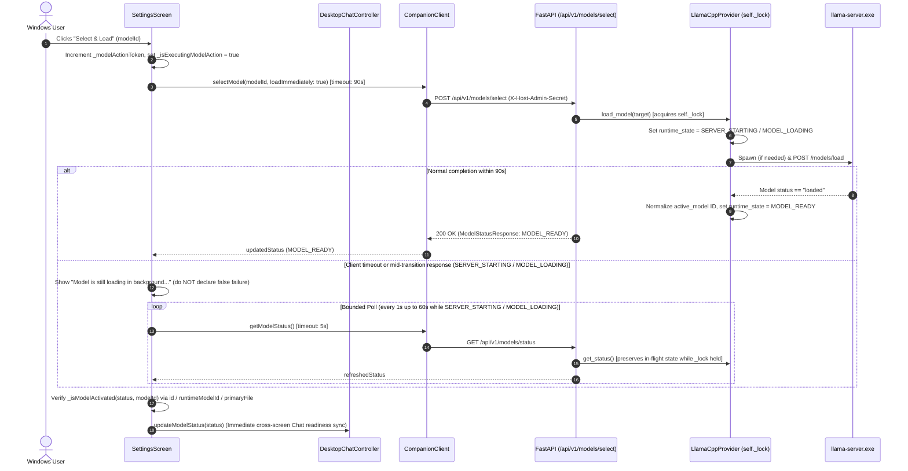

# Implementation Plan — M2 PC-HOST-005: Secure Host Lifecycle, Provider Cleanup & Model-Loading Reliability

- **Status:** `AWAITING HUMAN / INDEPENDENT PLAN REVIEW`
- **Delivery Level:** `Level C — Sensitive Design`
- **Scope Mode:** `New Feature / Security, Lifecycle Hardening & Bounded Model-Loading Reliability`
- **Milestone / Work Items:**
  - **Track A (Primary):** `M2 — PC Companion Foundation` / `PC-HOST-005` (`Host Administration Separation & Secure Lifecycle Authority`)
  - **Track B (Bounded Reliability Extension):** `PC-CLIENT-010` (`Model Management UI`), `PC-CLIENT-004` (`API Client Layer`), and `PC-MODEL-006` (`Single-Resident Model Lifecycle Policy`)
- **Branch:** `feature/m2-secure-host-lifecycle`
- **Target Integration Branch:** `develop`
- **Verified Baseline SHA:** `261d4b43930d3dcdad2dbd913d4dd4d60c8a4887`
- **Previously Reviewed Plan Commit:** `8adfae0f964de81528883f73b8165e1cb9f62fae`
- **Active Branch Tracker:** [`docs/01_Tracking/active/task-feature-m2-secure-host-lifecycle.md`](../../01_Tracking/active/task-feature-m2-secure-host-lifecycle.md)
- **Date:** `2026-11-04`
- **Author / Role:** `Authorized Implementing Agent (Phase 1 Independent Review Revision)`

> [!IMPORTANT]
> **Phase 1 Planning Candidate Notice:** This revised document is a **Phase 1 planning review candidate** published on `feature/m2-secure-host-lifecycle` addressing the Phase 1 Independent Review findings (`C1`–`C6`) and the Human Owner's confirmed Model-Loading Reliability report (`Issue B1`). It is **NOT** approved for Phase 2 implementation, and zero production source code, tests, contracts, or database migrations have been modified in Phase 1. Implementation begins only after explicit **Human Owner** and **Independent Reviewer** plan/design approval.

---

## 1. Corrected Baseline and Scope (`Track A` + `Track B`)

### 1.1 Problem Statement & Two-Track Delivery Scope
This delivery addresses two tightly coupled host/model lifecycle reliability tracks that share the exact same backend provider ([`backend/app/services/llm/llama_cpp.py`](../../../backend/app/services/llm/llama_cpp.py)), Flutter API client ([`frontend/flutter/packages/companion_api/lib/client/companion_client.dart`](../../../frontend/flutter/packages/companion_api/lib/client/companion_client.dart)), and Desktop Settings/Runtime coordinators ([`settings_screen.dart`](../../../frontend/flutter/apps/desktop/lib/screens/settings_screen.dart), [`desktop_runtime_coordinator.dart`](../../../frontend/flutter/apps/desktop/lib/coordinator/desktop_runtime_coordinator.dart)):

1. **Track A — Secure Host Lifecycle & Provider Cleanup (`PC-HOST-005`):**
   - Complete the privileged Host Administration shutdown boundary (`POST /api/v1/system/shutdown` protected by `require_host_admin`).
   - Fix [`LlamaCppProvider`](../../../backend/app/services/llm/llama_cpp.py) lifecycle separation so ordinary model unload (`unload_model()`), stopping the Core-managed `llama-server.exe` router (`stop_managed_router()`), full runtime shutdown (`shutdown()`), and supervisor emergency recovery are distinct, deterministic, and never orphan Core-managed `llama-server.exe` processes or kill externally started routers (`Issue A1`).
   - Replace unverified Windows `SIGINT` self-signaling with deterministic in-process `uvicorn.Server.should_exit = True` lifecycle control (`Correction C1`), whole-runtime mutation admission control and drain before `dispose_database_runtime()` (`Correction C6`), Route A vs. Route B native worker cancellation safety (`Correction C3`), and handle-bound TOCTOU-free OS fallback termination (`Correction C2`).
   - Wire `HostAdminSecretStore` into `DesktopRuntimeCoordinator` (`Correction C4`) and unify the System Tray and Settings **"Exit Companion"** actions behind a mandatory confirmation dialog (`Issue A2`).
2. **Track B — Model-Loading Reliability & Readiness Reconciliation (`Issue B1` — Bounded Extension under `PC-CLIENT-010` / `PC-CLIENT-004` / `PC-MODEL-006`):**
   - Resolve the user-observed defect where selecting/loading a model in Settings reports an activation timeout after 5 seconds while `llama-server.exe` continues spawning and loading weights in the background, leaving the UI falsely reporting the model as unloaded until the user clicks **Load Model** a second time.

### 1.2 Canonical WBS Ownership & Scope Recommendation for Track B
In [`docs/02_Planning/00_Master/WBS.md`](../../02_Planning/00_Master/WBS.md) and [`docs/02_Planning/00_Master/DELIVERY_INDEX.md`](../../02_Planning/00_Master/DELIVERY_INDEX.md), model selection, loading transport, and single-resident router lifecycle map to:
- **`PC-CLIENT-004`** (*API Client Layer* — OpenAPI-derived Dart client, request timeouts, transport error handling).
- **`PC-CLIENT-010`** (*Model Management UI* — Settings model selection, load/unload controls, status display, previously hardened alongside `PC-CLIENT-006` in [`plan-desktop-chat-quality-followup.md`](plan-desktop-chat-quality-followup.md)).
- **`PC-MODEL-006`** (*Single-Resident Model Lifecycle Policy & Advanced Multi-Model Warning Guard*).

**Architectural Recommendation:** Include Track B as a **bounded in-scope reliability correction** within this `feature/m2-secure-host-lifecycle` delivery rather than deferring it to a separate branch:
- Both Track A and Track B modify [`LlamaCppProvider`](../../../backend/app/services/llm/llama_cpp.py) (`_lock`, `_server_process`, `_managed_by_core`, `load_model()`, `unload_model()`, `get_status()`, `shutdown()`), [`CompanionClient._requestWithoutRedirects` / `_adminRequest`](../../../frontend/flutter/packages/companion_api/lib/client/companion_client.dart), and [`SettingsScreen`](../../../frontend/flutter/apps/desktop/lib/screens/settings_screen.dart).
- Fixing the 5-second hardcoded client timeout, the `get_status()` lockless state-clobber race, model ID normalization, timeout-to-polling reconciliation, and `DesktopChatController` model-status synchronization requires ~120 lines of targeted surgical changes in the exact files already opened for `PC-HOST-005`, eliminating merge conflicts and immediately resolving a user-facing reliability bug without introducing a multi-job async queue architecture.

### 1.3 Canonical References

| Canonical Document | Normative Sections & Requirements |
| :--- | :--- |
| [`docs/04_Architecture/SYSTEM_BASELINE.md`](../../04_Architecture/SYSTEM_BASELINE.md) | **§2 & §5:** Single-Machine Split Architecture; Local AI Runtime (`127.0.0.1:8000`) runs independently of Flutter UI; **Close Window (`×`)** hides UI to tray; **Exit Companion** performs confirmed full shutdown of UI + Local AI Runtime + Core-managed `llama.cpp`; **Host Administration Authority (`D15`)** separates normal Profile Session (`psk_`) and Device Pairing (`companion_sec_`) tokens from host-wide privileged operations (`X-Host-Admin-Secret`). |
| [`docs/04_Architecture/04_Infrastructure/windows-host-and-notifications.md`](../../04_Architecture/04_Infrastructure/windows-host-and-notifications.md) | **§1.2, §1.3, §2.1, §2.2, §4.2:** Four distinct lifecycle actions (**Close Window (`×`)**, **Quit UI Only (Dev/Diagnostics)**, **Pause Companion** [deferred], **Exit Companion**); mandatory user confirmation before full shutdown; intentional exit suppresses crash-recovery restart loops; `PC-HOST-005` owns authenticated host shutdown. |
| [`docs/04_Architecture/02_Data_and_Security/profiles-and-devices.md`](../../04_Architecture/02_Data_and_Security/profiles-and-devices.md) | **§1.3 & §3.2 (`D15`):** Profile sessions and remote paired devices must never stop the host runtime or mutate shared host-wide process state. |
| [`docs/04_Architecture/02_Data_and_Security/authentication-and-secrets.md`](../../04_Architecture/02_Data_and_Security/authentication-and-secrets.md) | **§1.1, §2.2, §3.1, §5.3 (`D15`):** `%LOCALAPPDATA%\AICompanion\secrets\desktop_admin.secret` ACL-restricted to current Windows user SID + `SYSTEM`; `X-Host-Admin-Secret` required with loopback IP/Host and non-browser (`Origin`/`Sec-Fetch-Site` rejected) enforcement. |
| [`docs/04_Architecture/04_Infrastructure/runtime-and-models.md`](../../04_Architecture/04_Infrastructure/runtime-and-models.md) | **§2.2 & §5.3:** Core-managed `llama-server.exe` lifecycle ownership (`_managed_by_core`), single-resident model loading, active generation cancellation, and clean subprocess termination on runtime exit. |
| [`docs/05_Design/01_PC_Desktop_Shell_and_Tray.md`](../../05_Design/01_PC_Desktop_Shell_and_Tray.md) | **§5 (Tray & Background Behavior):** Tray menu actions and explicit user-facing distinction between hiding window, developer UI-only exit, and confirmed full **"Exit Companion"** shutdown. |
| [`docs/04_Architecture/decisions/ADR-0003-d2-windows-host-model.md`](../../04_Architecture/decisions/ADR-0003-d2-windows-host-model.md) | **ADR-0003 (`D2`) — Per-User Background Host Model:** Runtime runs under interactive Windows user session without requiring UAC elevation or a Windows Service (`services.msc`). |

---

## 2. Independently Supported Source Findings

Direct inspection of the repository on `feature/m2-secure-host-lifecycle` (base `develop` SHA `261d4b43930d3dcdad2dbd913d4dd4d60c8a4887`) established the following verified facts vs. hypotheses:

| Finding ID | Classification | Exact Source Evidence | Summary of Verified Mechanism / Defect |
| :--- | :--- | :--- | :--- |
| **`Issue A1`** | **Confirmed Source Defect** | [`backend/app/services/llm/llama_cpp.py`](../../../backend/app/services/llm/llama_cpp.py#L663-L711) & [`#L1086-L1105`](../../../backend/app/services/llm/llama_cpp.py#L1086-L1105) | `LlamaCppProvider.shutdown()` calls `await self.unload_model()`, which returns `True` at line 677 immediately after HTTP `POST /models/unload` succeeds (`"unloaded via router API (router alive)"`), skipping lines 681–690 where `self._server_process` (`llama-server.exe`) is terminated. Also, if `_active_work_drained.wait()` times out at line 1099, `shutdown()` returns early at line 1104 without stopping `self._server_process`. |
| **`Issue A2`** | **Confirmed Source Defect** | [`frontend/flutter/apps/desktop/lib/screens/settings_screen.dart`](../../../frontend/flutter/apps/desktop/lib/screens/settings_screen.dart#L563-L569) & [`desktop_lifecycle_coordinator.dart`](../../../frontend/flutter/apps/desktop/lib/lifecycle/desktop_lifecycle_coordinator.dart#L72-L87) | Settings **Exit Companion** calls `coordinator?.handleExitRequested()`, which immediately closes the Flutter UI (`exit(0)`) without confirmation and leaves the detached Local AI Runtime running. Meanwhile, System Tray `exit_full` is hardcoded `disabled: true`. |
| **`Issue B1-RC1`** | **Confirmed Source Defect** | [`frontend/flutter/packages/companion_api/lib/client/companion_client.dart`](../../../frontend/flutter/packages/companion_api/lib/client/companion_client.dart#L102-L108) & [`#L238-L270`](../../../frontend/flutter/packages/companion_api/lib/client/companion_client.dart#L238-L270) | `_requestWithoutRedirects()` enforces a hardcoded `const Duration(seconds: 5)` timeout on **all** `_adminRequest` calls, including `selectModel(..., loadImmediately: true)` and `loadModel()`. Meanwhile, [`LlamaCppProvider.load_model()`](../../../backend/app/services/llm/llama_cpp.py#L246-L278) allows up to `45.0s` for `llama-server.exe` startup (`#L610-L631`) plus `45.0s` POST + `30.0s` polling in `_router_load_model()`. Any model load taking $> 5.0\text{s}$ deterministically throws `TimeoutException` in Flutter while the backend continues loading weights in the background. |
| **`Issue B1-RC2`** | **Confirmed Source Defect** | [`frontend/flutter/apps/desktop/lib/screens/settings_screen.dart`](../../../frontend/flutter/apps/desktop/lib/screens/settings_screen.dart#L1025-L1046) | When `selectModel` throws `TimeoutException` at $t = 5.0\text{s}$, the `catch` block performs a single immediate `getModelStatus()` call (while the backend is still in `SERVER_STARTING` or `MODEL_LOADING`), unconditionally overwrites `_modelActionMessage` with `'Model selection saved, but activation failed: TimeoutException... Model is NOT active.'`, sets `_isExecutingModelAction = false`, and performs **zero follow-up polling**. |
| **`Issue B1-RC3`** | **Confirmed Source Defect** | [`backend/app/services/llm/llama_cpp.py`](../../../backend/app/services/llm/llama_cpp.py#L792-L859) | `LlamaCppProvider.get_status()` does not acquire `self._lock` and does not guard against in-flight `SERVER_STARTING` / `MODEL_LOADING` transitions: at lines 830 and 845, a concurrent `get_status()` poll while `llama-server.exe` is starting or loading mutates `self._active_model_name = None` and `self._server_is_active = False`. Furthermore, lines 817–822 assign raw `loaded_model_id` from `llama-server` without normalizing through `find_model_registry_entry(loaded_model_id)`, causing [`settings_screen.dart`](../../../frontend/flutter/apps/desktop/lib/screens/settings_screen.dart#L1014-L1020) `isActivated` check to false-negative when `llama-server` returns a filename/path matching `primaryFile` rather than `id` or `runtimeModelId`. |
| **`Issue B1-RC4`** | **Confirmed Source Defect** | [`frontend/flutter/apps/desktop/lib/screens/settings_screen.dart`](../../../frontend/flutter/apps/desktop/lib/screens/settings_screen.dart#L998-L1047) & [`desktop_chat_controller.dart`](../../../frontend/flutter/apps/desktop/lib/features/chat/desktop_chat_controller.dart#L292-L343) | Unlike `_unloadModel()` (which calls `widget.chatController!.checkConnection()` at line 1082), `_selectModel()` **never notifies `widget.chatController`**, leaving `DesktopChatController._modelStatus` and the Chat screen header model badge stale after model selection/activation in Settings. |
| **`Correction C1`** | **Confirmed Source Evidence** | `backend/.venv/Lib/site-packages/uvicorn/server.py` (lines 96–101, 233–264, 326–340) & [`backend/app/main.py`](../../../backend/app/main.py#L140-L186) | Uvicorn's `Server.main_loop()` checks `self.should_exit` every `0.1s` and exits cleanly into `await self.shutdown(sockets=sockets)` $\rightarrow$ `await self.lifespan.shutdown()`. By contrast, `os.kill(os.getpid(), signal.SIGINT)` on Windows (`pythonw.exe` detached without console) either fails or invokes Win32 `TerminateProcess` / re-raises captured signals (`signal.raise_signal` at `uvicorn/server.py` line 340), bypassing clean lifespan teardown. |
| **`Correction C2`** | **Confirmed Source Evidence** | [`frontend/flutter/apps/desktop/lib/platform/windows_runtime_process_supervisor.dart`](../../../frontend/flutter/apps/desktop/lib/platform/windows_runtime_process_supervisor.dart#L316-L361) | Querying `Win32_Process` by PID and subsequently running a separate `Stop-Process -Id <pid>` has a classic TOCTOU PID-reuse window if the target process exits between the query and the kill command. Opening and holding a single OS process handle (`System.Diagnostics.Process.GetProcessById(pid)`) before verifying identity and calling `.Kill()` on that same handle object eliminates PID reuse because Windows cannot recycle a PID while an open process `HANDLE` exists. |
| **`Correction C3`** | **Confirmed Source Defect** | [`backend/app/services/llm/llama_cpp.py`](../../../backend/app/services/llm/llama_cpp.py#L214-L233) & [`#L969-L1084`](../../../backend/app/services/llm/llama_cpp.py#L969-L1084) | Route A (`httpx.AsyncClient` to `llama-server.exe`) does not abort active HTTP stream tasks on `shutdown()`. Route B (`asyncio.to_thread` calling native C++ `self._llm.create_chat_completion`) cannot be preempted mid-C++-call by `asyncio.Task.cancel()`; if `shutdown()` executes `del self._llm` after a drain timeout while a Route B worker thread is still inside native C++ inference, it risks a native use-after-free crash. |
| **`Correction C4`** | **Confirmed Source Defect** | [`frontend/flutter/apps/desktop/lib/main.dart`](../../../frontend/flutter/apps/desktop/lib/main.dart#L191-L194), [`desktop_runtime_coordinator.dart`](../../../frontend/flutter/apps/desktop/lib/coordinator/desktop_runtime_coordinator.dart#L52-L56), & [`settings_screen.dart`](../../../frontend/flutter/apps/desktop/lib/screens/settings_screen.dart#L950-L953) | `DesktopRuntimeCoordinator` constructs `CompanionClient(baseUrl: baseUrl, credentialStore: credentialStore)` **without `hostAdminStore`**, and `SettingsScreen._resolveClient()` fallback also omits `hostAdminStore`. Any `_adminRequest` call made through `DesktopRuntimeCoordinator._client` (`getSystemStatus()`, `shutdownSystem()`) would fail with `StateError('Host admin secret provider is not configured...')` unless `hostAdminStore` is wired. |
| **`Correction C5`** | **Confirmed Source Evidence** | [`backend/app/api/v1/endpoints/health.py`](../../../backend/app/api/v1/endpoints/health.py#L1-L78), [`desktop_runtime_coordinator.dart`](../../../frontend/flutter/apps/desktop/lib/coordinator/desktop_runtime_coordinator.dart#L155-L171), & [`host_admin.py`](../../../backend/app/core/host_admin.py#L31-L35) | (1) Only `GET /api/v1/health` and `GET /api/v1/system/status` exist (no `/api/v1/health/ready` endpoint exists). (2) Runtime lockfile path is `%LOCALAPPDATA%\AI Companion\runtime.lock` (with space, locked directly via `FileMode.append` + `FileLock.exclusive`, no `.guard` file), whereas Host Admin secret path is `%LOCALAPPDATA%\AICompanion\secrets\desktop_admin.secret` (no space). (3) Runtime port is configurable (`_port`), not hardcoded to `8000`. |
| **`Correction C6`** | **Confirmed Source Evidence** | [`backend/app/api/v1/router.py`](../../../backend/app/api/v1/router.py#L1-L34) & [`backend/app/db/session.py`](../../../backend/app/db/session.py#L84-L115) | Calling `dispose_database_runtime()` while in-flight CRUD requests (messages, memories, tasks, attachments, characters, profiles, auth sessions) are mid-transaction can interrupt SQLite commits. Whole-runtime admission control + in-flight request drain must precede `dispose_database_runtime()`. |

---

## 3. Confirmed Shutdown Defects (`Issue A1` & `Issue A2`)

### 3.1 `Issue A1` — Explicit Separation of Four Provider Lifecycle Operations
Inspection of [`backend/app/services/llm/llama_cpp.py`](../../../backend/app/services/llm/llama_cpp.py) shows that `LlamaCppProvider` tracks whether the `llama-server.exe` process was spawned by AI Companion (`self._managed_by_core = True` at line 588, `self._server_process = subprocess.Popen(...)` at line 575) or was an externally started router discovered on `127.0.0.1:8080` (`Mode 1` at lines 489–537, where `self._managed_by_core = False` and `self._server_process = None`).

We explicitly separate and define four distinct lifecycle operations:

| Operation | Method / Trigger | Target Effect on Model Weights | Target Effect on Core-Managed `llama-server.exe` (`_managed_by_core == True`) | Target Effect on External `llama-server.exe` (`_managed_by_core == False`) | Resulting `LLMRuntimeState` |
| :--- | :--- | :--- | :--- | :--- | :--- |
| **1. Ordinary Model Unload** | `await provider.unload_model()` (`POST /api/v1/models/unload`) | Unloads active model from VRAM (`POST /models/unload` on router or frees `self._llm` if idle). | **Preserves running `llama-server.exe` router** when HTTP `/models/unload` succeeds so subsequent model loads are fast. Only terminates `_server_process` if router HTTP unload fails. | Sends HTTP `POST /models/unload` only; **never** terminates external OS process. | `MODEL_UNLOADED` (or `SERVER_STOPPED` if fallback process kill was required) |
| **2. Stop Managed Router** | `await provider.stop_managed_router()` (Internal helper & router restart path) | Unloaded as part of router stop. | Closes `self._server_client`; terminates `self._server_process` (`terminate()` $\rightarrow$ `wait(5.0s)` $\rightarrow$ `kill()` + `wait(2.0s)`); clears `_server_process`, `_server_pid`, `_managed_by_core = False`. | Closes `self._server_client` and detaches provider state (`_server_is_active = False`); **never** kills external OS process. | `SERVER_STOPPED` |
| **3. Full Runtime Shutdown** | `await provider.shutdown(drain_timeout=5.0)` (`POST /api/v1/system/shutdown` & FastAPI `lifespan` exit) | Releases model weights safely (respecting Route B native worker guard in §7). | Cancels active Route A HTTP streams, waits up to `drain_timeout` for `_active_work_drained`, and **unconditionally executes `await self.stop_managed_router()`** even if drain wait timed out. | Cancels active Route A HTTP streams to the external router and closes `_server_client`; **never** kills external OS process. | `SERVER_STOPPED` |
| **4. Emergency Recovery** | `WindowsRuntimeProcessSupervisor.terminateVerifiedRuntimeProcess()` | N/A (OS process level). | Terminated by supervisor **only** if handle-bound child provenance confirms `llama-server.exe` is the Core-managed child of the verified runtime process (§6). | **Never touched** (fails closed on missing/external provenance). | `RuntimeStatus.stopped` |

### 3.2 `Issue A2` — Preserving Four Distinct Desktop Lifecycle Operations
In [`settings_screen.dart`](../../../frontend/flutter/apps/desktop/lib/screens/settings_screen.dart#L563-L569), the **Exit Companion** button currently calls `coordinator?.handleExitRequested()`, performing an unconfirmed UI-only exit (`exit(0)`) while leaving the Local AI Runtime running. We correct this while preserving all four canonical lifecycle semantics from [`windows-host-and-notifications.md`](../../04_Architecture/04_Infrastructure/windows-host-and-notifications.md) §2.1:

| User Action | Entry Points | Confirmation Required? | Desktop UI (`flutter_desktop.exe`) | Local AI Runtime (`pythonw.exe`) | Core-Managed `llama-server.exe` | Crash-Recovery Auto-Restart |
| :--- | :--- | :--- | :--- | :--- | :--- | :--- |
| **1. Close Window (`×`) / Hide to Tray** | Window titlebar `×` button; Settings **Hide to Tray** button | No | Hidden to System Tray (`windowManager.hide()`) | Continues running | Continues running | Active |
| **2. Quit UI Only (Dev/Diagnostics)** | System Tray `Close UI Only (Dev Test)` (`quit_ui_dev`) | No (Explicit dev-only label) | Exits (`exit(0)`) | Continues running (`ProcessStartMode.detached`) | Continues running | Inactive (UI exited) |
| **3. Pause Companion** | *(Deferred out of `PC-HOST-005`)* | N/A | N/A | N/A | N/A | N/A |
| **4. Exit Companion (Full Shutdown)** | System Tray **Exit Companion** (`exit_full`) AND Settings **Exit Companion** button | **Yes (Mandatory modal confirmation dialog)** | Exits (`exit(0)`) **only after** runtime stop is verified (or user explicitly selects `Quit Desktop UI Only` in failure recovery dialog) | Gracefully drains & exits via `POST /api/v1/system/shutdown` (or handle-bound OS fallback) | Unconditionally terminated via `stop_managed_router()` (or handle-bound child fallback) | **Suppressed** (`_intentionalShutdown = true`) |

---

## 4. Model-Loading Reliability Investigation & Bounded Correction (`Issue B1`)

### 4.1 Answers to the 12 Mandatory Investigation Questions for Track B

1. **What exact endpoint is called when the user selects or loads a model in Settings?**
   - In [`SettingsScreen._selectModel(String modelId)`](../../../frontend/flutter/apps/desktop/lib/screens/settings_screen.dart#L998-L1047), clicking **Select & Load** / **Load Model** calls [`client.selectModel(modelId, loadImmediately: true)`](../../../frontend/flutter/packages/companion_api/lib/client/companion_client.dart#L238-L253), which sends `POST /api/v1/models/select` with JSON body `{"model_id": modelId, "load_immediately": true}` via `_adminRequest`.
2. **What timeout is configured on the Flutter API client, Settings controller, and backend router/model client?**
   - **Flutter API Client (`companion_client.dart` line 106):** `_requestWithoutRedirects()` hardcodes `await _httpClient.send(request).timeout(const Duration(seconds: 5));` for **every** Host Admin request!
   - **Backend `LlamaCppProvider` (`llama_cpp.py`):**
     - `llama-server.exe` process spawn & `/health` loop (`#L610-L631`): up to **45.0 seconds** (`90 * 0.5s`).
     - `_router_load_model()` (`#L246-L278`): `httpx.AsyncClient(timeout=45.0)` for `POST /models/load`, followed by up to **30.0 seconds** (`60 * 0.5s`) polling `GET /models` until `status.value == "loaded"`.
3. **Is model loading synchronous or asynchronous from the HTTP caller's perspective?**
   - Synchronous: [`POST /api/v1/models/select`](../../../backend/app/api/v1/endpoints/llm.py#L223-L300) and [`POST /api/v1/models/load`](../../../backend/app/api/v1/endpoints/llm.py#L140-L220) `await provider.load_model(target)` inside the HTTP handler before returning `ModelStatusResponse`.
4. **What happens if `llama-server.exe` takes longer than the HTTP timeout to start and load model weights?**
   - At $t = 5.0\text{s}$, Flutter's `_requestWithoutRedirects` throws `TimeoutException after 0:00:05.000000: Future not completed`. On the backend, Uvicorn does **not** cancel an in-flight standard endpoint coroutine when the client socket times out, so `provider.load_model()` continues spawning `llama-server.exe` and loading multi-GB GGUF weights into VRAM in the background.
5. **Why does the UI report an error while `llama-server.exe` continues loading in the background?**
   - In [`settings_screen.dart`](../../../frontend/flutter/apps/desktop/lib/screens/settings_screen.dart#L1025-L1046), the `catch (e)` block immediately calls `await client.getModelStatus()` at $t = 5.0\text{s}$ (while `runtime_state` is still `SERVER_STARTING` or `MODEL_LOADING`), unconditionally sets `_modelActionMessage = 'Model selection saved, but activation failed: $e. Model is NOT active.'`, sets `_isExecutingModelAction = false`, and stops polling.
6. **How is `runtime_state` (`SERVER_STOPPED`, `SERVER_STARTING`, `MODEL_LOADING`, `MODEL_READY`, `MODEL_UNLOADED`, `MODEL_ERROR`, etc.) updated and polled?**
   - `LlamaCppProvider` updates `self._runtime_state` during `load_model()` (`SERVER_STARTING` at line 589, `MODEL_LOADING` at line 456/637, `MODEL_READY` at line 461/485). However, **neither `SettingsScreen` nor `DesktopChatController` polls `/api/v1/models/status` while `runtime_state` is `SERVER_STARTING` or `MODEL_LOADING`**, and `LlamaCppProvider.get_status()` (`#L792-L859`) has a bug where polling `/models` on `llama-server` without holding `self._lock` while `load_model()` is mid-flight overwrites `self._active_model_name = None` (line 830) or `self._server_is_active = False` (line 845)!
7. **Why does Chat still believe no model is ready after `llama-server.exe` finishes loading?**
   - Two reasons: (a) [`SettingsScreen._selectModel()`](../../../frontend/flutter/apps/desktop/lib/screens/settings_screen.dart#L998-L1047) **never notifies `widget.chatController`** when a model is selected or loaded (unlike `_unloadModel()` at line 1082), so `DesktopChatController._modelStatus` remains stale; and (b) when `selectModel` timed out at 5s in Settings, nothing ever re-fetched `/api/v1/models/status` once `llama-server.exe` finished loading at $t \approx 8\text{–}25\text{s}$.
8. **Why does clicking `Load Model` a second time appear to succeed immediately?**
   - By the time the user clicks **Load Model** a second time, the background `load_model()` from the first click has already finished loading the model in `llama-server.exe`. The second request enters `LlamaCppProvider.load_model()`, hits either the active-model reuse fast path (`#L425-L442`: `"Requested model matches active model; reusing without reload"`) or `Mode 0` (`#L466-L480`, where `_router_load_model` gets HTTP 400 `"already running"` at `#L254-L256` and returns `True`), completing in $< 10\text{ms}$ (well under the 5s client timeout).
9. **Can clicking `Load Model` a second time race with the first load or spawn duplicate router processes?**
   - `load_model()` acquires `async with self._lock:` (line 378), which serializes `load_model()` calls so two `subprocess.Popen` calls cannot run simultaneously. **However**, because `get_status()` (lines 792–859) runs **without** `self._lock` and mutates `self._server_is_active = False` / `self._active_model_name = None` when probed during startup, a concurrent `get_status()` call during the first load can corrupt provider state right before the queued second `load_model()` enters `self._lock`!
10. **How does model loading interact with single-resident model replacement, model unload, and `Exit Companion` shutdown?**
    - Single-resident replacement (`#L444-L454`) unloads the previous model via `_router_unload_model` inside `self._lock` before loading the new model. If `Exit Companion` (`shutdown()`) is requested while `load_model()` is in flight (`SERVER_STARTING` or `MODEL_LOADING`), `shutdown()` must set `self._closing = True`, cancel any in-flight load/poll wait, and terminate `self._server_process` via `stop_managed_router()`.
11. **Does this belong under `PC-HOST-005`, an existing M2 model/runtime WBS item (`PC-CLIENT-010`, `PC-MODEL-006`, etc.), or a bounded reliability extension?**
    - It maps to `PC-CLIENT-010` / `PC-CLIENT-004` / `PC-MODEL-006` and should be delivered as a **bounded reliability extension** in this branch because it touches the exact same provider lifecycle (`llama_cpp.py`), client transport (`companion_client.dart`), and Settings screen (`settings_screen.dart`) files as `PC-HOST-005`.
12. **What is the smallest clean architecture that makes model loading reliable without redesigning the entire model management subsystem?**
    - (1) Operation-specific HTTP timeouts in `CompanionClient` (`90s` for `selectModel(loadImmediately: true)` and `loadModel()`, `20s` for `unloadModel()`, `5s` default for status/control calls); (2) Lock/transition protection and canonical model ID normalization in `LlamaCppProvider.get_status()` + `_closing` abort check inside `load_model()`; (3) Bounded status-polling reconciliation with monotonic action tokens in `SettingsScreen` whenever a load returns `SERVER_STARTING` / `MODEL_LOADING` or experiences a transport timeout; and (4) Immediate `widget.chatController?.updateModelStatus(...)` synchronization on every Settings model state transition.

### 4.2 End-to-End Bounded Architecture for Track B (Model-Loading Reliability)



#### Specific Code Corrections for Track B:
1. **`CompanionClient` Operation-Specific Timeouts (`companion_client.dart`):**
   - Add `Duration timeout = const Duration(seconds: 5)` to `_requestWithoutRedirects()` and `_adminRequest()`.
   - `selectModel(modelId, {bool loadImmediately = true})`: pass `timeout: loadImmediately ? const Duration(seconds: 90) : const Duration(seconds: 10)`.
   - `loadModel(...)`: pass `timeout: const Duration(seconds: 90)`.
   - `unloadModel()`: pass `timeout: const Duration(seconds: 20)`.
   - `getModelStatus()` and `getModelRegistry()`: add `.timeout(const Duration(seconds: 5))` so status polling cannot hang indefinitely.
2. **`LlamaCppProvider.get_status()` & `load_model()` Hardening (`backend/app/services/llm/llama_cpp.py`):**
   - **Prevent Lockless State Clobbering in `get_status()`:** When `self._lock.locked()` and `self._runtime_state in (LLMRuntimeState.SERVER_STARTING, LLMRuntimeState.MODEL_LOADING, LLMRuntimeState.MODEL_UNLOADING)`, `get_status()` must **not** overwrite `self._active_model_name`, `self._server_is_active`, or `self._runtime_state` with transient empty `/models` responses while `llama-server.exe` is still booting or loading weights; instead, it returns the authoritative in-progress `self._runtime_state` and target model metadata cleanly.
   - **Canonical Model ID Normalization in `get_status()`:** When `get_status()` reads `loaded_model_id` from `http://127.0.0.1:8080/models` (lines 808–822), resolve `entry = find_model_registry_entry(loaded_model_id)` and set `self._active_model_name = entry.runtime_model_id or entry.manifest.id` (falling back to `loaded_model_id` if unmanaged), ensuring `active_model` always matches the canonical registry identifier expected by Flutter.
   - **Shutdown Abort Inside `load_model()` Polling Loops:** In `load_model()`'s router startup poll (`#L610-L631`) and `_router_load_model()`'s load poll (`#L259-L276`), check `if self._closing: return False` on each iteration so an `Exit Companion` request during a 45-second model load aborts the poll within `0.5s` and proceeds to `stop_managed_router()`.
3. **`SettingsScreen` Truthful Reconciliation & Identity Matching (`settings_screen.dart`):**
   - Add `_isTargetModelActive(ModelStatusDto status, String requestedModelId)` that checks `status.runtimeState == 'MODEL_READY'` and matches `status.activeModel` against `requestedModelId`, `entry.id`, `entry.runtimeModelId`, `entry.primaryFile`, or normalized filename stem.
   - Add a monotonic `int _modelActionToken = 0` to fence concurrent/rapid clicks and ignore stale responses if the widget is disposed or a newer model action starts.
   - If `selectModel(..., loadImmediately: true)` returns while `runtimeState` is `'SERVER_STARTING'` or `'MODEL_LOADING'`, or throws `TimeoutException`, enter `_pollUntilModelTransitionCompletes(client, modelId, actionToken, deadline: Duration(seconds: 60))` instead of immediately displaying `"Model is NOT active"`.
   - While polling, keep `_isExecutingModelAction = true` and display truthful progress (`'Loading model weights in Local AI Runtime (${status.runtimeState})...'`).
   - On every model status update in `_selectModel`, `_unloadModel`, and `_loadModelData`, invoke `widget.chatController?.updateModelStatus(updatedStatus)` so the Chat screen header and readiness state synchronize immediately without requiring a second click or screen reload.

---

## 5. Corrected Windows Server Shutdown Mechanism (`Correction C1`)

### 5.1 Why `os.kill(os.getpid(), signal.SIGINT)` Is Rejected on Windows
Independent review noted that the initial plan proposed signaling Uvicorn via `signal.raise_signal(signal.SIGINT)` or `os.kill(os.getpid(), signal.SIGINT)`. Direct inspection of Python's Windows signal implementation and `backend/.venv/Lib/site-packages/uvicorn/server.py` confirms why that approach is unsafe on Windows:
1. On Windows (`win32`), `os.kill(pid, signal.SIGINT)` calls Win32 `TerminateProcess` (for arbitrary signals) or `GenerateConsoleCtrlEvent`. Because [`WindowsRuntimeProcessSupervisor`](../../../frontend/flutter/apps/desktop/lib/platform/windows_runtime_process_supervisor.dart#L294-L303) launches `pythonw.exe` with `ProcessStartMode.detached` (no attached console window), console control events can fail with `OSError`/`SystemError` or terminate the process abruptly without unwinding Python's `asyncio` loop.
2. In `uvicorn/server.py` lines 326–340 (`capture_signals()`), any signal captured by Uvicorn's signal handler is appended to `self._captured_signals` and **re-raised via `signal.raise_signal(captured_signal)` after `serve()` exits**, causing the process to terminate with a non-zero/aborted signal exit status on Windows.

### 5.2 Supported Deterministic Uvicorn Shutdown (`uvicorn.Server.should_exit = True`)
Inspection of `uvicorn/server.py` (lines 67, 96–101, 233–264) proves that Uvicorn natively supports programmatic, signal-free shutdown via `server.should_exit = True`:
- `Server.main_loop(self)` executes `while not await self.on_tick(counter): await asyncio.sleep(0.1)`.
- `Server.on_tick()` checks `if self.should_exit: return True`.
- When `server.should_exit = True` is set in-process (with zero OS signals):
  1. `main_loop()` exits cleanly within $\le 100\text{ms}$.
  2. `_serve()` invokes `await self.shutdown(sockets=sockets)`, which closes all listening TCP sockets (`server.close()`), shuts down active HTTP protocol connections, awaits in-flight task completion (`_wait_tasks_to_complete()`), and executes `await self.lifespan.shutdown()`.
  3. `self.lifespan.shutdown()` runs the FastAPI `lifespan` `finally` block in [`backend/app/main.py`](../../../backend/app/main.py#L178-L186) (`await llm_manager.get_provider().shutdown()` and `await dispose_database_runtime()`).
  4. Because `self._captured_signals` is empty, `serve()` returns normally and Python exits with return code `0`.

### 5.3 How FastAPI Binds and Controls the Active `uvicorn.Server` Instance
We introduce [`backend/app/core/runtime_lifecycle.py`](../../../backend/app/core/runtime_lifecycle.py) containing a singleton `RuntimeLifecycleCoordinator`:
1. **Binding the Live `uvicorn.Server` at Lifespan Startup:**
   - During `lifespan(app: FastAPI)` startup in [`backend/app/main.py`](../../../backend/app/main.py#L140), `runtime_lifecycle.bind_running_uvicorn_server()` locates the active `uvicorn.Server` instance (either registered explicitly or resolved once at startup from the running `asyncio` stack / `gc.get_objects()` where `isinstance(obj, uvicorn.Server)`), stores a reference to it, and configures `server.config.timeout_graceful_shutdown = 8`.
   - This works seamlessly with the existing supervisor launch command (`pythonw.exe -m uvicorn app.main:app --host 127.0.0.1 --port <port>`) without breaking [`WindowsRuntimeProcessSupervisor._looksLikeCompanionUvicornCommand`](../../../frontend/flutter/apps/desktop/lib/platform/windows_runtime_process_supervisor.dart#L459-L473), while also allowing an explicit `runtime_lifecycle.set_server(server)` injection in tests.
2. **Exact Ordered Execution of `POST /api/v1/system/shutdown`:**
   - **Step 1 (Auth & Idempotency):** `require_host_admin` verifies `X-Host-Admin-Secret`, loopback IP/Host, and absence of `Origin`/`Sec-Fetch-Site`. `runtime_lifecycle.initiate_shutdown(reason, drain_timeout_seconds)` transitions state to `SHUTTING_DOWN` (or returns `already_shutting_down=True` if already in progress).
   - **Step 2 (Admission Control Activated Immediately):** The admission-control middleware immediately rejects any *new* mutating HTTP requests (`POST`, `PUT`, `PATCH`, `DELETE`, except `/api/v1/system/shutdown`) with `503 Service Unavailable` (`RUNTIME_SHUTTING_DOWN`).
   - **Step 3 (`202 Accepted` Flush):** The endpoint returns `202 Accepted` (`SystemShutdownResponse`) and schedules `_orchestrate_shutdown_sequence(drain_timeout_seconds)` on the event loop.
   - **Step 4 (Async Shutdown Sequence after `50ms` response flush yield):**
     1. Calls `await llm_manager.get_provider().shutdown(drain_timeout=drain_timeout_seconds)` — cancelling active Route A HTTP generation streams, signaling Route B chunk loops via `_closing = True`, waiting up to `drain_timeout_seconds` (`5.0s` default) for active turns to record `status="cancelled"` in SQLite, and **unconditionally stopping any Core-managed `llama-server.exe`** via `stop_managed_router()`.
     2. Waits up to a bounded quiescence window (`5.0s`) on `runtime_lifecycle.wait_for_in_flight_mutations()` so any already-admitted CRUD transactions finish committing/rolling back their SQLite sessions.
     3. Sets `uvicorn_server.should_exit = True`.
     4. Uvicorn closes the listening socket on the next `100ms` tick and runs `lifespan` `finally` (`await llm_manager.get_provider().shutdown()` [idempotent no-op] and `await dispose_database_runtime()`), exiting cleanly with code `0`.

---

## 6. Identity-Safe OS Termination Design (`Correction C2`)

### 6.1 Eliminating the TOCTOU PID-Reuse Race via Handle-Bound Verification & Termination
In the initial plan, `WindowsRuntimeProcessSupervisor` queried WMI `Win32_Process` and then invoked `Stop-Process -Id <pid>`. As the Independent Reviewer identified, if the target process exited right after the WMI query and Windows recycled that numeric PID for an unrelated process before `Stop-Process -Id <pid>` executed, `Stop-Process` would terminate the wrong process.

**Windows Kernel Guarantee:** On Windows, the OS kernel (`EPROCESS`) **cannot recycle a numeric `ProcessId` while any open process `HANDLE` to that process object exists**. Furthermore, `System.Diagnostics.Process.GetProcessById(int pid)` opens a Win32 process handle (`SafeProcessHandle`) and `$proc.Kill()` invokes Win32 `TerminateProcess($proc.SafeProcessHandle, -1)` **directly on that held handle**, without ever re-resolving the numeric PID!

### 6.2 Single Handle-Bound PowerShell Verification & Termination Protocol
In [`WindowsRuntimeProcessSupervisor.terminateVerifiedRuntimeProcess()`](../../../frontend/flutter/apps/desktop/lib/platform/windows_runtime_process_supervisor.dart), we execute a **single handle-bound PowerShell script** that opens the process handle *first*, verifies all 4 provenance invariants while holding that open handle, and calls `.Kill()` on the exact held `$proc` object:

```powershell
# Conceptual Handle-Bound Verification & Termination Flow (No PID re-resolution)
$proc = $null
try {
  # 1. Open and hold the OS process HANDLE first.
  # While $proc is undisposed, Windows CANNOT recycle $targetPid even if the process exits.
  $proc = [System.Diagnostics.Process]::GetProcessById($targetPid)
  $ _ = $proc.Handle # Force SafeProcessHandle acquisition

  if ($proc.HasExited) { return @{ status = 'alreadyExited' } | ConvertTo-Json -Compress }

  # 2. Query StartTime and MainModule directly from the held process handle + WMI CommandLine
  $startTimeUtc = $proc.StartTime.ToUniversalTime().ToString('o')
  $wmi = Get-CimInstance Win32_Process -Filter "ProcessId = $targetPid" -ErrorAction Stop
  if ($proc.HasExited -or $null -eq $wmi) { return @{ status = 'alreadyExited' } | ConvertTo-Json -Compress }

  # 3. Verify all 4 provenance invariants BEFORE any termination:
  #    (a) PID matches expectedDescriptor.pid
  #    (b) ExecutablePath matches python.exe / pythonw.exe and expectedDescriptor.executablePath
  #    (c) CommandLine contains 'uvicorn', 'app.main:app', and '--port <expectedPort>'
  #    (d) |startTimeUtc - expectedStartedAtUtc| <= 15 seconds
  if (-not $provenanceMatched) {
    return @{ status = 'provenanceMismatch'; reason = $mismatchReason } | ConvertTo-Json -Compress
  }

  # 4. Terminate directly via the held SafeProcessHandle ($proc.Kill()), NEVER by re-querying PID!
  $proc.Kill()
  $exited = $proc.WaitForExit($timeoutMs)
  return @{ status = if ($exited) { 'terminated' } else { 'timeout' } } | ConvertTo-Json -Compress
} finally {
  if ($null -ne $proc) { $proc.Dispose() }
}
```

**Why This Eliminates TOCTOU Completely:**
- **Scenario 1 (Runtime exited *before* `GetProcessById` and PID was reused by a foreign process):** `GetProcessById` opens a handle to the foreign process. Its `$proc.StartTime`, `ExecutablePath`, and `CommandLine` are inspected while the handle is pinned, deterministically failing the 4-factor check (`provenanceMismatch`), and `$proc.Kill()` is **never** called.
- **Scenario 2 (Runtime is alive when `GetProcessById` opens `$proc.Handle`, and exits *during* verification):** Because `$proc.Handle` is open, the Windows kernel **cannot** assign `$targetPid` to any new process while `$proc` is held. Calling `$proc.Kill()` on the already-exited handle safely traps `InvalidOperationException` / `Win32Exception` and reports `alreadyExited` without touching any other process.

### 6.3 Handle-Bound Verification of Core-Managed Child `llama-server.exe`
When emergency OS fallback termination runs because the local runtime is unresponsive:
- The supervisor **never** kills `llama-server.exe` by image name (`taskkill /IM llama-server.exe`) or by parent PID alone.
- `GET /api/v1/system/status` and `POST /api/v1/system/shutdown` expose `managed_llm_pid: int | None` and `managed_by_core: bool` (only populated when `LlamaCppProvider._managed_by_core == True`).
- For any candidate child `llama-server.exe` (discovered either via `ProcessId == managedLlmPid` or `ParentProcessId == verifiedRuntimePid` while the parent runtime handle `$proc` is still held open):
  1. Open and hold `$childProc = [System.Diagnostics.Process]::GetProcessById($childPid)` first.
  2. While holding `$childProc.Handle`, verify:
     - `ExecutablePath` basename is `llama-server.exe`.
     - `CommandLine` contains `--models-dir` and `--port`.
     - `$childProc.StartTime.ToUniversalTime() >= $verifiedRuntimeStartTimeUtc` (proving the child process was spawned *after* the verified runtime instance started, not before!).
     - `wmiChild.ParentProcessId == $verifiedRuntimePid` (or `ProcessId == $reportedManagedLlmPid` when `managed_by_core == true`).
  3. Only if all child provenance checks pass, invoke `$childProc.Kill()` and `$childProc.WaitForExit($timeoutMs)` on the held `$childProc` handle.
  4. **Fail-Closed Rule:** If `managed_by_core == False` (externally managed router) or any provenance field is missing or ambiguous, the supervisor **refuses to terminate** the `llama-server.exe` process.

---

## 7. Route A and Route B Resource Safety (`Correction C3`)

Inspection of [`backend/app/services/llm/llama_cpp.py`](../../../backend/app/services/llm/llama_cpp.py#L191-L233) and [`backend/app/services/assistant/orchestrator.py`](../../../backend/app/services/assistant/orchestrator.py#L195-L220) reveals fundamentally different execution models for Route A and Route B that must be handled explicitly during shutdown:

| Dimension | Route A: Standalone `llama-server.exe` Router (HTTP) | Route B: In-Process `llama-cpp-python` (`asyncio.to_thread` Native C++) |
| :--- | :--- | :--- |
| **How Inference Executes** | Async HTTP POST (`httpx.AsyncClient`) to `http://127.0.0.1:8080/v1/chat/completions` (`#L969-L985`, `#L1031-L1043`). | Worker thread spawned via `_start_owned_worker` (`asyncio.to_thread(owned_worker)`) calling C++ `self._llm.create_chat_completion(...)` (`#L988-L1004`, `#L1046-L1084`). |
| **Effect of `asyncio.Task.cancel()`** | **Immediately aborts** the awaiting `httpx` coroutine/stream and closes the client socket. | Cancels only the Python awaiting wrapper future; the underlying OS `ThreadPoolExecutor` thread continues executing inside native C++ until the current C++ call or token chunk yields! |
| **How `shutdown()` Stops Generation** | 1. Cancels all tracked active generation `asyncio.Task`s (`self._active_generation_tasks`).<br>2. Calls `stop_managed_router()`, terminating `llama-server.exe` and immediately halting GPU kernel execution in the child process. | 1. Sets `self._closing = True` and cancels the awaiting consumer task.<br>2. In `_worker` streaming loop (`for chunk in stream:` at `#L1058`), checks `if self._closing: break` on every token chunk, exiting the worker thread at the very next token boundary (typically $< 50\text{–}200\text{ms}$). |
| **Native Memory Safety Invariant (`self._llm`)** | Weights reside in child process memory (`llama-server.exe`), reclaimed by the OS when the child process exits. | **CRITICAL SAFETY RULE:** If `self._active_work_drained.wait()` times out during `shutdown()` and a Route B native thread is still active (`self.has_active_generation == True`), `shutdown()` **MUST NOT** execute `del self._llm` or `gc.collect()` while the C++ thread is still running (which would cause a native C++ use-after-free segfault). `self._llm` is freed only when `_active_work_drained.is_set()` is `True`. |
| **SQLite Turn Status Integrity (`orchestrator.py`)** | **Guaranteed:** Cancelling the consumer stream raises `asyncio.CancelledError` in `orchestrate_chat_stream` (`#L518`), rolling back the turn session and running `await asyncio.shield(_persist_terminal_assistant_status(..., status="cancelled"))` (`#L529-L538`) **before** `dispose_database_runtime()` is called. | **Guaranteed:** Even if a Route B non-streaming C++ call takes $> 5\text{s}$ to finish on its background thread, cancelling the awaiting request coroutine immediately triggers `orchestrate_chat_stream`'s shielded `status="cancelled"` DB commit before `dispose_database_runtime()` runs. |

---

## 8. Host Admin Credential Wiring (`Correction C4`)

### 8.1 Verified Wiring Defect in Current Code
Inspection of [`frontend/flutter/apps/desktop/lib/main.dart`](../../../frontend/flutter/apps/desktop/lib/main.dart#L162-L195), [`desktop_runtime_coordinator.dart`](../../../frontend/flutter/apps/desktop/lib/coordinator/desktop_runtime_coordinator.dart#L37-L106), and [`settings_screen.dart`](../../../frontend/flutter/apps/desktop/lib/screens/settings_screen.dart#L941-L954) confirmed:
1. In `main.dart` line 165, `DesktopChatController`'s `CompanionClient` receives `hostAdminStore: HostAdminSecretStore()`.
2. However, in `main.dart` lines 191–194, `DesktopRuntimeCoordinator` is constructed with only `baseUrl` and `credentialStore`, and inside [`DesktopRuntimeCoordinator`](../../../frontend/flutter/apps/desktop/lib/coordinator/desktop_runtime_coordinator.dart#L52-L56) (and `updateConfiguration` at lines 102–105), it instantiates `CompanionClient(baseUrl: baseUrl, credentialStore: credentialStore)` **without `hostAdminStore`**.
3. Similarly, in [`SettingsScreen._resolveClient()`](../../../frontend/flutter/apps/desktop/lib/screens/settings_screen.dart#L950-L953), the fallback `CompanionClient` when `widget.chatController == null` also omits `hostAdminStore`.
4. Consequently, whenever `DesktopRuntimeCoordinator` calls `_client.getSystemStatus()` (line 368) or the new `_client.shutdownSystem()`, `CompanionClient._adminRequest` throws `StateError('Host admin secret provider is not configured for this client.')` (which `_probeHealth` previously swallowed inside `catch (_) {}` at line 373!).

### 8.2 Complete End-to-End Host Admin Credential Flow
1. **Backend Secret Provisioning (`backend/app/core/host_admin.py`):**
   - During FastAPI `lifespan` startup, `initialize_host_admin_secret()` creates `%LOCALAPPDATA%\AICompanion\secrets\desktop_admin.secret` (or `COMPANION_HOST_ADMIN_SECRET_FILE` override in isolated tests) with Windows DACL `O:<user_sid>D:P(A;;FA;;;<user_sid>)(A;;FA;;;SY)` and non-reparse verification.
2. **Flutter `HostAdminSecretStore` (`host_admin_secret_store.dart`):**
   - Verifies via PowerShell that no directory component is a reparse point and that the file ACL grants access solely to the current Windows user SID and `NT AUTHORITY\SYSTEM` before reading the `hsk_...` secret.
   - Supports an optional `String? secretFilePathOverride` (or `COMPANION_HOST_ADMIN_SECRET_FILE` environment variable) so isolated Windows acceptance tests can test real ACL-verified secret reading without touching the developer's global `%LOCALAPPDATA%`.
3. **Wiring `hostAdminStore` Across All Desktop Clients:**
   - Add `CredentialStore? hostAdminStore` to `DesktopRuntimeCoordinator` (defaulting to `HostAdminSecretStore()` on Windows when not explicitly passed, and preserved across `updateConfiguration()`).
   - Pass the shared `HostAdminSecretStore` instance in [`main.dart`](../../../frontend/flutter/apps/desktop/lib/main.dart#L191-L194) and [`SettingsScreen._resolveClient()`](../../../frontend/flutter/apps/desktop/lib/screens/settings_screen.dart#L950-L953).
   - `CompanionClient._adminRequest` automatically clears and re-reads `hostAdminStore` once on `401`/`403` (lines 72–90 of `companion_client.dart`), handling secret rotation seamlessly when a runtime restarts.

---

## 9. Actual Routes, File Paths and Contracts (`Correction C5`)

To prevent any contract or path drift, all components in Phase 2 will adhere to the exact routes and file paths verified in the repository:

### 9.1 Verified HTTP Endpoints (`backend/app/api/v1/endpoints/health.py`)

| Endpoint | Auth Dependency | Current Status | Phase 2 Contract Behavior |
| :--- | :--- | :--- | :--- |
| `GET /api/v1/health` | Public (`health_router`) | Exists (`#L20-L26`) | Returns `200 OK` (`status="healthy"`) when running; returns `503 Service Unavailable` (`status="shutting_down"`) once `RuntimeLifecycleCoordinator.is_shutting_down` is `True`. *(Note: There is no `/api/v1/health/ready` endpoint in the repository; all references to `/health/ready` are removed.)* |
| `GET /api/v1/system/status` | `Depends(require_host_admin)` (`system_router`) | Exists (`#L44-L78`) | Extended with optional telemetry fields: `shutting_down: bool = False`, `managed_llm_pid: int | None = None`, and `managed_by_core: bool = False`. |
| `POST /api/v1/system/shutdown` | `Depends(require_host_admin)` (`system_router`) | **New in Phase 2** | Accepts optional `SystemShutdownRequest(reason="user_exit_companion", drain_timeout_seconds=5.0)`. Returns `202 Accepted` with `SystemShutdownResponse(status="shutting_down", pid=os.getpid(), managed_llm_pid=..., managed_by_core=..., already_shutting_down=...)`. |

### 9.2 Verified Windows File Paths & Lock Semantics

| Artifact | Canonical Default Path | Environment Override | Locking & Cleanup Semantics |
| :--- | :--- | :--- | :--- |
| **Runtime Lockfile** | `%LOCALAPPDATA%\AI Companion\runtime.lock` *(Note space in `AI Companion`, defined in [`desktop_runtime_coordinator.dart`](../../../frontend/flutter/apps/desktop/lib/coordinator/desktop_runtime_coordinator.dart#L155))* | `COMPANION_LOCK_FILE` | Locked **directly** via `lockFile.open(mode: FileMode.append)` + `handle.lock(FileLock.exclusive)` in [`WindowsRuntimeProcessSupervisor.acquireStartupLock`](../../../frontend/flutter/apps/desktop/lib/platform/windows_runtime_process_supervisor.dart#L68-L90). *(There is no `.guard` file.)* Because Windows forbids deleting a file while a handle is open, cleanup truncates the file to `0` bytes through the exclusive `RandomAccessFile` handle (`setPosition(0)` + `truncate(0)` + `flush()`)—which `readDescriptorThroughHandle` (`#L120`) and `readDescriptorDirect` (`#L137`) already treat as empty/absent—then unlocks/closes the handle and performs a best-effort `lockFile.delete()`. |
| **Runtime Logfile** | `%LOCALAPPDATA%\AI Companion\Logs\runtime.log` (`#L169`) | `COMPANION_LOG_FILE` | Append-only runtime stdout/stderr log. Preserved across shutdown for diagnostics. |
| **Host Admin Secret** | `%LOCALAPPDATA%\AICompanion\secrets\desktop_admin.secret` *(Note no space in `AICompanion`, defined in [`host_admin.py`](../../../backend/app/core/host_admin.py#L33) & [`host_admin_secret_store.dart`](../../../frontend/flutter/apps/desktop/lib/platform/host_admin_secret_store.dart#L20))* | `COMPANION_HOST_ADMIN_SECRET_FILE` *(Added in Phase 2 for hermetic tests)* | Protected by Windows DACL (`current user SID + SYSTEM`) and non-reparse check. Rotated on each runtime startup. |

### 9.3 Dynamic Port Handling
- Neither the backend nor the Flutter supervisor/coordinator may hardcode port `8000` during shutdown or provenance verification.
- `DesktopRuntimeCoordinator` uses its configured `_port` (and `expectedDescriptor.port` from `runtime.lock`), and `LlamaCppProvider` uses `settings.LLAMA_ROUTER_PORT`.

---

## 10. Runtime Admission Control and Whole-Runtime Quiescence (`Correction C6`)

### 10.1 Inventory of State-Changing Routes Across the Runtime
Inspection of [`backend/app/api/v1/router.py`](../../../backend/app/api/v1/router.py) and all endpoint modules identifies every route that mutates SQLite state or host files:

| Domain | Mutating Endpoints (`POST`, `PUT`, `PATCH`, `DELETE`) | Underlying Persistence / Resource |
| :--- | :--- | :--- |
| **Models & Host Config** | `POST /api/v1/models/load`, `POST /api/v1/models/select`, `POST /api/v1/models/unload`, `PATCH /api/v1/models/profile` | `host_config.json` + `LlamaCppProvider` subprocess/VRAM |
| **Conversations & Chat** | `POST /api/v1/conversations`, `PATCH /api/v1/conversations/{id}`, `DELETE /api/v1/conversations/{id}`, `POST /api/v1/conversations/{id}/generate-title`, `POST /api/v1/conversations/{id}/messages`, `POST /api/v1/chat/completions` | SQLite `conversations`, `messages`, `chat_requests` (`prepare_turn`, `orchestrate_chat_stream`, `_persist_terminal_assistant_status`) |
| **Attachments** | `POST /api/v1/conversations/{id}/attachments`, `DELETE /api/v1/conversations/{id}/attachments/{att_id}` | Files in `ATTACHMENT_DIR` + SQLite `attachments` |
| **Memories** | `POST /api/v1/memories`, `PATCH /api/v1/memories/{id}`, `DELETE /api/v1/memories/{id}` | SQLite `memories` + FTS5 index triggers |
| **Tasks** | `POST /api/v1/tasks`, `PATCH /api/v1/tasks/{id}`, `DELETE /api/v1/tasks/{id}`, `POST /api/v1/tasks/{id}/restore`, `DELETE /api/v1/tasks/{id}/permanent` | SQLite `tasks` |
| **Characters** | `PUT /api/v1/characters/active`, `POST /api/v1/characters/active/reset-neutral`, `POST /api/v1/characters/instances`, `PATCH /api/v1/characters/instances/{id}`, `DELETE /api/v1/characters/instances/{id}` | SQLite `character_instances`, `profiles` |
| **Profiles & Auth** | `POST /api/v1/profiles`, `PATCH /api/v1/profiles/{id}`, `POST /api/v1/auth/bootstrap/request`, `POST /api/v1/auth/bootstrap/ticket`, `POST /api/v1/auth/session/exchange`, `POST /api/v1/auth/session/revoke` | SQLite `profiles`, `profile_sessions`, `device_pairings` |

### 10.2 Proportionate Whole-Runtime Quiescence Middleware & Drain Order
Instead of scattering manual `if is_shutting_down:` checks into dozens of route handlers, `RuntimeLifecycleCoordinator` integrates cleanly via a lightweight ASGI/HTTP middleware in [`backend/app/main.py`](../../../backend/app/main.py):
1. **Admission Gate:**
   - Once `runtime_lifecycle.is_shutting_down` is `True`, any incoming mutating HTTP request (`request.method in {"POST", "PUT", "PATCH", "DELETE"}`) whose path is **not** `/api/v1/system/shutdown` is rejected **before** entering routing or opening a `get_db()` SQLite session, returning `503 Service Unavailable`:
     ```json
     {
       "detail": {
         "code": "RUNTIME_SHUTTING_DOWN",
         "message": "Local AI Runtime is shutting down and cannot accept new state-changing requests."
       }
     }
     ```
   - Read-only `GET /api/v1/system/status` and `POST /api/v1/system/shutdown` remain permitted so the supervisor can poll status or retry shutdown idempotently.
2. **In-Flight Mutation Accounting (`_in_flight_mutations` & `_mutations_drained` Event):**
   - Every admitted mutating request increments `runtime_lifecycle._in_flight_mutations` upon admission and decrements it in a `finally:` block *after* the route handler and its `get_db()` dependency (`session.commit()` / `session.rollback()` / `session.close()`) have completely finished.
   - When `_in_flight_mutations` reaches `0`, `_mutations_drained.set()` fires.
3. **Strict Teardown Ordering Before `dispose_database_runtime()`:**
   - During `_orchestrate_shutdown_sequence()`:
     1. `is_shutting_down = True` blocks any new mutations from starting.
     2. `await llm_manager.get_provider().shutdown(drain_timeout=5.0)` cancels active streaming chat turns (triggering `orchestrate_chat_stream`'s shielded `_persist_terminal_assistant_status(..., status="cancelled")` SQLite write) and terminates `llama-server.exe`.
     3. `await runtime_lifecycle.wait_for_in_flight_mutations(timeout=5.0)` waits for all already-admitted CRUD transactions and the shielded cancellation write to complete and close their SQLite sessions.
     4. `uvicorn_server.should_exit = True` closes listening sockets and triggers FastAPI `lifespan` `finally` $\rightarrow$ `await dispose_database_runtime()`.

---

## 11. Timeout and Readiness Semantics

We enforce a strict architectural distinction between **transport timeouts**, **in-progress backend work**, and **authoritative terminal states**:

| Lifecycle Flow | Transport / HTTP Request Timeout | In-Progress Backend State | Authoritative Completion Condition |
| :--- | :--- | :--- | :--- |
| **Model Selection / Load (`Track B`)** | `90s` on `POST /api/v1/models/select` (`loadImmediately: true`) and `POST /api/v1/models/load`; `5s` on `GET /api/v1/models/status`. A client timeout means only *"the HTTP call did not finish within the window"*, **not** *"the model failed to load"*. | `runtime_state` is `SERVER_STARTING` or `MODEL_LOADING`. UI displays progress and polls `GET /api/v1/models/status` every `1.0s` (up to `60s` post-timeout deadline). | **Success:** `GET /api/v1/models/status` returns `runtime_state == "MODEL_READY"` and normalized `active_model` matches target model.<br>**Failure:** `runtime_state` enters `MODEL_ERROR` / `SERVER_ERROR`, or the bounded poll deadline expires without reaching `MODEL_READY`. |
| **Full Host Shutdown (`Track A`)** | `5s` on `POST /api/v1/system/shutdown`. Receiving `202 Accepted` means *"cooperative shutdown initiated"*, **not** *"runtime has exited"*. | `RuntimeStatus.shuttingDown`. Coordinator polls OS process liveness and port closure every `250ms` for up to `8.0s` before invoking handle-bound OS fallback (`8.0s` timeout). | **Success (`RuntimeStatus.stopped`):** Verified runtime PID and any Core-managed child `llama-server.exe` PID have exited the OS process table, and `runtime.lock` is cleared.<br>**Failure (`RuntimeStatus.shutdownFailed`):** Process remains alive or provenance mismatch prevents safe termination. |

---

## 12. Failure Recovery and State Reconciliation

### 12.1 Host Shutdown Failure Recovery (`RuntimeStatus.shutdownFailed`)
If cooperative `POST /api/v1/system/shutdown` fails/times out **and** handle-bound OS fallback termination returns `timeout`, `failure`, or `provenanceMismatch` while the process remains alive:
1. `DesktopRuntimeCoordinator` transitions to `RuntimeStatus.shutdownFailed` with a specific, human-readable `errorMessage`.
2. The Flutter Desktop UI **does NOT silently exit**.
3. `DesktopShell` displays a structured **Shutdown Failed Dialog** with three explicit actions:
   - **`Retry Shutdown`** — Re-invokes `coordinator.shutdownLocalRuntime()`.
   - **`Quit Desktop UI Only (Leave Runtime State As-Is)`** — Explicitly warns that the background process could not be stopped and exits only the Flutter UI (`handleExitRequested()`).
   - **`Cancel`** — Keeps the Desktop UI open so the user can inspect Settings / diagnostics.

### 12.2 Model-Loading Failure & Interrupted Transition Recovery
1. **Mid-Load User Retry / Model Switch:**
   - In `SettingsScreen`, `_isExecutingModelAction` disables duplicate clicks on the same load button while a load or reconciliation poll is active.
   - If a new action is triggered after an earlier one, incrementing `_modelActionToken` ensures any late-arriving response or poll iteration from the superseded action is ignored.
2. **Router Crash or Port Conflict During Model Load:**
   - If `llama-server.exe` exits prematurely during startup (`self._server_process.poll() is not None` at `llama_cpp.py` line 614) or `/models/load` returns an error, `LlamaCppProvider` calls `await self.stop_managed_router()` to clean up any half-started process, transitions to `LLMRuntimeState.MODEL_ERROR` / `SERVER_ERROR` with a diagnostic `_last_error_message`, and surfaces that exact error in Settings and Chat.

---

## 13. Security Threat Scenarios & Privilege Boundaries

| Threat Scenario | Attack Vector | Defense-in-Depth Mitigation | Expected Result |
| :--- | :--- | :--- | :--- |
| **T1: Browser / CSRF / Local Web App Shutdown** | Malicious website or local web page sends `POST http://127.0.0.1:8000/api/v1/system/shutdown`. | `require_host_admin` rejects any request carrying `Origin` or `Sec-Fetch-Site` headers (`403 Forbidden`) and requires `X-Host-Admin-Secret`. | **Blocked (`403 Forbidden`)** |
| **T2: DNS Rebinding Attack** | Browser rebinds external domain to `127.0.0.1` and sends request with `Host: attacker.com`. | `require_host_admin` validates `Host` header hostname is strictly `127.0.0.1`, `localhost`, or `[::1]`. | **Blocked (`403 Forbidden`)** |
| **T3: Normal Profile Session Escalation** | Compromised or non-admin Profile session sends `X-Profile-Session: psk_...` to `/api/v1/system/shutdown`. | `require_host_admin` ignores `X-Profile-Session` and requires constant-time match of `X-Host-Admin-Secret` (`hsk_...`). | **Blocked (`403 Forbidden`)** |
| **T4: Paired Mobile / Remote Device Shutdown** | Paired Android/remote client sends `Authorization: Bearer companion_sec_...` over LAN or loopback. | Rejected by `require_host_admin` (non-loopback IP rejected; missing `X-Host-Admin-Secret` rejected). | **Blocked (`403 Forbidden`)** |
| **T5: Symlink / Reparse Point Secret Hijack** | Local attacker replaces `%LOCALAPPDATA%\AICompanion\secrets` with a junction/symlink. | Both backend (`windows_security.py`) and Flutter (`HostAdminSecretStore`) check `FILE_ATTRIBUTE_REPARSE_POINT` on every ancestor directory and validate DACL (`user SID + SYSTEM` only). | **Blocked (Secret rejected)** |
| **T6: Stale Lockfile / PID Reuse Collateral Kill** | `runtime.lock` contains PID `4321` from an old session; Windows assigns PID `4321` to user's IDE or browser. | Handle-bound verification opens `GetProcessById(4321)` first, checks `StartTime`, `ExecutablePath`, and `CommandLine` while holding the handle, detects mismatch, and aborts without calling `.Kill()`. | **Blocked (`provenanceMismatch`, zero processes killed)** |
| **T7: Developer's External `llama-server.exe` Killed** | Developer runs a separate `llama-server.exe` outside AI Companion. | Provider tracks `_managed_by_core`; supervisor checks `managed_by_core`, `ParentProcessId`, `StartTime >= runtimeStartTime`, and CLI flags before any child kill. | **Preserved (External process untouched)** |

---

## 14. Alternatives and Tradeoffs

### 14.1 Track A — Host Shutdown Architecture Alternatives

| Option | Mechanism | Pros | Cons / Why Accepted or Rejected | Verdict |
| :--- | :--- | :--- | :--- | :--- |
| **Option A1 (Selected): Cooperative Host-Admin HTTP (`uvicorn.Server.should_exit = True`) + Handle-Bound OS Fallback** | Primary: `POST /api/v1/system/shutdown` drains mutations, cancels LLM streams, stops managed `llama-server.exe`, and sets `server.should_exit = True`. Fallback: Handle-bound 4-factor OS termination. | Signal-free clean Windows Uvicorn exit; preserves SQLite integrity and `status="cancelled"`; zero TOCTOU PID-reuse risk on fallback. | Requires coordinating HTTP + bounded poll + handle-bound PowerShell script. | **SELECTED** |
| **Option A2: `os.kill(os.getpid(), signal.SIGINT)` Self-Signal** | Backend sends `SIGINT` to itself after HTTP response. | Short code snippet. | Unsafe on Windows under detached `pythonw.exe`; re-raises captured signal in Uvicorn (`uvicorn/server.py` line 340) or aborts lifespan teardown. | **Rejected (`C1`)** |
| **Option A3: WMI Query Followed by Separate `Stop-Process -Id <pid>`** | Inspect `Win32_Process`, then spawn `Stop-Process -Id`. | Simple PowerShell syntax. | Vulnerable to TOCTOU PID-reuse race if process exits between WMI check and `Stop-Process`. | **Rejected (`C2`)** |

### 14.2 Track B — Model-Loading Reliability Alternatives

| Option | Mechanism | Pros | Cons / Why Accepted or Rejected | Verdict |
| :--- | :--- | :--- | :--- | :--- |
| **Option B1 (Selected): Extended Operation Timeout (`90s`) + Lock-Safe `get_status()` + Bounded Timeout-to-Polling Reconciliation** | Increases client model-load timeout from `5s` to `90s`, protects `get_status()` during in-flight loads, normalizes model IDs, and falls back to bounded `1s` status polling if a load is still in `SERVER_STARTING` / `MODEL_LOADING`. | Fixes all 5 root causes with zero breaking OpenAPI schema changes; works for both fast (`< 5s`) and cold (`10–90s`) model loads; keeps Chat & Settings in sync. | Keeps `POST /api/v1/models/select` synchronous for the duration of the load (up to 90s). | **SELECTED** |
| **Option B2: Full Asynchronous Background Job Queue (`202 Accepted` + Job ID Table)** | Redesign `/api/v1/models/select` and `/load` into async background job endpoints with job IDs and WebSocket/SSE events. | Pure async HTTP pattern. | Breaks existing OpenAPI contracts and React/Flutter callers; high complexity and scope expansion for a single-user local runtime. | **Rejected (Over-engineering)** |

---

## 15. Complete Safety Closure Analysis & Implementation Components

### 15.1 Workflow A (Secure Host Shutdown) — Boundary-by-Boundary Closure Table

| Boundary Step | Component / File | Failure / Race Mode Analyzed | Planned Mitigation | Classification |
| :--- | :--- | :--- | :--- | :--- |
| **A.1 Tray / Settings Trigger** | [`desktop_shell.dart`](../../../frontend/flutter/apps/desktop/lib/shell/desktop_shell.dart), [`settings_screen.dart`](../../../frontend/flutter/apps/desktop/lib/screens/settings_screen.dart) | Settings **Exit Companion** bypassed confirmation and left runtime alive (`Issue A2`); Tray `exit_full` was disabled. | Both entry points route to `requestFullExitCompanion()`, restoring window from tray if hidden and presenting the mandatory confirmation dialog. | `REQUIRED IN-SCOPE CORRECTION` |
| **A.2 Coordinator Credential & State Fence** | [`desktop_runtime_coordinator.dart`](../../../frontend/flutter/apps/desktop/lib/coordinator/desktop_runtime_coordinator.dart) | Missing `hostAdminStore` caused `StateError` on admin calls (`Correction C4`); health timer could trigger crash recovery during shutdown. | Wire `HostAdminSecretStore` into `DesktopRuntimeCoordinator`; set `_intentionalShutdown = true`, cancel `_healthTimer`, and coalesce repeat `shutdownLocalRuntime()` calls. | `BLOCKING DESIGN DEFECT` (Fixed in Plan) |
| **A.3 Loopback Host Admin Gate** | [`backend/app/core/host_admin.py`](../../../backend/app/core/host_admin.py), [`health.py`](../../../backend/app/api/v1/endpoints/health.py) | Unauthorized Profile, paired device, or browser origin attempts shutdown. | `Depends(require_host_admin)` enforces loopback peer IP, loopback `Host`, no `Origin`/`Sec-Fetch-Site`, and `X-Host-Admin-Secret`. | `REQUIRED IN-SCOPE CORRECTION` |
| **A.4 Whole-Runtime Admission & Quiescence** | [`backend/app/core/runtime_lifecycle.py`](../../../backend/app/core/runtime_lifecycle.py), [`main.py`](../../../backend/app/main.py) | New CRUD writes arrive during shutdown or in-flight DB commits are cut off by `dispose_database_runtime()` (`Correction C6`). | Middleware rejects new `POST`/`PUT`/`PATCH`/`DELETE` with `503 RUNTIME_SHUTTING_DOWN` and drains in-flight admitted mutations before DB disposal. | `BLOCKING DESIGN DEFECT` (Fixed in Plan) |
| **A.5 Route A & Route B LLM Drain & Router Stop** | [`backend/app/services/llm/llama_cpp.py`](../../../backend/app/services/llm/llama_cpp.py) | `unload_model()` returned early leaving `llama-server.exe` alive (`Issue A1`); Route B `del self._llm` during active C++ thread risks segfault (`Correction C3`). | Separate `stop_managed_router()`; cancel Route A tasks; check `_closing` in Route B stream loop; guard `del self._llm` behind `not self.has_active_generation`. | `BLOCKING DESIGN DEFECT` (Fixed in Plan) |
| **A.6 Uvicorn Lifespan & DB Teardown** | [`backend/app/core/runtime_lifecycle.py`](../../../backend/app/core/runtime_lifecycle.py), [`main.py`](../../../backend/app/main.py) | `os.kill(SIGINT)` unsafe on Windows (`Correction C1`). | Set `uvicorn_server.should_exit = True`; Uvicorn closes sockets and runs `lifespan` `finally` $\rightarrow$ `dispose_database_runtime()`. | `BLOCKING DESIGN DEFECT` (Fixed in Plan) |
| **A.7 Handle-Bound OS Fallback & Lock Cleanup** | [`windows_runtime_process_supervisor.dart`](../../../frontend/flutter/apps/desktop/lib/platform/windows_runtime_process_supervisor.dart) | WMI-then-`Stop-Process` TOCTOU race (`Correction C2`); `runtime.lock` open handle prevents file deletion on Windows (`Correction C5`). | Single handle-bound `GetProcessById` $\rightarrow$ verify $\rightarrow$ `$proc.Kill()` script; truncate `runtime.lock` through exclusive handle before closing/deleting. | `BLOCKING DESIGN DEFECT` (Fixed in Plan) |

### 15.2 Workflow B (Model Selection & Loading) — Boundary-by-Boundary Closure Table

| Boundary Step | Component / File | Failure / Race Mode Analyzed | Planned Mitigation | Classification |
| :--- | :--- | :--- | :--- | :--- |
| **B.1 User Click & Action Fencing** | [`settings_screen.dart`](../../../frontend/flutter/apps/desktop/lib/screens/settings_screen.dart) | Rapid double-clicks or screen disposal during slow load can apply stale state. | Monotonic `_modelActionToken` and `_isExecutingModelAction` guard. | `REQUIRED IN-SCOPE CORRECTION` |
| **B.2 HTTP Client Timeout** | [`companion_client.dart`](../../../frontend/flutter/packages/companion_api/lib/client/companion_client.dart#L106) | Hardcoded `5s` timeout in `_requestWithoutRedirects` aborts client call while backend takes up to `45s + 30s` (`Issue B1-RC1`). | Operation-specific timeout parameter (`90s` for `selectModel(loadImmediately: true)` and `loadModel()`, `20s` for `unloadModel()`, `5s` default). | `BLOCKING DESIGN DEFECT` (Fixed in Plan) |
| **B.3 Backend Provider Lock & `get_status()` Concurrency** | [`backend/app/services/llm/llama_cpp.py`](../../../backend/app/services/llm/llama_cpp.py#L792-L859) | Concurrent `get_status()` without `_lock` clobbers `_active_model_name = None` and `_server_is_active = False` during `SERVER_STARTING` / `MODEL_LOADING` (`Issue B1-RC3`). | Guard `get_status()` so it never overwrites in-flight state while `_lock` is held in a transitional state; normalize `loaded_model_id` via `find_model_registry_entry`. | `BLOCKING DESIGN DEFECT` (Fixed in Plan) |
| **B.4 Timeout / Mid-Transition Polling Reconciliation** | [`settings_screen.dart`](../../../frontend/flutter/apps/desktop/lib/screens/settings_screen.dart#L1014-L1046) | Immediate `catch` block declared `"Model is NOT active"` while backend continued loading (`Issue B1-RC2`). | Bounded polling loop (`1s` interval up to `60s`) while `runtimeState` is `SERVER_STARTING` or `MODEL_LOADING`; normalized `_isTargetModelActive` matcher. | `REQUIRED IN-SCOPE CORRECTION` |
| **B.5 Cross-Screen Chat Readiness Sync** | [`settings_screen.dart`](../../../frontend/flutter/apps/desktop/lib/screens/settings_screen.dart), [`desktop_chat_controller.dart`](../../../frontend/flutter/apps/desktop/lib/features/chat/desktop_chat_controller.dart) | `_selectModel()` never updated `DesktopChatController._modelStatus` (`Issue B1-RC4`). | Add `DesktopChatController.updateModelStatus(ModelStatusDto)` and invoke it whenever Settings updates model status. | `REQUIRED IN-SCOPE CORRECTION` |
| **B.6 Real-Time Streaming Progress Bar for GGUF Load** | `llama-server.exe` stdout / SSE | `llama-server.exe` does not emit percentage-complete HTTP events during `/models/load`. | Indeterminate loading spinner + state label (`SERVER_STARTING` / `MODEL_LOADING`) is sufficient; byte-level progress streaming is out of scope. | `OUT OF SCOPE` |

### 15.3 Affected Files Inventory (Phase 2)

| File Path | Change Type | Planned Responsibility in Phase 2 |
| :--- | :--- | :--- |
| [`backend/app/core/runtime_lifecycle.py`](../../../backend/app/core/runtime_lifecycle.py) | **Create** | `RuntimeLifecycleCoordinator` managing `is_shutting_down`, in-flight mutation counter/drain event, bound `uvicorn.Server` reference, and `should_exit = True` shutdown orchestration. |
| [`backend/app/core/host_admin.py`](../../../backend/app/core/host_admin.py) | Modify | Support optional `COMPANION_HOST_ADMIN_SECRET_FILE` override while preserving strict Windows DACL and non-reparse verification. |
| [`backend/app/schemas/health.py`](../../../backend/app/schemas/health.py) | Modify | Add `SystemShutdownRequest`, `SystemShutdownResponse`, and `shutting_down` / `managed_llm_pid` / `managed_by_core` fields on `SystemStatusResponse`. |
| [`backend/app/api/v1/endpoints/health.py`](../../../backend/app/api/v1/endpoints/health.py) | Modify | Add `POST /api/v1/system/shutdown` on `system_router` (`Depends(require_host_admin)`), update `GET /api/v1/health` (`503` when shutting down) and `GET /api/v1/system/status`. |
| [`backend/app/main.py`](../../../backend/app/main.py) | Modify | Register admission-control & mutation-drain middleware; bind `uvicorn.Server` in `lifespan`. |
| [`backend/app/services/llm/base.py`](../../../backend/app/services/llm/base.py) & [`llama_cpp.py`](../../../backend/app/services/llm/llama_cpp.py) | Modify | Separate `unload_model()`, `stop_managed_router()`, and `shutdown()`; cancel active Route A tasks; add `_closing` checks to Route B stream loop and `load_model()` polls; guard `del self._llm` when native worker active; fix `get_status()` lock/state clobber and normalize `active_model` ID. |
| [`contracts/openapi/openapi.json`](../../../contracts/openapi/openapi.json) | Regenerate | Sync OpenAPI specification with `POST /api/v1/system/shutdown` and updated `SystemStatusResponse`. |
| [`frontend/flutter/packages/companion_core/lib/platform/runtime_process_state.dart`](../../../frontend/flutter/packages/companion_core/lib/platform/runtime_process_state.dart) | Modify | Add `shuttingDown`, `stopped`, and `shutdownFailed` to `RuntimeStatus`. |
| [`frontend/flutter/packages/companion_api/lib/dto/system_status_dto.dart`](../../../frontend/flutter/packages/companion_api/lib/dto/system_status_dto.dart) & [`companion_client.dart`](../../../frontend/flutter/packages/companion_api/lib/client/companion_client.dart) | Modify | Add `SystemShutdownDto`, `CompanionClient.shutdownSystem()`, and operation-specific `timeout` parameter (`90s` for model load/select, `20s` for unload, `5s` default). |
| [`frontend/flutter/apps/desktop/lib/platform/host_admin_secret_store.dart`](../../../frontend/flutter/apps/desktop/lib/platform/host_admin_secret_store.dart) | Modify | Support optional `secretFilePathOverride` / `COMPANION_HOST_ADMIN_SECRET_FILE` for isolated Windows acceptance tests. |
| [`frontend/flutter/apps/desktop/lib/platform/windows_runtime_process_supervisor.dart`](../../../frontend/flutter/apps/desktop/lib/platform/windows_runtime_process_supervisor.dart) | Modify | Add handle-bound `terminateVerifiedRuntimeProcess()` (`GetProcessById` $\rightarrow$ 4-factor verify $\rightarrow$ `$proc.Kill()`) and `clearRuntimeLockfileThroughHandle()`. |
| [`frontend/flutter/apps/desktop/lib/coordinator/desktop_runtime_coordinator.dart`](../../../frontend/flutter/apps/desktop/lib/coordinator/desktop_runtime_coordinator.dart) & [`main.dart`](../../../frontend/flutter/apps/desktop/lib/main.dart) | Modify | Wire `hostAdminStore` into `DesktopRuntimeCoordinator`; implement `shutdownLocalRuntime()` with cooperative HTTP shutdown, exit polling, handle-bound OS fallback, and recovery suppression. |
| [`frontend/flutter/apps/desktop/lib/lifecycle/desktop_lifecycle_coordinator.dart`](../../../frontend/flutter/apps/desktop/lib/lifecycle/desktop_lifecycle_coordinator.dart), [`shell/desktop_shell.dart`](../../../frontend/flutter/apps/desktop/lib/shell/desktop_shell.dart), [`screens/settings_screen.dart`](../../../frontend/flutter/apps/desktop/lib/screens/settings_screen.dart), [`features/chat/desktop_chat_controller.dart`](../../../frontend/flutter/apps/desktop/lib/features/chat/desktop_chat_controller.dart) | Modify | Enable Tray `Exit Companion`; route Tray & Settings `Exit Companion` through mandatory confirmation and failure recovery dialogs; add bounded model-loading polling reconciliation, normalized model ID check, and immediate `chatController.updateModelStatus()` sync. |

---

## 16. Proposed Automated Test Matrix

### 16.1 Host Admin & Shutdown Lifecycle Tests (`pytest` & `flutter test`)

| # | Test Scenario | Target Suite | Verification Assertion |
| :--- | :--- | :--- | :--- |
| **S1** | Valid local Host Admin shutdown request | `backend/tests/unit/test_host_shutdown.py` | Loopback `POST /api/v1/system/shutdown` with valid `X-Host-Admin-Secret` returns `202 Accepted` (`status="shutting_down"`, `pid`, `already_shutting_down=False`). |
| **S2** | Missing `X-Host-Admin-Secret` | `test_host_shutdown.py` | Returns `403 Forbidden` (`HOST_ADMIN_FORBIDDEN`). |
| **S3** | Invalid `X-Host-Admin-Secret` | `test_host_shutdown.py` | Returns `403 Forbidden`. |
| **S4** | Normal Profile Session token (`X-Profile-Session: psk_...`) | `test_host_shutdown.py` | Rejected with `403 Forbidden` when `X-Host-Admin-Secret` is absent. |
| **S5** | Paired Device bearer token (`Authorization: Bearer companion_sec_...`) | `test_host_shutdown.py` | Rejected with `403 Forbidden`. |
| **S6** | Browser `Origin` or `Sec-Fetch-Site` headers | `test_host_shutdown.py` | Rejected with `403 Forbidden` even if valid `X-Host-Admin-Secret` is supplied. |
| **S7** | Non-loopback client host or non-loopback `Host` header | `test_host_shutdown.py` | Rejected with `403 Forbidden`. |
| **S8** | Repeat / concurrent shutdown requests | `test_host_shutdown.py` & `desktop_runtime_coordinator_test.dart` | Second `POST /api/v1/system/shutdown` returns `202 Accepted` (`already_shutting_down=True`); concurrent Flutter calls coalesce onto one future. |
| **S9** | Shutdown admission control & in-flight mutation drain | `test_host_shutdown.py` | Once `is_shutting_down` is `True`, new `POST`/`PUT`/`PATCH`/`DELETE` requests across conversations, memories, tasks, models, and characters return `503 RUNTIME_SHUTTING_DOWN`, while an already-admitted mutation completes before DB disposal. |
| **S10** | Shutdown during active Route A chat stream | `test_llama_cpp_provider.py` & `test_host_shutdown.py` | Active Route A stream task is cancelled immediately; orchestrator persists `status="cancelled"` under `asyncio.shield()`. |
| **S11** | Shutdown during Route B native generation | `test_llama_cpp_provider.py` | `_closing = True` breaks streaming worker loop; if a native worker is still active after drain timeout, `self._llm` is **not** deleted prematurely (preventing use-after-free). |
| **S12** | Core-managed `llama-server.exe` cleanup vs. ordinary `unload_model()` | `test_llama_cpp_provider.py` | `unload_model()` keeps router alive on HTTP 200; `shutdown()` **always** calls `stop_managed_router()` and terminates `_server_process` even after HTTP unload or drain timeout. |
| **S13** | Externally managed `llama-server.exe` preservation | `test_llama_cpp_provider.py` & `windows_runtime_process_supervisor_test.dart` | When `_managed_by_core == False`, neither `stop_managed_router()` nor supervisor fallback terminates the external `llama-server.exe`. |
| **S14** | Handle-bound OS fallback & PID-reuse mismatch refusal | `windows_runtime_process_supervisor_test.dart` | `terminateVerifiedRuntimeProcess()` refuses to kill (`provenanceMismatch`) if PID executable, command line (`uvicorn`, `app.main:app`, `--port`), or `StartTime` ($\pm 15\text{s}$) mismatches `runtime.lock`. |
| **S15** | Intentional shutdown suppresses crash recovery | `desktop_runtime_coordinator_test.dart` | After `shutdownLocalRuntime()`, `_healthTimer` is cancelled and zero recovery attempts occur when the runtime process exits. |
| **S16** | Shutdown failure recovery UX | `desktop_shell_test.dart` / `settings_screen_test.dart` | When coordinator returns `RuntimeStatus.shutdownFailed`, UI stays open and presents `Retry Shutdown`, `Quit Desktop UI Only`, and `Cancel`. |
| **S17** | Settings `Exit Companion` vs. `Close Window` vs. `Quit UI Only` | `desktop_lifecycle_coordinator_test.dart` & `settings_screen_test.dart` | Both Tray and Settings `Exit Companion` open the mandatory confirmation dialog; canceling leaves UI and runtime running; `Close Window` hides to tray; `Quit UI Only` exits UI only. |

### 16.2 Model-Loading Reliability Tests (`pytest` & `flutter test`)

| # | Test Scenario | Target Suite | Verification Assertion |
| :--- | :--- | :--- | :--- |
| **M1** | Fast model load completing within client timeout | `settings_screen_test.dart` | `selectModel(loadImmediately: true)` returns `MODEL_READY`; UI immediately marks model active and notifies `DesktopChatController`. |
| **M2** | Slow model load ($> 5\text{s}$) exceeding old timeout or triggering reconciliation poll | `companion_client_test.dart` & `settings_screen_test.dart` | `CompanionClient.selectModel(loadImmediately: true)` uses `90s` timeout; if `TimeoutException` or `MODEL_LOADING` occurs, `SettingsScreen` polls `getModelStatus()` until `MODEL_READY` without showing false `"Model is NOT active"` error. |
| **M3** | Backend `get_status()` called concurrently while `load_model()` is in `SERVER_STARTING` / `MODEL_LOADING` | `backend/tests/unit/test_llama_cpp_provider.py` | `get_status()` does **not** clobber `_active_model_name` or `_server_is_active` while `_lock` is held in a loading state; returns `SERVER_STARTING` / `MODEL_LOADING` truthfully. |
| **M4** | Model ID normalization (`loaded_model_id` filename/path vs. registry `id`) | `test_llama_cpp_provider.py` & `settings_screen_test.dart` | `get_status()` normalizes `loaded_model_id` via `find_model_registry_entry`, and `SettingsScreen._isTargetModelActive` matches `id`, `runtimeModelId`, and `primaryFile`. |
| **M5** | Real model load failure (`llama-server.exe` crash or invalid GGUF) | `test_llama_cpp_provider.py` & `settings_screen_test.dart` | Provider cleans up dead router process, transitions to `MODEL_ERROR` / `SERVER_ERROR`, and UI displays the truthful failure message. |
| **M6** | Clicking `Load Model` twice while first load is still in progress | `test_llama_cpp_provider.py` & `settings_screen_test.dart` | UI disables button while `_isExecutingModelAction` is true; backend serializes via `_lock` and reuses the loaded model without spawning a second `llama-server.exe`. |
| **M7** | Selecting a second model while a first model is already loaded (single-resident swap) | `test_llama_cpp_provider.py` | Unloads first model on existing router and loads second model cleanly into `MODEL_READY`. |
| **M8** | Unloading a model (`unload_model()`) vs. stopping managed router | `test_llama_cpp_provider.py` | `unload_model()` transitions to `MODEL_UNLOADED` while keeping Core-managed `llama-server.exe` alive. |
| **M9** | Cross-screen Chat readiness synchronization after Settings model load | `settings_screen_test.dart` & `desktop_chat_controller_test.dart` | Completing model selection/load in Settings immediately calls `chatController.updateModelStatus(status)`, transitioning Chat out of `No Model Selected` / `Unloaded` without a second click. |
| **M10** | Full `Exit Companion` requested while model load is in progress (`SERVER_STARTING` / `MODEL_LOADING`) | `test_llama_cpp_provider.py` | `shutdown()` sets `_closing = True`, aborts the `load_model()` poll loop within `0.5s`, and terminates `llama-server.exe`. |

---

## 17. Physical Windows Acceptance Strategy

1. **Automated Isolated Windows Process Acceptance Suite (`windows_runtime_supervision_acceptance_test.dart` & [`scripts/verify_windows_runtime_supervision.ps1`](../../../scripts/verify_windows_runtime_supervision.ps1)):**
   - Runs in an isolated temporary directory (`COMPANION_LOCK_FILE`, `COMPANION_LOG_FILE`, `COMPANION_HOST_ADMIN_SECRET_FILE`) on an ephemeral high loopback port (`18080+`) so any developer-running AI Companion instance on port `8000` is completely untouched.
   - Launches a real detached local FastAPI runtime via `DesktopRuntimeCoordinator.ensureLocalRuntimeRunning()`, verifies `runtime.lock` and ACL-protected `desktop_admin.secret` creation, invokes `coordinator.shutdownLocalRuntime()`, and asserts:
     - `POST /api/v1/system/shutdown` succeeds (`202 Accepted`) using the wired `HostAdminSecretStore`.
     - Uvicorn exits cleanly via `should_exit = True` within the bounded timeout.
     - `runtime.lock` is truncated and removed.
     - `DesktopRuntimeCoordinator` reaches `RuntimeStatus.stopped` with zero automatic restart attempts.
2. **Interactive Windows Desktop Verification Checklist (Phase 3 / Human Acceptance):**
   - Select & load a GGUF model in Settings whose cold load takes $> 5\text{s}$ $\rightarrow$ verify UI shows loading state, transitions directly to `MODEL_READY` on the first click, and Chat screen immediately shows the model ready.
   - Click `Close Window (×)` $\rightarrow$ verify window hides to system tray and runtime stays alive.
   - Click `Exit Companion` in Settings or System Tray $\rightarrow$ verify confirmation dialog appears; click `Cancel` and confirm nothing stops.
   - Confirm `Exit Companion` $\rightarrow$ verify UI closes and neither `pythonw.exe` nor Core-managed `llama-server.exe` remains in Windows Task Manager.

---

## 18. Dependencies and Explicit Non-Goals

- **Dependencies:** Completed `PC-HOST-001` (PR #24) and `PC-IDENTITY-002` (PR #27/#28).
- **Explicit Non-Goals (Out of Scope for `PC-HOST-005`):**
  1. Windows login startup registration (`HKCU\...\Run` or Task Scheduler) — owned by **`PC-HOST-002`**.
  2. Background proactive notification dispatcher and WinRT toast activation — owned by **`PC-HOST-003`** and **`PC-CLIENT-012`**.
  3. Full **"Pause Companion"** scheduler pause mode.
  4. Windows installer / MSIX packaging — owned by **`PC-HOST-006`**.
  5. Redesigning model management into a persistent database job queue or modifying database schemas (zero Alembic migrations in this delivery).

---

## 19. Proposed Implementation Sequence (Phase 2 — TDD Tasks)

Once approved by the Human Owner and Independent Reviewer, Phase 2 will execute on `feature/m2-secure-host-lifecycle` in the following TDD sequence:

1. **Task 1 — Backend `LlamaCppProvider` Lifecycle Separation, Route A/B Safety & Model-Load Concurrency (`test_llama_cpp_provider.py` $\rightarrow$ `llama_cpp.py`):**
   - Write failing tests for `stop_managed_router()` vs. `unload_model()`, external router preservation (`_managed_by_core == False`), Route A task cancellation, Route B `_closing` loop break and `del self._llm` active-worker guard, `get_status()` lock/state preservation during `SERVER_STARTING`/`MODEL_LOADING`, and canonical `active_model` ID normalization.
   - Implement the fixes in `backend/app/services/llm/base.py` and `backend/app/services/llm/llama_cpp.py`.
2. **Task 2 — Backend `RuntimeLifecycleCoordinator`, Whole-Runtime Quiescence Middleware & `POST /api/v1/system/shutdown` (`test_host_shutdown.py` $\rightarrow$ `runtime_lifecycle.py`, `health.py`, `main.py`, `host_admin.py`):**
   - Write failing tests for all 7 security rejections (`403`), idempotent `202 Accepted`, mutation admission control (`503 RUNTIME_SHUTTING_DOWN`), in-flight mutation drain before DB disposal, and `uvicorn.Server.should_exit = True` signaling.
   - Implement `runtime_lifecycle.py`, `POST /api/v1/system/shutdown`, middleware in `main.py`, and `COMPANION_HOST_ADMIN_SECRET_FILE` override in `host_admin.py`.
3. **Task 3 — OpenAPI Contract Sync & `CompanionClient` Shutdown + Operation Timeouts (`companion_client_test.dart` $\rightarrow$ `openapi.json`, `companion_client.dart`):**
   - Regenerate `contracts/openapi/openapi.json` and verify with `python scripts/check_openapi_contract.py --check`.
   - Write failing tests in `companion_client_test.dart` for `shutdownSystem()` and operation-specific timeouts (`90s` for `selectModel(loadImmediately: true)` and `loadModel()`, `20s` for `unloadModel()`, `5s` default), then implement in `companion_api`.
4. **Task 4 — Flutter `WindowsRuntimeProcessSupervisor` Handle-Bound Termination & Lockfile Cleanup (`windows_runtime_process_supervisor_test.dart` $\rightarrow$ `windows_runtime_process_supervisor.dart`, `host_admin_secret_store.dart`):**
   - Write failing tests for handle-bound 4-factor provenance verification, PID-reuse mismatch rejection, verified child `llama-server.exe` termination, external router preservation, and `clearRuntimeLockfileThroughHandle()`.
   - Implement in `windows_runtime_process_supervisor.dart` and `host_admin_secret_store.dart`.
5. **Task 5 — Flutter `DesktopRuntimeCoordinator` Credential Wiring & `shutdownLocalRuntime()` (`desktop_runtime_coordinator_test.dart` $\rightarrow$ `desktop_runtime_coordinator.dart`, `main.dart`):**
   - Write failing tests verifying `hostAdminStore` wiring, cooperative HTTP shutdown $\rightarrow$ exit poll $\rightarrow$ `RuntimeStatus.stopped`, handle-bound OS fallback on unresponsive runtime, crash-recovery suppression, and `RuntimeStatus.shutdownFailed`.
   - Implement in `desktop_runtime_coordinator.dart` and `main.dart`.
6. **Task 6 — Desktop Tray/Settings Confirmation UX & Model-Loading Reconciliation (`desktop_lifecycle_coordinator_test.dart`, `settings_screen_test.dart` $\rightarrow$ `desktop_lifecycle_coordinator.dart`, `desktop_shell.dart`, `settings_screen.dart`, `desktop_chat_controller.dart`):**
   - Write failing widget/controller tests for Tray & Settings `Exit Companion` confirmation/cancel/failure dialogs, bounded model-loading status polling on slow loads, normalized model ID matching, and immediate `DesktopChatController.updateModelStatus()` sync.
   - Implement across `desktop_lifecycle_coordinator.dart`, `desktop_shell.dart`, `settings_screen.dart`, and `desktop_chat_controller.dart`.
7. **Task 7 — Full Verification & Isolated Windows Process Acceptance Suite:**
   - Extend `windows_runtime_supervision_acceptance_test.dart` and `scripts/verify_windows_runtime_supervision.ps1`.
   - Run full `pytest`, `flutter test`, `dart analyze`, React web tests, and `check_openapi_contract.py --check` before entering Phase 3 documentation and closure.

---

## 20. Explicit Design Decisions & Remaining Uncertainties Requiring Human Owner Approval

Before Phase 2 implementation begins, the Human Owner is asked to review and confirm the following design decisions:

1. **Decision 1 — Approval of Combined Two-Track Scope (`Track A: PC-HOST-005` + `Track B: Bounded Model-Loading Reliability`):**
   - *Proposal:* Deliver both the `PC-HOST-005` secure host shutdown/cleanup work and the bounded `PC-CLIENT-010`/`PC-CLIENT-004`/`PC-MODEL-006` model-loading reliability fix (`90s` load timeout, lock-safe `get_status()` with normalized model IDs, bounded timeout-to-polling reconciliation, and immediate Chat controller sync) in this single coherent delivery on `feature/m2-secure-host-lifecycle`.
2. **Decision 2 — Cooperative Uvicorn Shutdown (`uvicorn.Server.should_exit = True`) + Handle-Bound 4-Factor OS Fallback:**
   - *Proposal:* Use `POST /api/v1/system/shutdown` (with whole-runtime mutation admission control, active stream cancellation, `stop_managed_router()`, in-flight DB drain, and signal-free `uvicorn_server.should_exit = True`) as the primary shutdown mechanism, backed by a single handle-bound PowerShell verification and `$proc.Kill()` fallback in `WindowsRuntimeProcessSupervisor` if the local runtime is unresponsive.
3. **Decision 3 — Bounded Timeouts (`5.0s` Explicit Shutdown Drain; `90s` Client Model Load + `60s` Reconciliation Poll):**
   - *Proposal:* Apply a `5.0s` drain timeout for active LLM/DB work during explicit **Exit Companion** shutdown (followed by `8.0s` cooperative exit poll and `8.0s` handle-bound fallback), and apply a `90s` HTTP timeout for `selectModel(loadImmediately: true)` / `loadModel()` backed by up to `60s` of `1.0s` status polling if the backend is still in `SERVER_STARTING` or `MODEL_LOADING`.
4. **Decision 4 — Remote Host Mode Behavior (`isRemoteHost == true`):**
   - *Proposal:* When connected to a remote host URL, clicking **Exit Companion** never calls `/api/v1/system/shutdown` over the network; it informs the user that the remote host will remain running and closes only the local Desktop UI upon confirmation.
5. **Remaining Uncertainty (`UNCERTAINTY REQUIRING EVIDENCE` during Phase 2 Acceptance):**
   - *Observation:* While `uvicorn.Server.should_exit = True` is verified in `uvicorn/server.py` source code, its exact wall-clock teardown latency under an activedetached `pythonw.exe` process on Windows 11 will be measured empirically during Task 7's isolated Windows acceptance test (`windows_runtime_supervision_acceptance_test.dart`) and recorded in the Phase 3 walkthrough.
