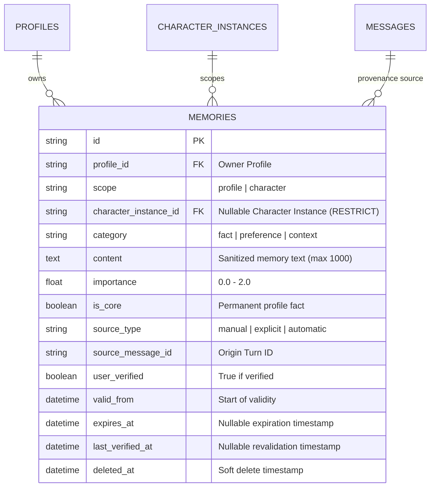

# Implementation Plan: Milestone M3 Batch C1 — Memory Foundation, Scoping & Context Assembly

Template Version: Docs_ProjectWorkflowStarterKit_v2.0

- **Status:** Awaiting Human Approval
- **Delivery Level:** Level C — Sensitive Design (Database Schema Migration & Personal Data Retention Boundary)
- **Scope Mode:** New Feature & Schema Migration — Backend Memory Scoping, Temporal Expiry, Core-Fact Injection, and API/Dart Client Contracts
- **Target Files:**
  - `backend/app/models/memory.py`
  - `backend/app/schemas/memory.py`
  - `backend/migrations/versions/010_memory_scoping_and_lifecycle.py`
  - `backend/app/services/memory/retriever.py`
  - `backend/app/services/assistant/orchestrator.py`
  - `backend/app/api/v1/endpoints/memories.py`
  - `backend/app/services/profile_purge_service.py`
  - `backend/tests/test_memory_foundation.py`
  - `backend/tests/test_migration_010.py`
  - `frontend/flutter/packages/companion_api/lib/dto/memory_dto.dart`
  - `frontend/flutter/packages/companion_api/lib/client/companion_client.dart`
  - `frontend/flutter/packages/companion_api/test/companion_client_test.dart`
  - `scripts/check_dart_openapi_parity.py`
  - `scripts/tests/test_check_dart_openapi_parity.py`
  - `contracts/openapi/openapi.json`
- **Branch:** `feature/m3-memory-foundation-c1`
- **Active Branch Tracker:** `docs/01_Tracking/active/task-feature-m3-memory-foundation-c1.md`

> Notice: Update this plan in place during planning. After Phase 1 approval, track execution in `docs/01_Tracking/active/task-feature-m3-memory-foundation-c1.md` and reopen this plan only when revising scope or architecture.

---

## 1. Request Understanding & Goals

### Primary Objective
Deliver the foundational database schema, scoping model, temporal validity lifecycle, context assembly retrieval engine, and client contracts for **Milestone M3 Memory & Continuity** (`PC-MEM-001`, `PC-MEM-003`, `PC-MEM-005`, `PC-API-001`). This establishes strict separation between global `PROFILE` memories and persona-bound `CHARACTER` memories, introduces temporal validity with query-time exclusion, provides deterministic core-fact injection into LLM turns, and creates the official Dart client implementation (`companion_api`).

### Milestone M3 Memory Batching Roadmap
To preserve first-pass accuracy and provide safe, verifiable delivery gates, the Memory capability is partitioned into three discrete batches:
1. **Batch M3-C1 (Current Delivery):** Memory Foundation, Schema Migration 010, Scoping, Temporal Validity, Context Assembly & Dart Client Parity. (Non-LLM, deterministic foundation).
2. **Batch M3-C2 (Follow-On):** Selective Automatic Extraction & Deterministic Slot Reconciliation (`PC-MEM-002`, Migration 011). Fast skip gate, sensitive data IGNORE, purge-safe background worker, slot-based reconciliation (NEW, MERGE, UPDATE, CONFLICT). Shipped default OFF until UI delivery.
3. **Batch M3-C3 (Follow-On):** Desktop Memory Control Center UI (`PC-CLIENT-009`). Full Flutter management screen, flip extraction to default ON with per-profile toggle, conflict resolution endpoint, and "ask once" clarification hint.

### Relevant Canonical Requirements
- **Canonical Architecture:** [`docs/04_Architecture/01_Domains/memory-and-personalization.md`](../../04_Architecture/01_Domains/memory-and-personalization.md) (Decision D7, ADR-0008, ADR-0018).
- **Cross-Cutting Baseline:** [`docs/04_Architecture/SYSTEM_BASELINE.md`](../../04_Architecture/SYSTEM_BASELINE.md) (§3 Cross-Cutting Invariants, D7, D11).
- **Decision Register:** [`docs/02_Planning/00_Master/DECISION_REGISTER.md`](../00_Master/DECISION_REGISTER.md) (Decision D7, ADR-0008).
- **Decision Debt Register:** [`docs/02_Planning/00_Master/DECISION_DEBT.md`](../00_Master/DECISION_DEBT.md) (`DEBT-V1-06`, `DEBT-V1-08`).
- **WBS Items Covered in C1:**
  - `PC-MEM-001`: Profile & Character Scoped Memory Schema Extension.
  - `PC-MEM-003`: Temporary Memory Lifecycle & Expiration Tracking (`valid_from`, `expires_at`, `last_verified_at`).
  - `PC-MEM-005`: Bounded Context Assembly & Scoped Memory Recall (FTS5 retrieval filtering by Profile global + active Character instance, excluding expired memories, token budgeting, core-fact injection).
  - `PC-API-001` / `companion_api`: REST endpoints, OpenAPI 3.1 schema regeneration, and Dart DTO / client methods.

### Concrete Deliverables
1. **Alembic Migration 010 (`010_memory_scoping_and_lifecycle.py`):**
   - Safe column additions for `scope` (String(16), default `'profile'`), `character_instance_id` (String(36) nullable FK to `character_instances.id` with `ondelete="RESTRICT"` per ADR-0008), `valid_from` (DateTime nullable in migration, backfilled from `created_at`, then set default), `expires_at` (DateTime nullable), `last_verified_at` (DateTime nullable), and `is_core` (Boolean, default `False`).
   - SQLite Check Constraints:
     - `ck_memories_scope`: `scope IN ('profile', 'character')`
     - `ck_memories_character_scope`: `(scope = 'profile' AND character_instance_id IS NULL) OR (scope = 'character' AND character_instance_id IS NOT NULL)`
     - `ck_memories_validity`: `expires_at IS NULL OR expires_at >= valid_from`
   - Indexes: `ix_memories_profile_scope` (`profile_id`, `scope`, `deleted_at`), `ix_memories_character_instance_id` (`character_instance_id`), `ix_memories_expires_at` (`expires_at`, `deleted_at`), `ix_memories_is_core` (`profile_id`, `is_core`, `deleted_at`).
   - FTS5 trigger cycling: drops and recreates `memories_fts` insert/update/delete triggers, followed by `INSERT INTO memories_fts(memories_fts) VALUES('rebuild');` to guarantee 100% index integrity.
2. **Retrieval & Context Assembly Engine (`services/memory/retriever.py` & `orchestrator.py`):**
   - Updates `search_relevant_memories` with bound `:now` parameter (avoiding SQLite `CURRENT_TIMESTAMP` string formatting mismatches).
   - Enforces scope isolation: returns all `scope = 'profile'` memories plus `scope = 'character' AND character_instance_id = :character_instance_id`. (For Neutral Assistant where `character_instance_id IS NULL`, returns strictly profile-scoped memories).
   - Core-Fact Injection: Retrieves up to 5 non-temporary, non-sensitive core memories (`is_core = True` or high importance) capped at 100 tokens. Deduplicates against FTS5 hits. Injected with system instruction: *"The following core user facts are permanent background context; use only when relevant and do not recite unprompted."*
   - Config setting: `MEMORY_CORE_FACTS_ENABLED: bool = True`, `MEMORY_CORE_FACTS_LIMIT: int = 5`, `MEMORY_CORE_FACTS_BUDGET_TOKENS: int = 100`.
3. **REST API Endpoint Hardening (`backend/app/api/v1/endpoints/memories.py`):**
   - Implements `GET /api/v1/memories/{memory_id}` with strict Profile session ownership.
   - Updates `GET /api/v1/memories` with query filters: `scope`, `character_instance_id`, `is_core`, and `include_expired`.
   - Validates foreign-profile ownership: rejects `POST` or `PATCH` referencing a `character_instance_id` belonging to a different profile (404/403).
   - Enforces content length boundary: `min_length=1, max_length=1000`.
   - Supports explicit nulling in `PATCH`: setting `expires_at = None` via `exclude_unset=True` turns temporary memories into permanent ones, updating `last_verified_at = now()`.
4. **Maintenance & Retention Purge (`services/profile_purge_service.py`):**
   - Extends the existing periodic maintenance sweep to permanently hard-purge soft-deleted memories older than `settings.DATA_RETENTION_DAYS` (30 days), respecting privacy retention rules.
5. **OpenAPI & Dart Client Implementation (`companion_api`):**
   - Creates `frontend/flutter/packages/companion_api/lib/dto/memory_dto.dart` (`MemoryDto`, `MemoryCreateDto`, `MemoryUpdateDto`, `MemoryListDto`).
   - Implements `listMemories`, `getMemory`, `createMemory`, `updateMemory`, `deleteMemory` in `CompanionClient`.
   - Moves memory endpoints from `UNMAPPED_FUTURE_ROUTES` to covered routes in `scripts/check_dart_openapi_parity.py`.
   - Updates `scripts/tests/test_check_dart_openapi_parity.py` route assertion count.
6. **Automated Verification Suite:**
   - `backend/tests/test_migration_010.py`: Tests migration 010 schema evolution, backfill, trigger persistence, and FTS5 rebuild.
   - `backend/tests/test_memory_foundation.py`: Tests `MEM-01` through `MEM-08` covering scoping, bound-time expiry, core-fact assembly, REST authorization, foreign instance rejection, and purge cascade.
   - `frontend/flutter/packages/companion_api/test/companion_client_test.dart`: Tests Dart client memory methods and error handling.

### Explicit Out-of-Scope (Deferred Deliverables with Documented Ownership)

| Deferred Capability | Justification & Architectural Owner | Planned Delivery Point |
| :--- | :--- | :--- |
| **Selective Automatic Extraction & Reconciliation** | Requires LLM prompt engineering, skip gates, queue concurrency controls, and slot-based reconciliation. Owned by `PC-MEM-002`. | **Milestone M3 Batch C2** |
| **Desktop Memory Control Center UI** | UI requires full interactive testing, search/filtering, and editing. Owned by `PC-CLIENT-009`. | **Milestone M3 Batch C3** |
| **Natural-Language Conflict Resolution ("yes I moved")** | Conversational dialogue clarification is open design; C3 delivers deterministic UI buttons & resolve endpoint first. | Milestone M3 follow-up |
| **Proactive Memory Check-Ins ("Are you still sick?")** | Requires `SchedulerService` (`PC-SCHED`), Windows Native Toasts (`PC-HOST-003`), quiet-hours policy, and presence arbitration (`D-SHARED-SCHED-02`). | Milestone M3 Scheduler follow-up |
| **PROPOSE Outcome (User Pre-Confirmation in Chat)** | Spec names PROPOSE, but silent auto-save with UI inspection is approved for V1. | Post-C3 enhancement |
| **Dense Vector Embeddings & Hybrid Search** | PC V1 relies on lexical FTS5; vector embeddings are explicitly classified as PC Later in `BACKLOG.md`. | Post-PC-V1 (`PC LATER`) |
| **React Web Test Runner Verification** | Per human direction, Web harness verification is skipped in C1. API responses remain strictly backward-compatible. | Web harness follow-up |

---

## 2. Architecture & Technical Approach

### Current Findings & Technical Baseline

| Component | Implemented Reality in Baseline | Architectural Requirement in Batch C1 |
| :--- | :--- | :--- |
| `memories` table | Flat model: `id`, `profile_id`, `owner_id`, `category`, `content`, `importance`, `source_type`, `source_message_id`, `user_verified`, audit timestamps, soft-delete. | Missing `scope`, `character_instance_id`, `valid_from`, `expires_at`, `last_verified_at`, `is_core`, and SQLite check constraints. |
| Migration Strategy | Historical migrations (007) used `batch_alter_table`, but dropped and recreated FTS5 triggers with index rebuild. | Migration 010 must either use native `add_column` or explicitly cycle FTS5 triggers and rebuild `memories_fts` to prevent broken search indexes. |
| FTS5 Retrieval | `services/memory/retriever.py` queries `memories_fts` joined on `memories`, filtering by `profile_id` and non-deleted. | Missing character-scoping filter, bound `:now` temporal filter, and core-fact assembly. |
| Memory Endpoints | `GET`, `POST`, `PATCH`, `DELETE` exist in `api/v1/endpoints/memories.py`. | Missing `GET /api/v1/memories/{memory_id}`; missing `scope` and `character_instance_id` query filters; PATCH cannot clear `expires_at`. |
| Dart Client | `companion_api` does NOT contain memory DTOs or client methods; routes are cataloged in `UNMAPPED_FUTURE_ROUTES`. | Must create `memory_dto.dart`, implement client methods, and update parity scripts. |

### Architectural Approach

#### A. Data Model & Migration 010


- **Scope & Isolation Invariants:**
  - `scope = 'profile'`: `character_instance_id` MUST be `NULL`. Represents facts about the user that apply universally.
  - `scope = 'character'`: `character_instance_id` MUST NOT be `NULL`. References the specific profile-owned `CharacterInstance`.
  - Foreign instance validation: the API rejects creating or updating a memory with a `character_instance_id` not belonging to the caller's Profile.
  - Foreign key constraint: `ondelete="RESTRICT"` prevents silent cascading deletion of memories when a character instance is removed.

#### B. Retrieval & Prompt Framing Architecture
- **Context Assembly Execution Flow:**
  1. **Core-Fact Query:**
     ```sql
     SELECT m.* FROM memories m
     WHERE m.profile_id = :profile_id
       AND m.deleted_at IS NULL
       AND m.scope = 'profile'
       AND (m.expires_at IS NULL OR m.expires_at > :now)
       AND (m.is_core = 1 OR m.importance >= 1.5)
     ORDER BY m.importance DESC, m.created_at DESC
     LIMIT :core_limit
     ```
  2. **Scoped FTS5 Search Query:**
     ```sql
     SELECT m.* FROM memories m
     JOIN memories_fts f ON m.id = f.id
     WHERE memories_fts MATCH :fts_query
       AND m.profile_id = :profile_id
       AND m.deleted_at IS NULL
       AND (m.expires_at IS NULL OR m.expires_at > :now)
       AND (
         m.scope = 'profile'
         OR (m.scope = 'character' AND m.character_instance_id = :character_instance_id)
       )
     ORDER BY rank LIMIT :limit
     ```
  3. **Token Budgeting & Framing:**
     - Core facts are capped at 100 tokens (`MEMORY_CORE_FACTS_BUDGET_TOKENS`).
     - FTS hits are deduplicated against selected core facts.
     - Remaining tokens up to `MEMORY_BUDGET_TOKENS` (256) are allocated to FTS memories.
     - Formatted inside `<retrieved_memories>` with strict untrusted framing.

---

## 3. Proposed File Changes & In-Place Logic

### 1. [ADD] `backend/migrations/versions/010_memory_scoping_and_lifecycle.py`
- Alembic migration:
  - Drop FTS5 triggers temporarily.
  - Add columns: `scope`, `character_instance_id`, `valid_from`, `expires_at`, `last_verified_at`, `is_core`.
  - Backfill `valid_from = created_at` for all existing memories.
  - Add foreign key `fk_memories_character_instance_id_character_instances` with `ondelete="RESTRICT"`.
  - Add indexes: `ix_memories_profile_scope`, `ix_memories_character_instance_id`, `ix_memories_expires_at`, `ix_memories_is_core`.
  - Add SQLite check constraints: `ck_memories_scope`, `ck_memories_character_scope`, `ck_memories_validity`.
  - Recreate FTS5 triggers (`insert`, `update`, `delete`) and execute `INSERT INTO memories_fts(memories_fts) VALUES('rebuild');`.

### 2. [MODIFY] `backend/app/models/memory.py`
- Update `Memory` ORM model:
  - Add `scope: Mapped[str] = mapped_column(String(16), nullable=False, default="profile", server_default="profile")`
  - Add `character_instance_id: Mapped[Optional[str]] = mapped_column(String(36), ForeignKey("character_instances.id", ondelete="RESTRICT"), nullable=True, index=True)`
  - Add `valid_from: Mapped[datetime] = mapped_column(DateTime(timezone=True), nullable=False, default=func.now())`
  - Add `expires_at: Mapped[Optional[datetime]] = mapped_column(DateTime(timezone=True), nullable=True, index=True)`
  - Add `last_verified_at: Mapped[Optional[datetime]] = mapped_column(DateTime(timezone=True), nullable=True)`
  - Add `is_core: Mapped[bool] = mapped_column(Boolean, nullable=False, default=False, server_default=sa.text("0"), index=True)`
  - Add table `CheckConstraint` declarations matching migration.

### 3. [MODIFY] `backend/app/schemas/memory.py`
- Update Pydantic schemas:
  - `MemoryCreate`: add `scope` (Literal["profile", "character"]), `character_instance_id`, `expires_at`, `is_core`. Validate `max_length=1000`. Validate character instance requirement based on scope.
  - `MemoryUpdate`: support updating `content`, `category`, `importance`, `is_core`, and `expires_at` (nullable to allow clearing expiration).
  - `MemoryOut`: add `scope`, `character_instance_id`, `valid_from`, `expires_at`, `last_verified_at`, `is_core`.

### 4. [MODIFY] `backend/app/services/memory/retriever.py`
- Update `search_relevant_memories`:
  - Accept `character_instance_id: Optional[str] = None`.
  - Bind `:now` datetime parameter for timezone-safe expiration checks.
  - Add helper `get_core_memories(db, profile_id, limit, now) -> List[Memory]`.

### 5. [MODIFY] `backend/app/services/assistant/orchestrator.py`
- Extract `character_instance_id` from conversation record and pass to `search_relevant_memories`.
- Integrate `get_core_memories` into context assembly with 100-token cap and FTS deduplication.

### 6. [MODIFY] `backend/app/api/v1/endpoints/memories.py`
- Implement `GET /api/v1/memories/{memory_id}`.
- Update `GET /api/v1/memories` with query parameters: `scope`, `character_instance_id`, `is_core`, `include_expired`.
- Add foreign character instance ownership validation on `POST` and `PATCH`.
- In `PATCH`, use `payload.model_dump(exclude_unset=True)` so that explicitly passing `{"expires_at": null}` clears the expiration.

### 7. [MODIFY] `backend/app/services/profile_purge_service.py`
- Reorder relational hard purge in Phase E: execute `delete(Memory)` **before** `delete(CharacterInstance)` to satisfy foreign key integrity under `ondelete="RESTRICT"` on `memories.character_instance_id`.
- Add expired soft-deleted memory purge to periodic maintenance loop: `DELETE FROM memories WHERE deleted_at IS NOT NULL AND deleted_at < :cutoff_date`.

### 8. [ADD] `frontend/flutter/packages/companion_api/lib/dto/memory_dto.dart`
- Dart data transfer objects: `MemoryDto`, `MemoryCreateDto`, `MemoryUpdateDto`, `MemoryListDto`.

### 9. [MODIFY] `frontend/flutter/packages/companion_api/lib/client/companion_client.dart`
- Implement memory API methods: `listMemories`, `getMemory`, `createMemory`, `updateMemory`, `deleteMemory`.

### 10. [MODIFY] `scripts/check_dart_openapi_parity.py` & `scripts/tests/test_check_dart_openapi_parity.py`
- Move memory routes from `UNMAPPED_FUTURE_ROUTES` to `M1_COVERED_ROUTES` (or covered set).
- Update test assertion for covered route count.

### 11. [ADD] `backend/tests/test_migration_010.py` & `backend/tests/test_memory_foundation.py`
- Tests covering migration evolution, trigger cycling, FTS index survival, CRUD, scoping isolation, bound-time expiry, core-fact injection, and foreign instance validation.

---

## 4. Step-by-Step Implementation Sequence (TDD)

### Step 1: Tests First (RED)
- Author `backend/tests/test_migration_010.py` asserting schema, triggers, and FTS survival.
- Author `backend/tests/test_memory_foundation.py` asserting scoping, temporal filtering, core facts, and API validation.
- Verify tests fail on baseline schema.

### Step 2: Database Migration & ORM Models (GREEN)
- Implement `backend/migrations/versions/010_memory_scoping_and_lifecycle.py`.
- Update `backend/app/models/memory.py` and `backend/app/schemas/memory.py`.
- Run migration and verify `test_migration_010.py` passes.

### Step 3: Retrieval & Context Assembly (GREEN)
- Update `services/memory/retriever.py` with bound `:now` parameter, character scoping, and core-fact assembly.
- Update `services/assistant/orchestrator.py` to pass conversation `character_instance_id`.
- Verify retrieval and scoping tests pass in `test_memory_foundation.py`.

### Step 4: REST API & Purge Maintenance (GREEN)
- Update `api/v1/endpoints/memories.py` (add `GET /{id}`, filters, nulling PATCH, foreign validation).
- Update `profile_purge_service.py` to include soft-deleted memory purge.
- Verify API and retention tests pass in `test_memory_foundation.py`.

### Step 5: Dart Client Implementation & Parity Checks
- Author `frontend/flutter/packages/companion_api/lib/dto/memory_dto.dart`.
- Implement client methods in `companion_client.dart`.
- Author tests in `companion_api/test/companion_client_test.dart`.
- Update `scripts/check_dart_openapi_parity.py` and regenerate `openapi.json`.
- Verify `python -m unittest discover -s scripts/tests` passes.
- Verify `flutter test packages/companion_api/test` passes.

---

## 5. Acceptance Criteria & Verification Strategy

### Automated Repository Checks
```powershell
# 1. Backend Migration and Memory Foundation Tests
pytest backend/tests/test_migration_010.py backend/tests/test_memory_foundation.py -v

# 2. Existing Memory & Conversation Regressions
pytest backend/tests/test_memory_fts.py backend/tests/test_conversations.py backend/tests/test_profile_deletion.py -v

# 3. Contract Drift & Parity Checks
python scripts/check_openapi_contract.py
python -m unittest discover -s scripts/tests

# 4. Flutter Dart Client Verification
cd frontend/flutter; dart analyze; flutter test packages/companion_api/test
```

---

## 6. Risks, Dependencies, Assumptions & Safeguards

- **Risk 1 (FTS5 Index Desynchronization):** Recreating or altering SQLite tables can change rowids, detaching FTS5 index content.
  - *Safeguard:* Migration 010 explicitly drops triggers before alteration, recreates them, and executes `INSERT INTO memories_fts(memories_fts) VALUES('rebuild');`. Tested in `test_migration_010.py`.
- **Risk 2 (Timezone-Aware Expiration Comparisons):** Comparing Python UTC timestamps with SQLite string timestamps can fail if string formats differ.
  - *Safeguard:* Use SQLAlchemy bound parameter `:now` with `datetime.now(timezone.utc)` instead of raw `CURRENT_TIMESTAMP`.
- **Risk 3 (Prompt History Token Starvation from Core Facts):** Always-injected facts could reduce tokens available for chat history.
  - *Safeguard:* Core facts are strictly capped at 5 items and 100 tokens, deduplicated against FTS hits, and can be disabled via `MEMORY_CORE_FACTS_ENABLED`.
- **Genuine Stop Conditions:**
  - Migration 010 failure or table locking under SQLite.
  - Failure of FTS5 search to return records after migration.
  - Dart client contract drift.
