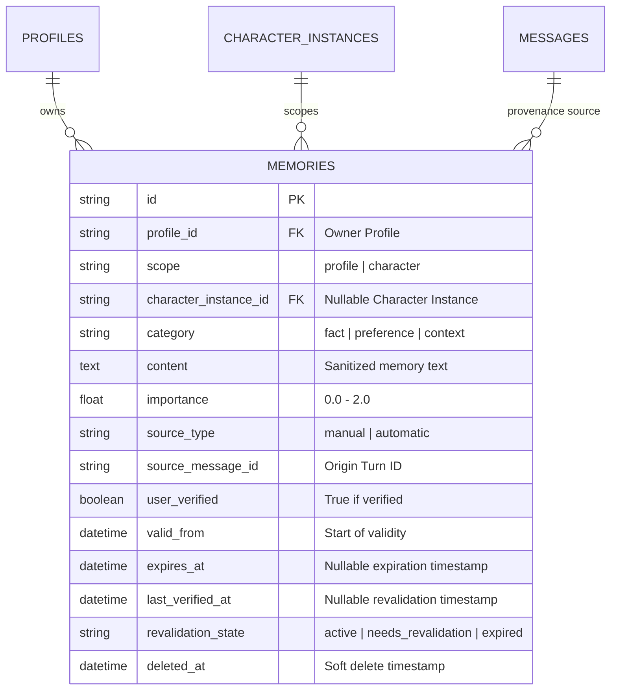

# Implementation Plan: Milestone M3 Batch C1 — Memory Foundation & Automatic Extraction Pipeline

Template Version: Docs_ProjectWorkflowStarterKit_v2.0

- **Status:** Awaiting Approval
- **Delivery Level:** Level B — Planned Autonomous (with Migration Safety Gate)
- **Scope Mode:** New Feature & Schema Migration — Backend Memory Scoping, Temporal Expiry, Automatic Extraction Pipeline, and API Contracts
- **Target Files:**
  - `backend/app/models/memory.py`
  - `backend/app/schemas/memory.py`
  - `backend/migrations/versions/010_memory_scoping_and_lifecycle.py`
  - `backend/app/services/memory/retriever.py`
  - `backend/app/services/memory/extractor.py` (New Service)
  - `backend/app/services/assistant/orchestrator.py`
  - `backend/app/api/v1/endpoints/memories.py`
  - `backend/tests/test_memory_foundation.py` (New Test Suite)
  - `frontend/flutter/packages/companion_api/lib/dto/memory_dto.dart`
  - `frontend/flutter/packages/companion_api/lib/client/companion_client.dart`
  - `frontend/flutter/packages/companion_api/test/companion_client_test.dart`
  - `contracts/openapi/openapi.json`
- **Branch:** `feature/m3-memory-foundation-c1`
- **Active Branch Tracker:** `docs/01_Tracking/active/task-feature-m3-memory-foundation-c1.md`

> Notice: Update this plan in place during planning. After Phase 1 approval, track execution in `docs/01_Tracking/active/task-feature-m3-memory-foundation-c1.md` and reopen this plan only when revising scope or architecture.

---

## 1. Request Understanding & Goals

### Primary Objective
Deliver the foundational backend architecture, schema migration, automatic memory extraction pipeline, temporal validity lifecycle, and OpenAPI/Dart client contracts for **Milestone M3 Memory & Continuity** (`PC-MEM-001`, `PC-MEM-002`, `PC-MEM-003`, `PC-MEM-005`). This gives the AI companion persistent knowledge of the user across conversation sessions, separating global profile facts from character-specific relationship context, supporting temporary memory expiration with natural conversational revalidation, and providing silent auto-save with transparent auditability.

### Relevant Canonical Requirements
- **Canonical Architecture:** [`docs/04_Architecture/01_Domains/memory-and-personalization.md`](../../04_Architecture/01_Domains/memory-and-personalization.md) (Decision D7, ADR-0008, ADR-0018).
- **Cross-Cutting Baseline:** [`docs/04_Architecture/SYSTEM_BASELINE.md`](../../04_Architecture/SYSTEM_BASELINE.md) (§3 Cross-Cutting Invariants, D7, D11).
- **Decision Register:** [`docs/02_Planning/00_Master/DECISION_REGISTER.md`](../00_Master/DECISION_REGISTER.md) (Decision D7, ADR-0008).
- **Decision Debt Register:** [`docs/02_Planning/00_Master/DECISION_DEBT.md`](../00_Master/DECISION_DEBT.md) (`DEBT-V1-06`, `DEBT-V1-08`).
- **WBS Items:**
  - `PC-MEM-001`: Profile & Character Scoped Memory Schema Extension.
  - `PC-MEM-002`: Selective Automatic Memory Extraction Pipeline (Local-only, fast turn heuristic, post-turn LLM extraction, deterministic auto-save under confidence policy, provenance tagging).
  - `PC-MEM-003`: Temporary Memory Lifecycle, Expiration Tracking & Natural Revalidation (`valid_from`, `expires_at`, `revalidation_state`).
  - `PC-MEM-005`: Context Assembly & Bounded Memory Recall (FTS5 retrieval filtering by Profile global + active Character instance, excluding expired memories, token budgeting).
  - `PC-API-001` / `companion_api`: REST endpoints, OpenAPI 3.1 schema regeneration, and Dart DTO / client methods.

### Concrete Deliverables
1. **Alembic Migration 010 (`010_memory_scoping_and_lifecycle.py`):**
   - Adds `scope` (String(16), `'profile'` or `'character'`), `character_instance_id` (String(36) nullable FK to `character_instances.id`), `valid_from` (DateTime), `expires_at` (DateTime nullable), `last_verified_at` (DateTime nullable), and `revalidation_state` (String(24), `'active'`, `'needs_revalidation'`, `'expired'`).
   - Indexes for efficient query-time scoping and expiration filtering.
2. **Automatic Memory Extraction Service (`backend/app/services/memory/extractor.py`):**
   - Fast turn heuristic / skip gate for trivial/short chatter (<15 chars or common greetings).
   - Post-turn asynchronous local LLM structured extraction prompt producing structured candidate facts.
   - Deterministic policy saving candidates with provenance (`source_message_id`, `source_type="automatic"`).
3. **Retrieval & Context Assembly Updates (`backend/app/services/memory/retriever.py`):**
   - Enforces scope isolation: returns all `scope = 'profile'` memories plus `scope = 'character' AND character_instance_id = :active_character_instance_id`.
   - Enforces temporal exclusion: excludes memories where `expires_at IS NOT NULL AND expires_at < CURRENT_TIMESTAMP`.
4. **REST API Endpoint Hardening (`backend/app/api/v1/endpoints/memories.py`):**
   - Supports query filtering by `scope`, `character_instance_id`, and `include_expired`.
   - Adds missing single-item inspection endpoint: `GET /api/v1/memories/{memory_id}`.
   - Updates `POST` and `PATCH` payloads to accept scoping and validity timestamps.
5. **OpenAPI & Dart Client Parity (`companion_api`):**
   - Regenerates `contracts/openapi/openapi.json`.
   - Updates `MemoryDto` and `CompanionClient` in `frontend/flutter/packages/companion_api/`.
   - Passes parity check `scripts/check_dart_openapi_parity.py --check`.
6. **Comprehensive Automated Verification:**
   - Pytest unit and integration test suite covering migration, extraction, scoping isolation, temporal expiration, and API contracts.

### Explicit Out-of-Scope (Batch M3-C2 & Future Work)
- **Desktop UI (`PC-CLIENT-009`):** Full interactive Flutter desktop `MemoryScreen` is explicitly sequenced as **Batch M3-C2** to maintain a safe, bounded delivery lifecycle.
- **Dense Vector Search / Embeddings:** Post-PC-V1 per canonical architecture; lexical FTS5 BM25 search remains authoritative for PC V1.
- **Autonomous Multi-Turn Cloud Extraction:** Cloud automatic memory processing remains disabled; extraction runs strictly on the local runtime engine.

---

## 2. Architecture & Technical Approach

### Current Findings & Technical Baseline

| Component | Implemented Reality in Baseline | Architectural Gap to Close |
| :--- | :--- | :--- |
| `memories` table | Flat model: `id`, `profile_id`, `owner_id`, `category`, `content`, `importance`, `source_type`, `source_message_id`, `user_verified`, audit timestamps, soft-delete. | Missing `scope`, `character_instance_id`, `valid_from`, `expires_at`, `last_verified_at`, and `revalidation_state`. |
| FTS5 Retrieval | `services/memory/retriever.py` queries `memories_fts` joined on `memories`, filtering by `profile_id` and non-deleted. | Does not filter by Character scope or temporal expiration (`expires_at`). |
| Extraction | Non-existent; all memories must be inserted manually via `POST /api/v1/memories`. | No automatic evaluation of conversation turns to capture user facts/preferences. |
| Memory Endpoints | `GET`, `POST`, `PATCH`, `DELETE` exist in `api/v1/endpoints/memories.py`. | Missing `GET /api/v1/memories/{memory_id}`; missing `scope` and `character_instance_id` query filters and schema fields. |
| Dart Client | `companion_api` has minimal `MemoryDto`. | Missing new scoping and temporal fields. |

### Architectural Approach

#### A. Data Model & Migration 010


- **Scope Invariants:**
  - `scope = 'profile'`: `character_instance_id` MUST be `NULL`. Represents facts about the user that apply universally (e.g., allergies, occupation, timezone).
  - `scope = 'character'`: `character_instance_id` MUST NOT be `NULL`. References the specific profile-owned `CharacterInstance`.
- **Temporal Invariants:**
  - Permanent memories: `expires_at` is `NULL`, `revalidation_state = 'active'`.
  - Temporary memories: `expires_at` is set to `valid_from + interval`.
  - Query-time filtering excludes records where `expires_at < CURRENT_TIMESTAMP`.

#### B. Automatic Memory Extraction Pipeline (`MemoryExtractionService`)
1. **Turn Hook:** When a conversation turn finishes (in `services/assistant/orchestrator.py`), if the turn originated from a live user conversation, an asynchronous extraction task is scheduled.
2. **Fast Skip Gate:** Inspect user turn text. If character length $< 15$ and contains no trigger keywords (e.g., "remember", "my name is", "i am", "i like", "i prefer", "allergic", "birthday", "live in"), exit immediately with zero LLM compute.
3. **Structured Local Extraction Prompt:**
   - Sends a compact system prompt instructing the local model to extract clear, unambiguous personal facts or stated preferences as JSON.
   - Enforces standard JSON array schema with fields: `content`, `category`, `scope`, `is_temporary`, `valid_days`.
4. **Deterministic Policy & Ingestion:**
   - Validates JSON format.
   - Sets `source_type = "automatic"`, `source_message_id = turn.user_message_id`, `user_verified = False` (or auto-save flag).
   - Automatically populates `valid_from = now()` and `expires_at = now() + timedelta(days=valid_days)` if temporary.
   - Inserts transactionally into `memories` table (triggers immediately update `memories_fts`).
   - Handles LLM errors gracefully without impacting conversation delivery.

#### C. Bounded Scoped Retrieval & Context Assembly
- In `services/memory/retriever.py`, update `search_relevant_memories`:
  ```sql
  SELECT m.* FROM memories m
  JOIN memories_fts f ON m.id = f.id
  WHERE memories_fts MATCH :fts_query
    AND m.profile_id = :profile_id
    AND m.deleted_at IS NULL
    AND (m.expires_at IS NULL OR m.expires_at > CURRENT_TIMESTAMP)
    AND (
      m.scope = 'profile'
      OR (m.scope = 'character' AND m.character_instance_id = :character_instance_id)
    )
  ORDER BY rank LIMIT :limit
  ```
- In `services/assistant/orchestrator.py`:
  - Pass the active `character_instance_id` to memory retrieval.
  - Assemble matching memories into `<retrieved_memories>` bounded by `settings.MEMORY_BUDGET_TOKENS`.

---

## 3. Proposed File Changes & In-Place Logic

### 1. [ADD] `backend/migrations/versions/010_memory_scoping_and_lifecycle.py`
- Alembic migration upgrading `memories` table:
  - Add columns: `scope`, `character_instance_id`, `valid_from`, `expires_at`, `last_verified_at`, `revalidation_state`.
  - Add foreign key `fk_memories_character_instance_id_character_instances` on delete cascade.
  - Add compound indexes: `ix_memories_profile_scope` (`profile_id`, `scope`, `deleted_at`), `ix_memories_expires_at` (`expires_at`, `deleted_at`).

### 2. [MODIFY] `backend/app/models/memory.py`
- Update `Memory` ORM class:
  - Add `scope: Mapped[str] = mapped_column(String(16), nullable=False, default="profile", server_default="profile")`
  - Add `character_instance_id: Mapped[Optional[str]] = mapped_column(String(36), ForeignKey("character_instances.id", ondelete="CASCADE"), nullable=True, index=True)`
  - Add `valid_from: Mapped[datetime] = mapped_column(DateTime(timezone=True), nullable=False, default=func.now())`
  - Add `expires_at: Mapped[Optional[datetime]] = mapped_column(DateTime(timezone=True), nullable=True, index=True)`
  - Add `last_verified_at: Mapped[Optional[datetime]] = mapped_column(DateTime(timezone=True), nullable=True)`
  - Add `revalidation_state: Mapped[str] = mapped_column(String(24), nullable=False, default="active", server_default="active")`

### 3. [MODIFY] `backend/app/schemas/memory.py`
- Update `MemoryCreate`, `MemoryUpdate`, `MemoryOut`, `MemoryListOut`:
  - Include `scope` (Literal["profile", "character"]), `character_instance_id`, `valid_from`, `expires_at`, `last_verified_at`, `revalidation_state`.
  - Validation: If `scope == "character"`, `character_instance_id` must be present. If `scope == "profile"`, `character_instance_id` must be null.

### 4. [MODIFY] `backend/app/services/memory/retriever.py`
- Extend `search_relevant_memories`:
  - Accept `character_instance_id: Optional[str] = None`.
  - Add query conditions for `scope` (Profile global + matching Character instance) and `expires_at` (exclude expired).

### 5. [ADD] `backend/app/services/memory/extractor.py`
- Implement `MemoryExtractionService`:
  - `should_extract(user_text: str) -> bool`: Quick regex/heuristic skip gate.
  - `extract_candidates(user_text: str, assistant_text: str, provider: BaseLLMProvider) -> List[MemoryCandidate]`: Structured JSON generation.
  - `process_and_store_turn_memories(db: AsyncSession, profile_id: str, character_instance_id: Optional[str], source_message_id: str, user_text: str, assistant_text: str, provider: BaseLLMProvider) -> List[Memory]`: End-to-end ingestion under database transaction.

### 6. [MODIFY] `backend/app/services/assistant/orchestrator.py`
- Pass `character_instance_id` to `search_relevant_memories`.
- Wire post-turn background call to `MemoryExtractionService.process_and_store_turn_memories`.

### 7. [MODIFY] `backend/app/api/v1/endpoints/memories.py`
- Add `GET /api/v1/memories/{memory_id}`.
- Update `GET /api/v1/memories` to support `scope`, `character_instance_id`, and `include_expired` query filters.
- Update `POST` and `PATCH` endpoints to accept and validate the new fields.

### 8. [MODIFY] `contracts/openapi/openapi.json`
- Regenerate schema reflecting new query parameters and schema fields.

### 9. [MODIFY] `frontend/flutter/packages/companion_api/lib/dto/memory_dto.dart` & `companion_client.dart`
- Update Dart `MemoryDto` with `scope`, `characterInstanceId`, `validFrom`, `expiresAt`, `lastVerifiedAt`, `revalidationState`.
- Update `CompanionClient.listMemories` with `scope`, `characterInstanceId`, `includeExpired`.
- Add `CompanionClient.getMemory(memoryId)`.

### 10. [ADD] `backend/tests/test_memory_foundation.py`
- Comprehensive test suite covering:
  - `MEM-01`: Migration 010 schema creation and column defaults.
  - `MEM-02`: Memory CRUD with `scope = 'profile'` and `scope = 'character'`.
  - `MEM-03`: FTS5 retrieval returns both profile memories and active character memories, but excludes other character memories.
  - `MEM-04`: Query-time temporal filtering excludes expired memories.
  - `MEM-05`: Automatic extraction fast skip gate drops trivial inputs.
  - `MEM-06`: Automatic extraction parses valid LLM JSON and persists memories with `source_type = 'automatic'`.
  - `MEM-07`: Single-item `GET /api/v1/memories/{id}` returns accurate record; foreign profile access fails closed (404/403).
  - `MEM-08`: Profile hard purge cascades to clean up new memory rows and FTS index.

---

## 4. Step-by-Step Implementation Sequence (TDD)

### Step 1: Tests First (RED)
- Author `backend/tests/test_memory_foundation.py` covering tests `MEM-01` through `MEM-08`.
- Verify tests fail on baseline schema.

### Step 2: Database Migration & ORM Models (GREEN)
- Author `backend/migrations/versions/010_memory_scoping_and_lifecycle.py`.
- Update `backend/app/models/memory.py` and `backend/app/schemas/memory.py`.
- Run migrations and verify `MEM-01` and `MEM-02` pass.

### Step 3: Retrieval & Context Assembly (GREEN)
- Update `backend/app/services/memory/retriever.py` with scoping and expiry filters.
- Update `backend/app/services/assistant/orchestrator.py` to pass active character instance ID.
- Verify `MEM-03` and `MEM-04` pass.

### Step 4: Memory Extraction Service (GREEN)
- Implement `backend/app/services/memory/extractor.py`.
- Integrate extraction hook into `orchestrator.py`.
- Verify `MEM-05` and `MEM-06` pass.

### Step 5: REST API & Single Item Endpoint (GREEN)
- Update `backend/app/api/v1/endpoints/memories.py`.
- Verify `MEM-07` and `MEM-08` pass.

### Step 6: OpenAPI Parity & Dart Client Updates
- Regenerate `contracts/openapi/openapi.json`.
- Update `companion_api` DTOs and client methods.
- Update `companion_api` test suite and verify `scripts/tests/test_check_dart_openapi_parity.py`.

---

## 5. Acceptance Criteria & Verification Strategy

### Automated Repository Checks
```powershell
# 1. Backend Migration and Memory Foundation Tests
pytest backend/tests/test_memory_foundation.py -v

# 2. Existing Suite Regression Gate
pytest backend/tests/test_memories.py backend/tests/test_conversations.py backend/tests/test_profile_deletion.py -v

# 3. Contract Drift & Parity Checks
python scripts/check_openapi_contract.py
python -m unittest scripts/tests/test_check_dart_openapi_parity.py

# 4. Flutter Dart Client Verification
cd frontend/flutter; dart analyze; flutter test packages/companion_api/test
```

---

## 6. Risks, Dependencies, Assumptions & Safeguards

- **Risk 1 (SQLite WAL Migration Safety):** Adding columns to SQLite must use non-locking operations or batch mode compatible with SQLite limitations.
  - *Mitigation:* Use Alembic `op.batch_alter_table("memories")` with server defaults to prevent table locking or recreation failures.
- **Risk 2 (Extraction LLM Latency & Failure):** Extraction must not add latency or failure risk to the user's chat turn.
  - *Mitigation:* Extraction runs in an asynchronous background task scheduled after the turn finishes. Failures are logged as non-fatal warnings and never fail user chat.
- **Risk 3 (Profile & Character Isolation Leak):** Retrieval must never leak character-specific memories across different character personas or different profiles.
  - *Mitigation:* Rigid SQL where-clause combining `profile_id` enforcement with `(scope = 'profile' OR (scope = 'character' AND character_instance_id = :id))`. Tested explicitly in `MEM-03`.
- **Genuine Stop Conditions:**
  - Database migration syntax failure on SQLite.
  - Inability of local LLM prompt to reliably output structured JSON.
  - Contract drift breaking OpenAPI parity assertions.
